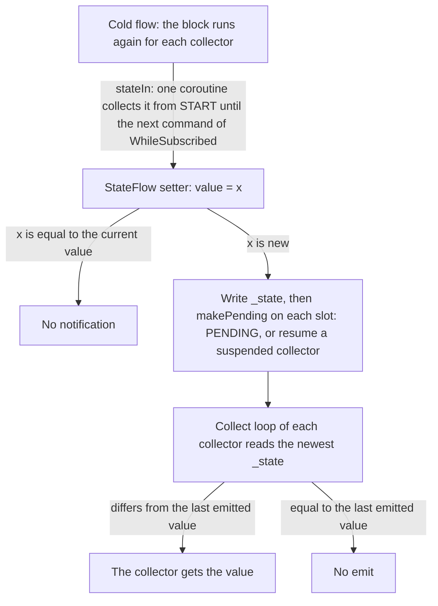

import Snippet from '../../../components/Snippet.astro';
import GoDeeper from '../../../components/GoDeeper.astro';

## The problem

A suspend function returns one value. A flow emits many values in sequence[^flow-doc]. `collect` is a suspend function, so code collects a flow inside a coroutine[^flow-doc-collect].

The [unidirectional data flow chapter](/state-survival/unidirectional-data-flow/) kept the UI state in a `StateFlow`, and the UI collected it. A `StateFlow` is a different kind of flow from the flow that the `flow` builder makes:

- A flow from the `flow` builder is cold. Its producer code runs each time that code calls a terminal operator, for example `collect`, on the flow. If two collectors collect the flow, the data source fetches the data two times[^flow-doc-collect].
- A `StateFlow` is hot. A `collect` call does not run producer code. A new collector first gets the last value, and then later values[^stateflow-doc].

A producer can write new values faster than a collector runs. Then the collector is behind. What does a state holder give to that collector: each old value in order, or only the newest value? This chapter builds a cold flow and a hot state holder in plain Kotlin. It shows how the state holder gives each old value to a collector that is behind. Then it shows how `StateFlow` of kotlinx.coroutines 1.11.0 gives the collector only the newest value.

## Build it naive

The rebuild is in the module `samples/flow`, in plain Kotlin. It has no Android types and no kotlinx.coroutines. Its functions do not suspend.

### A cold flow

`NaiveFlow` has one function, `collect`. `naiveFlow` makes a flow from a producer block. The flow keeps only the block, not the values. Each `collect` call runs the block again, with the collector of that call as `emit`:

<Snippet file="flow/src/main/kotlin/NaiveFlow.kt" region="cold" />

A test makes a flow that emits 1 and 2, and counts the runs of the block. Before the first `collect` call, the block does not run. Two `collect` calls run the block two times, and each collector gets 1 and 2:

<Snippet file="flow/src/test/kotlin/NaiveFlowTest.kt" region="cold" />

This test shows how a cold flow acts. It is not the breaking test.

### A hot state holder

`NaiveStateFlow` holds `value`. The value exists also when no code collects it, so the state holder is hot. `collect` adds the collector to a list, and gives the current value to the collector at once.

On Android, each dispatch to `Dispatchers.Main` is one message in the main queue, as the [main thread chapter](/launch-path/main-thread/) shows. `FakeQueue` stands for such a queue: the queue of the thread of the collector. It runs its tasks in post order, and only when the test calls `runAll`. Thus the test decides when the collector runs:

<Snippet file="flow/src/main/kotlin/NaiveStateFlow.kt" region="queue" />

Each write to `value` posts one delivery task for each collector. Each task holds its own copy of the new value:

<Snippet file="flow/src/main/kotlin/NaiveStateFlow.kt" region="state" />

Three more tests check `FakeQueue` and `NaiveStateFlow`. `FakeQueue` runs its tasks only in `runAll`, in post order. A new collector gets the current value. A write reaches each of two collectors only when the queue runs.

## Where it breaks

The setter posts one delivery task for each write. If the collector is behind, the queue holds one task for each write, and each task holds an old value. The breaking test writes four values before the queue runs:

<Snippet file="flow/src/test/kotlin/NaiveStateFlowTest.kt" region="flaw" />

1. `collect` gives the initial value 0 to the collector at once.
2. The test sets `value` to 1, 2, 3 and 3. Each write posts one task, so the queue holds four tasks.
3. `runAll` runs the four tasks in post order. The collector gets 1, 2, 3 and 3.

The list is `[0, 1, 2, 3, 3]`. The test passes, so the flaw occurs. When the first task runs, the current value is already 3. But the collector gets the old values 1 and 2 first. Then it gets 3 two times, although the last write did not change the value. A UI that renders each value renders four times after the initial value, but it needs to render only one value: 3. Each write adds one more task, so a collector that is far behind has a long queue of old values.

## The real thing

### `Flow` is one function

In kotlinx.coroutines 1.11.0, the `Flow` interface has one function: `suspend fun collect`[^flow-194]. `NaiveFlow` of the rebuild has the same shape, but its `collect` does not suspend.

The `Flow` type does not tell if a flow is cold or hot. Usually, a flow is cold. `SharedFlow` is the subtype for hot flows. `stateIn` and `shareIn` make any flow hot[^flow-37]. An intermediate operator, for example `map`, does not run code in the flow. It only sets up a chain of operations. A terminal operator, for example `collect`, starts the run of all the operations[^flow-10].

### `flow { }` keeps only its block

`flow { }` makes a cold flow. Its block runs each time that code applies a terminal operator to the flow[^builders-15]. `flow()` returns a `SafeFlow`, and the `SafeFlow` keeps only the block. `SafeFlow.collectSafely` runs the block on the collector[^builders-52]. `naiveFlow` of the rebuild has the same design. Thus each collector starts a new run of the producer. To share one run between collectors, use `shareIn`[^flow-doc-collect]. To see how, read "`stateIn` and `shareIn` share one run" below.

By default, the producer of the `flow` builder runs in the `CoroutineContext` of the collector, and it cannot emit values from a different `CoroutineContext`. To change the context, use `flowOn`. `flowOn` changes the context of the upstream flow: the producer and the operators before `flowOn`. The downstream flow, with the operators after `flowOn` and the collector, keeps the context of the collection[^flow-doc-context]. The context of `flowOn` does not leak into the downstream flow[^context-192]. `callbackFlow` can emit values from a different `CoroutineContext` with `send`, or from outside a coroutine with `trySend`[^flow-doc-callback].

<GoDeeper title="how the flow builder checks the context">

Each flow must keep two properties: context preservation and exception transparency[^flow-59]. Only `flowOn` changes the context of a flow, and it changes only the upstream context[^flow-74].

`flow { }` makes a `SafeFlow`, which is an `AbstractFlow`[^builders-52]. `AbstractFlow.collect` wraps the collector in a `SafeCollector` with the context of the `collect` call[^flow-223]. On the JVM, `SafeCollector.emit` reads the context of the caller. If the context is not the context of the last emission, `emit` calls `checkContext`[^safecollector-103]. `checkContext` compares each element of the emission context with the same element of the collect context[^safecollector-common-23]:

- If `emit` runs in another coroutine, for example in a coroutine that `launch` starts, `emit` fails with "Emission from another coroutine is detected"[^safecollector-common-34].
- If another element is different, `emit` fails with a message that says that the flow "was collected in" one context, "but emission happened in" another context[^safecollector-common-82].

The KDoc of `flow` gives an example: an `emit` inside `withContext(Dispatchers.IO)` fails with `IllegalStateException`[^builders-38].

If `emit` throws an exception, `SafeCollector` keeps the exception as the context of the last emission[^safecollector-81]. A later `emit` then fails with "Flow exception transparency is violated"[^safecollector-129][^safecollector-161].

</GoDeeper>

### `StateFlow` is hot

A shared flow is hot, because its active instance exists independently of its collectors. All collectors get all emitted values. A `flow { }` flow is cold, and it starts separately for each collector[^sharedflow-11]. A shared flow never completes, so a `collect` call on it never returns normally[^sharedflow-16]. An active collector of a shared flow is a subscriber[^sharedflow-16].

A `StateFlow` is a `SharedFlow` with one value. It is hot for the same reason[^stateflow-11]. It never completes[^stateflow-15]. A `collect` call does not run producer code, and a new collector first gets the last value[^stateflow-doc]. `NaiveStateFlow` of the rebuild acts the same way.

But `StateFlow` has one more rule. It always conflates the updates of its value: a slow collector skips fast updates, but it always collects the most recent value[^stateflow-20]. The conflation uses `equals`. A state flow does not emit a value to a collector if the value is equal to the value that it emitted last[^stateflow-51]. A `StateFlow` acts as `distinctUntilChanged` on a `SharedFlow` with `replay = 1` and `onBufferOverflow = DROP_OLDEST`[^stateflow-65].

### A write marks each collector, and the collector reads the newest value

This code of `StateFlowImpl` fixes the flaw of the rebuild:

1. The setter of `value` calls `updateState`[^stateflow-319].
2. If the new value is equal to the old value, `updateState` returns, and no collector gets a notification[^stateflow-332]. Otherwise, `updateState` writes the new value to `_state`[^stateflow-333].
3. Then `makePending` runs on the slot of each collector[^stateflow-351].
4. A slot holds one state, not a queue of values. The state is free, `NONE`, `PENDING` or a suspended collector[^stateflow-248][^stateflow-264]. If the slot is already `PENDING`, `makePending` does nothing[^stateflow-283]. If the slot is `NONE`, `makePending` sets it to `PENDING`[^stateflow-284]. If the collector is suspended, `makePending` sets the slot to `NONE` and resumes the collector[^stateflow-287]. `makePending` does not give the value to the collector.
5. When the collector runs, its collect loop reads the newest value of `_state`. A comment in the loop says that the coroutine can wait for its dispatch, so the loop uses the most recent value[^stateflow-393]. The loop emits the value only if it differs from the value that it emitted last[^stateflow-400].
6. If the slot is `PENDING`, the loop sets it to `NONE` and runs again. If not, the collector suspends until the next `makePending`[^stateflow-405][^stateflow-298].

The loop starts with the current value, with no wait[^stateflow-392]. Thus a new collector gets the current value first, as in the rebuild.

Here is the breaking test with a `MutableStateFlow(0)`. Its collector runs on `Dispatchers.Main`, so each resume of the collector goes through the main queue, as each delivery of the rebuild goes through `FakeQueue`. The Go deeper box below shows this path. The four writes run in one message of the main thread, so the collector cannot run between them:

1. The collector emitted 0, and it is suspended in its slot[^stateflow-392][^stateflow-405].
2. The write of 1 resumes the collector, so a task goes to the main queue. The slot is `NONE`.
3. The write of 2 sets the slot to `PENDING`. The write of 3 finds the slot `PENDING`, and does nothing to it. The second write of 3 returns at once, because the value is equal.
4. The task runs. The loop reads 3 and emits it. Then the slot is `PENDING`, so the loop reads 3 again. 3 is equal to the last emitted value, so the loop does not emit it. Then the collector suspends.

The collector gets `[0, 3]`. Prompt 1 of "Try it" makes the rebuild do the same. If the collector runs on `Dispatchers.Main.immediate`, the result can be different[^dispatchedtask-136]. The Go deeper box below shows why.

<GoDeeper title="how a resume reaches the queue of the collector">

`makePending` resumes a suspended collector, a `CancellableContinuationImpl`[^stateflow-287]. This class is a `DispatchedTask`[^cci-30]. Its `resumeWith` calls `resumeImpl`[^cci-358]. `resumeImpl` calls `dispatchResume`[^cci-504], and `dispatchResume` calls `dispatch`[^cci-467].

If the collector runs on a `CoroutineDispatcher`, `dispatch` asks the dispatcher if it needs a dispatch. If it does, `dispatch` gives the task to the dispatcher[^dispatchedtask-136]. `Dispatchers.Main` posts each dispatch as one message to the main queue. If the dispatcher needs no dispatch, and no unconfined event loop is active on the thread, the collector runs at once on the thread of the caller[^dispatchedtask-136][^dispatchedtask-167]. On the main thread, `Dispatchers.Main.immediate` needs no dispatch. The [main thread chapter](/launch-path/main-thread/) shows both dispatchers.

Thus, with `Dispatchers.Main.immediate`, a write on the main thread can run the collector inside the setter call, before the next write. If no unconfined event loop is active on the thread, the collector gets each new value that differs from the last value that it got. In the order of the breaking test, it gets `[0, 1, 2, 3]`. The collector skips old values only if it runs after the writes, for example through the main queue.

</GoDeeper>

### `conflate` skips values of a cold flow

By default, a flow is sequential: its operations run one after the other in the same coroutine[^flow-33]. `conflate()` changes this. With `conflate`, a slow collector never suspends the emitter, and the collector always gets the most recent value[^context-145]. A `StateFlow` already acts as a flow with `conflate`, so `conflate` on a `StateFlow` has no effect[^context-186].

<GoDeeper title="the channel under conflate and flowOn">

`conflate()` is `buffer(CONFLATED)`[^context-190]. On a `flow { }` flow, `buffer` returns a `ChannelFlowOperatorImpl`[^context-136]. Its `collect` takes the path with a channel[^channelflow-156]. It starts a `produce` coroutine. That coroutine collects the upstream flow and sends each value to a channel. The collector reads the channel in the coroutine that calls `collect`[^channelflow-114][^channelflow-152]. Thus the upstream flow and the collector run in two coroutines, and a conflated channel connects them[^context-145].

On a `flow { }` flow, `flowOn` also returns a `ChannelFlowOperatorImpl`[^context-245]. If `flowOn` changes the dispatcher, the upstream flow emits in a coroutine with the new context. The collector collects in another coroutine, with the context of the collection. A channel with the default buffer size connects the two coroutines[^context-212]. If no `buffer` is next to `flowOn`, and the new context has the dispatcher of the collector, `ChannelFlowOperator.collect` uses no channel[^channelflow-156].

</GoDeeper>

### A `SharedFlow` keeps a replay cache

A shared flow keeps a number of the most recent values in its replay cache[^sharedflow-52]. Its `replay` count sets how many old values a new subscriber gets. Its `onBufferOverflow` policy sets what happens when the buffer is full. The default policy, `BufferOverflow.SUSPEND`, suspends the caller[^stateflow-doc-sharedflow]. A `MutableSharedFlow()` with no parameters has no replay cache and no buffer. Its `emit` suspends until all subscribers get the value[^sharedflow-75]. A `StateFlow` never suspends its writer: its `emit` only sets `value`[^stateflow-377]. `MutableSharedFlow` also has `subscriptionCount`, the number of active collectors[^stateflow-doc-sharedflow].

### `stateIn` and `shareIn` share one run

`shareIn` makes a cold flow hot. It takes a `CoroutineScope` that shares the flow, the number of values to replay to each new subscriber, and a start policy[^stateflow-doc-sharein]. `stateIn` converts any flow to a `StateFlow`[^stateflow-doc].

Both operators share one run of the upstream flow with all subscribers[^share-14][^share-241]. `shareIn` shares the emissions of that run[^share-14]. `stateIn` shares the most recently emitted value of that run[^share-241]. `stateIn` makes a `MutableStateFlow` with the initial value. Then it launches one coroutine in the scope[^share-303][^share-205]. This coroutine collects the upstream flow into the state flow:

- `SharingStarted.Eagerly` starts the collection with no wait for a subscriber. `SharingStarted.Lazily` starts it when the first subscriber appears[^share-205]. Neither policy stops the collection[^sharingstarted-74].
- For other policies, the coroutine collects the commands of the policy with `collectLatest`. `START` collects the upstream flow into the state flow. A new command cancels the block of the last command, so `STOP` cancels the collection. `STOP_AND_RESET_REPLAY_CACHE` also sets a state flow back to its initial value[^share-217].

`SharingStarted.WhileSubscribed` makes the commands from the number of subscribers. If the count is more than 0, it emits `START`. If the count is 0, it waits for `stopTimeout` and emits `STOP`. Then it waits for `replayExpiration` and emits `STOP_AND_RESET_REPLAY_CACHE`. If `replayExpiration` is 0, it emits only `STOP_AND_RESET_REPLAY_CACHE`[^sharingstarted-172]. By default, `stopTimeoutMillis` is 0, and `replayExpirationMillis` is `Long.MAX_VALUE`, so the replay cache stays forever[^sharingstarted-84].

`transformLatest` makes the commands from the count. A second `START` has no effect[^sharingstarted-16]. `distinctUntilChanged` drops a second `START`[^sharingstarted-172][^share-217].

The count comes from the slots of the flow. Each collector of a shared flow or a state flow takes a slot. `allocateSlot` adds 1 to `subscriptionCount`, and `freeSlot` subtracts 1[^abstractsharedflow-39][^abstractsharedflow-70]. `StateFlowImpl.collect` takes a slot at the start, and it frees the slot in a `finally` block[^stateflow-387][^stateflow-409]. Thus the count goes to 0 when the last collector stops, for example when `repeatOnLifecycle(STARTED)` cancels the collection at `ON_STOP`. The [unidirectional data flow chapter](/state-survival/unidirectional-data-flow/) shows this cancel.

In an example, the state production guide converts a combined flow to UI state with `stateIn` and `SharingStarted.WhileSubscribed(5_000)`. If the pipeline must be active only while the UI is visible and collects the flow in a lifecycle-aware way, use `WhileSubscribed`. If the pipeline must stay active while the user can go back to the UI, use `Lazily`[^state-production-stream]. When possible, initialize the state production pipeline lazily, to save system resources. The `started` argument of `stateIn` makes this possible[^state-production-init].

The architecture recommendations say: make `uiState` a `StateFlow`. If the data comes as a stream from other layers, create `uiState` with `stateIn` and the `WhileSubscribed(5000)` policy[^recommendations-viewmodel]. With this policy, the upstream flow runs while the UI collects `uiState`. It stops 5 seconds after the last collector stops[^sharingstarted-84].

## Mental model

A `Flow` is one function, `collect`. A cold flow, for example a `flow { }` flow, keeps only its producer block and runs the block again for each collector. A hot flow exists without collectors. A `StateFlow` is a hot flow with one value, and a new collector gets that value first. A write to a `StateFlow` does not queue the value for each collector. If the new value is equal to the current value, the write does nothing. Otherwise, the write marks the slot of each collector, or resumes a suspended collector. When the collector runs, it reads the newest value. It emits the value only if the value differs from the last value that it emitted. Thus a slow collector skips old values, and it does not get an equal value again. `stateIn` converts a cold flow to a `StateFlow`: one coroutine collects the upstream flow, and `WhileSubscribed` starts and stops that collection from the number of subscribers.



## Try it

### 1. Skip the old values

Change `NaiveStateFlow` as `StateFlowImpl` does:

1. For each collector, keep a pending flag and the last value that the collector got. In `collect`, set the last value to the current value.
2. In the setter, post a task for a collector only if the flag of the collector is not set. Then set the flag.
3. In the task, clear the flag and read `value`. If the value differs from the last value that the collector got, keep it as the last value and give it to the collector.

From the repo root, run the tests of the rebuild:

```sh
samples/gradlew -p samples :flow:test
```

The breaking test fails, because the collector now gets `[0, 3]`. The other four tests pass. The Gradle output includes these lines:

```
NaiveStateFlowTest > naiveStateFlow_rendersStaleValues_whenCollectorIsBehind() FAILED
    org.opentest4j.AssertionFailedError at NaiveStateFlowTest.kt:55

5 tests completed, 1 failed
```

The four writes post one task. When the task runs, it reads 3, so the old values 1 and 2 never reach the collector. `StateFlowImpl` gets the same result with `makePending` and the collect loop[^stateflow-283][^stateflow-393].

### 2. Remove the equality check

Keep the change of prompt 1, but remove the equality check: in the task, give `value` to the collector each time. In the breaking test, make these changes:

1. After `queue.runAll()`, add `state.value = 3` and `queue.runAll()`.
2. Replace `assertEquals(listOf(0, 1, 2, 3, 3), rendered)` with `assertEquals(listOf(0, 3, 3), rendered)`.

Run the tests of the rebuild again. All five tests pass. The Gradle output includes this line:

```
BUILD SUCCESSFUL in …
```

The new write of 3 does not change the value, but it posts a new task, and the task gives 3 to the collector again. `StateFlowImpl` stops this second 3 at two places. The setter returns at once for an equal value[^stateflow-332]. The collect loop does not emit a value that is equal to the last emitted value[^stateflow-400].

[^flow-doc]: Kotlin flows on Android: [https://developer.android.com/kotlin/flow](https://developer.android.com/kotlin/flow)
[^flow-doc-collect]: Kotlin flows on Android, "Collecting from a flow": [https://developer.android.com/kotlin/flow#collect](https://developer.android.com/kotlin/flow#collect)
[^stateflow-doc]: StateFlow and SharedFlow, "StateFlow": [https://developer.android.com/kotlin/flow/stateflow-and-sharedflow#stateflow](https://developer.android.com/kotlin/flow/stateflow-and-sharedflow#stateflow)
[^flow-194]: Flow.kt, line 194: [https://github.com/Kotlin/kotlinx.coroutines/blob/1.11.0/kotlinx-coroutines-core/common/src/flow/Flow.kt#L194](https://github.com/Kotlin/kotlinx.coroutines/blob/1.11.0/kotlinx-coroutines-core/common/src/flow/Flow.kt#L194)
[^flow-37]: Flow.kt, lines 37–42: [https://github.com/Kotlin/kotlinx.coroutines/blob/1.11.0/kotlinx-coroutines-core/common/src/flow/Flow.kt#L37-L42](https://github.com/Kotlin/kotlinx.coroutines/blob/1.11.0/kotlinx-coroutines-core/common/src/flow/Flow.kt#L37-L42)
[^flow-10]: Flow.kt, lines 10–18: [https://github.com/Kotlin/kotlinx.coroutines/blob/1.11.0/kotlinx-coroutines-core/common/src/flow/Flow.kt#L10-L18](https://github.com/Kotlin/kotlinx.coroutines/blob/1.11.0/kotlinx-coroutines-core/common/src/flow/Flow.kt#L10-L18)
[^builders-15]: Builders.kt, lines 15–16: [https://github.com/Kotlin/kotlinx.coroutines/blob/1.11.0/kotlinx-coroutines-core/common/src/flow/Builders.kt#L15-L16](https://github.com/Kotlin/kotlinx.coroutines/blob/1.11.0/kotlinx-coroutines-core/common/src/flow/Builders.kt#L15-L16)
[^builders-52]: Builders.kt, lines 52–59: [https://github.com/Kotlin/kotlinx.coroutines/blob/1.11.0/kotlinx-coroutines-core/common/src/flow/Builders.kt#L52-L59](https://github.com/Kotlin/kotlinx.coroutines/blob/1.11.0/kotlinx-coroutines-core/common/src/flow/Builders.kt#L52-L59)
[^flow-doc-context]: Kotlin flows on Android, "Executing in a different CoroutineContext": [https://developer.android.com/kotlin/flow#context](https://developer.android.com/kotlin/flow#context)
[^context-192]: Context.kt, lines 192–195: [https://github.com/Kotlin/kotlinx.coroutines/blob/1.11.0/kotlinx-coroutines-core/common/src/flow/operators/Context.kt#L192-L195](https://github.com/Kotlin/kotlinx.coroutines/blob/1.11.0/kotlinx-coroutines-core/common/src/flow/operators/Context.kt#L192-L195)
[^flow-doc-callback]: Kotlin flows on Android, "Convert callback-based APIs to flows": [https://developer.android.com/kotlin/flow#callback](https://developer.android.com/kotlin/flow#callback)
[^flow-59]: Flow.kt, lines 59–62: [https://github.com/Kotlin/kotlinx.coroutines/blob/1.11.0/kotlinx-coroutines-core/common/src/flow/Flow.kt#L59-L62](https://github.com/Kotlin/kotlinx.coroutines/blob/1.11.0/kotlinx-coroutines-core/common/src/flow/Flow.kt#L59-L62)
[^flow-74]: Flow.kt, lines 74–75: [https://github.com/Kotlin/kotlinx.coroutines/blob/1.11.0/kotlinx-coroutines-core/common/src/flow/Flow.kt#L74-L75](https://github.com/Kotlin/kotlinx.coroutines/blob/1.11.0/kotlinx-coroutines-core/common/src/flow/Flow.kt#L74-L75)
[^flow-223]: Flow.kt, lines 223–230: [https://github.com/Kotlin/kotlinx.coroutines/blob/1.11.0/kotlinx-coroutines-core/common/src/flow/Flow.kt#L223-L230](https://github.com/Kotlin/kotlinx.coroutines/blob/1.11.0/kotlinx-coroutines-core/common/src/flow/Flow.kt#L223-L230)
[^safecollector-103]: SafeCollector.kt (JVM), lines 103–111: [https://github.com/Kotlin/kotlinx.coroutines/blob/1.11.0/kotlinx-coroutines-core/jvm/src/flow/internal/SafeCollector.kt#L103-L111](https://github.com/Kotlin/kotlinx.coroutines/blob/1.11.0/kotlinx-coroutines-core/jvm/src/flow/internal/SafeCollector.kt#L103-L111)
[^safecollector-common-23]: SafeCollector.common.kt, lines 23–31: [https://github.com/Kotlin/kotlinx.coroutines/blob/1.11.0/kotlinx-coroutines-core/common/src/flow/internal/SafeCollector.common.kt#L23-L31](https://github.com/Kotlin/kotlinx.coroutines/blob/1.11.0/kotlinx-coroutines-core/common/src/flow/internal/SafeCollector.common.kt#L23-L31)
[^safecollector-common-34]: SafeCollector.common.kt, lines 34–73: [https://github.com/Kotlin/kotlinx.coroutines/blob/1.11.0/kotlinx-coroutines-core/common/src/flow/internal/SafeCollector.common.kt#L34-L73](https://github.com/Kotlin/kotlinx.coroutines/blob/1.11.0/kotlinx-coroutines-core/common/src/flow/internal/SafeCollector.common.kt#L34-L73)
[^safecollector-common-82]: SafeCollector.common.kt, lines 82–89: [https://github.com/Kotlin/kotlinx.coroutines/blob/1.11.0/kotlinx-coroutines-core/common/src/flow/internal/SafeCollector.common.kt#L82-L89](https://github.com/Kotlin/kotlinx.coroutines/blob/1.11.0/kotlinx-coroutines-core/common/src/flow/internal/SafeCollector.common.kt#L82-L89)
[^builders-38]: Builders.kt, lines 38–48: [https://github.com/Kotlin/kotlinx.coroutines/blob/1.11.0/kotlinx-coroutines-core/common/src/flow/Builders.kt#L38-L48](https://github.com/Kotlin/kotlinx.coroutines/blob/1.11.0/kotlinx-coroutines-core/common/src/flow/Builders.kt#L38-L48)
[^safecollector-81]: SafeCollector.kt (JVM), lines 81–89: [https://github.com/Kotlin/kotlinx.coroutines/blob/1.11.0/kotlinx-coroutines-core/jvm/src/flow/internal/SafeCollector.kt#L81-L89](https://github.com/Kotlin/kotlinx.coroutines/blob/1.11.0/kotlinx-coroutines-core/jvm/src/flow/internal/SafeCollector.kt#L81-L89)
[^safecollector-129]: SafeCollector.kt (JVM), lines 129–131: [https://github.com/Kotlin/kotlinx.coroutines/blob/1.11.0/kotlinx-coroutines-core/jvm/src/flow/internal/SafeCollector.kt#L129-L131](https://github.com/Kotlin/kotlinx.coroutines/blob/1.11.0/kotlinx-coroutines-core/jvm/src/flow/internal/SafeCollector.kt#L129-L131)
[^safecollector-161]: SafeCollector.kt (JVM), lines 161–166: [https://github.com/Kotlin/kotlinx.coroutines/blob/1.11.0/kotlinx-coroutines-core/jvm/src/flow/internal/SafeCollector.kt#L161-L166](https://github.com/Kotlin/kotlinx.coroutines/blob/1.11.0/kotlinx-coroutines-core/jvm/src/flow/internal/SafeCollector.kt#L161-L166)
[^sharedflow-11]: SharedFlow.kt, lines 11–14: [https://github.com/Kotlin/kotlinx.coroutines/blob/1.11.0/kotlinx-coroutines-core/common/src/flow/SharedFlow.kt#L11-L14](https://github.com/Kotlin/kotlinx.coroutines/blob/1.11.0/kotlinx-coroutines-core/common/src/flow/SharedFlow.kt#L11-L14)
[^sharedflow-16]: SharedFlow.kt, lines 16–17: [https://github.com/Kotlin/kotlinx.coroutines/blob/1.11.0/kotlinx-coroutines-core/common/src/flow/SharedFlow.kt#L16-L17](https://github.com/Kotlin/kotlinx.coroutines/blob/1.11.0/kotlinx-coroutines-core/common/src/flow/SharedFlow.kt#L16-L17)
[^stateflow-11]: StateFlow.kt, lines 11–13: [https://github.com/Kotlin/kotlinx.coroutines/blob/1.11.0/kotlinx-coroutines-core/common/src/flow/StateFlow.kt#L11-L13](https://github.com/Kotlin/kotlinx.coroutines/blob/1.11.0/kotlinx-coroutines-core/common/src/flow/StateFlow.kt#L11-L13)
[^stateflow-15]: StateFlow.kt, lines 15–16: [https://github.com/Kotlin/kotlinx.coroutines/blob/1.11.0/kotlinx-coroutines-core/common/src/flow/StateFlow.kt#L15-L16](https://github.com/Kotlin/kotlinx.coroutines/blob/1.11.0/kotlinx-coroutines-core/common/src/flow/StateFlow.kt#L15-L16)
[^stateflow-20]: StateFlow.kt, lines 20–21: [https://github.com/Kotlin/kotlinx.coroutines/blob/1.11.0/kotlinx-coroutines-core/common/src/flow/StateFlow.kt#L20-L21](https://github.com/Kotlin/kotlinx.coroutines/blob/1.11.0/kotlinx-coroutines-core/common/src/flow/StateFlow.kt#L20-L21)
[^stateflow-51]: StateFlow.kt, lines 51–57: [https://github.com/Kotlin/kotlinx.coroutines/blob/1.11.0/kotlinx-coroutines-core/common/src/flow/StateFlow.kt#L51-L57](https://github.com/Kotlin/kotlinx.coroutines/blob/1.11.0/kotlinx-coroutines-core/common/src/flow/StateFlow.kt#L51-L57)
[^stateflow-65]: StateFlow.kt, lines 65–78: [https://github.com/Kotlin/kotlinx.coroutines/blob/1.11.0/kotlinx-coroutines-core/common/src/flow/StateFlow.kt#L65-L78](https://github.com/Kotlin/kotlinx.coroutines/blob/1.11.0/kotlinx-coroutines-core/common/src/flow/StateFlow.kt#L65-L78)
[^stateflow-319]: StateFlow.kt, lines 319–321: [https://github.com/Kotlin/kotlinx.coroutines/blob/1.11.0/kotlinx-coroutines-core/common/src/flow/StateFlow.kt#L319-L321](https://github.com/Kotlin/kotlinx.coroutines/blob/1.11.0/kotlinx-coroutines-core/common/src/flow/StateFlow.kt#L319-L321)
[^stateflow-332]: StateFlow.kt, line 332: [https://github.com/Kotlin/kotlinx.coroutines/blob/1.11.0/kotlinx-coroutines-core/common/src/flow/StateFlow.kt#L332](https://github.com/Kotlin/kotlinx.coroutines/blob/1.11.0/kotlinx-coroutines-core/common/src/flow/StateFlow.kt#L332)
[^stateflow-333]: StateFlow.kt, line 333: [https://github.com/Kotlin/kotlinx.coroutines/blob/1.11.0/kotlinx-coroutines-core/common/src/flow/StateFlow.kt#L333](https://github.com/Kotlin/kotlinx.coroutines/blob/1.11.0/kotlinx-coroutines-core/common/src/flow/StateFlow.kt#L333)
[^stateflow-351]: StateFlow.kt, lines 351–355: [https://github.com/Kotlin/kotlinx.coroutines/blob/1.11.0/kotlinx-coroutines-core/common/src/flow/StateFlow.kt#L351-L355](https://github.com/Kotlin/kotlinx.coroutines/blob/1.11.0/kotlinx-coroutines-core/common/src/flow/StateFlow.kt#L351-L355)
[^stateflow-248]: StateFlow.kt, lines 248–253: [https://github.com/Kotlin/kotlinx.coroutines/blob/1.11.0/kotlinx-coroutines-core/common/src/flow/StateFlow.kt#L248-L253](https://github.com/Kotlin/kotlinx.coroutines/blob/1.11.0/kotlinx-coroutines-core/common/src/flow/StateFlow.kt#L248-L253)
[^stateflow-264]: StateFlow.kt, line 264: [https://github.com/Kotlin/kotlinx.coroutines/blob/1.11.0/kotlinx-coroutines-core/common/src/flow/StateFlow.kt#L264](https://github.com/Kotlin/kotlinx.coroutines/blob/1.11.0/kotlinx-coroutines-core/common/src/flow/StateFlow.kt#L264)
[^stateflow-283]: StateFlow.kt, line 283: [https://github.com/Kotlin/kotlinx.coroutines/blob/1.11.0/kotlinx-coroutines-core/common/src/flow/StateFlow.kt#L283](https://github.com/Kotlin/kotlinx.coroutines/blob/1.11.0/kotlinx-coroutines-core/common/src/flow/StateFlow.kt#L283)
[^stateflow-284]: StateFlow.kt, lines 284–286: [https://github.com/Kotlin/kotlinx.coroutines/blob/1.11.0/kotlinx-coroutines-core/common/src/flow/StateFlow.kt#L284-L286](https://github.com/Kotlin/kotlinx.coroutines/blob/1.11.0/kotlinx-coroutines-core/common/src/flow/StateFlow.kt#L284-L286)
[^stateflow-287]: StateFlow.kt, lines 287–292: [https://github.com/Kotlin/kotlinx.coroutines/blob/1.11.0/kotlinx-coroutines-core/common/src/flow/StateFlow.kt#L287-L292](https://github.com/Kotlin/kotlinx.coroutines/blob/1.11.0/kotlinx-coroutines-core/common/src/flow/StateFlow.kt#L287-L292)
[^stateflow-393]: StateFlow.kt, lines 393–396: [https://github.com/Kotlin/kotlinx.coroutines/blob/1.11.0/kotlinx-coroutines-core/common/src/flow/StateFlow.kt#L393-L396](https://github.com/Kotlin/kotlinx.coroutines/blob/1.11.0/kotlinx-coroutines-core/common/src/flow/StateFlow.kt#L393-L396)
[^stateflow-400]: StateFlow.kt, lines 400–403: [https://github.com/Kotlin/kotlinx.coroutines/blob/1.11.0/kotlinx-coroutines-core/common/src/flow/StateFlow.kt#L400-L403](https://github.com/Kotlin/kotlinx.coroutines/blob/1.11.0/kotlinx-coroutines-core/common/src/flow/StateFlow.kt#L400-L403)
[^stateflow-405]: StateFlow.kt, lines 405–407: [https://github.com/Kotlin/kotlinx.coroutines/blob/1.11.0/kotlinx-coroutines-core/common/src/flow/StateFlow.kt#L405-L407](https://github.com/Kotlin/kotlinx.coroutines/blob/1.11.0/kotlinx-coroutines-core/common/src/flow/StateFlow.kt#L405-L407)
[^stateflow-298]: StateFlow.kt, lines 298–309: [https://github.com/Kotlin/kotlinx.coroutines/blob/1.11.0/kotlinx-coroutines-core/common/src/flow/StateFlow.kt#L298-L309](https://github.com/Kotlin/kotlinx.coroutines/blob/1.11.0/kotlinx-coroutines-core/common/src/flow/StateFlow.kt#L298-L309)
[^stateflow-392]: StateFlow.kt, line 392: [https://github.com/Kotlin/kotlinx.coroutines/blob/1.11.0/kotlinx-coroutines-core/common/src/flow/StateFlow.kt#L392](https://github.com/Kotlin/kotlinx.coroutines/blob/1.11.0/kotlinx-coroutines-core/common/src/flow/StateFlow.kt#L392)
[^cci-30]: CancellableContinuationImpl.kt, lines 30–33: [https://github.com/Kotlin/kotlinx.coroutines/blob/1.11.0/kotlinx-coroutines-core/common/src/CancellableContinuationImpl.kt#L30-L33](https://github.com/Kotlin/kotlinx.coroutines/blob/1.11.0/kotlinx-coroutines-core/common/src/CancellableContinuationImpl.kt#L30-L33)
[^cci-358]: CancellableContinuationImpl.kt, lines 358–359: [https://github.com/Kotlin/kotlinx.coroutines/blob/1.11.0/kotlinx-coroutines-core/common/src/CancellableContinuationImpl.kt#L358-L359](https://github.com/Kotlin/kotlinx.coroutines/blob/1.11.0/kotlinx-coroutines-core/common/src/CancellableContinuationImpl.kt#L358-L359)
[^cci-504]: CancellableContinuationImpl.kt, line 504: [https://github.com/Kotlin/kotlinx.coroutines/blob/1.11.0/kotlinx-coroutines-core/common/src/CancellableContinuationImpl.kt#L504](https://github.com/Kotlin/kotlinx.coroutines/blob/1.11.0/kotlinx-coroutines-core/common/src/CancellableContinuationImpl.kt#L504)
[^cci-467]: CancellableContinuationImpl.kt, lines 467–470: [https://github.com/Kotlin/kotlinx.coroutines/blob/1.11.0/kotlinx-coroutines-core/common/src/CancellableContinuationImpl.kt#L467-L470](https://github.com/Kotlin/kotlinx.coroutines/blob/1.11.0/kotlinx-coroutines-core/common/src/CancellableContinuationImpl.kt#L467-L470)
[^dispatchedtask-136]: DispatchedTask.kt, lines 136–147: [https://github.com/Kotlin/kotlinx.coroutines/blob/1.11.0/kotlinx-coroutines-core/common/src/internal/DispatchedTask.kt#L136-L147](https://github.com/Kotlin/kotlinx.coroutines/blob/1.11.0/kotlinx-coroutines-core/common/src/internal/DispatchedTask.kt#L136-L147)
[^dispatchedtask-167]: DispatchedTask.kt, lines 167–178: [https://github.com/Kotlin/kotlinx.coroutines/blob/1.11.0/kotlinx-coroutines-core/common/src/internal/DispatchedTask.kt#L167-L178](https://github.com/Kotlin/kotlinx.coroutines/blob/1.11.0/kotlinx-coroutines-core/common/src/internal/DispatchedTask.kt#L167-L178)
[^flow-33]: Flow.kt, lines 33–35: [https://github.com/Kotlin/kotlinx.coroutines/blob/1.11.0/kotlinx-coroutines-core/common/src/flow/Flow.kt#L33-L35](https://github.com/Kotlin/kotlinx.coroutines/blob/1.11.0/kotlinx-coroutines-core/common/src/flow/Flow.kt#L33-L35)
[^context-145]: Context.kt, lines 145–150: [https://github.com/Kotlin/kotlinx.coroutines/blob/1.11.0/kotlinx-coroutines-core/common/src/flow/operators/Context.kt#L145-L150](https://github.com/Kotlin/kotlinx.coroutines/blob/1.11.0/kotlinx-coroutines-core/common/src/flow/operators/Context.kt#L145-L150)
[^context-186]: Context.kt, lines 186–187: [https://github.com/Kotlin/kotlinx.coroutines/blob/1.11.0/kotlinx-coroutines-core/common/src/flow/operators/Context.kt#L186-L187](https://github.com/Kotlin/kotlinx.coroutines/blob/1.11.0/kotlinx-coroutines-core/common/src/flow/operators/Context.kt#L186-L187)
[^context-190]: Context.kt, line 190: [https://github.com/Kotlin/kotlinx.coroutines/blob/1.11.0/kotlinx-coroutines-core/common/src/flow/operators/Context.kt#L190](https://github.com/Kotlin/kotlinx.coroutines/blob/1.11.0/kotlinx-coroutines-core/common/src/flow/operators/Context.kt#L190)
[^context-136]: Context.kt, lines 136–139: [https://github.com/Kotlin/kotlinx.coroutines/blob/1.11.0/kotlinx-coroutines-core/common/src/flow/operators/Context.kt#L136-L139](https://github.com/Kotlin/kotlinx.coroutines/blob/1.11.0/kotlinx-coroutines-core/common/src/flow/operators/Context.kt#L136-L139)
[^channelflow-114]: ChannelFlow.kt, lines 114–120: [https://github.com/Kotlin/kotlinx.coroutines/blob/1.11.0/kotlinx-coroutines-core/common/src/flow/internal/ChannelFlow.kt#L114-L120](https://github.com/Kotlin/kotlinx.coroutines/blob/1.11.0/kotlinx-coroutines-core/common/src/flow/internal/ChannelFlow.kt#L114-L120)
[^channelflow-152]: ChannelFlow.kt, lines 152–153: [https://github.com/Kotlin/kotlinx.coroutines/blob/1.11.0/kotlinx-coroutines-core/common/src/flow/internal/ChannelFlow.kt#L152-L153](https://github.com/Kotlin/kotlinx.coroutines/blob/1.11.0/kotlinx-coroutines-core/common/src/flow/internal/ChannelFlow.kt#L152-L153)
[^context-245]: Context.kt, lines 245–252: [https://github.com/Kotlin/kotlinx.coroutines/blob/1.11.0/kotlinx-coroutines-core/common/src/flow/operators/Context.kt#L245-L252](https://github.com/Kotlin/kotlinx.coroutines/blob/1.11.0/kotlinx-coroutines-core/common/src/flow/operators/Context.kt#L245-L252)
[^context-212]: Context.kt, lines 212–217: [https://github.com/Kotlin/kotlinx.coroutines/blob/1.11.0/kotlinx-coroutines-core/common/src/flow/operators/Context.kt#L212-L217](https://github.com/Kotlin/kotlinx.coroutines/blob/1.11.0/kotlinx-coroutines-core/common/src/flow/operators/Context.kt#L212-L217)
[^channelflow-156]: ChannelFlow.kt, lines 156–170: [https://github.com/Kotlin/kotlinx.coroutines/blob/1.11.0/kotlinx-coroutines-core/common/src/flow/internal/ChannelFlow.kt#L156-L170](https://github.com/Kotlin/kotlinx.coroutines/blob/1.11.0/kotlinx-coroutines-core/common/src/flow/internal/ChannelFlow.kt#L156-L170)
[^sharedflow-52]: SharedFlow.kt, lines 52–55: [https://github.com/Kotlin/kotlinx.coroutines/blob/1.11.0/kotlinx-coroutines-core/common/src/flow/SharedFlow.kt#L52-L55](https://github.com/Kotlin/kotlinx.coroutines/blob/1.11.0/kotlinx-coroutines-core/common/src/flow/SharedFlow.kt#L52-L55)
[^stateflow-doc-sharedflow]: StateFlow and SharedFlow, "SharedFlow": [https://developer.android.com/kotlin/flow/stateflow-and-sharedflow#sharedflow](https://developer.android.com/kotlin/flow/stateflow-and-sharedflow#sharedflow)
[^sharedflow-75]: SharedFlow.kt, lines 75–80: [https://github.com/Kotlin/kotlinx.coroutines/blob/1.11.0/kotlinx-coroutines-core/common/src/flow/SharedFlow.kt#L75-L80](https://github.com/Kotlin/kotlinx.coroutines/blob/1.11.0/kotlinx-coroutines-core/common/src/flow/SharedFlow.kt#L75-L80)
[^stateflow-377]: StateFlow.kt, lines 377–379: [https://github.com/Kotlin/kotlinx.coroutines/blob/1.11.0/kotlinx-coroutines-core/common/src/flow/StateFlow.kt#L377-L379](https://github.com/Kotlin/kotlinx.coroutines/blob/1.11.0/kotlinx-coroutines-core/common/src/flow/StateFlow.kt#L377-L379)
[^stateflow-doc-sharein]: StateFlow and SharedFlow, "Making cold flows hot using shareIn": [https://developer.android.com/kotlin/flow/stateflow-and-sharedflow#sharein](https://developer.android.com/kotlin/flow/stateflow-and-sharedflow#sharein)
[^share-14]: Share.kt, lines 14–18: [https://github.com/Kotlin/kotlinx.coroutines/blob/1.11.0/kotlinx-coroutines-core/common/src/flow/operators/Share.kt#L14-L18](https://github.com/Kotlin/kotlinx.coroutines/blob/1.11.0/kotlinx-coroutines-core/common/src/flow/operators/Share.kt#L14-L18)
[^share-241]: Share.kt, lines 241–244: [https://github.com/Kotlin/kotlinx.coroutines/blob/1.11.0/kotlinx-coroutines-core/common/src/flow/operators/Share.kt#L241-L244](https://github.com/Kotlin/kotlinx.coroutines/blob/1.11.0/kotlinx-coroutines-core/common/src/flow/operators/Share.kt#L241-L244)
[^share-303]: Share.kt, lines 303–312: [https://github.com/Kotlin/kotlinx.coroutines/blob/1.11.0/kotlinx-coroutines-core/common/src/flow/operators/Share.kt#L303-L312](https://github.com/Kotlin/kotlinx.coroutines/blob/1.11.0/kotlinx-coroutines-core/common/src/flow/operators/Share.kt#L303-L312)
[^share-205]: Share.kt, lines 205–216: [https://github.com/Kotlin/kotlinx.coroutines/blob/1.11.0/kotlinx-coroutines-core/common/src/flow/operators/Share.kt#L205-L216](https://github.com/Kotlin/kotlinx.coroutines/blob/1.11.0/kotlinx-coroutines-core/common/src/flow/operators/Share.kt#L205-L216)
[^sharingstarted-74]: SharingStarted.kt, lines 74–82: [https://github.com/Kotlin/kotlinx.coroutines/blob/1.11.0/kotlinx-coroutines-core/common/src/flow/SharingStarted.kt#L74-L82](https://github.com/Kotlin/kotlinx.coroutines/blob/1.11.0/kotlinx-coroutines-core/common/src/flow/SharingStarted.kt#L74-L82)
[^share-217]: Share.kt, lines 217–234: [https://github.com/Kotlin/kotlinx.coroutines/blob/1.11.0/kotlinx-coroutines-core/common/src/flow/operators/Share.kt#L217-L234](https://github.com/Kotlin/kotlinx.coroutines/blob/1.11.0/kotlinx-coroutines-core/common/src/flow/operators/Share.kt#L217-L234)
[^sharingstarted-172]: SharingStarted.kt, lines 172–186: [https://github.com/Kotlin/kotlinx.coroutines/blob/1.11.0/kotlinx-coroutines-core/common/src/flow/SharingStarted.kt#L172-L186](https://github.com/Kotlin/kotlinx.coroutines/blob/1.11.0/kotlinx-coroutines-core/common/src/flow/SharingStarted.kt#L172-L186)
[^sharingstarted-84]: SharingStarted.kt, lines 84–106: [https://github.com/Kotlin/kotlinx.coroutines/blob/1.11.0/kotlinx-coroutines-core/common/src/flow/SharingStarted.kt#L84-L106](https://github.com/Kotlin/kotlinx.coroutines/blob/1.11.0/kotlinx-coroutines-core/common/src/flow/SharingStarted.kt#L84-L106)
[^sharingstarted-16]: SharingStarted.kt, lines 16–17: [https://github.com/Kotlin/kotlinx.coroutines/blob/1.11.0/kotlinx-coroutines-core/common/src/flow/SharingStarted.kt#L16-L17](https://github.com/Kotlin/kotlinx.coroutines/blob/1.11.0/kotlinx-coroutines-core/common/src/flow/SharingStarted.kt#L16-L17)
[^abstractsharedflow-39]: AbstractSharedFlow.kt, lines 39–67: [https://github.com/Kotlin/kotlinx.coroutines/blob/1.11.0/kotlinx-coroutines-core/common/src/flow/internal/AbstractSharedFlow.kt#L39-L67](https://github.com/Kotlin/kotlinx.coroutines/blob/1.11.0/kotlinx-coroutines-core/common/src/flow/internal/AbstractSharedFlow.kt#L39-L67)
[^abstractsharedflow-70]: AbstractSharedFlow.kt, lines 70–88: [https://github.com/Kotlin/kotlinx.coroutines/blob/1.11.0/kotlinx-coroutines-core/common/src/flow/internal/AbstractSharedFlow.kt#L70-L88](https://github.com/Kotlin/kotlinx.coroutines/blob/1.11.0/kotlinx-coroutines-core/common/src/flow/internal/AbstractSharedFlow.kt#L70-L88)
[^stateflow-387]: StateFlow.kt, line 387: [https://github.com/Kotlin/kotlinx.coroutines/blob/1.11.0/kotlinx-coroutines-core/common/src/flow/StateFlow.kt#L387](https://github.com/Kotlin/kotlinx.coroutines/blob/1.11.0/kotlinx-coroutines-core/common/src/flow/StateFlow.kt#L387)
[^stateflow-409]: StateFlow.kt, lines 409–411: [https://github.com/Kotlin/kotlinx.coroutines/blob/1.11.0/kotlinx-coroutines-core/common/src/flow/StateFlow.kt#L409-L411](https://github.com/Kotlin/kotlinx.coroutines/blob/1.11.0/kotlinx-coroutines-core/common/src/flow/StateFlow.kt#L409-L411)
[^state-production-stream]: UI State production, "Stream APIs as sources of state change": [https://developer.android.com/topic/architecture/ui-layer/state-production#stream-apis](https://developer.android.com/topic/architecture/ui-layer/state-production#stream-apis)
[^state-production-init]: UI State production, "State production pipeline initialization": [https://developer.android.com/topic/architecture/ui-layer/state-production#initializing-state-production](https://developer.android.com/topic/architecture/ui-layer/state-production#initializing-state-production)
[^recommendations-viewmodel]: Recommendations for Android architecture, "ViewModel": [https://developer.android.com/topic/architecture/recommendations#viewmodel](https://developer.android.com/topic/architecture/recommendations#viewmodel)
