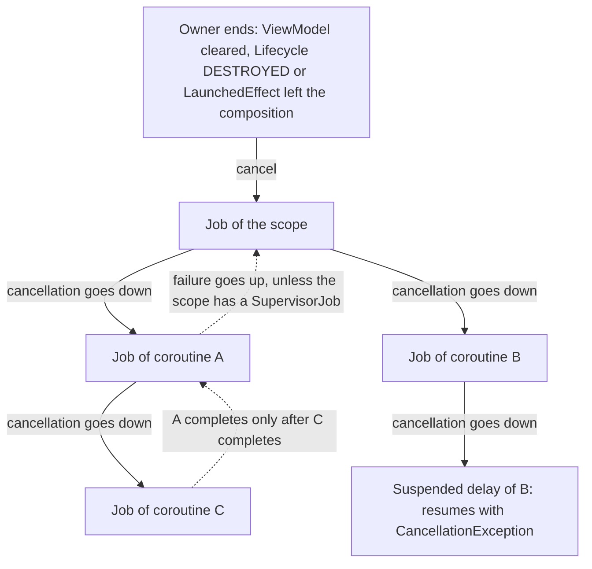

import Snippet from '../../../components/Snippet.astro';
import GoDeeper from '../../../components/GoDeeper.astro';

## The problem

Apps often start a coroutine for one screen, for example to load the data of the screen. If the user leaves the screen, the data has no use. An update of the UI after this time can even crash the app[^coroutinescope-581]. Thus the work must stop.

One operation can also run several coroutines. The `CoroutineScope` KDoc gives an example: a function downloads two files in parallel and compares them. If one download fails, the library cancels the other download, and the whole operation fails. If code cancels the caller, the library also cancels each coroutine of the operation[^coroutinescope-231].

`GlobalScope` shows the problem without structure. It has no `Job`. Thus no code can cancel all the coroutines in it at one time, and no code can wait until all of them end[^coroutinescope-565].

kotlinx.coroutines uses structured concurrency, an approach that tries to make the lifecycle of each concurrent operation clear[^coroutinescope-193]. In kotlinx.coroutines, a `Job` represents the lifecycle of a coroutine or of a scope. The `Job` of each coroutine in a `CoroutineScope` is a child of the `Job` of that scope[^coroutinescope-245]. Thus the jobs make a tree, with three rules:

- A cancellation of a parent cancels each child, and each child of a child[^job-18].
- If a child fails with an exception that is not a `CancellationException`, the failure cancels the parent and each other child of the parent[^job-18].
- A parent waits in the Completing state until each child completes[^job-67].

Cancellation also needs help from the code in the coroutine. Cancellation is cooperative: a coroutine reacts to a cancellation only when it suspends or when it checks for cancellation[^cancellation-cooperative].

This chapter builds a job tree, shows where it breaks, and then shows how kotlinx.coroutines and androidx.lifecycle make the real tree.

## Build it naive

The rebuild is in the module `samples/structured-concurrency`, in plain Kotlin. For coroutines, it uses only `kotlin.coroutines` of the Kotlin standard library, not kotlinx.coroutines. It has three parts: a fake loop, a job tree and a delay.

A breaking test must be deterministic, so the rebuild has no threads and no real time. `FakeLoop` has a virtual clock, `now`. `schedule` adds a task for a tick. `advanceTo` runs each task whose tick is not after the given tick, in the order of the ticks. Before each task, it sets the clock to the tick of the task. At the end, it sets the clock to the given tick. Only the test calls `advanceTo`:

<Snippet file="structured-concurrency/src/main/kotlin/FakeLoop.kt" region="loop" />

`NaiveJob` is one node of the tree. It keeps a list of its children. `cancel` marks the job and calls `cancel` on each child. Thus a cancellation goes down the tree. `failure` keeps the exception of the block of the job, and `isCompleted` is true after the block ends:

<Snippet file="structured-concurrency/src/main/kotlin/NaiveJob.kt" region="job" />

`NaiveScope` holds a job and the loop. `launch` makes a child job and adds it to the children of the job of the scope. Then `launch` starts the block as a coroutine with `startCoroutine`. The receiver of the block is a new `NaiveScope` with the child job, so a `launch` in the block makes a grandchild. The last argument of `startCoroutine` is the completion continuation. When the block ends, this continuation keeps the exception of the block in `failure`, and it marks the child complete:

<Snippet file="structured-concurrency/src/main/kotlin/NaiveJob.kt" region="scope" />

`naiveDelay` suspends the coroutine with `suspendCoroutine`. In the block of `suspendCoroutine`, it schedules a task on the loop. The task resumes the coroutine at the tick `now + ticks`:

<Snippet file="structured-concurrency/src/main/kotlin/NaiveJob.kt" region="delay" />

Each test makes a loop, a root job and a scope:

<Snippet file="structured-concurrency/src/test/kotlin/NaiveJobTest.kt" region="setup" />

The next test records the tick before and after `naiveDelay(3)`. At the launch, the block runs up to `naiveDelay` and records tick 0. At tick 2, the block has not resumed. At tick 3, the loop resumes the block, and the block records tick 3:

<Snippet file="structured-concurrency/src/test/kotlin/NaiveJobTest.kt" region="resume" />

Other tests check that `launch` adds the child job to the children of the job of the scope. They also check that a block that returns ends with no failure, and that a block that throws ends with its exception in `failure`. A test also checks that `cancel` on the root job cancels a child and a grandchild.

## Where it breaks

The rebuild has two flaws. The tree does not connect a child to its parent, and the delay does not watch the job. Three breaking tests show the flaws. Each breaking test passes, so each flaw occurs.

### A failure stays in the child

Child A fails at tick 1. Child B wakes at tick 2 and at tick 3. Each time, if its job is not cancelled, B adds 1 to a counter:

<Snippet file="structured-concurrency/src/test/kotlin/NaiveJobTest.kt" region="child-failure" />

At tick 3, `a.failure` holds the exception, the counter is 2, and the root job is not cancelled. The completion continuation of `launch` keeps the failure in the child and tells no other job. In the real tree, the failure of A cancels the parent, and the parent cancels B[^job-18].

### The parent completes before its child

The block of the parent launches child C and then returns. C wakes at tick 5:

<Snippet file="structured-concurrency/src/test/kotlin/NaiveJobTest.kt" region="parent-completion" />

At tick 1, the parent is complete, but C is not complete. The completion continuation of `launch` marks a job complete when the block of that job ends. It does not look at the children of the job. A real job waits in the Completing state until each child completes[^job-67].

### A cancelled coroutine still resumes

The test cancels the job at tick 1. At that time, `naiveDelay(10)` suspends the coroutine of the job:

<Snippet file="structured-concurrency/src/test/kotlin/NaiveJobTest.kt" region="cancelled-delay" />

The job is cancelled, but the line after `naiveDelay` still runs, at tick 10. In `naiveDelay`, only the task of the loop holds the continuation. No code connects the continuation to the job. Thus `cancel` marks the job, but the coroutine stays suspended until the task resumes it. The kotlinx.coroutines guide states the same for each custom suspend function that uses `suspendCoroutine`: such a function does not react to cancellation[^suspension-points].

## The real thing

### `launch` attaches the new job to the job of the scope

`launch` makes the context of the new coroutine from the context of the scope. The `Job` in the context of the scope becomes the parent of the new coroutine[^builders-39]. By default, `launch` creates a `StandaloneCoroutine`[^builders-200]. `StandaloneCoroutine` extends `AbstractCoroutine`[^builders-519].

`AbstractCoroutine` extends `JobSupport`, and it implements the completion `Continuation`, `Job` and `CoroutineScope`. It keeps the result of the block in the state of its job[^abstractcoroutine-10][^abstractcoroutine-36]. Thus the coroutine object is its own job. When the block ends, `resumeWith` calls `makeCompletingOnce` with the result[^abstractcoroutine-98]. The rebuild has a separate `NaiveJob` and a separate completion continuation.

`StandaloneCoroutine` gives `initParentJob = true` to `AbstractCoroutine`[^builders-519]. Thus the constructor of `AbstractCoroutine` calls `initParentJob` with the `Job` of the parent context[^abstractcoroutine-42]. `initParentJob` calls `attachChild` on the parent, and keeps the result as its `parentHandle`[^jobsupport-141]. `attachChild` puts a `ChildHandleNode` for the child into the list of the parent[^jobsupport-1022]. The node links the two jobs in both directions. Its `invoke` calls `parentCancelled` on the child. Its `childCancelled` calls `childCancelled` on the parent[^jobsupport-1575]. Thus the nodes in the list of the parent do the work of the `children` list of `NaiveJob`. Each node also links back to the parent.

If the cancellation of the parent already started when a child attaches, `attachChild` cancels the child at once[^jobsupport-1058].

### A cancellation goes down

`cancel` moves a job to the Cancelling state at once. The job becomes Cancelled only after its own work ends and each child completes[^job-61].

`tryMakeCancelling` sets the Cancelling state and calls `notifyCancelling`[^jobsupport-817]. `notifyCancelling` first cancels the children of the job: it invokes each node of the list that has `onCancelling` set. Then it calls `cancelParent`[^jobsupport-320]. A `ChildHandleNode` has `onCancelling` set, so its `invoke` runs here[^jobsupport-1575]. `parentCancelled` of the child calls `cancelImpl`, so the child starts its own cancellation[^jobsupport-667]. Thus the cancellation goes down the tree, as in `NaiveJob.cancel`.

`cancel` takes only a `CancellationException`. Thus `cancel` always gives a normal cancellation, and a parent can cancel its children with no cancellation of itself[^job-100].

### A failure goes up

If the block of a coroutine throws a `CancellationException`, the coroutine ends with a normal cancellation. If the block throws a different exception, the job of the coroutine fails[^job-95].

The failed job calls `cancelParent`, which calls `childCancelled` on the parent through the `ChildHandleNode`[^jobsupport-336][^jobsupport-1575]. In the parent, `childCancelled` returns at once for a `CancellationException`. For each other exception, it cancels the parent with that exception[^jobsupport-680]. Then the parent cancels its other children, as the previous section shows. The rebuild does not have this step.

A failure of a child cancels the parent only if all these conditions are true[^coroutinescope-326]:

1. The exception is not a `CancellationException`.
2. The child is not a lexically scoped coroutine, for example the coroutine of `coroutineScope` or `withContext`.
3. The `Job` of the parent is not a `SupervisorJob`.

The same rule applies to the parent of the parent[^coroutinescope-326]. A lexically scoped coroutine throws the exception to its caller[^coroutineexceptionhandler-119].

If several children fail, the parent keeps the first exception that is not a `CancellationException` as the final cause. `getFinalRootCause` makes this choice[^jobsupport-237]. The other failures become suppressed exceptions of the final cause[^coroutinescope-378].

`SupervisorJob` is the opt-out. Its `childCancelled` returns false[^supervisor-109]. Thus a failed child does not cancel the supervisor or the other children of the supervisor. Then a `CoroutineExceptionHandler` in the context of a failed `launch` child can handle the failure[^supervisor-17]. Code can handle the failure of an `async` child with `await`[^supervisor-17].

### The exception of a failed coroutine

`async` keeps its exception in the `Deferred`, and `await` throws the exception[^builders-263]. A failure of `async` still cancels a parent that is not a supervisor[^builders-247].

`launch` returns a `Job`, and a `Job` gives no way to read the exception[^coroutineexceptionhandler-160]. When a job ends with an exception, `finalizeFinishingState` first gives the exception to `cancelParent`. If the parent does not handle the exception, `finalizeFinishingState` calls `handleJobException`[^jobsupport-221]. `StandaloneCoroutine` overrides `handleJobException` and calls `handleCoroutineException`[^builders-519]. `handleCoroutineException` uses the `CoroutineExceptionHandler` of the context. If the context has no handler, it calls `handleUncaughtCoroutineException`[^coroutineexceptionhandler-18]. On the JVM, this path ends at the uncaught exception handler of the current thread[^coroutineexceptionhandler-184]. On Android, the default uncaught exception handler kills the process of the app[^runtimeinit-237][^runtimeinit-150]. The Go deeper box "from a coroutine exception to a crash" gives the path from the thread to this handler.

A `CoroutineExceptionHandler` works only for a root coroutine or for a child of a supervisor. Each other child gives its exception to its parent, so the handler in its context never runs[^exception-handler-doc]. All handlers ignore a `CancellationException`[^cancellation-and-exceptions].

`supervisorScope` installs no `CoroutineExceptionHandler`. Thus if a `launch` child of `supervisorScope` fails, no code handles the exception, and the exception can crash the program[^supervisor-74].

<GoDeeper title="from a coroutine exception to a crash">

`handleUncaughtCoroutineException` gives the exception to each handler in `platformExceptionHandlers`. If no handler throws `ExceptionSuccessfullyProcessed`, it adds the coroutine context to the exception as a suppressed `DiagnosticCoroutineContextException`. Then it calls `propagateExceptionFinalResort`[^cehimpl-common-30]. On the JVM, `ServiceLoader` fills `platformExceptionHandlers`[^cehimpl-jvm-17]. `propagateExceptionFinalResort` calls `uncaughtException` on the uncaught exception handler of the current thread[^cehimpl-jvm-28].

If a thread has no handler of its own, `getUncaughtExceptionHandler` returns the `ThreadGroup` of the thread[^thread-3339]. The top `ThreadGroup` calls the default uncaught exception handler[^threadgroup-1091]. `RuntimeInit.commonInit` sets `KillApplicationHandler` as the default handler and a `LoggingHandler` as the pre-handler. A comment there says that these handlers apply to all threads in the VM[^runtimeinit-237].

`KillApplicationHandler.uncaughtException` makes sure that the `LoggingHandler` ran. It reports the crash to the system with `handleApplicationCrash`. In its `finally` block, it kills the process[^runtimeinit-150]. For an app, the `LoggingHandler` writes "FATAL EXCEPTION" and the name of the thread to the crash buffer of the log[^runtimeinit-79][^runtimeinit-101].

The runtime path, `Thread.dispatchUncaughtException`, calls the pre-handler before the handler of the thread[^thread-3375]. `propagateExceptionFinalResort` calls the handler of the thread directly, so the pre-handler does not run first. Then `ensureLogging` of `KillApplicationHandler` calls the `LoggingHandler`[^runtimeinit-204]. Thus the log also shows a crash that comes from a coroutine.

</GoDeeper>

### The parent waits for its children

If the block of a coroutine returns while children still run, `tryMakeCompletingSlowPath` moves the job to the Completing state. It registers a completion handler on a child that is not complete, and returns `COMPLETING_WAITING_CHILDREN`[^jobsupport-902][^jobsupport-954]. When that child completes, `continueCompleting` waits for the next child. When no child is left, it calls `finalizeFinishingState`[^jobsupport-1260][^jobsupport-965]. Only then is the job complete. While the job waits, it is still active for code outside the job[^job-67].

`coroutineScope` uses the same rule. It returns only after its block and each coroutine in the scope complete[^coroutinescope-745].

### A suspended coroutine watches its job

`delay` suspends with `suspendCancellableCoroutine`[^delay-121]. If code cancels the `Job` while `delay` waits, `delay` resumes at once with a `CancellationException`[^delay-109].

`suspendCancellableCoroutine` creates a `CancellableContinuationImpl` and calls `initCancellability` before it calls the block[^cc-429]. `initCancellability` calls `installParentHandle`[^ccimpl-120]. `installParentHandle` registers a `ChildContinuation` node on the `Job` of the coroutine[^ccimpl-339]. A comment calls `ChildContinuation` the same as `ChildHandleNode`, but for a cancellable continuation. `ChildContinuation` has `onCancelling` set, so `notifyCancelling` of the job invokes it. Its `invoke` calls `parentCancelled` on the continuation[^ccimpl-691].

`parentCancelled` calls `cancel`[^ccimpl-219]. If the continuation is still active, `cancel` moves it to the cancelled state and dispatches the resume[^ccimpl-201]. The coroutine resumes with a `CancellationException`[^cc-12]. If code resumes the continuation after the cancellation, `resumeImpl` finds the cancelled state and ignores the resume[^ccimpl-508]. Of a `cancel` and a `resume`, only one succeeds[^cc-43]. `naiveDelay` does not have these two parts: a link from the job to the continuation, and a guard that lets only one of the two resumes succeed.

A cancellable continuation also gives the prompt cancellation guarantee. A resume does not run the coroutine at once. It gives the coroutine to its dispatcher, so the cancellation can come after the resume and before the coroutine runs. If the `Job` gets the cancellation while the coroutine is suspended, the coroutine does not resume successfully, even if the resume came first[^cc-51].

`withContext` uses this guarantee. Before it starts the block, it checks for cancellation with `ensureActive`[^builders-484]. If the caller is cancelled when its dispatcher starts to run it again, `withContext` discards the result and throws a `CancellationException`[^builders-452]. For example, if a screen cancels its coroutine before `withContext(Dispatchers.IO)` returns, the UI update after `withContext` does not run[^handle-values].

<GoDeeper title="the check before a resumed coroutine runs">

The dispatcher runs `DispatchedTask.run`. If the coroutine resumed with a value in a cancellable mode, `run` reads the `Job` of the coroutine. If the `Job` is not active, `run` resumes the coroutine with the `CancellationException` of the job, not with the value[^dispatchedtask-91].

The block of `suspendCancellableCoroutine` can also resume the continuation before `getResult` runs. Then `getResult` makes the same check, and throws the cancellation exception if the `Job` is not active[^ccimpl-324].

The guarantee needs a `CoroutineDispatcher`. A custom `ContinuationInterceptor` that does not extend `CoroutineDispatcher` gives no prompt cancellation guarantee[^cc-417].

</GoDeeper>

### Cancellation is cooperative

All the suspend functions of kotlinx.coroutines use `suspendCancellableCoroutine`, so they react to cancellation. A custom suspend function that uses `suspendCoroutine` does not react, as `naiveDelay` shows[^suspension-points].

If a coroutine does not suspend for a long time, it does not stop at a cancellation, unless it checks for cancellation. `isActive` is false after the cancellation, `ensureActive` throws a `CancellationException`, and `yield` suspends and checks[^check-explicitly].

`withTimeout` cancels its block with a `TimeoutCancellationException` after the timeout[^timeout-33]. This cancellation is also cooperative. For example, a block with `Thread.sleep(10_000)` runs to completion. On the JVM, `runInterruptible` turns the cancellation into a thread interrupt[^timeout-53]. A `TimeoutCancellationException` is a `CancellationException`[^timeout-253]. Thus it does not fail the parent[^timeout-73].

A `catch` of `CancellationException` can stop the propagation of the cancellation. If you catch it, throw it again[^cancel-coroutines].

To make sure that suspend cleanup code completes after a cancellation, for example a suspend `close` in a `finally` block, run it in `withContext(NonCancellable)`[^run-non-cancelable]. Do not use `launch(NonCancellable)`. It removes the parent-child relation: the parent does not wait for the child, and a failure of the child does not cancel the parent[^noncancellable-19].

### The scopes of Android

`viewModelScope` has a `SupervisorJob` and `Dispatchers.Main.immediate`. The library cancels the scope when the library clears the `ViewModel`[^viewmodel-207]. `createViewModelScope` makes this context[^closeablecoroutinescope-51]. The `ViewModel` keeps the scope as a closeable with a key[^viewmodel-224]. The clear closes the closeables with a key first, before `onCleared`[^viewmodel-162]. `close` cancels the context of the scope[^closeablecoroutinescope-84]. Thus each coroutine in `viewModelScope` gets the cancellation. The [config changes chapter](/state-survival/config-changes/) shows when the store of an activity clears its `ViewModel` objects.

`lifecycleScope` is the `coroutineScope` of the `Lifecycle` of the owner[^lifecycleowner-39]. This scope also has a `SupervisorJob` and `Dispatchers.Main.immediate`[^lifecycle-297]. Its observer cancels the scope when the `Lifecycle` reaches `DESTROYED`[^lifecycle-354]. Thus a coroutine in `lifecycleScope` still runs after `ON_STOP`, when the state is `CREATED`[^lifecycle-146].

`repeatOnLifecycle` cancels work at an earlier state. It suspends in `suspendCancellableCoroutine` until `ON_DESTROY`. When the `Lifecycle` reaches the given state, its observer launches the block in a child coroutine. When the `Lifecycle` falls below the state, the observer cancels the child[^repeatonlifecycle-96]. For the state `STARTED`, the `Lifecycle` falls below the state at the event `ON_STOP`[^lifecycle-167]. When `repeatOnLifecycle` ends, its `finally` block cancels the child[^repeatonlifecycle-124].

`LaunchedEffect` keeps a `LaunchedEffectImpl` in `remember(key1)`[^effects-563]. When the impl enters the composition, `onRemembered` launches the block. When the impl leaves the composition, `onForgotten` cancels the job[^effects-508]. The KDoc states that if the key changes, the old coroutine gets the cancellation, and a new coroutine starts[^effects-552].

In `viewModelScope` and `lifecycleScope`, the `SupervisorJob` does not handle the exception of a failed `launch` coroutine[^supervisor-109][^jobsupport-221]. The context that the library makes for each scope has no `CoroutineExceptionHandler`[^closeablecoroutinescope-51][^lifecycle-297]. Thus, if the `launch` call adds no handler, the exception goes to the handlers that `ServiceLoader` finds and to the uncaught exception handler of the current thread[^coroutineexceptionhandler-184].

The Android guide gives this advice:

- If an exception is likely in a coroutine of `viewModelScope` or `lifecycleScope`, catch it in the body of the coroutine. An unhandled exception can crash the app[^bp-exceptions].
- If a coroutine does blocking work in a loop, call `ensureActive` before each step[^bp-cancellable].
- In the data and business layers, if the work belongs only to the current screen, use `coroutineScope` or `supervisorScope`[^bp-data-layer].
- Do not use `GlobalScope`. If work must live longer than the current screen, inject an external `CoroutineScope`[^bp-global-scope].

Since Android 15, if an app starts a network request outside a valid process lifecycle, the app gets an exception, for example an `UnknownHostException`. The page tells apps to cancel such requests with lifecycle-aware components when the app leaves a valid process lifecycle[^android-15-network].

## Mental model

Each coroutine is a `Job` in a tree. `launch` attaches the new job to the job of its scope with a `ChildHandleNode`. A cancellation goes down the tree: each job cancels its children, and each suspended cancellable continuation resumes with a `CancellationException`. A failure goes up the tree: a child that fails with an exception that is not a `CancellationException` cancels its parent, and the parent cancels its other children. A `SupervisorJob` stops a failure, so the exception of a failed `launch` child goes to the exception handlers. A job completes only after each child completes. Cancellation is cooperative: code reacts only when it suspends in a cancellable function or when it checks for cancellation. On Android, `viewModelScope`, `lifecycleScope` and `LaunchedEffect` cancel their coroutines when their owner ends. `repeatOnLifecycle` cancels its block when the `Lifecycle` falls below a state.



## Try it

### 1. Connect the tree

Change `NaiveJob` and `NaiveScope.launch` in `samples/structured-concurrency/src/main/kotlin/NaiveJob.kt`, so that the tree follows the rules of `JobSupport`:

1. Give `NaiveJob` a link to its parent. In the completion continuation of `launch`, if the block failed with an exception that is not a `CancellationException`, cancel the parent job. The cancellation of the parent then cancels the other children. Do not cancel the parent for a `CancellationException`, because a normal cancellation does not cancel the parent[^job-100]. Use `kotlin.coroutines.cancellation.CancellationException`.
2. Mark a job complete only after its block ends and each child completes. When a child completes, make its parent check again.

From the repo root, run the tests of the rebuild:

```sh
samples/gradlew -p samples :structured-concurrency:test
```

The two breaking tests of the tree fail, because the flaws are gone. The other tests pass. The Gradle output includes these lines:

```
NaiveJobTest > naiveScope_completesParent_whileChildRuns() FAILED
    org.opentest4j.AssertionFailedError at NaiveJobTest.kt:98

NaiveJobTest > naiveScope_keepsSiblingRunning_whenChildFails() FAILED
    org.opentest4j.AssertionFailedError at NaiveJobTest.kt:86

11 tests completed, 2 failed
```

Compare your fix with the real code. `childCancelled` cancels the parent[^jobsupport-680], and `tryMakeCompletingSlowPath` waits for each child[^jobsupport-902].

### 2. Make the delay cancellable

Give `NaiveJob` a list of cancellation callbacks, and make `cancel` call each callback. In `naiveDelay`, register a callback on the job. The callback resumes the coroutine with a `CancellationException`. Make sure that the coroutine resumes only one time: after the callback resumes it, the task of the loop must not resume it again. Run the tests again:

```sh
samples/gradlew -p samples :structured-concurrency:test
```

If you start from the original rebuild, the Gradle output includes these lines:

```
NaiveJobTest > naiveDelay_resumesBody_whenJobIsCancelledWhileSuspended() FAILED
    org.opentest4j.AssertionFailedError at NaiveJobTest.kt:115

11 tests completed, 1 failed
```

If you also made the change of prompt 1, the three breaking tests fail, and the other eight tests pass. Then the rule of prompt 1 for `CancellationException` is necessary: a cancelled `naiveDelay` throws a `CancellationException`, and in the real tree, a normal cancellation does not cancel the parent[^job-100].

Compare your fix with the real code. `ChildContinuation` links the job to the continuation[^ccimpl-691], and `resumeImpl` ignores a resume after the cancellation[^ccimpl-508].

[^coroutinescope-581]: CoroutineScope.kt, lines 581–584: [https://github.com/Kotlin/kotlinx.coroutines/blob/1.11.0/kotlinx-coroutines-core/common/src/CoroutineScope.kt#L581-L584](https://github.com/Kotlin/kotlinx.coroutines/blob/1.11.0/kotlinx-coroutines-core/common/src/CoroutineScope.kt#L581-L584)
[^coroutinescope-231]: CoroutineScope.kt, lines 231–241: [https://github.com/Kotlin/kotlinx.coroutines/blob/1.11.0/kotlinx-coroutines-core/common/src/CoroutineScope.kt#L231-L241](https://github.com/Kotlin/kotlinx.coroutines/blob/1.11.0/kotlinx-coroutines-core/common/src/CoroutineScope.kt#L231-L241)
[^coroutinescope-565]: CoroutineScope.kt, lines 565–570: [https://github.com/Kotlin/kotlinx.coroutines/blob/1.11.0/kotlinx-coroutines-core/common/src/CoroutineScope.kt#L565-L570](https://github.com/Kotlin/kotlinx.coroutines/blob/1.11.0/kotlinx-coroutines-core/common/src/CoroutineScope.kt#L565-L570)
[^coroutinescope-193]: CoroutineScope.kt, lines 193–194: [https://github.com/Kotlin/kotlinx.coroutines/blob/1.11.0/kotlinx-coroutines-core/common/src/CoroutineScope.kt#L193-L194](https://github.com/Kotlin/kotlinx.coroutines/blob/1.11.0/kotlinx-coroutines-core/common/src/CoroutineScope.kt#L193-L194)
[^coroutinescope-245]: CoroutineScope.kt, lines 245–249: [https://github.com/Kotlin/kotlinx.coroutines/blob/1.11.0/kotlinx-coroutines-core/common/src/CoroutineScope.kt#L245-L249](https://github.com/Kotlin/kotlinx.coroutines/blob/1.11.0/kotlinx-coroutines-core/common/src/CoroutineScope.kt#L245-L249)
[^job-18]: Job.kt, lines 18–22: [https://github.com/Kotlin/kotlinx.coroutines/blob/1.11.0/kotlinx-coroutines-core/common/src/Job.kt#L18-L22](https://github.com/Kotlin/kotlinx.coroutines/blob/1.11.0/kotlinx-coroutines-core/common/src/Job.kt#L18-L22)
[^job-67]: Job.kt, lines 67–73: [https://github.com/Kotlin/kotlinx.coroutines/blob/1.11.0/kotlinx-coroutines-core/common/src/Job.kt#L67-L73](https://github.com/Kotlin/kotlinx.coroutines/blob/1.11.0/kotlinx-coroutines-core/common/src/Job.kt#L67-L73)
[^cancellation-cooperative]: Cancellation and timeouts, "Make coroutines react to cancellation": [https://github.com/Kotlin/kotlinx.coroutines/blob/1.11.0/docs/topics/cancellation-and-timeouts.md#make-coroutines-react-to-cancellation-idcancellation-is-cooperative](https://github.com/Kotlin/kotlinx.coroutines/blob/1.11.0/docs/topics/cancellation-and-timeouts.md#make-coroutines-react-to-cancellation-idcancellation-is-cooperative)
[^suspension-points]: Cancellation and timeouts, "Suspension points and cancellation": [https://github.com/Kotlin/kotlinx.coroutines/blob/1.11.0/docs/topics/cancellation-and-timeouts.md#suspension-points-and-cancellation](https://github.com/Kotlin/kotlinx.coroutines/blob/1.11.0/docs/topics/cancellation-and-timeouts.md#suspension-points-and-cancellation)
[^builders-39]: Builders.common.kt, lines 39–48: [https://github.com/Kotlin/kotlinx.coroutines/blob/1.11.0/kotlinx-coroutines-core/common/src/Builders.common.kt#L39-L48](https://github.com/Kotlin/kotlinx.coroutines/blob/1.11.0/kotlinx-coroutines-core/common/src/Builders.common.kt#L39-L48)
[^builders-200]: Builders.common.kt, lines 200–211: [https://github.com/Kotlin/kotlinx.coroutines/blob/1.11.0/kotlinx-coroutines-core/common/src/Builders.common.kt#L200-L211](https://github.com/Kotlin/kotlinx.coroutines/blob/1.11.0/kotlinx-coroutines-core/common/src/Builders.common.kt#L200-L211)
[^builders-519]: Builders.common.kt, lines 519–527: [https://github.com/Kotlin/kotlinx.coroutines/blob/1.11.0/kotlinx-coroutines-core/common/src/Builders.common.kt#L519-L527](https://github.com/Kotlin/kotlinx.coroutines/blob/1.11.0/kotlinx-coroutines-core/common/src/Builders.common.kt#L519-L527)
[^abstractcoroutine-10]: AbstractCoroutine.kt, lines 10–16: [https://github.com/Kotlin/kotlinx.coroutines/blob/1.11.0/kotlinx-coroutines-core/common/src/AbstractCoroutine.kt#L10-L16](https://github.com/Kotlin/kotlinx.coroutines/blob/1.11.0/kotlinx-coroutines-core/common/src/AbstractCoroutine.kt#L10-L16)
[^abstractcoroutine-36]: AbstractCoroutine.kt, lines 36–40: [https://github.com/Kotlin/kotlinx.coroutines/blob/1.11.0/kotlinx-coroutines-core/common/src/AbstractCoroutine.kt#L36-L40](https://github.com/Kotlin/kotlinx.coroutines/blob/1.11.0/kotlinx-coroutines-core/common/src/AbstractCoroutine.kt#L36-L40)
[^abstractcoroutine-98]: AbstractCoroutine.kt, lines 98–102: [https://github.com/Kotlin/kotlinx.coroutines/blob/1.11.0/kotlinx-coroutines-core/common/src/AbstractCoroutine.kt#L98-L102](https://github.com/Kotlin/kotlinx.coroutines/blob/1.11.0/kotlinx-coroutines-core/common/src/AbstractCoroutine.kt#L98-L102)
[^abstractcoroutine-42]: AbstractCoroutine.kt, lines 42–51: [https://github.com/Kotlin/kotlinx.coroutines/blob/1.11.0/kotlinx-coroutines-core/common/src/AbstractCoroutine.kt#L42-L51](https://github.com/Kotlin/kotlinx.coroutines/blob/1.11.0/kotlinx-coroutines-core/common/src/AbstractCoroutine.kt#L42-L51)
[^jobsupport-141]: JobSupport.kt, lines 141–155: [https://github.com/Kotlin/kotlinx.coroutines/blob/1.11.0/kotlinx-coroutines-core/common/src/JobSupport.kt#L141-L155](https://github.com/Kotlin/kotlinx.coroutines/blob/1.11.0/kotlinx-coroutines-core/common/src/JobSupport.kt#L141-L155)
[^jobsupport-1022]: JobSupport.kt, lines 1022–1028: [https://github.com/Kotlin/kotlinx.coroutines/blob/1.11.0/kotlinx-coroutines-core/common/src/JobSupport.kt#L1022-L1028](https://github.com/Kotlin/kotlinx.coroutines/blob/1.11.0/kotlinx-coroutines-core/common/src/JobSupport.kt#L1022-L1028)
[^jobsupport-1575]: JobSupport.kt, lines 1575–1582: [https://github.com/Kotlin/kotlinx.coroutines/blob/1.11.0/kotlinx-coroutines-core/common/src/JobSupport.kt#L1575-L1582](https://github.com/Kotlin/kotlinx.coroutines/blob/1.11.0/kotlinx-coroutines-core/common/src/JobSupport.kt#L1575-L1582)
[^jobsupport-1058]: JobSupport.kt, lines 1058–1067: [https://github.com/Kotlin/kotlinx.coroutines/blob/1.11.0/kotlinx-coroutines-core/common/src/JobSupport.kt#L1058-L1067](https://github.com/Kotlin/kotlinx.coroutines/blob/1.11.0/kotlinx-coroutines-core/common/src/JobSupport.kt#L1058-L1067)
[^job-61]: Job.kt, lines 61–65: [https://github.com/Kotlin/kotlinx.coroutines/blob/1.11.0/kotlinx-coroutines-core/common/src/Job.kt#L61-L65](https://github.com/Kotlin/kotlinx.coroutines/blob/1.11.0/kotlinx-coroutines-core/common/src/Job.kt#L61-L65)
[^jobsupport-817]: JobSupport.kt, lines 817–828: [https://github.com/Kotlin/kotlinx.coroutines/blob/1.11.0/kotlinx-coroutines-core/common/src/JobSupport.kt#L817-L828](https://github.com/Kotlin/kotlinx.coroutines/blob/1.11.0/kotlinx-coroutines-core/common/src/JobSupport.kt#L817-L828)
[^jobsupport-320]: JobSupport.kt, lines 320–327: [https://github.com/Kotlin/kotlinx.coroutines/blob/1.11.0/kotlinx-coroutines-core/common/src/JobSupport.kt#L320-L327](https://github.com/Kotlin/kotlinx.coroutines/blob/1.11.0/kotlinx-coroutines-core/common/src/JobSupport.kt#L320-L327)
[^jobsupport-667]: JobSupport.kt, lines 667–669: [https://github.com/Kotlin/kotlinx.coroutines/blob/1.11.0/kotlinx-coroutines-core/common/src/JobSupport.kt#L667-L669](https://github.com/Kotlin/kotlinx.coroutines/blob/1.11.0/kotlinx-coroutines-core/common/src/JobSupport.kt#L667-L669)
[^job-100]: Job.kt, lines 100–111: [https://github.com/Kotlin/kotlinx.coroutines/blob/1.11.0/kotlinx-coroutines-core/common/src/Job.kt#L100-L111](https://github.com/Kotlin/kotlinx.coroutines/blob/1.11.0/kotlinx-coroutines-core/common/src/Job.kt#L100-L111)
[^job-95]: Job.kt, lines 95–105: [https://github.com/Kotlin/kotlinx.coroutines/blob/1.11.0/kotlinx-coroutines-core/common/src/Job.kt#L95-L105](https://github.com/Kotlin/kotlinx.coroutines/blob/1.11.0/kotlinx-coroutines-core/common/src/Job.kt#L95-L105)
[^jobsupport-336]: JobSupport.kt, lines 336–353: [https://github.com/Kotlin/kotlinx.coroutines/blob/1.11.0/kotlinx-coroutines-core/common/src/JobSupport.kt#L336-L353](https://github.com/Kotlin/kotlinx.coroutines/blob/1.11.0/kotlinx-coroutines-core/common/src/JobSupport.kt#L336-L353)
[^jobsupport-680]: JobSupport.kt, lines 680–683: [https://github.com/Kotlin/kotlinx.coroutines/blob/1.11.0/kotlinx-coroutines-core/common/src/JobSupport.kt#L680-L683](https://github.com/Kotlin/kotlinx.coroutines/blob/1.11.0/kotlinx-coroutines-core/common/src/JobSupport.kt#L680-L683)
[^coroutinescope-326]: CoroutineScope.kt, lines 326–333: [https://github.com/Kotlin/kotlinx.coroutines/blob/1.11.0/kotlinx-coroutines-core/common/src/CoroutineScope.kt#L326-L333](https://github.com/Kotlin/kotlinx.coroutines/blob/1.11.0/kotlinx-coroutines-core/common/src/CoroutineScope.kt#L326-L333)
[^coroutineexceptionhandler-119]: CoroutineExceptionHandler.kt, lines 119–120: [https://github.com/Kotlin/kotlinx.coroutines/blob/1.11.0/kotlinx-coroutines-core/common/src/CoroutineExceptionHandler.kt#L119-L120](https://github.com/Kotlin/kotlinx.coroutines/blob/1.11.0/kotlinx-coroutines-core/common/src/CoroutineExceptionHandler.kt#L119-L120)
[^jobsupport-237]: JobSupport.kt, lines 237–260: [https://github.com/Kotlin/kotlinx.coroutines/blob/1.11.0/kotlinx-coroutines-core/common/src/JobSupport.kt#L237-L260](https://github.com/Kotlin/kotlinx.coroutines/blob/1.11.0/kotlinx-coroutines-core/common/src/JobSupport.kt#L237-L260)
[^coroutinescope-378]: CoroutineScope.kt, lines 378–380: [https://github.com/Kotlin/kotlinx.coroutines/blob/1.11.0/kotlinx-coroutines-core/common/src/CoroutineScope.kt#L378-L380](https://github.com/Kotlin/kotlinx.coroutines/blob/1.11.0/kotlinx-coroutines-core/common/src/CoroutineScope.kt#L378-L380)
[^supervisor-109]: Supervisor.kt, lines 109–111: [https://github.com/Kotlin/kotlinx.coroutines/blob/1.11.0/kotlinx-coroutines-core/common/src/Supervisor.kt#L109-L111](https://github.com/Kotlin/kotlinx.coroutines/blob/1.11.0/kotlinx-coroutines-core/common/src/Supervisor.kt#L109-L111)
[^supervisor-17]: Supervisor.kt, lines 17–21: [https://github.com/Kotlin/kotlinx.coroutines/blob/1.11.0/kotlinx-coroutines-core/common/src/Supervisor.kt#L17-L21](https://github.com/Kotlin/kotlinx.coroutines/blob/1.11.0/kotlinx-coroutines-core/common/src/Supervisor.kt#L17-L21)
[^builders-263]: Builders.common.kt, lines 263–267: [https://github.com/Kotlin/kotlinx.coroutines/blob/1.11.0/kotlinx-coroutines-core/common/src/Builders.common.kt#L263-L267](https://github.com/Kotlin/kotlinx.coroutines/blob/1.11.0/kotlinx-coroutines-core/common/src/Builders.common.kt#L263-L267)
[^builders-247]: Builders.common.kt, lines 247–255: [https://github.com/Kotlin/kotlinx.coroutines/blob/1.11.0/kotlinx-coroutines-core/common/src/Builders.common.kt#L247-L255](https://github.com/Kotlin/kotlinx.coroutines/blob/1.11.0/kotlinx-coroutines-core/common/src/Builders.common.kt#L247-L255)
[^jobsupport-221]: JobSupport.kt, lines 221–224: [https://github.com/Kotlin/kotlinx.coroutines/blob/1.11.0/kotlinx-coroutines-core/common/src/JobSupport.kt#L221-L224](https://github.com/Kotlin/kotlinx.coroutines/blob/1.11.0/kotlinx-coroutines-core/common/src/JobSupport.kt#L221-L224)
[^coroutineexceptionhandler-18]: CoroutineExceptionHandler.kt, lines 18–32: [https://github.com/Kotlin/kotlinx.coroutines/blob/1.11.0/kotlinx-coroutines-core/common/src/CoroutineExceptionHandler.kt#L18-L32](https://github.com/Kotlin/kotlinx.coroutines/blob/1.11.0/kotlinx-coroutines-core/common/src/CoroutineExceptionHandler.kt#L18-L32)
[^coroutineexceptionhandler-184]: CoroutineExceptionHandler.kt, lines 184–190: [https://github.com/Kotlin/kotlinx.coroutines/blob/1.11.0/kotlinx-coroutines-core/common/src/CoroutineExceptionHandler.kt#L184-L190](https://github.com/Kotlin/kotlinx.coroutines/blob/1.11.0/kotlinx-coroutines-core/common/src/CoroutineExceptionHandler.kt#L184-L190)
[^coroutineexceptionhandler-160]: CoroutineExceptionHandler.kt, lines 160–176: [https://github.com/Kotlin/kotlinx.coroutines/blob/1.11.0/kotlinx-coroutines-core/common/src/CoroutineExceptionHandler.kt#L160-L176](https://github.com/Kotlin/kotlinx.coroutines/blob/1.11.0/kotlinx-coroutines-core/common/src/CoroutineExceptionHandler.kt#L160-L176)
[^runtimeinit-237]: RuntimeInit.java, lines 237–243: [https://android.googlesource.com/platform/frameworks/base/+/refs/tags/android-17.0.0_r1/core/java/com/android/internal/os/RuntimeInit.java#237](https://android.googlesource.com/platform/frameworks/base/+/refs/tags/android-17.0.0_r1/core/java/com/android/internal/os/RuntimeInit.java#237)
[^runtimeinit-150]: RuntimeInit.java, lines 150–185: [https://android.googlesource.com/platform/frameworks/base/+/refs/tags/android-17.0.0_r1/core/java/com/android/internal/os/RuntimeInit.java#150](https://android.googlesource.com/platform/frameworks/base/+/refs/tags/android-17.0.0_r1/core/java/com/android/internal/os/RuntimeInit.java#150)
[^exception-handler-doc]: Coroutine exceptions handling, "CoroutineExceptionHandler": [https://github.com/Kotlin/kotlinx.coroutines/blob/1.11.0/docs/topics/exception-handling.md#coroutineexceptionhandler](https://github.com/Kotlin/kotlinx.coroutines/blob/1.11.0/docs/topics/exception-handling.md#coroutineexceptionhandler)
[^cancellation-and-exceptions]: Coroutine exceptions handling, "Cancellation and exceptions": [https://github.com/Kotlin/kotlinx.coroutines/blob/1.11.0/docs/topics/exception-handling.md#cancellation-and-exceptions](https://github.com/Kotlin/kotlinx.coroutines/blob/1.11.0/docs/topics/exception-handling.md#cancellation-and-exceptions)
[^supervisor-74]: Supervisor.kt, lines 74–80: [https://github.com/Kotlin/kotlinx.coroutines/blob/1.11.0/kotlinx-coroutines-core/common/src/Supervisor.kt#L74-L80](https://github.com/Kotlin/kotlinx.coroutines/blob/1.11.0/kotlinx-coroutines-core/common/src/Supervisor.kt#L74-L80)
[^cehimpl-common-30]: CoroutineExceptionHandlerImpl.common.kt, lines 30–49: [https://github.com/Kotlin/kotlinx.coroutines/blob/1.11.0/kotlinx-coroutines-core/common/src/internal/CoroutineExceptionHandlerImpl.common.kt#L30-L49](https://github.com/Kotlin/kotlinx.coroutines/blob/1.11.0/kotlinx-coroutines-core/common/src/internal/CoroutineExceptionHandlerImpl.common.kt#L30-L49)
[^cehimpl-jvm-17]: CoroutineExceptionHandlerImpl.kt, lines 17–20: [https://github.com/Kotlin/kotlinx.coroutines/blob/1.11.0/kotlinx-coroutines-core/jvm/src/internal/CoroutineExceptionHandlerImpl.kt#L17-L20](https://github.com/Kotlin/kotlinx.coroutines/blob/1.11.0/kotlinx-coroutines-core/jvm/src/internal/CoroutineExceptionHandlerImpl.kt#L17-L20)
[^cehimpl-jvm-28]: CoroutineExceptionHandlerImpl.kt, lines 28–43: [https://github.com/Kotlin/kotlinx.coroutines/blob/1.11.0/kotlinx-coroutines-core/jvm/src/internal/CoroutineExceptionHandlerImpl.kt#L28-L43](https://github.com/Kotlin/kotlinx.coroutines/blob/1.11.0/kotlinx-coroutines-core/jvm/src/internal/CoroutineExceptionHandlerImpl.kt#L28-L43)
[^thread-3339]: Thread.java, lines 3339–3342: [https://android.googlesource.com/platform/libcore/+/refs/tags/android-17.0.0_r1/ojluni/src/main/java/java/lang/Thread.java#3339](https://android.googlesource.com/platform/libcore/+/refs/tags/android-17.0.0_r1/ojluni/src/main/java/java/lang/Thread.java#3339)
[^threadgroup-1091]: ThreadGroup.java, lines 1091–1105: [https://android.googlesource.com/platform/libcore/+/refs/tags/android-17.0.0_r1/ojluni/src/main/java/java/lang/ThreadGroup.java#1091](https://android.googlesource.com/platform/libcore/+/refs/tags/android-17.0.0_r1/ojluni/src/main/java/java/lang/ThreadGroup.java#1091)
[^runtimeinit-79]: RuntimeInit.java, lines 79–94: [https://android.googlesource.com/platform/frameworks/base/+/refs/tags/android-17.0.0_r1/core/java/com/android/internal/os/RuntimeInit.java#79](https://android.googlesource.com/platform/frameworks/base/+/refs/tags/android-17.0.0_r1/core/java/com/android/internal/os/RuntimeInit.java#79)
[^runtimeinit-101]: RuntimeInit.java, lines 101–122: [https://android.googlesource.com/platform/frameworks/base/+/refs/tags/android-17.0.0_r1/core/java/com/android/internal/os/RuntimeInit.java#101](https://android.googlesource.com/platform/frameworks/base/+/refs/tags/android-17.0.0_r1/core/java/com/android/internal/os/RuntimeInit.java#101)
[^thread-3375]: Thread.java, lines 3375–3388: [https://android.googlesource.com/platform/libcore/+/refs/tags/android-17.0.0_r1/ojluni/src/main/java/java/lang/Thread.java#3375](https://android.googlesource.com/platform/libcore/+/refs/tags/android-17.0.0_r1/ojluni/src/main/java/java/lang/Thread.java#3375)
[^runtimeinit-204]: RuntimeInit.java, lines 204–212: [https://android.googlesource.com/platform/frameworks/base/+/refs/tags/android-17.0.0_r1/core/java/com/android/internal/os/RuntimeInit.java#204](https://android.googlesource.com/platform/frameworks/base/+/refs/tags/android-17.0.0_r1/core/java/com/android/internal/os/RuntimeInit.java#204)
[^jobsupport-902]: JobSupport.kt, lines 902–947: [https://github.com/Kotlin/kotlinx.coroutines/blob/1.11.0/kotlinx-coroutines-core/common/src/JobSupport.kt#L902-L947](https://github.com/Kotlin/kotlinx.coroutines/blob/1.11.0/kotlinx-coroutines-core/common/src/JobSupport.kt#L902-L947)
[^jobsupport-954]: JobSupport.kt, lines 954–962: [https://github.com/Kotlin/kotlinx.coroutines/blob/1.11.0/kotlinx-coroutines-core/common/src/JobSupport.kt#L954-L962](https://github.com/Kotlin/kotlinx.coroutines/blob/1.11.0/kotlinx-coroutines-core/common/src/JobSupport.kt#L954-L962)
[^jobsupport-1260]: JobSupport.kt, lines 1260–1270: [https://github.com/Kotlin/kotlinx.coroutines/blob/1.11.0/kotlinx-coroutines-core/common/src/JobSupport.kt#L1260-L1270](https://github.com/Kotlin/kotlinx.coroutines/blob/1.11.0/kotlinx-coroutines-core/common/src/JobSupport.kt#L1260-L1270)
[^jobsupport-965]: JobSupport.kt, lines 965–988: [https://github.com/Kotlin/kotlinx.coroutines/blob/1.11.0/kotlinx-coroutines-core/common/src/JobSupport.kt#L965-L988](https://github.com/Kotlin/kotlinx.coroutines/blob/1.11.0/kotlinx-coroutines-core/common/src/JobSupport.kt#L965-L988)
[^coroutinescope-745]: CoroutineScope.kt, lines 745–747: [https://github.com/Kotlin/kotlinx.coroutines/blob/1.11.0/kotlinx-coroutines-core/common/src/CoroutineScope.kt#L745-L747](https://github.com/Kotlin/kotlinx.coroutines/blob/1.11.0/kotlinx-coroutines-core/common/src/CoroutineScope.kt#L745-L747)
[^delay-121]: Delay.kt, lines 121–129: [https://github.com/Kotlin/kotlinx.coroutines/blob/1.11.0/kotlinx-coroutines-core/common/src/Delay.kt#L121-L129](https://github.com/Kotlin/kotlinx.coroutines/blob/1.11.0/kotlinx-coroutines-core/common/src/Delay.kt#L121-L129)
[^delay-109]: Delay.kt, lines 109–112: [https://github.com/Kotlin/kotlinx.coroutines/blob/1.11.0/kotlinx-coroutines-core/common/src/Delay.kt#L109-L112](https://github.com/Kotlin/kotlinx.coroutines/blob/1.11.0/kotlinx-coroutines-core/common/src/Delay.kt#L109-L112)
[^cc-429]: CancellableContinuation.kt, lines 429–444: [https://github.com/Kotlin/kotlinx.coroutines/blob/1.11.0/kotlinx-coroutines-core/common/src/CancellableContinuation.kt#L429-L444](https://github.com/Kotlin/kotlinx.coroutines/blob/1.11.0/kotlinx-coroutines-core/common/src/CancellableContinuation.kt#L429-L444)
[^ccimpl-120]: CancellableContinuationImpl.kt, lines 120–136: [https://github.com/Kotlin/kotlinx.coroutines/blob/1.11.0/kotlinx-coroutines-core/common/src/CancellableContinuationImpl.kt#L120-L136](https://github.com/Kotlin/kotlinx.coroutines/blob/1.11.0/kotlinx-coroutines-core/common/src/CancellableContinuationImpl.kt#L120-L136)
[^ccimpl-339]: CancellableContinuationImpl.kt, lines 339–345: [https://github.com/Kotlin/kotlinx.coroutines/blob/1.11.0/kotlinx-coroutines-core/common/src/CancellableContinuationImpl.kt#L339-L345](https://github.com/Kotlin/kotlinx.coroutines/blob/1.11.0/kotlinx-coroutines-core/common/src/CancellableContinuationImpl.kt#L339-L345)
[^ccimpl-691]: CancellableContinuationImpl.kt, lines 691–700: [https://github.com/Kotlin/kotlinx.coroutines/blob/1.11.0/kotlinx-coroutines-core/common/src/CancellableContinuationImpl.kt#L691-L700](https://github.com/Kotlin/kotlinx.coroutines/blob/1.11.0/kotlinx-coroutines-core/common/src/CancellableContinuationImpl.kt#L691-L700)
[^ccimpl-219]: CancellableContinuationImpl.kt, lines 219–224: [https://github.com/Kotlin/kotlinx.coroutines/blob/1.11.0/kotlinx-coroutines-core/common/src/CancellableContinuationImpl.kt#L219-L224](https://github.com/Kotlin/kotlinx.coroutines/blob/1.11.0/kotlinx-coroutines-core/common/src/CancellableContinuationImpl.kt#L219-L224)
[^ccimpl-201]: CancellableContinuationImpl.kt, lines 201–217: [https://github.com/Kotlin/kotlinx.coroutines/blob/1.11.0/kotlinx-coroutines-core/common/src/CancellableContinuationImpl.kt#L201-L217](https://github.com/Kotlin/kotlinx.coroutines/blob/1.11.0/kotlinx-coroutines-core/common/src/CancellableContinuationImpl.kt#L201-L217)
[^cc-12]: CancellableContinuation.kt, lines 12–16: [https://github.com/Kotlin/kotlinx.coroutines/blob/1.11.0/kotlinx-coroutines-core/common/src/CancellableContinuation.kt#L12-L16](https://github.com/Kotlin/kotlinx.coroutines/blob/1.11.0/kotlinx-coroutines-core/common/src/CancellableContinuation.kt#L12-L16)
[^ccimpl-508]: CancellableContinuationImpl.kt, lines 508–518: [https://github.com/Kotlin/kotlinx.coroutines/blob/1.11.0/kotlinx-coroutines-core/common/src/CancellableContinuationImpl.kt#L508-L518](https://github.com/Kotlin/kotlinx.coroutines/blob/1.11.0/kotlinx-coroutines-core/common/src/CancellableContinuationImpl.kt#L508-L518)
[^cc-43]: CancellableContinuation.kt, lines 43–49: [https://github.com/Kotlin/kotlinx.coroutines/blob/1.11.0/kotlinx-coroutines-core/common/src/CancellableContinuation.kt#L43-L49](https://github.com/Kotlin/kotlinx.coroutines/blob/1.11.0/kotlinx-coroutines-core/common/src/CancellableContinuation.kt#L43-L49)
[^cc-51]: CancellableContinuation.kt, lines 51–64: [https://github.com/Kotlin/kotlinx.coroutines/blob/1.11.0/kotlinx-coroutines-core/common/src/CancellableContinuation.kt#L51-L64](https://github.com/Kotlin/kotlinx.coroutines/blob/1.11.0/kotlinx-coroutines-core/common/src/CancellableContinuation.kt#L51-L64)
[^builders-484]: Builders.common.kt, lines 484–485: [https://github.com/Kotlin/kotlinx.coroutines/blob/1.11.0/kotlinx-coroutines-core/common/src/Builders.common.kt#L484-L485](https://github.com/Kotlin/kotlinx.coroutines/blob/1.11.0/kotlinx-coroutines-core/common/src/Builders.common.kt#L484-L485)
[^builders-452]: Builders.common.kt, lines 452–455: [https://github.com/Kotlin/kotlinx.coroutines/blob/1.11.0/kotlinx-coroutines-core/common/src/Builders.common.kt#L452-L455](https://github.com/Kotlin/kotlinx.coroutines/blob/1.11.0/kotlinx-coroutines-core/common/src/Builders.common.kt#L452-L455)
[^handle-values]: Cancellation and timeouts, "Handle values safely when canceling coroutines": [https://github.com/Kotlin/kotlinx.coroutines/blob/1.11.0/docs/topics/cancellation-and-timeouts.md#handle-values-safely-when-canceling-coroutines](https://github.com/Kotlin/kotlinx.coroutines/blob/1.11.0/docs/topics/cancellation-and-timeouts.md#handle-values-safely-when-canceling-coroutines)
[^dispatchedtask-91]: DispatchedTask.kt, lines 91–96: [https://github.com/Kotlin/kotlinx.coroutines/blob/1.11.0/kotlinx-coroutines-core/common/src/internal/DispatchedTask.kt#L91-L96](https://github.com/Kotlin/kotlinx.coroutines/blob/1.11.0/kotlinx-coroutines-core/common/src/internal/DispatchedTask.kt#L91-L96)
[^ccimpl-324]: CancellableContinuationImpl.kt, lines 324–335: [https://github.com/Kotlin/kotlinx.coroutines/blob/1.11.0/kotlinx-coroutines-core/common/src/CancellableContinuationImpl.kt#L324-L335](https://github.com/Kotlin/kotlinx.coroutines/blob/1.11.0/kotlinx-coroutines-core/common/src/CancellableContinuationImpl.kt#L324-L335)
[^cc-417]: CancellableContinuation.kt, lines 417–426: [https://github.com/Kotlin/kotlinx.coroutines/blob/1.11.0/kotlinx-coroutines-core/common/src/CancellableContinuation.kt#L417-L426](https://github.com/Kotlin/kotlinx.coroutines/blob/1.11.0/kotlinx-coroutines-core/common/src/CancellableContinuation.kt#L417-L426)
[^check-explicitly]: Cancellation and timeouts, "Check for cancellation explicitly": [https://github.com/Kotlin/kotlinx.coroutines/blob/1.11.0/docs/topics/cancellation-and-timeouts.md#check-for-cancellation-explicitly](https://github.com/Kotlin/kotlinx.coroutines/blob/1.11.0/docs/topics/cancellation-and-timeouts.md#check-for-cancellation-explicitly)
[^timeout-33]: Timeout.kt, lines 33–38: [https://github.com/Kotlin/kotlinx.coroutines/blob/1.11.0/kotlinx-coroutines-core/common/src/Timeout.kt#L33-L38](https://github.com/Kotlin/kotlinx.coroutines/blob/1.11.0/kotlinx-coroutines-core/common/src/Timeout.kt#L33-L38)
[^timeout-53]: Timeout.kt, lines 53–71: [https://github.com/Kotlin/kotlinx.coroutines/blob/1.11.0/kotlinx-coroutines-core/common/src/Timeout.kt#L53-L71](https://github.com/Kotlin/kotlinx.coroutines/blob/1.11.0/kotlinx-coroutines-core/common/src/Timeout.kt#L53-L71)
[^timeout-253]: Timeout.kt, lines 253–256: [https://github.com/Kotlin/kotlinx.coroutines/blob/1.11.0/kotlinx-coroutines-core/common/src/Timeout.kt#L253-L256](https://github.com/Kotlin/kotlinx.coroutines/blob/1.11.0/kotlinx-coroutines-core/common/src/Timeout.kt#L253-L256)
[^timeout-73]: Timeout.kt, lines 73–91: [https://github.com/Kotlin/kotlinx.coroutines/blob/1.11.0/kotlinx-coroutines-core/common/src/Timeout.kt#L73-L91](https://github.com/Kotlin/kotlinx.coroutines/blob/1.11.0/kotlinx-coroutines-core/common/src/Timeout.kt#L73-L91)
[^cancel-coroutines]: Cancellation and timeouts, "Cancel coroutines": [https://github.com/Kotlin/kotlinx.coroutines/blob/1.11.0/docs/topics/cancellation-and-timeouts.md#cancel-coroutines](https://github.com/Kotlin/kotlinx.coroutines/blob/1.11.0/docs/topics/cancellation-and-timeouts.md#cancel-coroutines)
[^run-non-cancelable]: Cancellation and timeouts, "Run non-cancelable blocks": [https://github.com/Kotlin/kotlinx.coroutines/blob/1.11.0/docs/topics/cancellation-and-timeouts.md#run-non-cancelable-blocks](https://github.com/Kotlin/kotlinx.coroutines/blob/1.11.0/docs/topics/cancellation-and-timeouts.md#run-non-cancelable-blocks)
[^noncancellable-19]: NonCancellable.kt, lines 19–22: [https://github.com/Kotlin/kotlinx.coroutines/blob/1.11.0/kotlinx-coroutines-core/common/src/NonCancellable.kt#L19-L22](https://github.com/Kotlin/kotlinx.coroutines/blob/1.11.0/kotlinx-coroutines-core/common/src/NonCancellable.kt#L19-L22)
[^viewmodel-207]: ViewModel.kt, lines 207–223: [https://android.googlesource.com/platform/frameworks/support/+/def56dbfecf527197bb67c59d6424a4d3fe9d25a/lifecycle/lifecycle-viewmodel/src/commonMain/kotlin/androidx/lifecycle/ViewModel.kt#207](https://android.googlesource.com/platform/frameworks/support/+/def56dbfecf527197bb67c59d6424a4d3fe9d25a/lifecycle/lifecycle-viewmodel/src/commonMain/kotlin/androidx/lifecycle/ViewModel.kt#207)
[^closeablecoroutinescope-51]: CloseableCoroutineScope.kt, lines 51–70: [https://android.googlesource.com/platform/frameworks/support/+/def56dbfecf527197bb67c59d6424a4d3fe9d25a/lifecycle/lifecycle-viewmodel/src/commonMain/kotlin/androidx/lifecycle/viewmodel/internal/CloseableCoroutineScope.kt#51](https://android.googlesource.com/platform/frameworks/support/+/def56dbfecf527197bb67c59d6424a4d3fe9d25a/lifecycle/lifecycle-viewmodel/src/commonMain/kotlin/androidx/lifecycle/viewmodel/internal/CloseableCoroutineScope.kt#51)
[^viewmodel-224]: ViewModel.kt, lines 224–231: [https://android.googlesource.com/platform/frameworks/support/+/def56dbfecf527197bb67c59d6424a4d3fe9d25a/lifecycle/lifecycle-viewmodel/src/commonMain/kotlin/androidx/lifecycle/ViewModel.kt#224](https://android.googlesource.com/platform/frameworks/support/+/def56dbfecf527197bb67c59d6424a4d3fe9d25a/lifecycle/lifecycle-viewmodel/src/commonMain/kotlin/androidx/lifecycle/ViewModel.kt#224)
[^viewmodel-162]: ViewModel.kt, lines 162–167: [https://android.googlesource.com/platform/frameworks/support/+/def56dbfecf527197bb67c59d6424a4d3fe9d25a/lifecycle/lifecycle-viewmodel/src/commonMain/kotlin/androidx/lifecycle/ViewModel.kt#162](https://android.googlesource.com/platform/frameworks/support/+/def56dbfecf527197bb67c59d6424a4d3fe9d25a/lifecycle/lifecycle-viewmodel/src/commonMain/kotlin/androidx/lifecycle/ViewModel.kt#162)
[^closeablecoroutinescope-84]: CloseableCoroutineScope.kt, line 84: [https://android.googlesource.com/platform/frameworks/support/+/def56dbfecf527197bb67c59d6424a4d3fe9d25a/lifecycle/lifecycle-viewmodel/src/commonMain/kotlin/androidx/lifecycle/viewmodel/internal/CloseableCoroutineScope.kt#84](https://android.googlesource.com/platform/frameworks/support/+/def56dbfecf527197bb67c59d6424a4d3fe9d25a/lifecycle/lifecycle-viewmodel/src/commonMain/kotlin/androidx/lifecycle/viewmodel/internal/CloseableCoroutineScope.kt#84)
[^lifecycleowner-39]: LifecycleOwner.kt, lines 39–47: [https://android.googlesource.com/platform/frameworks/support/+/def56dbfecf527197bb67c59d6424a4d3fe9d25a/lifecycle/lifecycle-common/src/commonMain/kotlin/androidx/lifecycle/LifecycleOwner.kt#39](https://android.googlesource.com/platform/frameworks/support/+/def56dbfecf527197bb67c59d6424a4d3fe9d25a/lifecycle/lifecycle-common/src/commonMain/kotlin/androidx/lifecycle/LifecycleOwner.kt#39)
[^lifecycle-297]: Lifecycle.kt, lines 297–319: [https://android.googlesource.com/platform/frameworks/support/+/def56dbfecf527197bb67c59d6424a4d3fe9d25a/lifecycle/lifecycle-common/src/commonMain/kotlin/androidx/lifecycle/Lifecycle.kt#297](https://android.googlesource.com/platform/frameworks/support/+/def56dbfecf527197bb67c59d6424a4d3fe9d25a/lifecycle/lifecycle-common/src/commonMain/kotlin/androidx/lifecycle/Lifecycle.kt#297)
[^lifecycle-354]: Lifecycle.kt, lines 354–359: [https://android.googlesource.com/platform/frameworks/support/+/def56dbfecf527197bb67c59d6424a4d3fe9d25a/lifecycle/lifecycle-common/src/commonMain/kotlin/androidx/lifecycle/Lifecycle.kt#354](https://android.googlesource.com/platform/frameworks/support/+/def56dbfecf527197bb67c59d6424a4d3fe9d25a/lifecycle/lifecycle-common/src/commonMain/kotlin/androidx/lifecycle/Lifecycle.kt#354)
[^lifecycle-146]: Lifecycle.kt, lines 146–147: [https://android.googlesource.com/platform/frameworks/support/+/def56dbfecf527197bb67c59d6424a4d3fe9d25a/lifecycle/lifecycle-common/src/commonMain/kotlin/androidx/lifecycle/Lifecycle.kt#146](https://android.googlesource.com/platform/frameworks/support/+/def56dbfecf527197bb67c59d6424a4d3fe9d25a/lifecycle/lifecycle-common/src/commonMain/kotlin/androidx/lifecycle/Lifecycle.kt#146)
[^repeatonlifecycle-96]: RepeatOnLifecycle.kt, lines 96–123: [https://android.googlesource.com/platform/frameworks/support/+/def56dbfecf527197bb67c59d6424a4d3fe9d25a/lifecycle/lifecycle-runtime/src/commonMain/kotlin/androidx/lifecycle/RepeatOnLifecycle.kt#96](https://android.googlesource.com/platform/frameworks/support/+/def56dbfecf527197bb67c59d6424a4d3fe9d25a/lifecycle/lifecycle-runtime/src/commonMain/kotlin/androidx/lifecycle/RepeatOnLifecycle.kt#96)
[^lifecycle-167]: Lifecycle.kt, lines 167–174: [https://android.googlesource.com/platform/frameworks/support/+/def56dbfecf527197bb67c59d6424a4d3fe9d25a/lifecycle/lifecycle-common/src/commonMain/kotlin/androidx/lifecycle/Lifecycle.kt#167](https://android.googlesource.com/platform/frameworks/support/+/def56dbfecf527197bb67c59d6424a4d3fe9d25a/lifecycle/lifecycle-common/src/commonMain/kotlin/androidx/lifecycle/Lifecycle.kt#167)
[^repeatonlifecycle-124]: RepeatOnLifecycle.kt, lines 124–127: [https://android.googlesource.com/platform/frameworks/support/+/def56dbfecf527197bb67c59d6424a4d3fe9d25a/lifecycle/lifecycle-runtime/src/commonMain/kotlin/androidx/lifecycle/RepeatOnLifecycle.kt#124](https://android.googlesource.com/platform/frameworks/support/+/def56dbfecf527197bb67c59d6424a4d3fe9d25a/lifecycle/lifecycle-runtime/src/commonMain/kotlin/androidx/lifecycle/RepeatOnLifecycle.kt#124)
[^effects-563]: Effects.kt, lines 563–569: [https://android.googlesource.com/platform/frameworks/support/+/ac6d2ce3d991b07d9b981d616bddc6d3ab461eab/compose/runtime/runtime/src/commonMain/kotlin/androidx/compose/runtime/Effects.kt#563](https://android.googlesource.com/platform/frameworks/support/+/ac6d2ce3d991b07d9b981d616bddc6d3ab461eab/compose/runtime/runtime/src/commonMain/kotlin/androidx/compose/runtime/Effects.kt#563)
[^effects-508]: Effects.kt, lines 508–517: [https://android.googlesource.com/platform/frameworks/support/+/ac6d2ce3d991b07d9b981d616bddc6d3ab461eab/compose/runtime/runtime/src/commonMain/kotlin/androidx/compose/runtime/Effects.kt#508](https://android.googlesource.com/platform/frameworks/support/+/ac6d2ce3d991b07d9b981d616bddc6d3ab461eab/compose/runtime/runtime/src/commonMain/kotlin/androidx/compose/runtime/Effects.kt#508)
[^effects-552]: Effects.kt, lines 552–556: [https://android.googlesource.com/platform/frameworks/support/+/ac6d2ce3d991b07d9b981d616bddc6d3ab461eab/compose/runtime/runtime/src/commonMain/kotlin/androidx/compose/runtime/Effects.kt#552](https://android.googlesource.com/platform/frameworks/support/+/ac6d2ce3d991b07d9b981d616bddc6d3ab461eab/compose/runtime/runtime/src/commonMain/kotlin/androidx/compose/runtime/Effects.kt#552)
[^bp-exceptions]: Best practices for coroutines in Android, "Watch out for exceptions": [https://developer.android.com/kotlin/coroutines/coroutines-best-practices#exceptions](https://developer.android.com/kotlin/coroutines/coroutines-best-practices#exceptions)
[^bp-cancellable]: Best practices for coroutines in Android, "Make your coroutine cancellable": [https://developer.android.com/kotlin/coroutines/coroutines-best-practices#coroutine-cancellable](https://developer.android.com/kotlin/coroutines/coroutines-best-practices#coroutine-cancellable)
[^bp-data-layer]: Best practices for coroutines in Android, "Creating coroutines in the business and data layer": [https://developer.android.com/kotlin/coroutines/coroutines-best-practices#create-coroutines-data-layer](https://developer.android.com/kotlin/coroutines/coroutines-best-practices#create-coroutines-data-layer)
[^bp-global-scope]: Best practices for coroutines in Android, "Avoid GlobalScope": [https://developer.android.com/kotlin/coroutines/coroutines-best-practices#global-scope](https://developer.android.com/kotlin/coroutines/coroutines-best-practices#global-scope)
[^android-15-network]: Android 15 behavior changes, "Background network access restrictions": [https://developer.android.com/about/versions/15/behavior-changes-all#background-network-access](https://developer.android.com/about/versions/15/behavior-changes-all#background-network-access)
