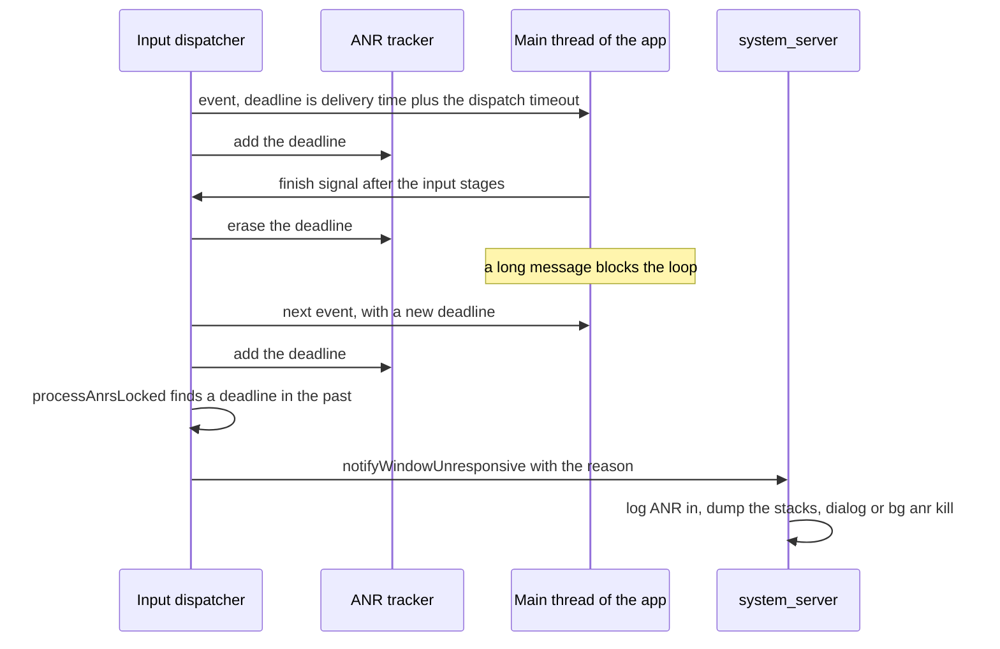

import Snippet from '../../../components/Snippet.astro';
import GoDeeper from '../../../components/GoDeeper.astro';

## The problem

The [main-thread chapter](/launch-path/main-thread/) shows that the main thread of an app runs one message loop. The loop runs one message at a time. If one message runs for a long time, all later messages wait, also the input events.

If an app in the foreground does not respond, the user sees the "Application Not Responding" (ANR) dialog. The dialog lets the user force quit the app. If the app is not in the foreground, the system stops the app silently[^responsive]. The ActivityManager and WindowManager system services monitor the responses of the app. The system shows the ANR dialog if the app does not respond to an input event, for example a key press or a tap, in 5 seconds. The system also shows it if a `BroadcastReceiver` does not finish in 10 to 20 seconds for a foreground intent[^responsive-triggers].

Android stops one type of slow work on the main thread by default: network access. When the app starts, the main thread handles the message `BIND_APPLICATION` and calls `handleBindApplication`[^activitythread-2754]. This method calls `StrictMode.initThreadDefaults` with the `ApplicationInfo` of the app[^activitythread-8132]. `initThreadDefaults` sets the default policy of the current thread. If the app targets Honeycomb or higher, the policy detects network access and has the penalty "death on network"[^strictmode-1586]. Then each network access on that thread throws `NetworkOnMainThreadException`[^strictmode-1844]. A StrictMode thread policy is a thread-local value[^strictmode-1379]. Thus this default applies to the main thread.

So the app moves slow work, network access included, to other threads. The official guide says that thread creation is expensive. Thus it tells you to create a thread pool one time, when the app starts, and to keep its `ExecutorService`, for example in the `Application` class[^java-threads-create]. To give a result back to the main thread, post the result with a `Handler` of the main `Looper`[^java-threads-handlers].

A thread pool keeps slow work away from the main thread. But how does the system find out that the main thread does not respond? The system times the work that it gives to the app. An input dispatch ANR occurs if the main thread does not respond to an input event in time[^diagnose-input]. This chapter builds a naive input dispatcher that times the events. Its breaking test shows an ANR that the dispatcher does not report. Then the chapter follows the real dispatcher, the threads and pools of the app, and the ANR report.

## Build it naive

The rebuild is an input dispatcher in plain Kotlin, in the module `samples/threads-and-anr`. It follows the ANR rule of the dispatcher of Android 10. It uses no threads and no real time.

`FakeClock` is a fake clock and a scripted scheduler. `at` schedules an action at a time. `advanceTo` moves the time and runs each due action at its own time. Thus no test waits, and no thread runs:

<Snippet file="threads-and-anr/src/main/kotlin/NaiveInputDispatcher.kt" region="clock" />

`FakeWindow` stands in for a window and the main thread of its app. `receive` records each touch with its delivery time. The test gives the window one finish time for each touch, in order. At that time, the clock calls `onFinish`, the stand-in for the finish signal that the app sends back to the dispatcher. If a touch has no finish time, the window never finishes it. A main thread that a long task blocks acts the same way:

<Snippet file="threads-and-anr/src/main/kotlin/NaiveInputDispatcher.kt" region="window" />

`NaiveInputDispatcher` keeps two queues. `inbound` holds the touches that the window did not get. `waitQueue` holds the delivery time of each touch that the window did not finish. The dispatcher sends a touch at once, unless the oldest unfinished touch is 500 ms old or older. In that case, the touch waits, and the dispatcher starts its one timer of 5000 ms. When the window finishes a touch, a touch that waits can go. If the timer runs out while a touch waits, the dispatcher reports an ANR: it adds the time to `anrs`.

<Snippet file="threads-and-anr/src/main/kotlin/NaiveInputDispatcher.kt" region="dispatcher" />

Four tests check the normal cases:

- A touch goes to the window at once if the window has no unfinished touch.
- A touch goes at once if the oldest unfinished touch is 499 ms old.
- If the oldest unfinished touch is 500 ms old, a new touch waits until the window finishes the oldest touch.
- Each wait gets a new timer. Two touches wait one after the other. The second wait ends 5100 ms after the first wait starts, and the dispatcher reports no ANR.

<GoDeeper title="the dispatcher of Android 10">

In Android 10, `InputDispatcher.cpp` gives the two values in nanoseconds. `DEFAULT_INPUT_DISPATCHING_TIMEOUT` is 5 s[^inputdispatcher-10-74], and `STREAM_AHEAD_EVENT_TIMEOUT` is 0.5 s[^inputdispatcher-10-89]. A touch waits if the wait queue of the window is not empty, and the dispatcher delivered the head of the queue 500 ms ago or earlier[^inputdispatcher-10-1893]. A key event waits if the window has any unfinished event[^inputdispatcher-10-1862]. The rebuild models only touches.

`startDispatchCycleLocked` records the delivery time of each event that it sends[^inputdispatcher-10-2201]. The timer starts in `handleTargetsNotReadyLocked`, when an event starts to wait for the window. The end of the timer is the current time plus the timeout[^inputdispatcher-10-1091]. If the current time reaches the end, the dispatcher calls `onANRLocked`[^inputdispatcher-10-1126]. Before the dispatcher handles a new event, it resets the timer[^inputdispatcher-10-383][^inputdispatcher-10-1188]. Thus each wait gets a new timer.

</GoDeeper>

## Where it breaks

The dispatcher starts its timer only when a touch must wait. Nothing times a touch that the window already has. The first breaking test sends one touch to a window that never finishes it. Then the test moves the clock to 60 s:

<Snippet file="threads-and-anr/src/test/kotlin/NaiveInputDispatcherTest.kt" region="flaw" />

The test passes, so the flaw occurs. For 60 s, the window does not finish the touch, and the dispatcher reports no ANR. A long task blocks the main thread of the app, but the dispatcher does nothing.

The second breaking test shows a late ANR. The window never finishes the first touch. At t=10000, a second touch comes. The first touch is 500 ms old or older, so the second touch waits, and the timer starts only at that time:

<Snippet file="threads-and-anr/src/test/kotlin/NaiveInputDispatcherTest.kt" region="late-anr" />

The ANR comes at t=15000, 15 s after the first touch. The time of the ANR depends on the next touch of the user, not on the touch that the window did not finish.

The dispatcher of Android 10 had the same flaw. For a touch, it started the timer only when it found the window not ready for more input[^inputdispatcher-10-1560][^inputdispatcher-10-1091]. "The real thing" shows how Android 11 and later fix the flaw.

## The real thing

### The dispatcher sets a deadline for each event

The real dispatcher times each event that it sends, not only an event that waits. When the dispatcher sends an event to a window, `startDispatchCycleLocked` sets two times on the event: the delivery time and a deadline. The deadline is the delivery time plus the dispatch timeout[^inputdispatcher-3893]. Then the event goes into the wait queue of the connection to the window. If the connection is responsive, the dispatcher adds the deadline to `mAnrTracker`[^inputdispatcher-4025]. When the app finishes the event, the dispatcher removes the event from the wait queue and erases its deadline from the tracker[^inputdispatcher-6737].

`AnrTracker` keeps the deadlines of all connections in one sorted set. Thus the dispatcher finds the next deadline fast[^anrtracker-25][^anrtracker-44].

The dispatcher has its own thread, `InputDispatcher`, which runs `dispatchOnce`[^inputdispatcher-963]. Near the end of `dispatchOnce`, the dispatcher calls `processAnrsLocked`. The next wake time is at most the time that `processAnrsLocked` returns[^inputdispatcher-1001]. Then the thread sleeps until that time, a callback or a wake[^inputdispatcher-1022].

`processAnrsLocked` compares the current time with the earliest deadline. If the deadline is in the future, the method returns the deadline as the time of the next check. If not, the method marks the connection as not responsive, erases all deadlines of the connection, and calls `onAnrLocked`[^inputdispatcher-1143].

`onAnrLocked` takes the oldest event in the wait queue. It builds the reason `<window> is not responding. Waited <n>ms for <event>`, where `<n>` is the time since the delivery of that event[^inputdispatcher-6792]. Then the dispatcher sends the reason and the PID of the owner of the window to its policy, with `notifyWindowUnresponsive`[^inputdispatcher-6930][^inputdispatcher-6905].

The default timeout, `DEFAULT_INPUT_DISPATCHING_TIMEOUT`, is `UNMULTIPLIED_DEFAULT_DISPATCHING_TIMEOUT_MILLIS` times `HwTimeoutMultiplier()`[^inputdispatcher-125]. `UNMULTIPLIED_DEFAULT_DISPATCHING_TIMEOUT_MILLIS` is 5000 ms. A comment says to multiply it by the value of the system property `ro.hw_timeout_multiplier`[^iinputconstants-23]. The window of a connection gives the dispatch timeout of the connection, with `DEFAULT_INPUT_DISPATCHING_TIMEOUT` as the default[^inputdispatcher-1195]. Prompt 2 of "Try it" reads the multiplier.

Since Android 11, the dispatcher sets a deadline for each event that it sends, and adds the deadline to the ANR tracker[^inputdispatcher-11-2467][^inputdispatcher-11-2602]. It raises an ANR when the earliest deadline passes, also if no later event comes[^inputdispatcher-11-489]. Before, the dispatcher of Android 10 started its timer only when a later event had to wait for the window, as the rebuild does[^inputdispatcher-10-1091]. In Android 10 and 11, the default timeout is 5 s, with no multiplier[^inputdispatcher-10-74][^inputdispatcher-11-81].

### The app finishes an event after its input stages

The [first-frame chapter](/launch-path/first-frame/) shows that the main thread makes the `ViewRootImpl` of the activity window when the activity resumes. `ViewRootImpl` creates the input receiver of its window with the `Looper` of the current thread[^viewrootimpl-1898]. Thus the events of the activity window come to the main thread.

`deliverInputEvent` passes each event through the input stages of the window[^viewrootimpl-11293]. After the last stage, `finishInputEvent` tells the receiver that the event is finished[^viewrootimpl-7970][^viewrootimpl-11347]. This is the finish signal that the dispatcher waits for. While a long message blocks the main thread, the app finishes no event, and the deadline of the oldest event passes.

A tap does not call `onClick` inside its touch events. On `ACTION_UP`, `View` posts a `PerformClick` runnable. A comment gives the reason: other visual state of the view can update before the click actions start[^view-18511]. `post` adds the runnable to the message queue of the main thread[^view-21709]. Later, the main thread runs `PerformClick`, which calls `performClickInternal`[^view-32178]. Thus the touch events of the tap finish before `onClick` runs. If `onClick` then blocks the main thread, the dispatcher has no unfinished event. The ANR comes only after a later input event, when the deadline of that event passes. Prompt 3 of "Try it" shows this.

### system_server reports the ANR

The window manager handles an unresponsive window in `AnrController.notifyWindowUnresponsive`[^anrcontroller-247]. It finds the window of the input token. If the token belongs to the window of an activity, the activity reports the ANR. If not, the window manager reports the ANR to the activity manager with the PID[^anrcontroller-271]. The activity reports the ANR to the activity manager with its short component name[^activityrecord-6819]. The activity manager gives the ANR to its ANR helper[^activitymanagerservice-19328].

`appNotResponding` of `ProcessErrorStateRecord` handles the ANR of one process[^processerrorstaterecord-349]:

1. It puts the app process first in the list of processes to dump[^processerrorstaterecord-484]. It writes the stack traces of these processes to a file[^processerrorstaterecord-628].
2. It writes `ANR in <process> (<activity>)`, `PID: <pid>` and `Reason: <reason>` to the log[^processerrorstaterecord-536][^processerrorstaterecord-656].
3. For a silent ANR, it kills the process with the reason `bg anr`[^processerrorstaterecord-779]. For other ANRs, it can show the ANR dialog[^processerrorstaterecord-800].

An ANR is silent if the user did not turn on the setting that shows background ANRs, and `isInterestingForBackgroundTraces` returns false. For example, this method returns true for a process that shows an activity[^processerrorstaterecord-863][^processerrorstaterecord-930].

<GoDeeper title="the ANR trace">

`StackTracesDumpHelper` writes the stack dump into a new file `anr_<date and time>` in `/data/anr`. Only the owner of the file can read it[^stacktracesdumphelper-74][^stacktracesdumphelper-542]. For a Java process, the helper calls `Debug.dumpJavaBacktraceToFileTimeout`[^stacktracesdumphelper-643]. This native method asks debuggerd for a Java backtrace (`kDebuggerdJavaBacktrace`) through `dump_backtrace_to_file_timeout`[^android-os-debug-609][^android-os-debug-616]. For a Java backtrace, the debuggerd client sends `SIGQUIT` to the process[^debuggerd-client-234].

ART runs a thread named "Signal Catcher" that waits for `SIGQUIT`[^signal-catcher-229]. On `SIGQUIT`, this thread writes a dump that starts with `----- pid <pid> at <date> -----`. Then it adds the dump of the runtime, `DumpForSigQuit`[^signal-catcher-128]. The thread gives the dump to tombstoned[^signal-catcher-117]. Prompt 2 of "Try it" shows the Signal Catcher thread of the launch app, and prompt 3 reads its dump.

</GoDeeper>

### Services and broadcasts use the same pattern

Other types of ANR also use a timer. `system_server` starts the timer when it gives work to the app, and cancels the timer when the app reports that the work is done:

- **Service.** `scheduleServiceTimeoutLocked` starts the timer of the process with `SERVICE_TIMEOUT` if the process executes the service call in the foreground, and with `SERVICE_BACKGROUND_TIMEOUT` if not[^activeservices-8468]. When no service of the process executes, `serviceDoneExecutingLocked` cancels the timer[^activeservices-7363]. If the timer runs out, `serviceTimeout` finds the service that executes for too long, and gives the ANR to the ANR helper[^activeservices-8294]. By default, `SERVICE_TIMEOUT` is 20 s times the hardware timeout multiplier, and `SERVICE_BACKGROUND_TIMEOUT` is 10 times that value[^activitymanagerconstants-318].
- **Broadcast.** When the broadcast queue gives a broadcast to a receiver, it starts a timer with the timeout of a foreground or a background broadcast[^broadcastqueueimpl-1255]. The timer can extend[^broadcastqueueimpl-1461]. If the timer runs out, the queue calls `appNotResponding`[^broadcastqueueimpl-1446][^broadcastqueueimpl-1586]. The timeout is 10 s for a foreground broadcast and 60 s for a background broadcast, each times the hardware timeout multiplier[^activitymanagerservice-663][^activitymanagerservice-20153].

Since Android 14, the modern broadcast queue, `BroadcastQueueModernImpl`, extends the timeout one time by the time that the process waited for the CPU, at most by the timeout itself[^broadcastqueuemodernimpl-14-1009][^broadcastqueuemodernimpl-14-1152]. Thus the timeout is 10 to 20 s for a foreground broadcast, and 60 to 120 s for a background broadcast. Before, the timeouts were 10 s and 60 s[^diagnose-timeout-periods].

JobScheduler expects `onStartJob` and `onStopJob` of a `JobService` to return in a few seconds. Since Android 14, if an app targets Android 14 or higher and one of these callbacks takes longer than the granted time on the main thread, the app gets an ANR. The message of the ANR is "No response to onStartJob" or "No response to onStopJob". Before, the job stopped and failed silently[^behavior-changes-14-jobscheduler].

### A Java thread is a Linux thread

The app moves slow work to other threads. `Thread.start()` calls `nativeCreate`, a native method that Android adds[^thread-1430][^thread-1550]. In ART, `nativeCreate` calls `Thread::CreateNativeThread`[^java-lang-thread-89]. This method calls `pthread_create` with a detached attribute and a stack size[^art-thread-1008]. Thus each thread that `Thread.start()` creates is a Linux thread. Prompt 2 of "Try it" lists the threads of the launch app, each with its thread ID (TID).

Before the call, `FixStackSize` adds 1 MB to the requested or default stack size[^art-thread-775]. Thus the stack of each thread that `Thread.start()` creates is larger than 1 MB. The new thread sets its name and its niceness, and then calls the `run()` method of its `java.lang.Thread`. When `run()` returns, the thread ends[^art-thread-685][^art-thread-745]. Linux uses a niceness from -20, the highest scheduling priority, to 19, the lowest[^process-1392].

<GoDeeper title="Java priority and niceness">

Java priorities go from 1 (`MIN_PRIORITY`) to 10 (`MAX_PRIORITY`). The default is 5 (`NORM_PRIORITY`)[^thread-454]. A new `Thread` gets the Java priority of its parent, and the niceness that maps to that priority[^thread-875]. If the API level of the device is above 32, ART gets its map from Java priority to niceness from `PaletteMapPriority` of libartpalette[^art-thread-4933][^art-thread-4988][^palette-android-103]. Priority 5 maps to `ANDROID_PRIORITY_NORMAL`, niceness 0. Priority 1 maps to `ANDROID_PRIORITY_LOWEST`, niceness 19[^palette-android-44][^thread-defs-41].

</GoDeeper>

### A pool keeps its threads

A `ThreadPoolExecutor` keeps its threads, the workers, and gives new tasks to them. `execute()` has three steps[^threadpoolexecutor-1302]:

1. If fewer than `corePoolSize` threads run, it starts a new worker with the task as its first task.
2. If not, it puts the task into the work queue.
3. If the queue refuses the task, it tries to start a new worker. If it cannot start a worker, it rejects the task.

Each worker runs tasks in a loop, and gets each next task from `getTask`[^threadpoolexecutor-1079]. If the worker has no idle time limit, `getTask` blocks in `workQueue.take()` until a task comes[^threadpoolexecutor-1011]. Thus an idle worker thread stays alive and waits.

`Executors.newFixedThreadPool(n)` makes a `ThreadPoolExecutor` with n core threads, n maximum threads and an unbounded `LinkedBlockingQueue`. If all threads are busy, extra tasks wait in the queue[^executors-78]. The threads come from the default thread factory[^threadpoolexecutor-1148]. This factory names each thread `pool-N-thread-M`, makes it a non-daemon thread and gives it `NORM_PRIORITY`. N counts the factories of the process, and M counts the threads of one factory[^executors-584].

Do not use the same threads for long work that blocks and for work that must be fast, for example the receipt of broadcasts[^responsive-avoid].

A `ScheduledThreadPoolExecutor` can run a task again and again. After each run, `setNextRunTime` sets the next time of the task[^scheduledthreadpoolexecutor-284]. Since Android 16, if an app targets Android 16 or higher, `scheduleAtFixedRate` runs at most one missed run at once when the app comes back to a valid process lifecycle. Before, it ran all missed runs at once[^behavior-changes-16-fixed-rate]. Some later builds of Android 15, for example the AOSP tag `android-15.0.0_r6`, already have this rule for apps that target Android 16 or higher[^scheduledthreadpoolexecutor-15r6-157][^scheduledthreadpoolexecutor-15r6-311]. At the baseline, `setNextRunTime` has no check of the target SDK, so the rule applies to all apps[^scheduledthreadpoolexecutor-284].

### HandlerThread and the niceness of a thread

`HandlerThread` is a `Thread` that has a `Looper`[^handlerthread-24]. Its `run()` prepares the `Looper`, sets the niceness of the thread with `Process.setThreadPriority`, and runs the loop[^handlerthread-129]. The [main-thread chapter](/launch-path/main-thread/) explains the loop. The niceness comes from the constructor. If the constructor gets no niceness, the niceness is `THREAD_PRIORITY_DEFAULT`[^handlerthread-92].

`Process.setThreadPriority` takes a Linux niceness, not a Java priority[^process-1392]. `THREAD_PRIORITY_DEFAULT` is 0[^process-410]. `THREAD_PRIORITY_BACKGROUND` is 10. A comment says that a thread with this niceness has less chance to slow down the user interface[^process-433].

The system also changes the niceness of the main thread. When the process of an app becomes the top app, `OomAdjuster` boosts its main thread: the thread whose TID is the PID of the process. If the process does not use FIFO scheduling for the UI, `OomAdjuster` sets the niceness of that thread to `THREAD_PRIORITY_TOP_APP_BOOST`, -10[^oomadjuster-2386][^process-481]. Prompt 2 of "Try it" shows the niceness of each thread.

## Mental model

The main thread runs one message loop, so a long message blocks each input event after it. The system times the work that it gives to the app. The input dispatcher gives each event that it sends a deadline: the delivery time plus the dispatch timeout of the window, by default 5 s times the hardware multiplier. The deadline goes into one sorted set for all windows. The main thread finishes an event after the input stages of the window, and the finish signal erases the deadline. If the earliest deadline passes first, the dispatcher reports the window as unresponsive, also if no later event comes. Then `system_server` logs `ANR in`, dumps the stacks with the help of the Signal Catcher of ART, and shows the dialog or, for a silent ANR, kills the process. A click runs later as a message, so a slow `onClick` gets an ANR only after the next event. Services and broadcasts use the same timer pattern. To keep the main thread free, the app gives slow work to other threads. Each Java thread is a Linux thread with its own stack and niceness. Thus a pool creates a few threads one time, and its idle workers wait in the queue for the next task.



## Try it

### 1. Give each touch a deadline

Give the rebuild the fix of the real dispatcher. Change `NaiveInputDispatcher`:

1. Add a list of deadlines. In `send`, add a deadline for the touch: the current time plus `DEFAULT_INPUT_DISPATCHING_TIMEOUT`. Then call `clock.at` with the deadline, so that the dispatcher checks the deadlines at that time.
2. In the `onFinish` action of `send`, remove the deadline of the touch.
3. In the check, if the current time is at the earliest deadline or after it, add the time to `anrs`. Then clear the list, so that the dispatcher reports the window one time.

From the repo root, run the tests of the rebuild:

```sh
samples/gradlew -p samples :threads-and-anr:test
```

Both breaking tests fail, because the flaw is gone. The window does not finish the first touch, so its deadline passes at t=5000. The first breaking test now gets the ANRs `[5000]`, and the second gets `[5000, 15000]`. The four other tests pass, because no deadline passes in them. The Gradle output includes these lines:

```
NaiveInputDispatcherTest > naiveDispatcher_reportsAnrAt15000_whenSecondTapComesAt10000() FAILED
    org.opentest4j.AssertionFailedError at NaiveInputDispatcherTest.kt:73

NaiveInputDispatcherTest > naiveDispatcher_reportsNoAnr_whenWindowNeverFinishesTheOnlyEvent() FAILED
    org.opentest4j.AssertionFailedError at NaiveInputDispatcherTest.kt:59

6 tests completed, 2 failed
```

The real dispatcher does the same work with one sorted set for all windows, `AnrTracker`, and one check, `processAnrsLocked`[^anrtracker-44][^inputdispatcher-1143].

### 2. List the threads of the launch app

Start an emulator with the system image of the checked stamp. From the repo root, install the release build of the `threadsAndAnr` flavor of the launch app:

```sh
samples/gradlew -p samples :launch-app:installThreadsAndAnrRelease
```

The flavor has one activity, `AnrActivity`. In `onCreate`, the activity starts `Executors.newFixedThreadPool(2)` with two short tasks. It also starts a `HandlerThread` with the name `worker` and the niceness `THREAD_PRIORITY_BACKGROUND`. Its content is one `TextView`. A click on the `TextView` makes the main thread sleep for 30 s.

Read the multiplier of the system timeouts:

```sh
adb shell getprop ro.hw_timeout_multiplier
```

{/* Edit step: capture this output on the emulator of the checked stamp. */}

```
…
```

If the output is a number, it multiplies the 5 s input timeout[^iinputconstants-23].

Start the app:

```sh
adb shell am start -W -n io.github.imgurpreetsk.afp.launchapp.threadsAndAnr/io.github.imgurpreetsk.afp.launchapp.AnrActivity
```

List the threads of the app:

```sh
adb shell 'ps -T -o TID,NI,CMD -p $(pidof io.github.imgurpreetsk.afp.launchapp.threadsAndAnr)'
```

{/* Edit step: capture this output on the emulator of the checked stamp. */}

```
  TID  NI CMD
    … -10 …
…
    …   … Signal Catcher
…
    …   0 pool-…-thread-1
    …   0 pool-…-thread-2
    …  10 worker
…
```

In the block, a line `…` stands for lines that the block leaves out. `-T` shows the threads, `-p` selects the process, and `-o` selects the fields[^ps-61]. `TID` is the thread ID, `NI` is the niceness, and `CMD` is the thread name from `/proc/TID/stat`[^ps-326]. Each line is one Linux thread of the process:

- The thread whose TID is the PID of the process is the main thread. It shows NI -10, because `OomAdjuster` boosts it while the app is the top app. If the device uses FIFO scheduling for the UI, `OomAdjuster` does not set this niceness[^oomadjuster-2386].
- `Signal Catcher` is the ART thread that writes the stack dump of an ANR[^signal-catcher-229].
- `pool-…-thread-1` and `pool-…-thread-2` are the two workers of the pool. The default thread factory gives them these names and `NORM_PRIORITY`[^executors-584]. `NORM_PRIORITY` maps to niceness 0[^palette-android-44]. After their tasks, the workers wait in `workQueue.take()`[^threadpoolexecutor-1011].
- `worker` is the `HandlerThread`. It shows NI 10, because its `run()` calls `Process.setThreadPriority` with `THREAD_PRIORITY_BACKGROUND`[^handlerthread-129][^process-433].

### 3. Get an ANR from a click, and read the trace

Clear the log. Then tap the `TextView` one time, wait 10 s, and look for an ANR in the log:

```sh
adb logcat -c
adb shell input tap 500 1000
sleep 10
adb shell 'logcat -d -s ActivityManager | grep "ANR in"'
```

{/* Edit step: make sure on the emulator of the checked stamp that the last command prints no line. */}

The last command prints no line, although the click blocks the main thread. `View` posted the click as a message, so the touch events of the tap finished before `onClick` ran[^view-18511][^view-21709]. The dispatcher has no unfinished event, so no deadline passes.

While the main thread still sleeps, tap again. Wait 10 s, and read the log again, with the three lines after the match:

```sh
adb shell input tap 500 1000
sleep 10
adb shell 'logcat -d -s ActivityManager | grep -A 3 "ANR in"'
```

{/* Edit step: capture this output on the emulator of the checked stamp. */}

```
… E ActivityManager: ANR in io.github.imgurpreetsk.afp.launchapp.threadsAndAnr (io.github.imgurpreetsk.afp.launchapp.threadsAndAnr/io.github.imgurpreetsk.afp.launchapp.AnrActivity)
… E ActivityManager: PID: …
… E ActivityManager: Reason: … is not responding. Waited …ms for MotionEvent…
… E ActivityManager: …
```

- `ProcessErrorStateRecord` writes the first three lines[^processerrorstaterecord-536]. The name of the activity comes from `ActivityRecord`[^activityrecord-6819].
- The reason comes from `onAnrLocked` of the dispatcher[^inputdispatcher-6792]. The wait is about 5000 ms times the multiplier of prompt 2. It counts from the delivery of the second tap, and no later event came. This is the deadline for each event that the rebuild does not have. `system_server` writes the `ANR in`, `PID` and `Reason` lines only after it writes the stack traces to a file[^processerrorstaterecord-628][^processerrorstaterecord-656]. A comment says that the dump of the stacks can take a few seconds[^processerrorstaterecord-558]. If the multiplier is more than 1, the ANR also comes later. If the command prints no line, wait 5 s, and run the last command again.
- The emulator also shows the ANR dialog. The app shows an activity, so the ANR is not silent[^processerrorstaterecord-863][^processerrorstaterecord-800]. When the sleep of the main thread ends, about 30 s after the first tap, the main thread finishes the events of the second tap. If no event in the wait queue of the window is then past its deadline, the dispatcher marks the connection as responsive again and tells its policy[^inputdispatcher-6745][^inputdispatcher-540][^inputdispatcher-6952]. The window manager tells the activity manager, and the activity manager dismisses the ANR dialogs of the process[^anrcontroller-341][^activitymanagerservice-18469]. Thus the dialog closes by itself.

Only the owner of an ANR file can read it[^stacktracesdumphelper-542]. Thus restart adbd as root, and list the files in `/data/anr`. Prompt 2 of the [main-thread chapter](/launch-path/main-thread/) shows how to make sure that the image allows `adb root`.

```sh
adb root
adb shell ls /data/anr
```

{/* Edit step: capture this output on the emulator of the checked stamp. */}

```
anr_…
```

The name of the file is `anr_` and the date and time[^stacktracesdumphelper-74][^stacktracesdumphelper-542]. In the next commands, put the name of the file in place of `<file>`. Print the header of each process dump, and the stack of the first thread with the name `main`:

```sh
adb shell 'grep -- "----- pid" /data/anr/<file>'
adb shell 'grep -m 1 -A 30 "^\"main\"" /data/anr/<file>'
```

{/* Edit step: capture this output on the emulator of the checked stamp. */}

```
----- pid … at … -----
…
"main" … Sleeping
…
  at java.lang.Thread.sleep(Native method)
…
  at io.github.imgurpreetsk.afp.launchapp.AnrActivity.onClick(AnrActivity.java:…)
  at android.view.View.performClick(View.java:…)
…
  at android.os.Handler.handleCallback(Handler.java:…)
…
  at android.os.Looper.loopOnce(Looper.java:…)
…
```

- The Signal Catcher of ART writes the header `----- pid … at … -----` on `SIGQUIT`[^signal-catcher-128]. `system_server` puts the app first in the list of processes to dump, so the first header is the header of the app[^processerrorstaterecord-484]. `-m 1` stops `grep` at the first match. Thus the `main` thread of the output is the main thread of the app.
- The main thread sleeps in `Thread.sleep`. `AnrActivity.onClick` calls it, under `View.performClick`, `Handler.handleCallback` and `Looper.loopOnce`. Thus the stack shows that the click ran as a message of the main loop and blocked it.

At the end, stop the app:

```sh
adb shell am force-stop io.github.imgurpreetsk.afp.launchapp.threadsAndAnr
```

[^responsive]: Keep your app responsive: [https://developer.android.com/topic/performance/anrs/keep-your-app-responsive](https://developer.android.com/topic/performance/anrs/keep-your-app-responsive)
[^responsive-triggers]: Keep your app responsive, "ANR triggers": [https://developer.android.com/topic/performance/anrs/keep-your-app-responsive#anr-triggers](https://developer.android.com/topic/performance/anrs/keep-your-app-responsive#anr-triggers)
[^activitythread-2754]: ActivityThread.java, lines 2754–2761: [https://android.googlesource.com/platform/frameworks/base/+/refs/tags/android-17.0.0_r1/core/java/android/app/ActivityThread.java#2754](https://android.googlesource.com/platform/frameworks/base/+/refs/tags/android-17.0.0_r1/core/java/android/app/ActivityThread.java#2754)
[^activitythread-8132]: ActivityThread.java, line 8132: [https://android.googlesource.com/platform/frameworks/base/+/refs/tags/android-17.0.0_r1/core/java/android/app/ActivityThread.java#8132](https://android.googlesource.com/platform/frameworks/base/+/refs/tags/android-17.0.0_r1/core/java/android/app/ActivityThread.java#8132)
[^strictmode-1586]: StrictMode.java, lines 1586–1601: [https://android.googlesource.com/platform/frameworks/base/+/refs/tags/android-17.0.0_r1/core/java/android/os/StrictMode.java#1586](https://android.googlesource.com/platform/frameworks/base/+/refs/tags/android-17.0.0_r1/core/java/android/os/StrictMode.java#1586)
[^strictmode-1844]: StrictMode.java, lines 1844–1850: [https://android.googlesource.com/platform/frameworks/base/+/refs/tags/android-17.0.0_r1/core/java/android/os/StrictMode.java#1844](https://android.googlesource.com/platform/frameworks/base/+/refs/tags/android-17.0.0_r1/core/java/android/os/StrictMode.java#1844)
[^strictmode-1379]: StrictMode.java, lines 1379–1385: [https://android.googlesource.com/platform/frameworks/base/+/refs/tags/android-17.0.0_r1/core/java/android/os/StrictMode.java#1379](https://android.googlesource.com/platform/frameworks/base/+/refs/tags/android-17.0.0_r1/core/java/android/os/StrictMode.java#1379)
[^java-threads-create]: Asynchronous work with Java threads, "Create multiple threads": [https://developer.android.com/develop/background-work/background-tasks/asynchronous/java-threads#create-multiple](https://developer.android.com/develop/background-work/background-tasks/asynchronous/java-threads#create-multiple)
[^java-threads-handlers]: Asynchronous work with Java threads, "Use handlers": [https://developer.android.com/develop/background-work/background-tasks/asynchronous/java-threads#use-handlers](https://developer.android.com/develop/background-work/background-tasks/asynchronous/java-threads#use-handlers)
[^diagnose-input]: Diagnose and fix ANRs, "Input dispatch timeout": [https://developer.android.com/topic/performance/anrs/diagnose-and-fix-anrs#input-dispatch](https://developer.android.com/topic/performance/anrs/diagnose-and-fix-anrs#input-dispatch)
[^inputdispatcher-10-74]: InputDispatcher.cpp at android-10.0.0_r1, line 74: [https://android.googlesource.com/platform/frameworks/native/+/refs/tags/android-10.0.0_r1/services/inputflinger/InputDispatcher.cpp#74](https://android.googlesource.com/platform/frameworks/native/+/refs/tags/android-10.0.0_r1/services/inputflinger/InputDispatcher.cpp#74)
[^inputdispatcher-10-89]: InputDispatcher.cpp at android-10.0.0_r1, line 89: [https://android.googlesource.com/platform/frameworks/native/+/refs/tags/android-10.0.0_r1/services/inputflinger/InputDispatcher.cpp#89](https://android.googlesource.com/platform/frameworks/native/+/refs/tags/android-10.0.0_r1/services/inputflinger/InputDispatcher.cpp#89)
[^inputdispatcher-10-1893]: InputDispatcher.cpp at android-10.0.0_r1, lines 1893–1898: [https://android.googlesource.com/platform/frameworks/native/+/refs/tags/android-10.0.0_r1/services/inputflinger/InputDispatcher.cpp#1893](https://android.googlesource.com/platform/frameworks/native/+/refs/tags/android-10.0.0_r1/services/inputflinger/InputDispatcher.cpp#1893)
[^inputdispatcher-10-1862]: InputDispatcher.cpp at android-10.0.0_r1, lines 1862–1879: [https://android.googlesource.com/platform/frameworks/native/+/refs/tags/android-10.0.0_r1/services/inputflinger/InputDispatcher.cpp#1862](https://android.googlesource.com/platform/frameworks/native/+/refs/tags/android-10.0.0_r1/services/inputflinger/InputDispatcher.cpp#1862)
[^inputdispatcher-10-2201]: InputDispatcher.cpp at android-10.0.0_r1, lines 2201–2204: [https://android.googlesource.com/platform/frameworks/native/+/refs/tags/android-10.0.0_r1/services/inputflinger/InputDispatcher.cpp#2201](https://android.googlesource.com/platform/frameworks/native/+/refs/tags/android-10.0.0_r1/services/inputflinger/InputDispatcher.cpp#2201)
[^inputdispatcher-10-1091]: InputDispatcher.cpp at android-10.0.0_r1, lines 1091–1109: [https://android.googlesource.com/platform/frameworks/native/+/refs/tags/android-10.0.0_r1/services/inputflinger/InputDispatcher.cpp#1091](https://android.googlesource.com/platform/frameworks/native/+/refs/tags/android-10.0.0_r1/services/inputflinger/InputDispatcher.cpp#1091)
[^inputdispatcher-10-1126]: InputDispatcher.cpp at android-10.0.0_r1, lines 1126–1128: [https://android.googlesource.com/platform/frameworks/native/+/refs/tags/android-10.0.0_r1/services/inputflinger/InputDispatcher.cpp#1126](https://android.googlesource.com/platform/frameworks/native/+/refs/tags/android-10.0.0_r1/services/inputflinger/InputDispatcher.cpp#1126)
[^inputdispatcher-10-383]: InputDispatcher.cpp at android-10.0.0_r1, lines 383–384: [https://android.googlesource.com/platform/frameworks/native/+/refs/tags/android-10.0.0_r1/services/inputflinger/InputDispatcher.cpp#383](https://android.googlesource.com/platform/frameworks/native/+/refs/tags/android-10.0.0_r1/services/inputflinger/InputDispatcher.cpp#383)
[^inputdispatcher-10-1188]: InputDispatcher.cpp at android-10.0.0_r1, lines 1188–1196: [https://android.googlesource.com/platform/frameworks/native/+/refs/tags/android-10.0.0_r1/services/inputflinger/InputDispatcher.cpp#1188](https://android.googlesource.com/platform/frameworks/native/+/refs/tags/android-10.0.0_r1/services/inputflinger/InputDispatcher.cpp#1188)
[^inputdispatcher-10-1560]: InputDispatcher.cpp at android-10.0.0_r1, lines 1560–1570: [https://android.googlesource.com/platform/frameworks/native/+/refs/tags/android-10.0.0_r1/services/inputflinger/InputDispatcher.cpp#1560](https://android.googlesource.com/platform/frameworks/native/+/refs/tags/android-10.0.0_r1/services/inputflinger/InputDispatcher.cpp#1560)
[^inputdispatcher-3893]: InputDispatcher.cpp, lines 3893–3905: [https://android.googlesource.com/platform/frameworks/native/+/refs/tags/android-17.0.0_r1/services/inputflinger/dispatcher/InputDispatcher.cpp#3893](https://android.googlesource.com/platform/frameworks/native/+/refs/tags/android-17.0.0_r1/services/inputflinger/dispatcher/InputDispatcher.cpp#3893)
[^inputdispatcher-4025]: InputDispatcher.cpp, lines 4025–4032: [https://android.googlesource.com/platform/frameworks/native/+/refs/tags/android-17.0.0_r1/services/inputflinger/dispatcher/InputDispatcher.cpp#4025](https://android.googlesource.com/platform/frameworks/native/+/refs/tags/android-17.0.0_r1/services/inputflinger/dispatcher/InputDispatcher.cpp#4025)
[^inputdispatcher-6737]: InputDispatcher.cpp, lines 6737–6744: [https://android.googlesource.com/platform/frameworks/native/+/refs/tags/android-17.0.0_r1/services/inputflinger/dispatcher/InputDispatcher.cpp#6737](https://android.googlesource.com/platform/frameworks/native/+/refs/tags/android-17.0.0_r1/services/inputflinger/dispatcher/InputDispatcher.cpp#6737)
[^anrtracker-25]: AnrTracker.h, lines 25–29: [https://android.googlesource.com/platform/frameworks/native/+/refs/tags/android-17.0.0_r1/services/inputflinger/dispatcher/AnrTracker.h#25](https://android.googlesource.com/platform/frameworks/native/+/refs/tags/android-17.0.0_r1/services/inputflinger/dispatcher/AnrTracker.h#25)
[^anrtracker-44]: AnrTracker.h, lines 44–54: [https://android.googlesource.com/platform/frameworks/native/+/refs/tags/android-17.0.0_r1/services/inputflinger/dispatcher/AnrTracker.h#44](https://android.googlesource.com/platform/frameworks/native/+/refs/tags/android-17.0.0_r1/services/inputflinger/dispatcher/AnrTracker.h#44)
[^inputdispatcher-963]: InputDispatcher.cpp, lines 963–971: [https://android.googlesource.com/platform/frameworks/native/+/refs/tags/android-17.0.0_r1/services/inputflinger/dispatcher/InputDispatcher.cpp#963](https://android.googlesource.com/platform/frameworks/native/+/refs/tags/android-17.0.0_r1/services/inputflinger/dispatcher/InputDispatcher.cpp#963)
[^inputdispatcher-1001]: InputDispatcher.cpp, lines 1001–1009: [https://android.googlesource.com/platform/frameworks/native/+/refs/tags/android-17.0.0_r1/services/inputflinger/dispatcher/InputDispatcher.cpp#1001](https://android.googlesource.com/platform/frameworks/native/+/refs/tags/android-17.0.0_r1/services/inputflinger/dispatcher/InputDispatcher.cpp#1001)
[^inputdispatcher-1022]: InputDispatcher.cpp, lines 1022–1025: [https://android.googlesource.com/platform/frameworks/native/+/refs/tags/android-17.0.0_r1/services/inputflinger/dispatcher/InputDispatcher.cpp#1022](https://android.googlesource.com/platform/frameworks/native/+/refs/tags/android-17.0.0_r1/services/inputflinger/dispatcher/InputDispatcher.cpp#1022)
[^inputdispatcher-1143]: InputDispatcher.cpp, lines 1143–1180: [https://android.googlesource.com/platform/frameworks/native/+/refs/tags/android-17.0.0_r1/services/inputflinger/dispatcher/InputDispatcher.cpp#1143](https://android.googlesource.com/platform/frameworks/native/+/refs/tags/android-17.0.0_r1/services/inputflinger/dispatcher/InputDispatcher.cpp#1143)
[^inputdispatcher-6792]: InputDispatcher.cpp, lines 6792–6821: [https://android.googlesource.com/platform/frameworks/native/+/refs/tags/android-17.0.0_r1/services/inputflinger/dispatcher/InputDispatcher.cpp#6792](https://android.googlesource.com/platform/frameworks/native/+/refs/tags/android-17.0.0_r1/services/inputflinger/dispatcher/InputDispatcher.cpp#6792)
[^inputdispatcher-6930]: InputDispatcher.cpp, lines 6930–6950: [https://android.googlesource.com/platform/frameworks/native/+/refs/tags/android-17.0.0_r1/services/inputflinger/dispatcher/InputDispatcher.cpp#6930](https://android.googlesource.com/platform/frameworks/native/+/refs/tags/android-17.0.0_r1/services/inputflinger/dispatcher/InputDispatcher.cpp#6930)
[^inputdispatcher-6905]: InputDispatcher.cpp, lines 6905–6914: [https://android.googlesource.com/platform/frameworks/native/+/refs/tags/android-17.0.0_r1/services/inputflinger/dispatcher/InputDispatcher.cpp#6905](https://android.googlesource.com/platform/frameworks/native/+/refs/tags/android-17.0.0_r1/services/inputflinger/dispatcher/InputDispatcher.cpp#6905)
[^inputdispatcher-125]: InputDispatcher.cpp, lines 125–129: [https://android.googlesource.com/platform/frameworks/native/+/refs/tags/android-17.0.0_r1/services/inputflinger/dispatcher/InputDispatcher.cpp#125](https://android.googlesource.com/platform/frameworks/native/+/refs/tags/android-17.0.0_r1/services/inputflinger/dispatcher/InputDispatcher.cpp#125)
[^iinputconstants-23]: IInputConstants.aidl, lines 23–26: [https://android.googlesource.com/platform/frameworks/native/+/refs/tags/android-17.0.0_r1/libs/input/android/os/IInputConstants.aidl#23](https://android.googlesource.com/platform/frameworks/native/+/refs/tags/android-17.0.0_r1/libs/input/android/os/IInputConstants.aidl#23)
[^inputdispatcher-1195]: InputDispatcher.cpp, lines 1195–1205: [https://android.googlesource.com/platform/frameworks/native/+/refs/tags/android-17.0.0_r1/services/inputflinger/dispatcher/InputDispatcher.cpp#1195](https://android.googlesource.com/platform/frameworks/native/+/refs/tags/android-17.0.0_r1/services/inputflinger/dispatcher/InputDispatcher.cpp#1195)
[^inputdispatcher-11-2467]: InputDispatcher.cpp at android-11.0.0_r1, lines 2467–2472: [https://android.googlesource.com/platform/frameworks/native/+/refs/tags/android-11.0.0_r1/services/inputflinger/dispatcher/InputDispatcher.cpp#2467](https://android.googlesource.com/platform/frameworks/native/+/refs/tags/android-11.0.0_r1/services/inputflinger/dispatcher/InputDispatcher.cpp#2467)
[^inputdispatcher-11-2602]: InputDispatcher.cpp at android-11.0.0_r1, lines 2602–2611: [https://android.googlesource.com/platform/frameworks/native/+/refs/tags/android-11.0.0_r1/services/inputflinger/dispatcher/InputDispatcher.cpp#2602](https://android.googlesource.com/platform/frameworks/native/+/refs/tags/android-11.0.0_r1/services/inputflinger/dispatcher/InputDispatcher.cpp#2602)
[^inputdispatcher-11-489]: InputDispatcher.cpp at android-11.0.0_r1, lines 489–523: [https://android.googlesource.com/platform/frameworks/native/+/refs/tags/android-11.0.0_r1/services/inputflinger/dispatcher/InputDispatcher.cpp#489](https://android.googlesource.com/platform/frameworks/native/+/refs/tags/android-11.0.0_r1/services/inputflinger/dispatcher/InputDispatcher.cpp#489)
[^inputdispatcher-11-81]: InputDispatcher.cpp at android-11.0.0_r1, line 81: [https://android.googlesource.com/platform/frameworks/native/+/refs/tags/android-11.0.0_r1/services/inputflinger/dispatcher/InputDispatcher.cpp#81](https://android.googlesource.com/platform/frameworks/native/+/refs/tags/android-11.0.0_r1/services/inputflinger/dispatcher/InputDispatcher.cpp#81)
[^viewrootimpl-1898]: ViewRootImpl.java, lines 1898–1899: [https://android.googlesource.com/platform/frameworks/base/+/refs/tags/android-17.0.0_r1/core/java/android/view/ViewRootImpl.java#1898](https://android.googlesource.com/platform/frameworks/base/+/refs/tags/android-17.0.0_r1/core/java/android/view/ViewRootImpl.java#1898)
[^viewrootimpl-11293]: ViewRootImpl.java, lines 11293–11345: [https://android.googlesource.com/platform/frameworks/base/+/refs/tags/android-17.0.0_r1/core/java/android/view/ViewRootImpl.java#11293](https://android.googlesource.com/platform/frameworks/base/+/refs/tags/android-17.0.0_r1/core/java/android/view/ViewRootImpl.java#11293)
[^viewrootimpl-7970]: ViewRootImpl.java, lines 7970–7979: [https://android.googlesource.com/platform/frameworks/base/+/refs/tags/android-17.0.0_r1/core/java/android/view/ViewRootImpl.java#7970](https://android.googlesource.com/platform/frameworks/base/+/refs/tags/android-17.0.0_r1/core/java/android/view/ViewRootImpl.java#7970)
[^viewrootimpl-11347]: ViewRootImpl.java, lines 11347–11368: [https://android.googlesource.com/platform/frameworks/base/+/refs/tags/android-17.0.0_r1/core/java/android/view/ViewRootImpl.java#11347](https://android.googlesource.com/platform/frameworks/base/+/refs/tags/android-17.0.0_r1/core/java/android/view/ViewRootImpl.java#11347)
[^view-18511]: View.java, lines 18511–18519: [https://android.googlesource.com/platform/frameworks/base/+/refs/tags/android-17.0.0_r1/core/java/android/view/View.java#18511](https://android.googlesource.com/platform/frameworks/base/+/refs/tags/android-17.0.0_r1/core/java/android/view/View.java#18511)
[^view-21709]: View.java, lines 21709–21710: [https://android.googlesource.com/platform/frameworks/base/+/refs/tags/android-17.0.0_r1/core/java/android/view/View.java#21709](https://android.googlesource.com/platform/frameworks/base/+/refs/tags/android-17.0.0_r1/core/java/android/view/View.java#21709)
[^view-32178]: View.java, lines 32178–32184: [https://android.googlesource.com/platform/frameworks/base/+/refs/tags/android-17.0.0_r1/core/java/android/view/View.java#32178](https://android.googlesource.com/platform/frameworks/base/+/refs/tags/android-17.0.0_r1/core/java/android/view/View.java#32178)
[^anrcontroller-247]: AnrController.java, lines 247–263: [https://android.googlesource.com/platform/frameworks/base/+/refs/tags/android-17.0.0_r1/services/core/java/com/android/server/wm/AnrController.java#247](https://android.googlesource.com/platform/frameworks/base/+/refs/tags/android-17.0.0_r1/services/core/java/com/android/server/wm/AnrController.java#247)
[^anrcontroller-271]: AnrController.java, lines 271–310: [https://android.googlesource.com/platform/frameworks/base/+/refs/tags/android-17.0.0_r1/services/core/java/com/android/server/wm/AnrController.java#271](https://android.googlesource.com/platform/frameworks/base/+/refs/tags/android-17.0.0_r1/services/core/java/com/android/server/wm/AnrController.java#271)
[^activityrecord-6819]: ActivityRecord.java, lines 6819–6838: [https://android.googlesource.com/platform/frameworks/base/+/refs/tags/android-17.0.0_r1/services/core/java/com/android/server/wm/ActivityRecord.java#6819](https://android.googlesource.com/platform/frameworks/base/+/refs/tags/android-17.0.0_r1/services/core/java/com/android/server/wm/ActivityRecord.java#6819)
[^activitymanagerservice-19328]: ActivityManagerService.java, lines 19328–19363: [https://android.googlesource.com/platform/frameworks/base/+/refs/tags/android-17.0.0_r1/services/core/java/com/android/server/am/ActivityManagerService.java#19328](https://android.googlesource.com/platform/frameworks/base/+/refs/tags/android-17.0.0_r1/services/core/java/com/android/server/am/ActivityManagerService.java#19328)
[^processerrorstaterecord-349]: ProcessErrorStateRecord.java, lines 349–353: [https://android.googlesource.com/platform/frameworks/base/+/refs/tags/android-17.0.0_r1/services/core/java/com/android/server/am/ProcessErrorStateRecord.java#349](https://android.googlesource.com/platform/frameworks/base/+/refs/tags/android-17.0.0_r1/services/core/java/com/android/server/am/ProcessErrorStateRecord.java#349)
[^processerrorstaterecord-484]: ProcessErrorStateRecord.java, lines 484–485: [https://android.googlesource.com/platform/frameworks/base/+/refs/tags/android-17.0.0_r1/services/core/java/com/android/server/am/ProcessErrorStateRecord.java#484](https://android.googlesource.com/platform/frameworks/base/+/refs/tags/android-17.0.0_r1/services/core/java/com/android/server/am/ProcessErrorStateRecord.java#484)
[^processerrorstaterecord-628]: ProcessErrorStateRecord.java, lines 628–632: [https://android.googlesource.com/platform/frameworks/base/+/refs/tags/android-17.0.0_r1/services/core/java/com/android/server/am/ProcessErrorStateRecord.java#628](https://android.googlesource.com/platform/frameworks/base/+/refs/tags/android-17.0.0_r1/services/core/java/com/android/server/am/ProcessErrorStateRecord.java#628)
[^processerrorstaterecord-536]: ProcessErrorStateRecord.java, lines 536–547: [https://android.googlesource.com/platform/frameworks/base/+/refs/tags/android-17.0.0_r1/services/core/java/com/android/server/am/ProcessErrorStateRecord.java#536](https://android.googlesource.com/platform/frameworks/base/+/refs/tags/android-17.0.0_r1/services/core/java/com/android/server/am/ProcessErrorStateRecord.java#536)
[^processerrorstaterecord-656]: ProcessErrorStateRecord.java, line 656: [https://android.googlesource.com/platform/frameworks/base/+/refs/tags/android-17.0.0_r1/services/core/java/com/android/server/am/ProcessErrorStateRecord.java#656](https://android.googlesource.com/platform/frameworks/base/+/refs/tags/android-17.0.0_r1/services/core/java/com/android/server/am/ProcessErrorStateRecord.java#656)
[^processerrorstaterecord-779]: ProcessErrorStateRecord.java, lines 779–791: [https://android.googlesource.com/platform/frameworks/base/+/refs/tags/android-17.0.0_r1/services/core/java/com/android/server/am/ProcessErrorStateRecord.java#779](https://android.googlesource.com/platform/frameworks/base/+/refs/tags/android-17.0.0_r1/services/core/java/com/android/server/am/ProcessErrorStateRecord.java#779)
[^processerrorstaterecord-800]: ProcessErrorStateRecord.java, lines 800–810: [https://android.googlesource.com/platform/frameworks/base/+/refs/tags/android-17.0.0_r1/services/core/java/com/android/server/am/ProcessErrorStateRecord.java#800](https://android.googlesource.com/platform/frameworks/base/+/refs/tags/android-17.0.0_r1/services/core/java/com/android/server/am/ProcessErrorStateRecord.java#800)
[^processerrorstaterecord-863]: ProcessErrorStateRecord.java, lines 863–882: [https://android.googlesource.com/platform/frameworks/base/+/refs/tags/android-17.0.0_r1/services/core/java/com/android/server/am/ProcessErrorStateRecord.java#863](https://android.googlesource.com/platform/frameworks/base/+/refs/tags/android-17.0.0_r1/services/core/java/com/android/server/am/ProcessErrorStateRecord.java#863)
[^processerrorstaterecord-930]: ProcessErrorStateRecord.java, lines 930–938: [https://android.googlesource.com/platform/frameworks/base/+/refs/tags/android-17.0.0_r1/services/core/java/com/android/server/am/ProcessErrorStateRecord.java#930](https://android.googlesource.com/platform/frameworks/base/+/refs/tags/android-17.0.0_r1/services/core/java/com/android/server/am/ProcessErrorStateRecord.java#930)
[^stacktracesdumphelper-74]: StackTracesDumpHelper.java, lines 74–77: [https://android.googlesource.com/platform/frameworks/base/+/refs/tags/android-17.0.0_r1/services/core/java/com/android/server/am/StackTracesDumpHelper.java#74](https://android.googlesource.com/platform/frameworks/base/+/refs/tags/android-17.0.0_r1/services/core/java/com/android/server/am/StackTracesDumpHelper.java#74)
[^stacktracesdumphelper-542]: StackTracesDumpHelper.java, lines 542–548: [https://android.googlesource.com/platform/frameworks/base/+/refs/tags/android-17.0.0_r1/services/core/java/com/android/server/am/StackTracesDumpHelper.java#542](https://android.googlesource.com/platform/frameworks/base/+/refs/tags/android-17.0.0_r1/services/core/java/com/android/server/am/StackTracesDumpHelper.java#542)
[^stacktracesdumphelper-643]: StackTracesDumpHelper.java, lines 643–647: [https://android.googlesource.com/platform/frameworks/base/+/refs/tags/android-17.0.0_r1/services/core/java/com/android/server/am/StackTracesDumpHelper.java#643](https://android.googlesource.com/platform/frameworks/base/+/refs/tags/android-17.0.0_r1/services/core/java/com/android/server/am/StackTracesDumpHelper.java#643)
[^android-os-debug-609]: android_os_Debug.cpp, line 609: [https://android.googlesource.com/platform/frameworks/base/+/refs/tags/android-17.0.0_r1/core/jni/android_os_Debug.cpp#609](https://android.googlesource.com/platform/frameworks/base/+/refs/tags/android-17.0.0_r1/core/jni/android_os_Debug.cpp#609)
[^android-os-debug-616]: android_os_Debug.cpp, lines 616–620: [https://android.googlesource.com/platform/frameworks/base/+/refs/tags/android-17.0.0_r1/core/jni/android_os_Debug.cpp#616](https://android.googlesource.com/platform/frameworks/base/+/refs/tags/android-17.0.0_r1/core/jni/android_os_Debug.cpp#616)
[^debuggerd-client-234]: debuggerd_client.cpp, lines 234–240: [https://android.googlesource.com/platform/system/core/+/refs/tags/android-17.0.0_r1/debuggerd/client/debuggerd_client.cpp#234](https://android.googlesource.com/platform/system/core/+/refs/tags/android-17.0.0_r1/debuggerd/client/debuggerd_client.cpp#234)
[^signal-catcher-229]: signal_catcher.cc, lines 229–260: [https://android.googlesource.com/platform/art/+/refs/tags/android-17.0.0_r1/runtime/signal_catcher.cc#229](https://android.googlesource.com/platform/art/+/refs/tags/android-17.0.0_r1/runtime/signal_catcher.cc#229)
[^signal-catcher-128]: signal_catcher.cc, lines 128–163: [https://android.googlesource.com/platform/art/+/refs/tags/android-17.0.0_r1/runtime/signal_catcher.cc#128](https://android.googlesource.com/platform/art/+/refs/tags/android-17.0.0_r1/runtime/signal_catcher.cc#128)
[^signal-catcher-117]: signal_catcher.cc, lines 117–126: [https://android.googlesource.com/platform/art/+/refs/tags/android-17.0.0_r1/runtime/signal_catcher.cc#117](https://android.googlesource.com/platform/art/+/refs/tags/android-17.0.0_r1/runtime/signal_catcher.cc#117)
[^activeservices-8468]: ActiveServices.java, lines 8468–8476: [https://android.googlesource.com/platform/frameworks/base/+/refs/tags/android-17.0.0_r1/services/core/java/com/android/server/am/ActiveServices.java#8468](https://android.googlesource.com/platform/frameworks/base/+/refs/tags/android-17.0.0_r1/services/core/java/com/android/server/am/ActiveServices.java#8468)
[^activeservices-7363]: ActiveServices.java, lines 7363–7368: [https://android.googlesource.com/platform/frameworks/base/+/refs/tags/android-17.0.0_r1/services/core/java/com/android/server/am/ActiveServices.java#7363](https://android.googlesource.com/platform/frameworks/base/+/refs/tags/android-17.0.0_r1/services/core/java/com/android/server/am/ActiveServices.java#7363)
[^activeservices-8294]: ActiveServices.java, lines 8294–8338: [https://android.googlesource.com/platform/frameworks/base/+/refs/tags/android-17.0.0_r1/services/core/java/com/android/server/am/ActiveServices.java#8294](https://android.googlesource.com/platform/frameworks/base/+/refs/tags/android-17.0.0_r1/services/core/java/com/android/server/am/ActiveServices.java#8294)
[^activitymanagerconstants-318]: ActivityManagerConstants.java, lines 318–325: [https://android.googlesource.com/platform/frameworks/base/+/refs/tags/android-17.0.0_r1/services/core/java/com/android/server/am/ActivityManagerConstants.java#318](https://android.googlesource.com/platform/frameworks/base/+/refs/tags/android-17.0.0_r1/services/core/java/com/android/server/am/ActivityManagerConstants.java#318)
[^broadcastqueueimpl-1255]: BroadcastQueueImpl.java, lines 1255–1262: [https://android.googlesource.com/platform/frameworks/base/+/refs/tags/android-17.0.0_r1/services/core/java/com/android/server/am/BroadcastQueueImpl.java#1255](https://android.googlesource.com/platform/frameworks/base/+/refs/tags/android-17.0.0_r1/services/core/java/com/android/server/am/BroadcastQueueImpl.java#1255)
[^broadcastqueueimpl-1461]: BroadcastQueueImpl.java, lines 1461–1468: [https://android.googlesource.com/platform/frameworks/base/+/refs/tags/android-17.0.0_r1/services/core/java/com/android/server/am/BroadcastQueueImpl.java#1461](https://android.googlesource.com/platform/frameworks/base/+/refs/tags/android-17.0.0_r1/services/core/java/com/android/server/am/BroadcastQueueImpl.java#1461)
[^broadcastqueueimpl-1446]: BroadcastQueueImpl.java, lines 1446–1459: [https://android.googlesource.com/platform/frameworks/base/+/refs/tags/android-17.0.0_r1/services/core/java/com/android/server/am/BroadcastQueueImpl.java#1446](https://android.googlesource.com/platform/frameworks/base/+/refs/tags/android-17.0.0_r1/services/core/java/com/android/server/am/BroadcastQueueImpl.java#1446)
[^broadcastqueueimpl-1586]: BroadcastQueueImpl.java, lines 1586–1594: [https://android.googlesource.com/platform/frameworks/base/+/refs/tags/android-17.0.0_r1/services/core/java/com/android/server/am/BroadcastQueueImpl.java#1586](https://android.googlesource.com/platform/frameworks/base/+/refs/tags/android-17.0.0_r1/services/core/java/com/android/server/am/BroadcastQueueImpl.java#1586)
[^activitymanagerservice-663]: ActivityManagerService.java, lines 663–665: [https://android.googlesource.com/platform/frameworks/base/+/refs/tags/android-17.0.0_r1/services/core/java/com/android/server/am/ActivityManagerService.java#663](https://android.googlesource.com/platform/frameworks/base/+/refs/tags/android-17.0.0_r1/services/core/java/com/android/server/am/ActivityManagerService.java#663)
[^activitymanagerservice-20153]: ActivityManagerService.java, lines 20153–20165: [https://android.googlesource.com/platform/frameworks/base/+/refs/tags/android-17.0.0_r1/services/core/java/com/android/server/am/ActivityManagerService.java#20153](https://android.googlesource.com/platform/frameworks/base/+/refs/tags/android-17.0.0_r1/services/core/java/com/android/server/am/ActivityManagerService.java#20153)
[^broadcastqueuemodernimpl-14-1009]: BroadcastQueueModernImpl.java at android-14.0.0_r1, lines 1009–1019: [https://android.googlesource.com/platform/frameworks/base/+/refs/tags/android-14.0.0_r1/services/core/java/com/android/server/am/BroadcastQueueModernImpl.java#1009](https://android.googlesource.com/platform/frameworks/base/+/refs/tags/android-14.0.0_r1/services/core/java/com/android/server/am/BroadcastQueueModernImpl.java#1009)
[^broadcastqueuemodernimpl-14-1152]: BroadcastQueueModernImpl.java at android-14.0.0_r1, lines 1152–1166: [https://android.googlesource.com/platform/frameworks/base/+/refs/tags/android-14.0.0_r1/services/core/java/com/android/server/am/BroadcastQueueModernImpl.java#1152](https://android.googlesource.com/platform/frameworks/base/+/refs/tags/android-14.0.0_r1/services/core/java/com/android/server/am/BroadcastQueueModernImpl.java#1152)
[^diagnose-timeout-periods]: Diagnose and fix ANRs, "Timeout periods": [https://developer.android.com/topic/performance/anrs/diagnose-and-fix-anrs#timeout-periods](https://developer.android.com/topic/performance/anrs/diagnose-and-fix-anrs#timeout-periods)
[^behavior-changes-14-jobscheduler]: Android 14 behavior changes, "JobScheduler reinforces callback and network behavior": [https://developer.android.com/about/versions/14/behavior-changes-14#jobscheduler-reinforces-behavior](https://developer.android.com/about/versions/14/behavior-changes-14#jobscheduler-reinforces-behavior)
[^thread-1430]: Thread.java, lines 1430–1434: [https://android.googlesource.com/platform/libcore/+/refs/tags/android-17.0.0_r1/ojluni/src/main/java/java/lang/Thread.java#1430](https://android.googlesource.com/platform/libcore/+/refs/tags/android-17.0.0_r1/ojluni/src/main/java/java/lang/Thread.java#1430)
[^thread-1550]: Thread.java, lines 1550–1555: [https://android.googlesource.com/platform/libcore/+/refs/tags/android-17.0.0_r1/ojluni/src/main/java/java/lang/Thread.java#1550](https://android.googlesource.com/platform/libcore/+/refs/tags/android-17.0.0_r1/ojluni/src/main/java/java/lang/Thread.java#1550)
[^java-lang-thread-89]: java_lang_Thread.cc, lines 89–100: [https://android.googlesource.com/platform/art/+/refs/tags/android-17.0.0_r1/runtime/native/java_lang_Thread.cc#89](https://android.googlesource.com/platform/art/+/refs/tags/android-17.0.0_r1/runtime/native/java_lang_Thread.cc#89)
[^art-thread-1008]: thread.cc, lines 1008–1021: [https://android.googlesource.com/platform/art/+/refs/tags/android-17.0.0_r1/runtime/thread.cc#1008](https://android.googlesource.com/platform/art/+/refs/tags/android-17.0.0_r1/runtime/thread.cc#1008)
[^art-thread-775]: thread.cc, lines 775–783: [https://android.googlesource.com/platform/art/+/refs/tags/android-17.0.0_r1/runtime/thread.cc#775](https://android.googlesource.com/platform/art/+/refs/tags/android-17.0.0_r1/runtime/thread.cc#775)
[^art-thread-685]: thread.cc, lines 685–693: [https://android.googlesource.com/platform/art/+/refs/tags/android-17.0.0_r1/runtime/thread.cc#685](https://android.googlesource.com/platform/art/+/refs/tags/android-17.0.0_r1/runtime/thread.cc#685)
[^art-thread-745]: thread.cc, lines 745–753: [https://android.googlesource.com/platform/art/+/refs/tags/android-17.0.0_r1/runtime/thread.cc#745](https://android.googlesource.com/platform/art/+/refs/tags/android-17.0.0_r1/runtime/thread.cc#745)
[^process-1392]: Process.java, lines 1392–1399: [https://android.googlesource.com/platform/frameworks/base/+/refs/tags/android-17.0.0_r1/core/java/android/os/Process.java#1392](https://android.googlesource.com/platform/frameworks/base/+/refs/tags/android-17.0.0_r1/core/java/android/os/Process.java#1392)
[^thread-454]: Thread.java, lines 454–467: [https://android.googlesource.com/platform/libcore/+/refs/tags/android-17.0.0_r1/ojluni/src/main/java/java/lang/Thread.java#454](https://android.googlesource.com/platform/libcore/+/refs/tags/android-17.0.0_r1/ojluni/src/main/java/java/lang/Thread.java#454)
[^thread-875]: Thread.java, lines 875–878: [https://android.googlesource.com/platform/libcore/+/refs/tags/android-17.0.0_r1/ojluni/src/main/java/java/lang/Thread.java#875](https://android.googlesource.com/platform/libcore/+/refs/tags/android-17.0.0_r1/ojluni/src/main/java/java/lang/Thread.java#875)
[^art-thread-4933]: thread.cc, lines 4933–4940: [https://android.googlesource.com/platform/art/+/refs/tags/android-17.0.0_r1/runtime/thread.cc#4933](https://android.googlesource.com/platform/art/+/refs/tags/android-17.0.0_r1/runtime/thread.cc#4933)
[^art-thread-4988]: thread.cc, lines 4988–4995: [https://android.googlesource.com/platform/art/+/refs/tags/android-17.0.0_r1/runtime/thread.cc#4988](https://android.googlesource.com/platform/art/+/refs/tags/android-17.0.0_r1/runtime/thread.cc#4988)
[^palette-android-103]: palette_android.cc, lines 103–110: [https://android.googlesource.com/platform/system/libartpalette/+/refs/tags/android-17.0.0_r1/palette_android.cc#103](https://android.googlesource.com/platform/system/libartpalette/+/refs/tags/android-17.0.0_r1/palette_android.cc#103)
[^palette-android-44]: palette_android.cc, lines 44–58: [https://android.googlesource.com/platform/system/libartpalette/+/refs/tags/android-17.0.0_r1/palette_android.cc#44](https://android.googlesource.com/platform/system/libartpalette/+/refs/tags/android-17.0.0_r1/palette_android.cc#44)
[^thread-defs-41]: thread_defs.h, lines 41–47: [https://android.googlesource.com/platform/system/core/+/refs/tags/android-17.0.0_r1/libsystem/include/system/thread_defs.h#41](https://android.googlesource.com/platform/system/core/+/refs/tags/android-17.0.0_r1/libsystem/include/system/thread_defs.h#41)
[^threadpoolexecutor-1302]: ThreadPoolExecutor.java, lines 1302–1338: [https://android.googlesource.com/platform/libcore/+/refs/tags/android-17.0.0_r1/ojluni/src/main/java/java/util/concurrent/ThreadPoolExecutor.java#1302](https://android.googlesource.com/platform/libcore/+/refs/tags/android-17.0.0_r1/ojluni/src/main/java/java/util/concurrent/ThreadPoolExecutor.java#1302)
[^threadpoolexecutor-1079]: ThreadPoolExecutor.java, lines 1079–1086: [https://android.googlesource.com/platform/libcore/+/refs/tags/android-17.0.0_r1/ojluni/src/main/java/java/util/concurrent/ThreadPoolExecutor.java#1079](https://android.googlesource.com/platform/libcore/+/refs/tags/android-17.0.0_r1/ojluni/src/main/java/java/util/concurrent/ThreadPoolExecutor.java#1079)
[^threadpoolexecutor-1011]: ThreadPoolExecutor.java, lines 1011–1028: [https://android.googlesource.com/platform/libcore/+/refs/tags/android-17.0.0_r1/ojluni/src/main/java/java/util/concurrent/ThreadPoolExecutor.java#1011](https://android.googlesource.com/platform/libcore/+/refs/tags/android-17.0.0_r1/ojluni/src/main/java/java/util/concurrent/ThreadPoolExecutor.java#1011)
[^executors-78]: Executors.java, lines 78–97: [https://android.googlesource.com/platform/libcore/+/refs/tags/android-17.0.0_r1/ojluni/src/main/java/java/util/concurrent/Executors.java#78](https://android.googlesource.com/platform/libcore/+/refs/tags/android-17.0.0_r1/ojluni/src/main/java/java/util/concurrent/Executors.java#78)
[^threadpoolexecutor-1148]: ThreadPoolExecutor.java, lines 1148–1155: [https://android.googlesource.com/platform/libcore/+/refs/tags/android-17.0.0_r1/ojluni/src/main/java/java/util/concurrent/ThreadPoolExecutor.java#1148](https://android.googlesource.com/platform/libcore/+/refs/tags/android-17.0.0_r1/ojluni/src/main/java/java/util/concurrent/ThreadPoolExecutor.java#1148)
[^executors-584]: Executors.java, lines 584–607: [https://android.googlesource.com/platform/libcore/+/refs/tags/android-17.0.0_r1/ojluni/src/main/java/java/util/concurrent/Executors.java#584](https://android.googlesource.com/platform/libcore/+/refs/tags/android-17.0.0_r1/ojluni/src/main/java/java/util/concurrent/Executors.java#584)
[^responsive-avoid]: Keep your app responsive, "Avoid ANRs": [https://developer.android.com/topic/performance/anrs/keep-your-app-responsive#avoid-anrs](https://developer.android.com/topic/performance/anrs/keep-your-app-responsive#avoid-anrs)
[^scheduledthreadpoolexecutor-284]: ScheduledThreadPoolExecutor.java, lines 284–304: [https://android.googlesource.com/platform/libcore/+/refs/tags/android-17.0.0_r1/ojluni/src/main/java/java/util/concurrent/ScheduledThreadPoolExecutor.java#284](https://android.googlesource.com/platform/libcore/+/refs/tags/android-17.0.0_r1/ojluni/src/main/java/java/util/concurrent/ScheduledThreadPoolExecutor.java#284)
[^behavior-changes-16-fixed-rate]: Android 16 behavior changes, "Fixed rate work scheduling optimization": [https://developer.android.com/about/versions/16/behavior-changes-16#schedule-at-fixed-rate](https://developer.android.com/about/versions/16/behavior-changes-16#schedule-at-fixed-rate)
[^scheduledthreadpoolexecutor-15r6-157]: ScheduledThreadPoolExecutor.java at android-15.0.0_r6, lines 157–165: [https://android.googlesource.com/platform/libcore/+/refs/tags/android-15.0.0_r6/ojluni/src/main/java/java/util/concurrent/ScheduledThreadPoolExecutor.java#157](https://android.googlesource.com/platform/libcore/+/refs/tags/android-15.0.0_r6/ojluni/src/main/java/java/util/concurrent/ScheduledThreadPoolExecutor.java#157)
[^scheduledthreadpoolexecutor-15r6-311]: ScheduledThreadPoolExecutor.java at android-15.0.0_r6, lines 311–328: [https://android.googlesource.com/platform/libcore/+/refs/tags/android-15.0.0_r6/ojluni/src/main/java/java/util/concurrent/ScheduledThreadPoolExecutor.java#311](https://android.googlesource.com/platform/libcore/+/refs/tags/android-15.0.0_r6/ojluni/src/main/java/java/util/concurrent/ScheduledThreadPoolExecutor.java#311)
[^handlerthread-24]: HandlerThread.java, lines 24–26: [https://android.googlesource.com/platform/frameworks/base/+/refs/tags/android-17.0.0_r1/core/java/android/os/HandlerThread.java#24](https://android.googlesource.com/platform/frameworks/base/+/refs/tags/android-17.0.0_r1/core/java/android/os/HandlerThread.java#24)
[^handlerthread-129]: HandlerThread.java, lines 129–141: [https://android.googlesource.com/platform/frameworks/base/+/refs/tags/android-17.0.0_r1/core/java/android/os/HandlerThread.java#129](https://android.googlesource.com/platform/frameworks/base/+/refs/tags/android-17.0.0_r1/core/java/android/os/HandlerThread.java#129)
[^handlerthread-92]: HandlerThread.java, lines 92–96: [https://android.googlesource.com/platform/frameworks/base/+/refs/tags/android-17.0.0_r1/core/java/android/os/HandlerThread.java#92](https://android.googlesource.com/platform/frameworks/base/+/refs/tags/android-17.0.0_r1/core/java/android/os/HandlerThread.java#92)
[^process-410]: Process.java, lines 410–416: [https://android.googlesource.com/platform/frameworks/base/+/refs/tags/android-17.0.0_r1/core/java/android/os/Process.java#410](https://android.googlesource.com/platform/frameworks/base/+/refs/tags/android-17.0.0_r1/core/java/android/os/Process.java#410)
[^process-433]: Process.java, lines 433–441: [https://android.googlesource.com/platform/frameworks/base/+/refs/tags/android-17.0.0_r1/core/java/android/os/Process.java#433](https://android.googlesource.com/platform/frameworks/base/+/refs/tags/android-17.0.0_r1/core/java/android/os/Process.java#433)
[^oomadjuster-2386]: OomAdjuster.java, lines 2386–2408: [https://android.googlesource.com/platform/frameworks/base/+/refs/tags/android-17.0.0_r1/services/core/java/com/android/server/am/psc/OomAdjuster.java#2386](https://android.googlesource.com/platform/frameworks/base/+/refs/tags/android-17.0.0_r1/services/core/java/com/android/server/am/psc/OomAdjuster.java#2386)
[^process-481]: Process.java, lines 481–485: [https://android.googlesource.com/platform/frameworks/base/+/refs/tags/android-17.0.0_r1/core/java/android/os/Process.java#481](https://android.googlesource.com/platform/frameworks/base/+/refs/tags/android-17.0.0_r1/core/java/android/os/Process.java#481)
[^ps-61]: ps.c, lines 61–84: [https://android.googlesource.com/platform/external/toybox/+/refs/tags/android-17.0.0_r1/toys/posix/ps.c#61](https://android.googlesource.com/platform/external/toybox/+/refs/tags/android-17.0.0_r1/toys/posix/ps.c#61)
[^ps-326]: ps.c, lines 326–356: [https://android.googlesource.com/platform/external/toybox/+/refs/tags/android-17.0.0_r1/toys/posix/ps.c#326](https://android.googlesource.com/platform/external/toybox/+/refs/tags/android-17.0.0_r1/toys/posix/ps.c#326)
[^processerrorstaterecord-558]: ProcessErrorStateRecord.java, lines 558–559: [https://android.googlesource.com/platform/frameworks/base/+/refs/tags/android-17.0.0_r1/services/core/java/com/android/server/am/ProcessErrorStateRecord.java#558](https://android.googlesource.com/platform/frameworks/base/+/refs/tags/android-17.0.0_r1/services/core/java/com/android/server/am/ProcessErrorStateRecord.java#558)
[^inputdispatcher-6745]: InputDispatcher.cpp, lines 6745–6750: [https://android.googlesource.com/platform/frameworks/native/+/refs/tags/android-17.0.0_r1/services/inputflinger/dispatcher/InputDispatcher.cpp#6745](https://android.googlesource.com/platform/frameworks/native/+/refs/tags/android-17.0.0_r1/services/inputflinger/dispatcher/InputDispatcher.cpp#6745)
[^inputdispatcher-540]: InputDispatcher.cpp, lines 540–552: [https://android.googlesource.com/platform/frameworks/native/+/refs/tags/android-17.0.0_r1/services/inputflinger/dispatcher/InputDispatcher.cpp#540](https://android.googlesource.com/platform/frameworks/native/+/refs/tags/android-17.0.0_r1/services/inputflinger/dispatcher/InputDispatcher.cpp#540)
[^inputdispatcher-6952]: InputDispatcher.cpp, lines 6952–6967: [https://android.googlesource.com/platform/frameworks/native/+/refs/tags/android-17.0.0_r1/services/inputflinger/dispatcher/InputDispatcher.cpp#6952](https://android.googlesource.com/platform/frameworks/native/+/refs/tags/android-17.0.0_r1/services/inputflinger/dispatcher/InputDispatcher.cpp#6952)
[^anrcontroller-341]: AnrController.java, lines 341–358: [https://android.googlesource.com/platform/frameworks/base/+/refs/tags/android-17.0.0_r1/services/core/java/com/android/server/wm/AnrController.java#341](https://android.googlesource.com/platform/frameworks/base/+/refs/tags/android-17.0.0_r1/services/core/java/com/android/server/wm/AnrController.java#341)
[^activitymanagerservice-18469]: ActivityManagerService.java, lines 18469–18477: [https://android.googlesource.com/platform/frameworks/base/+/refs/tags/android-17.0.0_r1/services/core/java/com/android/server/am/ActivityManagerService.java#18469](https://android.googlesource.com/platform/frameworks/base/+/refs/tags/android-17.0.0_r1/services/core/java/com/android/server/am/ActivityManagerService.java#18469)
