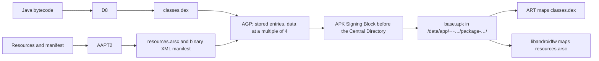

import Snippet from '../../../components/Snippet.astro';
import GoDeeper from '../../../components/GoDeeper.astro';

## The problem

Section 1 follows one cold start of the launch app, from the launcher tap to the first frame. The cold start begins with one file on the device: the APK that the build wrote.

An APK is a ZIP file[^abis-native-code]. The build puts the code, the resources and the manifest into it as ZIP entries:

- `classes.dex` holds the code as DEX bytecode. D8 compiles the Java bytecode of the project into DEX bytecode[^d8].
- `resources.arsc` holds the resource table. `AndroidManifest.xml` holds the manifest. AAPT2 compiles the resources into a binary format, and then links them and the manifest into the APK[^aapt2].

A v2 or newer signature is not a ZIP entry. It is in the APK Signing Block, immediately before the ZIP Central Directory[^apksigning-v2-block].

The platform does not unpack the APK. It reads the entries in place, from the APK file:

- ART maps `classes.dex` directly from the APK file[^dex-file-loader-548].
- `libandroidfw` opens `resources.arsc` with `mmap`[^apkassets-118].

With `mmap`, a process reads the bytes of a file directly, with no copy in RAM[^zipalign-doc]. ART and `libandroidfw` use an entry in place, with no copy, only if two conditions are true:

- The entry is stored. The ZIP file holds a stored entry with no compression, so the bytes in the APK are the bytes of the file.
- The data of the entry starts at an aligned offset. For a DEX file and for the resource table, the offset must be a multiple of 4[^dex-format-header-item]<sup>,</sup>[^asset-698].

If an entry does not meet the two conditions, the platform copies the entry into RAM, or the install fails. A ZIP file can be valid and not meet them. This chapter builds such a ZIP file, shows where it breaks, and then shows how the real build prevents the problem.

## Build it naive

The rebuild is an APK writer in plain Kotlin, in the module `samples/apk`. It does not compile code or resources. It takes each entry as a name and a byte array, and it writes the ZIP file around the entries. The tests give it placeholder bytes with the names `AndroidManifest.xml`, `classes.dex` and `resources.arsc`.

A ZIP file has three parts. The platform ZIP reader, libziparchive, has one struct for each part:

1. For each entry: a local file header and then the data. The local file header has fixed fields, the name of the entry and an optional extra field[^zip-archive-common-129].
2. The Central Directory: one record for each entry. Each record holds the offset of the local file header of its entry[^zip-archive-common-75].
3. The End of Central Directory record. It holds the offset of the Central Directory[^zip-archive-common-31].

The writer stores each entry. For each entry, it writes the local file header and then the data. At the end, it writes the Central Directory and the End of Central Directory record:

<Snippet file="apk/src/main/kotlin/NaiveApkWriter.kt" region="write" />

The local file header has 30 bytes of fixed fields. The last two fields give the length of the name and the length of the extra field. The name comes immediately after the fixed fields. The extra field comes after the name[^zip-archive-common-129]. The writer sets the time and the date to 0, so that each run writes the same bytes. It writes no extra field:

<Snippet file="apk/src/main/kotlin/NaiveApkWriter.kt" region="header" />

To read an entry, libziparchive finds the name of the entry in the Central Directory[^zip-archive-1121]. It reads the offset of the local file header from the Central Directory record[^zip-archive-827]. Then it reads the local file header. The data starts at this offset: the header offset + the size of the fixed fields + the name length + the extra field length[^zip-archive-1017].

The rebuild has a small reader, `dataOffset`, with the same formula. To keep the code short, it does not use the Central Directory. It reads the local file headers one after the other, from the start of the file:

<Snippet file="apk/src/main/kotlin/DataOffset.kt" region="offset" />

A test opens the output of the writer with `java.util.zip.ZipFile` from the JDK. The JDK reads each entry, its method (stored), its CRC-32 and its bytes. Thus the output is a valid ZIP file.

## Where it breaks

The writer puts the data of each entry immediately after its local file header. Nothing aligns the data. The breaking test writes one stored entry, `classes.dex`:

<Snippet file="apk/src/test/kotlin/NaiveApkWriterTest.kt" region="flaw" />

The local file header starts at offset 0. The fixed fields use 30 bytes, and the name `classes.dex` uses 11 bytes. Thus the data starts at offset 41, and 41 is not a multiple of 4. The test passes, so the flaw occurs.

The JDK reads such a file with no error. In the output of the JDK test, the data of `classes.dex` starts at offset 98, and 98 is not a multiple of 4. But the platform cannot use an entry at such an offset in place:

- ART maps a stored DEX entry directly from the APK only if the entry is aligned to the alignment of the DEX header. Otherwise, ART logs "please zipalign" and extracts the DEX file into memory. A comment in ART says that the map prevents a dirty copy[^dex-file-loader-548]. The DEX format gives the header an alignment of 4 bytes[^dex-format-header-item].
- If the data of `resources.arsc` does not start on a 4-byte boundary, `libandroidfw` copies the table into a new buffer on the heap[^asset-698].
- The install can fail. If the app targets API level 30 or higher[^android-11-arsc] and the `AssetManager` of the parse holds an allocated resource table (`containsAllocatedTable()`), the parse gives the error `INSTALL_PARSE_FAILED_RESOURCES_ARSC_COMPRESSED`. The error message says that an app that targets Android 11 (API level 30) or higher must store `resources.arsc` uncompressed and aligned on a 4-byte boundary[^parsingpackageutils-622].

Since Android 11, an app that targets API level 30 or higher cannot install if its `resources.arsc` is compressed or is not aligned on a 4-byte boundary. The reason is that the system cannot use such a table in place. The system must read the table into a buffer in RAM[^android-11-arsc].

<GoDeeper title="dex2oat and the second copy of the DEX">

When dex2oat compiles an app, it can copy the DEX files of the app into the vdex file. With the option `kOnlyIfCompressed`, it copies them if ART could not map one or more DEX files directly from the APK. A comment in the code says it: "only do it if not all the dex files are aligned and uncompressed"[^oat-writer-3443]. `kOnlyIfCompressed` is the default option of dex2oat[^dex2oat-3071]. Thus an unaligned stored DEX entry also gets a copy. Then the installed app has a second copy of its DEX bytecode on disk.

</GoDeeper>

## The real thing

### The build makes the entries

Android Studio and AGP run these build tools:

1. AAPT2 compiles each resource file into a binary format, a `.flat` file[^aapt2-compile].
2. AAPT2 links the compiled files and the manifest into one APK. This APK has no DEX bytecode and has no signature[^aapt2-link]. AAPT2 can also generate `R.java`, which holds the resource IDs[^aapt2-link-options].
3. D8 compiles the Java bytecode of the project into DEX bytecode[^d8]. One DEX file can reference at most 65,536 methods[^multidex-about]. If the app references more, the build writes `classes.dex` and then `classes2.dex`, `classes3.dex` and so on[^multidex-gradle].
4. AGP writes the final APK. If you build without AGP, sign the APK with `apksigner`[^aapt2-link].

### AGP aligns each stored entry

AGP aligns the APK automatically[^zipalign-doc]. `ApkFlinger`, an APK writer in the AGP code, shows the rules:

- If an entry is not compressed, `ApkFlinger` aligns it on 4 bytes, the `DEFAULT_ALIGNMENT`[^apkflinger-195]<sup>,</sup>[^apkflinger-284].
- If AGP packages the native libraries uncompressed, `ApkFlinger` aligns each native library on the page size[^apkflinger-90]<sup>,</sup>[^apkflinger-195]. The default page size is 16 KB[^apkflinger-65].
- A compressed entry gets no alignment[^apkflinger-265]. The platform cannot map a compressed entry, so its offset is not important. For example, ART always extracts a compressed DEX entry[^dex-file-loader-569].

AGP also decides which entries to store. If `minSdk` is 28 or higher and `useLegacyPackaging` has no value, AGP stores the DEX files uncompressed[^dexpackaging]. The launch app has `minSdk` 29 and uses AGP 9.5.0, so its `classes.dex` is a stored entry.

### zipalign: the fix for other build systems

If you do not use AGP, align the APK with `zipalign`[^zipalign-doc]. `zipalign` copies each entry of an APK into a new file:

- It copies a compressed entry or a directory with no padding[^zipalign-73].
- It adds each other entry with an alignment `alignTo`[^zipalign-84]. `alignTo` is the alignment argument of the command: 4 for the files of an APK. If page alignment is on, `alignTo` for a `.so` file is the page size[^zipalign-39]<sup>,</sup>[^zipalign-usage].

Before `zipalign` writes an entry, it calculates where the data of the entry will start. It uses the same formula as libziparchive: the current offset + the size of the fixed fields + the name length + the extra field length. If the result is not a multiple of `alignTo`, `zipalign` adds padding to the extra field of the local file header[^zipfile-495]. This is the fix for the flaw of the rebuild: the padding moves the data to the next multiple of 4.

To check an APK, run `zipalign -c -P 16 -v 4 existing.apk`[^zipalign-usage]. For each entry that is not aligned, `zipalign` prints `BAD`. If one entry is not aligned, the check fails[^zipalign-183].

### The signature comes after the alignment

A v2 signature puts the APK Signing Block immediately before the ZIP Central Directory. The block ends with the magic `APK Sig Block 42`[^apksigning-v2-block]. APK Signature Scheme v2 protects the contents of the ZIP entries, the Central Directory and the End of Central Directory[^apksigning-v2-integrity]. `zipalign` changes the size of the extra fields, so it must run before `apksigner`. If a tool changes the APK after `apksigner` signs it, the signature is not valid[^zipalign-doc].

At install, the platform finds the APK Signing Block from the offset of the Central Directory[^apksigningblockutils-82]. It checks the magic at the end of the block[^apksigningblockutils-745]. If an app targets API level 30 or higher, the minimum signature scheme is v2[^apksignatureverifier-579].

Since Android 11, if an app targets API level 30 or higher and has only a v1 signature, the app must also have a v2 or higher signature[^android-11-signature].

### The installer keeps the APK as one file

At install, the package manager opens the APK as an asset container. It reads the binary `AndroidManifest.xml` from the APK[^apkliteparseutils-368]. If the parse flags ask for the signing certificates, it also collects them[^apkliteparseutils-379]. The full parse reads the manifest again through the `AssetManager`[^parsingpackageutils-609].

The installer keeps the APK as one file. It puts the file in a new directory `<package>-<random>`, inside a new directory `~~<random>`[^packagemanagerserviceutils-1140]. The file has the canonical name of a base APK, `base.apk`. A split APK has the name `split_<name>.apk`[^apkliteparseutils-328]. Prompt 2 of "Try it" shows the path.

Since Android 11, the code directory of an app has the extra level `~~<random>`[^packagemanagerservice-11-15944].

### The platform maps the entries

At run time, the platform reads the entries from `base.apk`:

- ART opens `classes.dex`, then `classes2.dex`, `classes3.dex` and so on. It stops at the first name that has no entry[^dex-file-loader-170]<sup>,</sup>[^dex-file-loader-410]. If an entry is stored and aligned, ART maps it from the file, "to avoid a dirty copy"[^dex-file-loader-548].
- `libandroidfw` opens `resources.arsc` with `mmap`, unless the entry is compressed. It parses the table from an aligned buffer[^apkassets-118]. If the mapped data is aligned on 4 bytes, `libandroidfw` uses it directly. Otherwise, it copies the data[^asset-698].

<GoDeeper title="binary XML and the resource table">

The `AndroidManifest.xml` in the APK and `resources.arsc` are binary chunk files, not text files. Each chunk starts with a `ResChunk_header`: the chunk type, the header size and the total size of the chunk. The total size includes the child chunks[^resourcetypes-219]. Type `0x0002` (`RES_TABLE_TYPE`) marks the resource table. Type `0x0003` (`RES_XML_TYPE`) marks binary XML[^resourcetypes-241]. Prompt 3 of "Try it" shows the `0x0003` header.

A resource ID has the form `0xpptteeee`: the package index, the type index and the entry index into the table[^resourcetypes-428]. The package ID of an app must be `0x7f` or higher, unless the link uses `--allow-reserved-package-id`[^aapt2-link-options].

</GoDeeper>

<GoDeeper title="the DEX magic">

A `.dex` file starts with `DEX_FILE_MAGIC`: `dex\n`, a format version of three decimal digits, and `\0`[^dex-format-magic]. ART accepts a DEX file only if it starts with `dex\n` and has a version from the list of versions in ART[^standard-dex-file-26]<sup>,</sup>[^standard-dex-file-58]. Prompt 3 of "Try it" shows these bytes.

</GoDeeper>

<GoDeeper title="native libraries and 16 KB pages">

Native libraries go in the APK at `lib/<abi>/lib<name>.so`[^abis-native-code]. At install, the package manager looks for the libraries of the primary ABI. If it finds none, it looks for the libraries of a secondary ABI[^abis-aen].

If `extractNativeLibs` is false, each library must be stored and page-aligned, so that the platform can open it directly from the APK. If a library is compressed, the install fails with `INSTALL_FAILED_INVALID_APK`. If a library is not page-aligned, the install also fails. There is one exception. On a 16 KB device, if the 16 KB compatibility mode is on and the library is 4 KB-aligned, the installer extracts the library[^nativelibraryhelper-308]. `zipalign -P 16` aligns `.so` files on a 16 KB page, for both 16 KB and 4 KB devices[^zipalign-usage].

Since Android 15, AOSP supports devices with a 16 KB page size. If an app has native libraries, build the app again for these devices[^android-15-16-kb].

Since Android 16, a 16 KB device runs an app with 4 KB-aligned native code in a compatibility mode and shows a dialog. If the manifest attribute `android:pageSizeCompat` turns on the mode, the dialog does not show[^android-16-16-kb].

</GoDeeper>

## Mental model

An APK is a ZIP file that the platform reads in place. D8 writes the code as `classes.dex`. AAPT2 writes the resources as `resources.arsc` and the manifest as binary XML. AGP stores the entries that the platform maps. It puts the data of each stored entry at a multiple of 4. Without AGP, `zipalign` does the alignment with padding in the extra field of the local file header. Then the v2 signature goes in the APK Signing Block, before the Central Directory. The signature protects this layout. At install, the APK stays one file, `base.apk`. At run time, ART maps `classes.dex` and `libandroidfw` maps `resources.arsc` from that file. If a stored entry is not aligned, the platform copies it into RAM, or the install fails.



## Try it

### 1. Fix the rebuild

Change `NaiveApkWriter` so that the data of each stored entry starts at a multiple of 4. Use the fix of `zipalign`: before you write a local file header, calculate where the data will start. If the offset is not a multiple of 4, write padding bytes after the name, for example zero bytes. Put the number of padding bytes in the extra field length of the local file header. `entryFields` writes the fields of the local file header and of the Central Directory record. Keep the extra field length 0 in the Central Directory record, because the record has no padding bytes. From the repo root, run the tests of the rebuild:

```sh
samples/gradlew -p samples :apk:test
```

The breaking test fails, because the flaw is gone. The other tests pass, so the output is still a valid ZIP file. The Gradle output includes these lines:

```
NaiveApkWriterTest > naiveApkWriter_putsStoredDexAtUnalignedOffset() FAILED
    org.opentest4j.AssertionFailedError at NaiveApkWriterTest.kt:35

5 tests completed, 1 failed
```

### 2. List the entries of the installed APK

Start an emulator with the system image of the checked stamp. From the repo root, install the release build of the launch app:

```sh
samples/gradlew -p samples :launch-app:installLaunchPathRelease
```

Find the APK on the device:

```sh
adb shell pm path io.github.imgurpreetsk.afp.launchapp
```

{/* Edit step: capture this output on the emulator of the checked stamp. */}

```
package:/data/app/~~…/io.github.imgurpreetsk.afp.launchapp-…/base.apk
```

The output has one line. `pm path` prints `package:` and the path of the APK. The installer keeps the APK as one file, `base.apk`, in a directory `<package>-<random>` inside a directory `~~<random>`[^packagemanagerserviceutils-1140].

List the entries of `base.apk`:

```sh
adb shell 'unzip -lv $(pm path io.github.imgurpreetsk.afp.launchapp | cut -d: -f2)'
```

{/* Edit step: capture this output on the emulator of the checked stamp. */}

```
Archive:  /data/app/~~…/io.github.imgurpreetsk.afp.launchapp-…/base.apk
 Length   Method    Size  Cmpr    Date    Time   CRC-32   Name
--------  ------  ------- ---- ---------- ----- --------  ----
       …  Defl:N        …   …% …          …     …         META-INF/com/android/build/gradle/app-metadata.properties
       …  Defl:N        …   …% …          …     …         META-INF/version-control-info.textproto
       …  Stored        …   0% …          …     …         classes.dex
       …  Defl:N        …   …% …          …     …         AndroidManifest.xml
       …  Stored        …   0% …          …     …         resources.arsc
--------          -------  ---                            -------
       …                …   …%                            5 files
```

`ziptool` of libziparchive acts as `unzip` if its program name is `unzip`, for example through a symlink[^ziptool-490]. With `-lv`, it prints a row for each entry: the length, the method (`Stored` or `Defl:N`), the size, the compression ratio, the date, the time, the CRC-32 and the name[^ziptool-128]<sup>,</sup>[^ziptool-313]. The order of the rows can be different from the order in the ZIP file[^ziptool-410].

- `classes.dex` is `Stored`. The launch app has `minSdk` 29, so AGP stores its DEX files uncompressed[^dexpackaging].
- `resources.arsc` is `Stored`. The launch app targets API level 37, and the installer rejects a compressed table[^parsingpackageutils-622].
- The output has no `lib/` entry, so the launch app has no native code[^abis-native-code].

### 3. Read the first bytes of two entries

Print the first 8 bytes of the manifest and of `classes.dex`:

```sh
adb shell 'p=$(pm path io.github.imgurpreetsk.afp.launchapp | cut -d: -f2); unzip -p $p AndroidManifest.xml | xxd -l 8; unzip -p $p classes.dex | xxd -l 8'
```

{/* Edit step: capture this output on the emulator of the checked stamp. */}

```
00000000: 0300 0800 …                           ....…
00000000: 6465 780a 30.. ..00                      dex.…
```

In the second line, each `.` in the hex is one hex digit of the DEX format version.

- A binary XML file is a chunk file. Each chunk starts with a header: the chunk type (2 bytes), the header size (2 bytes) and the total size of the chunk (4 bytes)[^resourcetypes-219]. The manifest starts with `0300 0800`: the chunk type `0x0003` (`RES_XML_TYPE`) and the header size 8[^resourcetypes-241]. Then comes the chunk size. Thus the manifest in the APK is binary XML, not text.
- `classes.dex` starts with `6465 780a 30.. ..00`. These bytes are `dex\n`, a three-digit version and `\0`: the `DEX_FILE_MAGIC`[^dex-format-magic]. ART accepts only the versions in its list[^standard-dex-file-26]. Thus the APK holds DEX bytecode.

[^abis-native-code]: ABIs, "Native code in app packages": [https://developer.android.com/ndk/guides/abis#native-code-in-app-packages](https://developer.android.com/ndk/guides/abis#native-code-in-app-packages)
[^d8]: d8: [https://developer.android.com/tools/d8](https://developer.android.com/tools/d8)
[^aapt2]: AAPT2: [https://developer.android.com/tools/aapt2](https://developer.android.com/tools/aapt2)
[^apksigning-v2-block]: APK signature scheme v2, "APK signing block": [https://source.android.com/docs/security/features/apksigning/v2#apk-signing-block](https://source.android.com/docs/security/features/apksigning/v2#apk-signing-block)
[^dex-file-loader-548]: dex_file_loader.cc, lines 548–572: [https://android.googlesource.com/platform/art/+/refs/tags/android-17.0.0_r1/libdexfile/dex/dex_file_loader.cc#548](https://android.googlesource.com/platform/art/+/refs/tags/android-17.0.0_r1/libdexfile/dex/dex_file_loader.cc#548)
[^apkassets-118]: ApkAssets.cpp, lines 118–150: [https://android.googlesource.com/platform/frameworks/base/+/refs/tags/android-17.0.0_r1/libs/androidfw/ApkAssets.cpp#118](https://android.googlesource.com/platform/frameworks/base/+/refs/tags/android-17.0.0_r1/libs/androidfw/ApkAssets.cpp#118)
[^zipalign-doc]: zipalign: [https://developer.android.com/tools/zipalign](https://developer.android.com/tools/zipalign)
[^dex-format-header-item]: DEX format, "header_item": [https://source.android.com/docs/core/runtime/dex-format#header-item](https://source.android.com/docs/core/runtime/dex-format#header-item)
[^asset-698]: Asset.cpp, lines 698–726: [https://android.googlesource.com/platform/frameworks/base/+/refs/tags/android-17.0.0_r1/libs/androidfw/Asset.cpp#698](https://android.googlesource.com/platform/frameworks/base/+/refs/tags/android-17.0.0_r1/libs/androidfw/Asset.cpp#698)
[^zip-archive-common-129]: zip_archive_common.h, lines 129–163: [https://android.googlesource.com/platform/system/libziparchive/+/refs/tags/android-17.0.0_r1/zip_archive_common.h#129](https://android.googlesource.com/platform/system/libziparchive/+/refs/tags/android-17.0.0_r1/zip_archive_common.h#129)
[^zip-archive-common-75]: zip_archive_common.h, lines 75–123: [https://android.googlesource.com/platform/system/libziparchive/+/refs/tags/android-17.0.0_r1/zip_archive_common.h#75](https://android.googlesource.com/platform/system/libziparchive/+/refs/tags/android-17.0.0_r1/zip_archive_common.h#75)
[^zip-archive-common-31]: zip_archive_common.h, lines 31–67: [https://android.googlesource.com/platform/system/libziparchive/+/refs/tags/android-17.0.0_r1/zip_archive_common.h#31](https://android.googlesource.com/platform/system/libziparchive/+/refs/tags/android-17.0.0_r1/zip_archive_common.h#31)
[^zip-archive-1121]: zip_archive.cc, lines 1121–1128: [https://android.googlesource.com/platform/system/libziparchive/+/refs/tags/android-17.0.0_r1/zip_archive.cc#1121](https://android.googlesource.com/platform/system/libziparchive/+/refs/tags/android-17.0.0_r1/zip_archive.cc#1121)
[^zip-archive-827]: zip_archive.cc, lines 827–830: [https://android.googlesource.com/platform/system/libziparchive/+/refs/tags/android-17.0.0_r1/zip_archive.cc#827](https://android.googlesource.com/platform/system/libziparchive/+/refs/tags/android-17.0.0_r1/zip_archive.cc#827)
[^zip-archive-1017]: zip_archive.cc, lines 1017–1018: [https://android.googlesource.com/platform/system/libziparchive/+/refs/tags/android-17.0.0_r1/zip_archive.cc#1017](https://android.googlesource.com/platform/system/libziparchive/+/refs/tags/android-17.0.0_r1/zip_archive.cc#1017)
[^android-11-arsc]: Android 11 behavior changes, "Compressed resource files": [https://developer.android.com/about/versions/11/behavior-changes-11#compressed-resource-file](https://developer.android.com/about/versions/11/behavior-changes-11#compressed-resource-file)
[^parsingpackageutils-622]: ParsingPackageUtils.java, lines 622–631: [https://android.googlesource.com/platform/frameworks/base/+/refs/tags/android-17.0.0_r1/core/java/com/android/internal/pm/pkg/parsing/ParsingPackageUtils.java#622](https://android.googlesource.com/platform/frameworks/base/+/refs/tags/android-17.0.0_r1/core/java/com/android/internal/pm/pkg/parsing/ParsingPackageUtils.java#622)
[^oat-writer-3443]: oat_writer.cc, lines 3443–3452: [https://android.googlesource.com/platform/art/+/refs/tags/android-17.0.0_r1/dex2oat/linker/oat_writer.cc#3443](https://android.googlesource.com/platform/art/+/refs/tags/android-17.0.0_r1/dex2oat/linker/oat_writer.cc#3443)
[^dex2oat-3071]: dex2oat.cc, line 3071: [https://android.googlesource.com/platform/art/+/refs/tags/android-17.0.0_r1/dex2oat/dex2oat.cc#3071](https://android.googlesource.com/platform/art/+/refs/tags/android-17.0.0_r1/dex2oat/dex2oat.cc#3071)
[^aapt2-compile]: AAPT2, "Compile": [https://developer.android.com/tools/aapt2#compile](https://developer.android.com/tools/aapt2#compile)
[^aapt2-link]: AAPT2, "Link": [https://developer.android.com/tools/aapt2#link](https://developer.android.com/tools/aapt2#link)
[^aapt2-link-options]: AAPT2, "Link options": [https://developer.android.com/tools/aapt2#link_options](https://developer.android.com/tools/aapt2#link_options)
[^multidex-about]: multidex, "About the 64K reference limit": [https://developer.android.com/build/multidex#about](https://developer.android.com/build/multidex#about)
[^multidex-gradle]: multidex, "Configure your app for multidex": [https://developer.android.com/build/multidex#mdex-gradle](https://developer.android.com/build/multidex#mdex-gradle)
[^apkflinger-195]: ApkFlinger.kt, lines 195–201: [https://android.googlesource.com/platform/tools/base/+/refs/tags/studio-2026.2.2/build-system/builder/src/main/java/com/android/builder/internal/packaging/ApkFlinger.kt#195](https://android.googlesource.com/platform/tools/base/+/refs/tags/studio-2026.2.2/build-system/builder/src/main/java/com/android/builder/internal/packaging/ApkFlinger.kt#195)
[^apkflinger-284]: ApkFlinger.kt, line 284: [https://android.googlesource.com/platform/tools/base/+/refs/tags/studio-2026.2.2/build-system/builder/src/main/java/com/android/builder/internal/packaging/ApkFlinger.kt#284](https://android.googlesource.com/platform/tools/base/+/refs/tags/studio-2026.2.2/build-system/builder/src/main/java/com/android/builder/internal/packaging/ApkFlinger.kt#284)
[^apkflinger-90]: ApkFlinger.kt, lines 90–96: [https://android.googlesource.com/platform/tools/base/+/refs/tags/studio-2026.2.2/build-system/builder/src/main/java/com/android/builder/internal/packaging/ApkFlinger.kt#90](https://android.googlesource.com/platform/tools/base/+/refs/tags/studio-2026.2.2/build-system/builder/src/main/java/com/android/builder/internal/packaging/ApkFlinger.kt#90)
[^apkflinger-65]: ApkFlinger.kt, line 65: [https://android.googlesource.com/platform/tools/base/+/refs/tags/studio-2026.2.2/build-system/builder/src/main/java/com/android/builder/internal/packaging/ApkFlinger.kt#65](https://android.googlesource.com/platform/tools/base/+/refs/tags/studio-2026.2.2/build-system/builder/src/main/java/com/android/builder/internal/packaging/ApkFlinger.kt#65)
[^apkflinger-265]: ApkFlinger.kt, lines 265–268: [https://android.googlesource.com/platform/tools/base/+/refs/tags/studio-2026.2.2/build-system/builder/src/main/java/com/android/builder/internal/packaging/ApkFlinger.kt#265](https://android.googlesource.com/platform/tools/base/+/refs/tags/studio-2026.2.2/build-system/builder/src/main/java/com/android/builder/internal/packaging/ApkFlinger.kt#265)
[^dex-file-loader-569]: dex_file_loader.cc, lines 569–571: [https://android.googlesource.com/platform/art/+/refs/tags/android-17.0.0_r1/libdexfile/dex/dex_file_loader.cc#569](https://android.googlesource.com/platform/art/+/refs/tags/android-17.0.0_r1/libdexfile/dex/dex_file_loader.cc#569)
[^dexpackaging]: DexPackaging, "useLegacyPackaging": [https://developer.android.com/reference/tools/gradle-api/9.5/com/android/build/api/dsl/DexPackaging#useLegacyPackaging()](https://developer.android.com/reference/tools/gradle-api/9.5/com/android/build/api/dsl/DexPackaging#useLegacyPackaging())
[^zipalign-73]: ZipAlign.cpp, lines 73–83: [https://android.googlesource.com/platform/build/+/refs/tags/android-17.0.0_r1/tools/zipalign/ZipAlign.cpp#73](https://android.googlesource.com/platform/build/+/refs/tags/android-17.0.0_r1/tools/zipalign/ZipAlign.cpp#73)
[^zipalign-84]: ZipAlign.cpp, lines 84–92: [https://android.googlesource.com/platform/build/+/refs/tags/android-17.0.0_r1/tools/zipalign/ZipAlign.cpp#84](https://android.googlesource.com/platform/build/+/refs/tags/android-17.0.0_r1/tools/zipalign/ZipAlign.cpp#84)
[^zipalign-39]: ZipAlign.cpp, lines 39–51: [https://android.googlesource.com/platform/build/+/refs/tags/android-17.0.0_r1/tools/zipalign/ZipAlign.cpp#39](https://android.googlesource.com/platform/build/+/refs/tags/android-17.0.0_r1/tools/zipalign/ZipAlign.cpp#39)
[^zipalign-usage]: zipalign, "Usage": [https://developer.android.com/tools/zipalign#usage](https://developer.android.com/tools/zipalign#usage)
[^zipfile-495]: ZipFile.cpp, lines 495–519: [https://android.googlesource.com/platform/build/+/refs/tags/android-17.0.0_r1/tools/zipalign/ZipFile.cpp#495](https://android.googlesource.com/platform/build/+/refs/tags/android-17.0.0_r1/tools/zipalign/ZipFile.cpp#495)
[^zipalign-183]: ZipAlign.cpp, lines 183–205: [https://android.googlesource.com/platform/build/+/refs/tags/android-17.0.0_r1/tools/zipalign/ZipAlign.cpp#183](https://android.googlesource.com/platform/build/+/refs/tags/android-17.0.0_r1/tools/zipalign/ZipAlign.cpp#183)
[^apksigning-v2-integrity]: APK signature scheme v2, "Integrity-protected contents": [https://source.android.com/docs/security/features/apksigning/v2#integrity-protected-contents](https://source.android.com/docs/security/features/apksigning/v2#integrity-protected-contents)
[^apksigningblockutils-82]: ApkSigningBlockUtils.java, lines 82–85: [https://android.googlesource.com/platform/frameworks/base/+/refs/tags/android-17.0.0_r1/core/java/android/util/apk/ApkSigningBlockUtils.java#82](https://android.googlesource.com/platform/frameworks/base/+/refs/tags/android-17.0.0_r1/core/java/android/util/apk/ApkSigningBlockUtils.java#82)
[^apksigningblockutils-745]: ApkSigningBlockUtils.java, lines 745–756: [https://android.googlesource.com/platform/frameworks/base/+/refs/tags/android-17.0.0_r1/core/java/android/util/apk/ApkSigningBlockUtils.java#745](https://android.googlesource.com/platform/frameworks/base/+/refs/tags/android-17.0.0_r1/core/java/android/util/apk/ApkSigningBlockUtils.java#745)
[^apksignatureverifier-579]: ApkSignatureVerifier.java, lines 579–581: [https://android.googlesource.com/platform/frameworks/base/+/refs/tags/android-17.0.0_r1/core/java/android/util/apk/ApkSignatureVerifier.java#579](https://android.googlesource.com/platform/frameworks/base/+/refs/tags/android-17.0.0_r1/core/java/android/util/apk/ApkSignatureVerifier.java#579)
[^android-11-signature]: Android 11 behavior changes, "APK Signature Scheme v2 now required": [https://developer.android.com/about/versions/11/behavior-changes-11#minimum-signature-scheme](https://developer.android.com/about/versions/11/behavior-changes-11#minimum-signature-scheme)
[^apkliteparseutils-368]: ApkLiteParseUtils.java, lines 368–376: [https://android.googlesource.com/platform/frameworks/base/+/refs/tags/android-17.0.0_r1/core/java/android/content/pm/parsing/ApkLiteParseUtils.java#368](https://android.googlesource.com/platform/frameworks/base/+/refs/tags/android-17.0.0_r1/core/java/android/content/pm/parsing/ApkLiteParseUtils.java#368)
[^apkliteparseutils-379]: ApkLiteParseUtils.java, line 379: [https://android.googlesource.com/platform/frameworks/base/+/refs/tags/android-17.0.0_r1/core/java/android/content/pm/parsing/ApkLiteParseUtils.java#379](https://android.googlesource.com/platform/frameworks/base/+/refs/tags/android-17.0.0_r1/core/java/android/content/pm/parsing/ApkLiteParseUtils.java#379)
[^parsingpackageutils-609]: ParsingPackageUtils.java, lines 609–610: [https://android.googlesource.com/platform/frameworks/base/+/refs/tags/android-17.0.0_r1/core/java/com/android/internal/pm/pkg/parsing/ParsingPackageUtils.java#609](https://android.googlesource.com/platform/frameworks/base/+/refs/tags/android-17.0.0_r1/core/java/com/android/internal/pm/pkg/parsing/ParsingPackageUtils.java#609)
[^packagemanagerserviceutils-1140]: PackageManagerServiceUtils.java, lines 1140–1168: [https://android.googlesource.com/platform/frameworks/base/+/refs/tags/android-17.0.0_r1/services/core/java/com/android/server/pm/PackageManagerServiceUtils.java#1140](https://android.googlesource.com/platform/frameworks/base/+/refs/tags/android-17.0.0_r1/services/core/java/com/android/server/pm/PackageManagerServiceUtils.java#1140)
[^apkliteparseutils-328]: ApkLiteParseUtils.java, lines 328–332: [https://android.googlesource.com/platform/frameworks/base/+/refs/tags/android-17.0.0_r1/core/java/android/content/pm/parsing/ApkLiteParseUtils.java#328](https://android.googlesource.com/platform/frameworks/base/+/refs/tags/android-17.0.0_r1/core/java/android/content/pm/parsing/ApkLiteParseUtils.java#328)
[^packagemanagerservice-11-15944]: PackageManagerService.java at android-11.0.0_r1, lines 15944–15966: [https://android.googlesource.com/platform/frameworks/base/+/refs/tags/android-11.0.0_r1/services/core/java/com/android/server/pm/PackageManagerService.java#15944](https://android.googlesource.com/platform/frameworks/base/+/refs/tags/android-11.0.0_r1/services/core/java/com/android/server/pm/PackageManagerService.java#15944)
[^dex-file-loader-170]: dex_file_loader.cc, line 170: [https://android.googlesource.com/platform/art/+/refs/tags/android-17.0.0_r1/libdexfile/dex/dex_file_loader.cc#170](https://android.googlesource.com/platform/art/+/refs/tags/android-17.0.0_r1/libdexfile/dex/dex_file_loader.cc#170)
[^dex-file-loader-410]: dex_file_loader.cc, lines 410–427: [https://android.googlesource.com/platform/art/+/refs/tags/android-17.0.0_r1/libdexfile/dex/dex_file_loader.cc#410](https://android.googlesource.com/platform/art/+/refs/tags/android-17.0.0_r1/libdexfile/dex/dex_file_loader.cc#410)
[^resourcetypes-219]: ResourceTypes.h, lines 219–236: [https://android.googlesource.com/platform/frameworks/base/+/refs/tags/android-17.0.0_r1/libs/androidfw/include/androidfw/ResourceTypes.h#219](https://android.googlesource.com/platform/frameworks/base/+/refs/tags/android-17.0.0_r1/libs/androidfw/include/androidfw/ResourceTypes.h#219)
[^resourcetypes-241]: ResourceTypes.h, lines 241–242: [https://android.googlesource.com/platform/frameworks/base/+/refs/tags/android-17.0.0_r1/libs/androidfw/include/androidfw/ResourceTypes.h#241](https://android.googlesource.com/platform/frameworks/base/+/refs/tags/android-17.0.0_r1/libs/androidfw/include/androidfw/ResourceTypes.h#241)
[^resourcetypes-428]: ResourceTypes.h, lines 428–433: [https://android.googlesource.com/platform/frameworks/base/+/refs/tags/android-17.0.0_r1/libs/androidfw/include/androidfw/ResourceTypes.h#428](https://android.googlesource.com/platform/frameworks/base/+/refs/tags/android-17.0.0_r1/libs/androidfw/include/androidfw/ResourceTypes.h#428)
[^dex-format-magic]: DEX format, "DEX_FILE_MAGIC": [https://source.android.com/docs/core/runtime/dex-format#dex-file-magic](https://source.android.com/docs/core/runtime/dex-format#dex-file-magic)
[^standard-dex-file-26]: standard_dex_file.cc, lines 26–41: [https://android.googlesource.com/platform/art/+/refs/tags/android-17.0.0_r1/libdexfile/dex/standard_dex_file.cc#26](https://android.googlesource.com/platform/art/+/refs/tags/android-17.0.0_r1/libdexfile/dex/standard_dex_file.cc#26)
[^standard-dex-file-58]: standard_dex_file.cc, lines 58–69: [https://android.googlesource.com/platform/art/+/refs/tags/android-17.0.0_r1/libdexfile/dex/standard_dex_file.cc#58](https://android.googlesource.com/platform/art/+/refs/tags/android-17.0.0_r1/libdexfile/dex/standard_dex_file.cc#58)
[^abis-aen]: ABIs, "Automatic extraction of native code at install time": [https://developer.android.com/ndk/guides/abis#aen](https://developer.android.com/ndk/guides/abis#aen)
[^nativelibraryhelper-308]: com_android_internal_content_NativeLibraryHelper.cpp, lines 308–342: [https://android.googlesource.com/platform/frameworks/base/+/refs/tags/android-17.0.0_r1/core/jni/com_android_internal_content_NativeLibraryHelper.cpp#308](https://android.googlesource.com/platform/frameworks/base/+/refs/tags/android-17.0.0_r1/core/jni/com_android_internal_content_NativeLibraryHelper.cpp#308)
[^android-15-16-kb]: Android 15 behavior changes, "Support for 16 KB page sizes": [https://developer.android.com/about/versions/15/behavior-changes-all#16-kb](https://developer.android.com/about/versions/15/behavior-changes-all#16-kb)
[^android-16-16-kb]: Android 16 behavior changes, "16 KB page size compatibility mode": [https://developer.android.com/about/versions/16/behavior-changes-all#16-kb-compatibility-mode](https://developer.android.com/about/versions/16/behavior-changes-all#16-kb-compatibility-mode)
[^ziptool-490]: ziptool.cpp, lines 490–499: [https://android.googlesource.com/platform/system/libziparchive/+/refs/tags/android-17.0.0_r1/ziptool.cpp#490](https://android.googlesource.com/platform/system/libziparchive/+/refs/tags/android-17.0.0_r1/ziptool.cpp#490)
[^ziptool-128]: ziptool.cpp, lines 128–130: [https://android.googlesource.com/platform/system/libziparchive/+/refs/tags/android-17.0.0_r1/ziptool.cpp#128](https://android.googlesource.com/platform/system/libziparchive/+/refs/tags/android-17.0.0_r1/ziptool.cpp#128)
[^ziptool-313]: ziptool.cpp, lines 313–316: [https://android.googlesource.com/platform/system/libziparchive/+/refs/tags/android-17.0.0_r1/ziptool.cpp#313](https://android.googlesource.com/platform/system/libziparchive/+/refs/tags/android-17.0.0_r1/ziptool.cpp#313)
[^ziptool-410]: ziptool.cpp, lines 410–411: [https://android.googlesource.com/platform/system/libziparchive/+/refs/tags/android-17.0.0_r1/ziptool.cpp#410](https://android.googlesource.com/platform/system/libziparchive/+/refs/tags/android-17.0.0_r1/ziptool.cpp#410)
