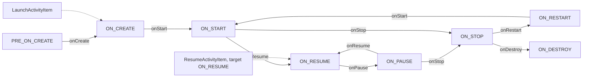

import Snippet from '../../../components/Snippet.astro';
import GoDeeper from '../../../components/GoDeeper.astro';

## The problem

The [Binder chapter](/launch-path/binder/) ends with a call from `system_server` into the new process of the launch app: `bindApplication`. The process runs, but no code of the launch app has run yet. The launch app has one class, `MainActivity`, with one method, `onCreate`. It has no `main()`.

An Android app has four types of components: activities, services, broadcast receivers and content providers. Each component is an entry point for the system or for the user. When the system starts a component, it starts the process of the app if the process does not run. Then it creates the objects of the component classes. Thus an Android app has no `main()` function[^fundamentals-components]. The manifest declares each activity, service and content provider. An app can also register a broadcast receiver in code[^fundamentals-declaring]. An intent activates three of the four types: activities, services and broadcast receivers[^fundamentals-activating].

The `Activity` class has six core callbacks: `onCreate`, `onStart`, `onResume`, `onPause`, `onStop` and `onDestroy`. The system calls each callback when the activity enters a new state[^lifecycle-concepts]. After `onCreate`, the system calls `onStart` and then `onResume`[^lifecycle-oncreate]. If a stopped activity comes back, the system calls `onRestart`[^lifecycle-onstop].

The app does not decide when the state of an activity changes. `system_server` keeps a record of each activity, with the state of the activity[^activityrecord-553]. For each change, `system_server` sends the app a request with one target state[^activitylifecycleitem-73]. To start an activity in a new process, `system_server` sends two items in one transaction. A `LaunchActivityItem` creates the activity. If the activity must resume, a `ResumeActivityItem` follows it[^activitytasksupervisor-1050][^activitytasksupervisor-1060][^activitytasksupervisor-1079]. The target state of `ResumeActivityItem` is `ON_RESUME`[^resumeactivityitem-86]. Neither item asks for `onStart`. Thus the app must find each callback between the current state and the target state, and call the callbacks in order.

This chapter builds a client that calls only the callback of the target state. Its breaking tests show the callbacks that it skips. Then the chapter follows the real client in `ActivityThread`, from `bindApplication` to `onResume`.

## Build it naive

The rebuild is in the module `samples/components-lifecycle`. It has no `android.*` classes and no threads. An enum stands for the lifecycle states of the client:

<Snippet file="components-lifecycle/src/main/kotlin/NaiveLifecycleClient.kt" region="state" />

In `ActivityLifecycleItem`, the states are integers from `PRE_ON_CREATE` (0) to `ON_RESTART` (7), and `UNDEFINED` is -1[^activitylifecycleitem-47]. The rebuild leaves out `UNDEFINED`. The ordinal of each other entry is the number of its real state. The states are ordered numbers, so the real client can compare two states and go up one state at a time.

A `FakeActivity` stands for an `Activity`. Each callback adds its name to a log:

<Snippet file="components-lifecycle/src/main/kotlin/NaiveLifecycleClient.kt" region="activity" />

`NaiveLifecycleClient` stands for the app side of the lifecycle. It keeps the current state. `moveTo` takes the target state of one request from the system. It calls the callback of the target state, and then makes the target the current state:

<Snippet file="components-lifecycle/src/main/kotlin/NaiveLifecycleClient.kt" region="client" />

`perform` maps each state to one callback, as the real `performLifecycleSequence` maps each state to one handler[^transactionexecutor-198]. No callback moves an activity to `PRE_ON_CREATE`, so `perform` throws an exception for it.

The first test asks for each state from `ON_CREATE` to `ON_DESTROY`, one step at a time:

<Snippet file="components-lifecycle/src/test/kotlin/NaiveLifecycleClientTest.kt" region="steps" />

The test passes. The log has the six core callbacks in order, and the client ends in `ON_DESTROY`. This test is not a breaking test. If the system asks for each step, the naive client calls each callback.

## Where it breaks

The real system does not ask for each step. `LaunchActivityItem` is not a lifecycle item: it extends `ClientTransactionItem`, not `ActivityLifecycleItem`[^launchactivityitem-61]. Its `execute` makes an `ActivityClientRecord` and calls `handleLaunchActivity`[^launchactivityitem-216]. `handleLaunchActivity` calls `performLaunchActivity`[^activitythread-4781]. `performLaunchActivity` calls `onCreate`, and then sets the state of the record to `ON_CREATE`[^activitythread-4556][^activitythread-4568]. Thus the tests treat a `LaunchActivityItem` as a request for `ON_CREATE`.

The first breaking test sends the two requests of a cold start, `ON_CREATE` and then `ON_RESUME`:

<Snippet file="components-lifecycle/src/test/kotlin/NaiveLifecycleClientTest.kt" region="launch" />

The test passes, so the flaw occurs. The log is `[onCreate, onResume]`. The client skipped `onStart`.

The second breaking test starts in `ON_STOP` and asks for `ON_RESUME`. Prompt 3 of "Try it" shows this change on a device:

<Snippet file="components-lifecycle/src/test/kotlin/NaiveLifecycleClientTest.kt" region="restart" />

The test passes. The log is `[onResume]`. The client skipped `onRestart` and `onStart`. The system cannot ask for `onRestart`, because the real client does not accept `ON_RESTART` as a target state[^transactionexecutorhelper-72]. Thus the client must add `onRestart` itself.

The lifecycle doc says that the system calls `onStart` before `onResume`[^lifecycle-oncreate], and `onRestart` when a stopped activity comes back[^lifecycle-onstop]. The naive client breaks both rules.

The tests use no threads and no clock, so they give the same result on each run.

## The real thing

### system_server decides the state

`ActivityRecord` is the record of one activity in `system_server`. Its `State` enum holds the states that `system_server` keeps for the activity, for example `INITIALIZING`, `RESUMED` and `STOPPED`[^activityrecord-553]. `system_server` decides each change of state, and then tells the app.

To start an activity, `startSpecificActivity` looks for the process of the activity. If the process runs, it starts the activity immediately. If not, it asks for a new process[^activitytasksupervisor-1171]. The [Zygote chapter](/launch-path/zygote/) shows how the new process starts. The [Binder chapter](/launch-path/binder/) shows how the new process calls `attachApplication`, and how `system_server` calls `bindApplication` on it. Then `system_server` starts the activity that waits for the process. The box "attachApplication starts the components that wait" gives the details.

`realStartActivityLocked` calls `tryRealStartActivityInner`[^activitytasksupervisor-927]. That method writes the event `wm_restart_activity` to the event log, with the user, the identity hash code of the record, the task and the name of the activity[^activitytasksupervisor-1019]. It makes a `LaunchActivityItem`[^activitytasksupervisor-1050]. Then it makes one lifecycle item for the target state. If the activity must resume, the item is a `ResumeActivityItem`. Otherwise, it is a `PauseActivityItem` or a `StopActivityItem`[^activitytasksupervisor-1060]. It sends the two items to the app in one transaction[^activitytasksupervisor-1079].

<GoDeeper title="attachApplication starts the components that wait">

When the new process calls `attachApplication`, `attachApplicationLocked` writes the event `am_proc_bound` with the user, the PID and the process name[^ams-5295]. Later, it calls `bindApplication` on the app[^ams-5451]. Then `system_server` starts the components that wait for the process:

- The activity. If the flag `expediteActivityLaunchOnColdStart` is on, `attachApplicationLocked` starts it[^ams-5525]. If the flag is off, `finishAttachApplicationInner` starts it[^ams-5620]. In both cases, `am_proc_bound` comes first.
- The services of the process[^ams-5634].
- The broadcast that waits for a receiver in the process[^ams-5646].

</GoDeeper>

### The main thread runs each item

The transaction reaches the app as a call to `scheduleTransaction` on its `ApplicationThread`[^activitythread-2394]. The [Binder chapter](/launch-path/binder/) shows that a call from `system_server` to `ApplicationThread` runs on a binder thread of the app. `scheduleTransaction` does not run the items on that thread. It calls `preExecute` on the transaction, and then sends the message `EXECUTE_TRANSACTION`[^clienttransactionhandler-57]. `ActivityThread` sends each message to its handler `H`[^activitythread-4388]. `ActivityThread.main` creates the `ActivityThread` on the main thread after it prepares the main `Looper`. Then it runs the loop[^activitythread-9507]. For `EXECUTE_TRANSACTION`, `H` gives the transaction to `TransactionExecutor.execute`[^activitythread-3026]. Thus each lifecycle callback runs on the main thread. The next chapter explains the main thread, its loop and its messages.

`bindApplication` also sends a message, `BIND_APPLICATION`[^activitythread-1543]. For this message, `H` calls `handleBindApplication`[^activitythread-2754].

### handleBindApplication creates the Application

`handleBindApplication` creates the `Application` object of the app[^activitythread-8260]. Then it installs the content providers of the app. It calls `Application.onCreate` only after these two steps[^activitythread-8289]. The doc of `Application.onCreate` says that the system calls it before it creates an activity, service or receiver object. Content providers are an exception[^application-254].

`LoadedApk.makeApplicationInner` creates the `Application` through `Instrumentation.newApplication`[^loadedapk-1658][^instrumentation-1358]. It does this one time. On each later call, it returns the `Application` that it keeps[^loadedapk-1595]. Thus all components of the process get the same `Application`. `Instrumentation.callApplicationOnCreate` calls `onCreate` of the `Application`[^instrumentation-1397].

### ActivityThread creates each component

Before the system can start a component, the manifest of the app must tell the system that the component exists[^fundamentals-manifest]. `performLaunchActivity` gives the class name of the activity to `Instrumentation.newActivity`[^activitythread-4471]. `newActivity` asks the `AppComponentFactory` of the package for the object[^instrumentation-1454]. The default `instantiateActivity` loads the class and calls `newInstance()`[^appcomponentfactory-96]. Thus an activity class needs a constructor with no arguments. An app can supply its own factory, for example for dependency injection[^appcomponentfactory-83].

Then `performLaunchActivity` gets the `Application`[^activitythread-4488] and calls `attach` on the activity[^activitythread-4528]. Then it calls `Instrumentation.callActivityOnCreate`[^activitythread-4556], which calls `Activity.performCreate`[^instrumentation-1541]. If `onCreate` did not call `super.onCreate`, `performLaunchActivity` throws `SuperNotCalledException`[^activitythread-4561]. Last, it sets the state of the record to `ON_CREATE`[^activitythread-4568].

The `perform` methods of `Activity` wrap the callbacks of the app:

- `performCreate` calls the `ActivityLifecycleCallbacks` before `onCreate`. Then it calls `onCreate`, and writes the event `wm_on_create_called` with the reason `performCreate` and the duration. Then it calls the `ActivityLifecycleCallbacks` after `onCreate`[^activity-9322].
- `performStart` calls `onStart` through `Instrumentation`, and writes `wm_on_start_called` with the reason that its caller gives. If `onStart` did not call `super`, it throws `SuperNotCalledException`[^activity-9372].
- `performResume` does the same for `onResume` and `wm_on_resume_called`[^activity-9497].

The tags `wm_on_create_called`, `wm_on_start_called`, `wm_on_resume_called`, `wm_on_paused_called`, `wm_on_stop_called`, `wm_on_restart_called` and `wm_on_destroy_called` have four fields: the token, the component name, the reason and the time. The tags `wm_on_top_resumed_gained_called` and `wm_on_top_resumed_lost_called` have no time field[^eventlogtags-8]. Prompts 2 and 3 of "Try it" read these events.

The system creates the other three types of components with the same factory. `handleCreateService` calls `instantiateService`[^activitythread-5615]. `handleReceiver` calls `instantiateReceiver`[^activitythread-5360]. `installProvider` calls `instantiateProvider`[^activitythread-9176]. A service and a receiver also get the `Application` from `makeApplicationInner`[^activitythread-5607][^activitythread-5344].

Since Android 12, if an app targets Android 12 or higher, each activity, service and broadcast receiver with an intent filter must declare `android:exported`. Otherwise, the app does not install. If the component has the `LAUNCHER` category, set `android:exported` to `true`[^android-12-exported]. The launch app does this for `MainActivity`.

Since Android 14, if an app targets Android 14 or higher, an implicit intent goes only to exported components. To start a component that is not exported, use an explicit intent[^android-14-intents]. If such an app registers a receiver in code, it must give the flag `RECEIVER_EXPORTED` or `RECEIVER_NOT_EXPORTED`. If the receiver gets only system broadcasts, do not give a flag[^android-14-receivers].

### The client walks the path

This is the real fix for the flaw of the rebuild.

`TransactionExecutor` executes the items of a transaction in order[^transactionexecutor-95]. For a lifecycle item, it calls `cycleToPath` with the target state of the item and with `excludeLastState` set to true. Then it executes the item, which does the last step[^transactionexecutor-165]. `cycleToPath` gets the path from `TransactionExecutorHelper.getLifecyclePath`, and gives the path to `performLifecycleSequence`[^transactionexecutor-184].

`getLifecyclePath` computes each state between the current state and the target state:

- If the target state has the same number or a higher number, the path has each state after the current state, up to the target. Exception: from `ON_START` to `ON_STOP`, the path has only `ON_STOP`[^transactionexecutorhelper-81].
- If the target state has a lower number, these rules apply:
  - From `ON_PAUSE` to `ON_RESUME`, the path has only `ON_RESUME`[^transactionexecutorhelper-92].
  - If the current state is `ON_STOP` or lower, and the target is `ON_START` or higher, the path has each state up to `ON_STOP`, then `ON_RESTART`, then each state from `ON_START` to the target[^transactionexecutorhelper-96].
  - In the other cases, the path has each state up to `ON_DESTROY`, then each state from `ON_CREATE` to the target[^transactionexecutorhelper-109].
- If `excludeLastState` is true, `getLifecyclePath` removes the last state of the path[^transactionexecutorhelper-123].

`getLifecyclePath` throws an exception if the current state or the target state is `ON_RESTART`. It also throws an exception if the target state is `PRE_ON_CREATE` and the current state is a different state[^transactionexecutorhelper-72]. Thus no item can ask for `ON_RESTART`. Only a path can add it.

`performLifecycleSequence` calls one handler for each state of the path: `handleLaunchActivity` for `ON_CREATE`, `handleStartActivity` for `ON_START`, `handleResumeActivity` for `ON_RESUME`, and a handler for each other state[^transactionexecutor-198]. For `ON_RESTART`, it calls `performRestartActivity`[^transactionexecutor-238].

Two paths of the launch app:

- Cold start. The `LaunchActivityItem` leaves the activity in `ON_CREATE`[^activitythread-4568]. For the `ResumeActivityItem`, the path from `ON_CREATE` to `ON_RESUME` is `ON_START`, `ON_RESUME`. Without the last state, the path is `ON_START`. Thus `cycleToPath` calls `handleStartActivity`, which calls `performStart` with the reason `handleStartActivity`[^activitythread-4601]. Then the item calls `handleResumeActivity` with the reason `RESUME_ACTIVITY`[^resumeactivityitem-70].
- Return to a stopped activity. From `ON_STOP` to `ON_RESUME`, the path is `ON_RESTART`, `ON_START`, `ON_RESUME`. For `ON_RESTART`, `performRestartActivity` calls `Activity.performRestart`[^activitythread-6456]. `performRestart` calls `onRestart`, and writes `wm_on_restart_called` with the reason `performRestart`[^activity-9464]. Then `handleStartActivity` calls `onStart`.

Jetpack does the same walk for a new observer. `LifecycleRegistry.addObserver` brings the observer up to the current state one event at a time, with the event from `Event.upFrom`[^lifecycleregistry-220][^lifecycle-194]. For example, an observer that you add in `STARTED` gets `ON_CREATE` and then `ON_START`.

`Activity.performTopResumedActivityChanged` calls `onTopResumedActivityChanged`, and writes `wm_on_top_resumed_gained_called` or `wm_on_top_resumed_lost_called`[^activity-2349]. `ActivityThread` calls it after `onResume` with the reason `topWhenResuming`, if the activity is the topmost resumed activity[^activitythread-5969]. If the position changes while the activity is resumed, it calls it with the reason `topStateChangedWhenResumed`[^activitythread-6141]. Before `onPause`, it reports the loss of the position with the reason `pausing`[^activitythread-6256].

Since Android 10, in multi-window mode and multi-display mode, each focusable top activity in a visible stack is in the resumed state. One of them is the topmost resumed activity. Before Android 10, only one activity in the system could be in the resumed state. `onTopResumedActivityChanged` tells an activity when it gets or loses the topmost resumed position[^android-10-multi-resume].

<GoDeeper title="system_server and the other lifecycle items">

`TaskFragment.resumeTopActivity` resumes the top activity of a task. Before it resumes an activity, it pauses the resumed activities of the back tasks. While a pause runs, it does not resume the next activity[^taskfragment-1442]. If the process of the next activity runs, it sends one `ResumeActivityItem`[^taskfragment-1552][^taskfragment-1654]. Otherwise, it calls `startSpecificActivity`[^taskfragment-1668].

When a pause completes, and the paused activity is not visible, `completePause` adds the activity to the list of activities to stop. The system stops it later[^taskfragment-1971]. If a stopped activity must become visible, `makeActiveIfNeeded` can send a `StartActivityItem`[^activityrecord-6128][^activityrecord-6188].

Each of these items names one target state, and the client walks the path to it.

</GoDeeper>

<GoDeeper title="the window at the first onStart">

The lifecycle doc says that `onStart` makes the activity visible to the user[^lifecycle-onstart]. On the first launch, the code does this later. `handleStartActivity` calls `updateVisibility`[^activitythread-4639]. `updateVisibility` changes nothing if the activity has no decor view[^activitythread-6394].

On the first launch, `handleResumeActivity` first calls `performResumeActivity`, which calls `onResume`[^activitythread-6006][^activitythread-5963]. Then, if the record has no window, it sets the decor view of the activity and adds the decor view to the window manager with `wm.addView`[^activitythread-6035]. Then it calls `makeVisible`[^activitythread-6100]. Thus at the first `onStart`, the window manager does not have the window of the activity.

</GoDeeper>

### Jetpack Lifecycle follows the platform callbacks

`androidx.activity.ComponentActivity` extends `androidx.core.app.ComponentActivity`[^componentactivity-114]. Its `onCreate` calls `ReportFragment.injectIfNeededIn(this)`[^componentactivity-338]. On API level 29 and higher, `injectIfNeededIn` registers `Application.ActivityLifecycleCallbacks` on the activity[^reportfragment-155]. These callbacks have a method before and a method after each of the six core callbacks, for example `onActivityPreStarted` and `onActivityPostStarted`[^application-73]. `ReportFragment` sends `ON_CREATE`, `ON_START` and `ON_RESUME` from the methods after the platform callback. It sends `ON_PAUSE`, `ON_STOP` and `ON_DESTROY` from the methods before the platform callback[^reportfragment-102]. `dispatch` calls `handleLifecycleEvent` on the `LifecycleRegistry` of the activity[^reportfragment-173]. `handleLifecycleEvent` moves the registry to the target state of the event[^lifecycleregistry-147].

The Jetpack `Lifecycle` has five states: `DESTROYED`, `INITIALIZED`, `CREATED`, `STARTED` and `RESUMED`. It has six events from `ON_CREATE` to `ON_DESTROY`, and `ON_ANY`, which matches each event[^lifecycle-112][^lifecycle-232]. For an `Activity`, the states map to the platform callbacks[^lifecycle-232]:

- `CREATED` comes after `onCreate`, and immediately before `onStop`.
- `STARTED` comes after `onStart`, and immediately before `onPause`.
- `RESUMED` comes after `onResume`.
- `DESTROYED` comes immediately before `onDestroy`.

### Back moves a launcher task to the back

On Back, the activity calls `ActivityClient.onBackPressed`, which asks `system_server` what to do[^activity-4383]. `ActivityClientController.onBackPressed` moves the task to the back if `shouldMoveTaskToBack` is true. Otherwise, it tells the app to finish the activity[^activityclientcontroller-1960]. `shouldMoveTaskToBack` is true if all these conditions are true[^activityclientcontroller-2021]:

- The activity is the root activity of its task, and the top activity of the task.
- The home screen launched the root activity.
- The intent of the root activity is the main intent.

If the task moves to the back, the activity does not finish, so it gets no `onDestroy`. Prompt 3 of "Try it" shows `onPause` and `onStop`, and then `onRestart` when the app comes back.

Since Android 12, on Back, the system moves a root launcher activity and its task to the background, and does not finish the activity. Other activities still finish on Back[^android-12-back].

<GoDeeper title="Back in the app and in system_server">

If `isOnBackInvokedCallbackEnabled` is true, `Activity.onCreate` registers `onBackInvoked` as the default Back callback of the activity[^activity-1922]. If the activity has no default Back callback, `onKeyUp` calls `onBackPressed` for `KEYCODE_BACK`. This is the legacy Back path[^activity-4281]. `onBackPressed` calls `onBackInvoked`, unless the action bar collapses an action view or the fragment manager pops its back stack[^activity-4370].

Since Android 16, if an app targets Android 16 or higher, the predictive Back animations of the system are on by default. The system does not call `onBackPressed`, and it does not send `KEYCODE_BACK` to the app[^android-16-back]. The launch app targets API level 37.

`ActivityRecord` keeps the launch source of each activity. If the UID of the launch is the system UID or the root UID, the source is the system. Otherwise, if the caller is the home process, the source is the home screen[^activityrecord-2242]. `isMainIntent` is true only for `ACTION_MAIN` with the one category `CATEGORY_LAUNCHER`, no data and no type[^activityrecord-2890]. If the feature flag and the resource `config_alwaysMoveTaskToBackOnBackPressed` are both true, `shouldMoveTaskToBack` does not check the launch source and the intent[^activityclientcontroller-2008].

</GoDeeper>

## Mental model

An app has no `main()`. `system_server` keeps the state of each activity. For each change, it sends the app a transaction. For a cold start, the transaction has a `LaunchActivityItem` and a `ResumeActivityItem` with the target state `ON_RESUME`. A binder thread of the app receives the transaction, and the main thread runs it. `ActivityThread` creates the `Application` one time, and creates each component from its class name through `AppComponentFactory`. For each lifecycle item, `TransactionExecutor` gets the path from the current state to the target from `getLifecyclePath`, and calls the callback of each step in order. Thus `onStart` comes before `onResume`, and `onRestart` comes before `onStart` after a stop. The transaction of a cold start does not ask for `onStart`. No item can ask for `onRestart`. The rebuild calls only the callback of the target, so it skips `onStart` and `onRestart`. Jetpack `Lifecycle` follows the platform callbacks through `ActivityLifecycleCallbacks`.



## Try it

### 1. Give the rebuild a path

Change `moveTo` in `NaiveLifecycleClient`. Compute each state between the current state and the target. For a target with a higher number, take each state after the current state, up to the target. If the client goes from `ON_STOP` or lower back to `ON_START` or higher, put `ON_RESTART` between `ON_STOP` and `ON_START`. Call `perform` for each state of the path, in order. Then set the state. From the repo root, run the tests of the rebuild:

```sh
samples/gradlew -p samples :components-lifecycle:test
```

The two breaking tests fail, because the client now calls `onStart` and `onRestart`. The Gradle output includes these lines:

```
NaiveLifecycleClientTest > naiveClient_skipsOnRestartAndOnStart_whenResumedFromStopped() FAILED
    org.opentest4j.AssertionFailedError at NaiveLifecycleClientTest.kt:33

NaiveLifecycleClientTest > naiveClient_skipsOnStart_whenLaunchIsFollowedByResume() FAILED
    org.opentest4j.AssertionFailedError at NaiveLifecycleClientTest.kt:24

3 tests completed, 2 failed
```

The first test still passes, because each request of that test is one step away. Compare your path with `getLifecyclePath`[^transactionexecutorhelper-68]. Your path does not need the rule from `ON_PAUSE` to `ON_RESUME` or the path through `ON_DESTROY`, because no test asks for them.

### 2. Watch one cold start cross two processes

Start an emulator with the system image of the checked stamp. From the repo root, install the release build of the launch app:

```sh
samples/gradlew -p samples :launch-app:installLaunchPathRelease
```

Stop the app, so that the next start is a cold start. Clear the event log. Start the app and wait for the launch to complete. Then print the events of the launch app:

```sh
adb shell am force-stop io.github.imgurpreetsk.afp.launchapp
adb logcat -b events -c
adb shell am start -W -n io.github.imgurpreetsk.afp.launchapp/.MainActivity
adb shell "logcat -b events -d | grep -E '(am_proc_bound|wm_restart_activity|wm_on_).*io.github.imgurpreetsk.afp.launchapp'"
```

{/* Edit step: capture this output on the emulator of the checked stamp. */}

```
Starting: Intent { cmp=io.github.imgurpreetsk.afp.launchapp/.MainActivity }
Status: ok
LaunchState: COLD
Activity: io.github.imgurpreetsk.afp.launchapp/.MainActivity
TotalTime: …
WaitTime: …
Complete
… I am_proc_bound: [0,…,io.github.imgurpreetsk.afp.launchapp]
… I wm_restart_activity: [0,…,…,io.github.imgurpreetsk.afp.launchapp/.MainActivity]
… I wm_on_create_called: […,io.github.imgurpreetsk.afp.launchapp.MainActivity,performCreate,…]
… I wm_on_start_called: […,io.github.imgurpreetsk.afp.launchapp.MainActivity,handleStartActivity,…]
… I wm_on_resume_called: […,io.github.imgurpreetsk.afp.launchapp.MainActivity,RESUME_ACTIVITY,…]
… I wm_on_top_resumed_gained_called: […,io.github.imgurpreetsk.afp.launchapp.MainActivity,…]
```

The [Zygote chapter](/launch-path/zygote/) explains `am force-stop` and `am start -W`. Each event line starts with the date, the time, the PID and the thread ID. The block shows them as `…`.

- `system_server` writes the first two events. `am_proc_bound` shows that the new process called `attachApplication`. Its fields are the user, the PID of the new process and the process name[^ams-5295]. `wm_restart_activity` shows that `tryRealStartActivityInner` ran[^activitytasksupervisor-1019]. After this event, that method sends the transaction with the `LaunchActivityItem` and the `ResumeActivityItem`[^activitytasksupervisor-1079].
- The app process writes the other events, so their PID is the PID in `am_proc_bound`. `wm_on_create_called` has the reason `performCreate`[^activity-9322].
- `wm_on_start_called` has the reason `handleStartActivity`[^activitythread-4601]. `cycleToPath` added this step, because the transaction asked only for `ON_RESUME`[^transactionexecutor-165].
- `wm_on_resume_called` has the reason `RESUME_ACTIVITY`, from the `ResumeActivityItem`[^resumeactivityitem-70].
- `wm_on_top_resumed_gained_called` shows that the activity became the topmost resumed activity. Its reason is `topWhenResuming` or `topStateChangedWhenResumed`. The reason depends on when the activity got its position[^activitythread-5969][^activitythread-6141].
- The last field of `wm_on_create_called`, `wm_on_start_called` and `wm_on_resume_called` is the duration of the callback in milliseconds[^activity-9322][^activity-9372][^activity-9497].

### 3. Press Back and come back

This prompt needs a tap on the icon of the app on the home screen, because `system_server` moves the task to the back only if the home screen launched the activity.

1. Run `adb shell am force-stop io.github.imgurpreetsk.afp.launchapp`.
2. In the emulator, tap the icon of the app on the home screen.
3. Run `adb logcat -b events -c`.
4. Run `adb shell input keyevent KEYCODE_BACK`.
5. Tap the icon of the app again.
6. Run `adb shell "logcat -b events -d | grep -E 'wm_on_.*io.github.imgurpreetsk.afp.launchapp'"`.

{/* Edit step: capture this output on the emulator of the checked stamp. */}

```
… I wm_on_top_resumed_lost_called: […,io.github.imgurpreetsk.afp.launchapp.MainActivity,…]
… I wm_on_paused_called: […,io.github.imgurpreetsk.afp.launchapp.MainActivity,performPause,…]
… I wm_on_stop_called: […,io.github.imgurpreetsk.afp.launchapp.MainActivity,…,…]
… I wm_on_restart_called: […,io.github.imgurpreetsk.afp.launchapp.MainActivity,performRestart,…]
… I wm_on_start_called: […,io.github.imgurpreetsk.afp.launchapp.MainActivity,handleStartActivity,…]
… I wm_on_resume_called: […,io.github.imgurpreetsk.afp.launchapp.MainActivity,RESUME_ACTIVITY,…]
… I wm_on_top_resumed_gained_called: […,io.github.imgurpreetsk.afp.launchapp.MainActivity,…]
```

In the block, `…` also stands for each reason that this chapter does not trace.

- The first three events come after Back. The activity is the root of its task, the home screen launched it, and its intent is the main intent. Thus `system_server` moves the task to the back, and the output has no `wm_on_destroy_called`[^activityclientcontroller-2021][^android-12-back]. `wm_on_paused_called` has the reason `performPause`[^activity-9574].
- The other four events come after the second tap. The client goes from `ON_STOP` to `ON_RESUME` through `ON_RESTART` and `ON_START`, as `getLifecyclePath` computes[^transactionexecutorhelper-96]. No item can ask for `ON_RESTART`[^transactionexecutorhelper-72], so the client adds `onRestart` itself. The rebuild skips `onRestart`. If the system asks only for `ON_RESUME`, the rebuild also skips `onStart`.

To see the contrast, start the app from the shell in step 2: run `adb shell am start -n io.github.imgurpreetsk.afp.launchapp/.MainActivity`. Then the output after Back also has `wm_on_destroy_called`. The shell is not the home process, so the launch source is not the home screen[^activityrecord-2242], and `shouldMoveTaskToBack` is false[^activityclientcontroller-2021]. `system_server` tells the app to finish the activity[^activityclientcontroller-1960], and the system calls `onDestroy` when an activity finishes[^lifecycle-ondestroy].

[^fundamentals-components]: Application fundamentals, "App components": [https://developer.android.com/guide/components/fundamentals#Components](https://developer.android.com/guide/components/fundamentals#Components)
[^fundamentals-declaring]: Application fundamentals, "Declare components": [https://developer.android.com/guide/components/fundamentals#DeclaringComponents](https://developer.android.com/guide/components/fundamentals#DeclaringComponents)
[^fundamentals-activating]: Application fundamentals, "Activate components": [https://developer.android.com/guide/components/fundamentals#ActivatingComponents](https://developer.android.com/guide/components/fundamentals#ActivatingComponents)
[^lifecycle-concepts]: The activity lifecycle, "Activity-lifecycle concepts": [https://developer.android.com/guide/components/activities/activity-lifecycle#activity-lifecycle-concepts](https://developer.android.com/guide/components/activities/activity-lifecycle#activity-lifecycle-concepts)
[^lifecycle-oncreate]: The activity lifecycle, "onCreate": [https://developer.android.com/guide/components/activities/activity-lifecycle#oncreate](https://developer.android.com/guide/components/activities/activity-lifecycle#oncreate)
[^lifecycle-onstop]: The activity lifecycle, "onStop": [https://developer.android.com/guide/components/activities/activity-lifecycle#onstop](https://developer.android.com/guide/components/activities/activity-lifecycle#onstop)
[^activityrecord-553]: ActivityRecord.java, lines 553–565: [https://android.googlesource.com/platform/frameworks/base/+/refs/tags/android-17.0.0_r1/services/core/java/com/android/server/wm/ActivityRecord.java#553](https://android.googlesource.com/platform/frameworks/base/+/refs/tags/android-17.0.0_r1/services/core/java/com/android/server/wm/ActivityRecord.java#553)
[^activitylifecycleitem-73]: ActivityLifecycleItem.java, lines 73–75: [https://android.googlesource.com/platform/frameworks/base/+/refs/tags/android-17.0.0_r1/core/java/android/app/servertransaction/ActivityLifecycleItem.java#73](https://android.googlesource.com/platform/frameworks/base/+/refs/tags/android-17.0.0_r1/core/java/android/app/servertransaction/ActivityLifecycleItem.java#73)
[^activitytasksupervisor-1050]: ActivityTaskSupervisor.java, lines 1050–1058: [https://android.googlesource.com/platform/frameworks/base/+/refs/tags/android-17.0.0_r1/services/core/java/com/android/server/wm/ActivityTaskSupervisor.java#1050](https://android.googlesource.com/platform/frameworks/base/+/refs/tags/android-17.0.0_r1/services/core/java/com/android/server/wm/ActivityTaskSupervisor.java#1050)
[^activitytasksupervisor-1060]: ActivityTaskSupervisor.java, lines 1060–1069: [https://android.googlesource.com/platform/frameworks/base/+/refs/tags/android-17.0.0_r1/services/core/java/com/android/server/wm/ActivityTaskSupervisor.java#1060](https://android.googlesource.com/platform/frameworks/base/+/refs/tags/android-17.0.0_r1/services/core/java/com/android/server/wm/ActivityTaskSupervisor.java#1060)
[^activitytasksupervisor-1079]: ActivityTaskSupervisor.java, lines 1079–1084: [https://android.googlesource.com/platform/frameworks/base/+/refs/tags/android-17.0.0_r1/services/core/java/com/android/server/wm/ActivityTaskSupervisor.java#1079](https://android.googlesource.com/platform/frameworks/base/+/refs/tags/android-17.0.0_r1/services/core/java/com/android/server/wm/ActivityTaskSupervisor.java#1079)
[^resumeactivityitem-86]: ResumeActivityItem.java, lines 86–89: [https://android.googlesource.com/platform/frameworks/base/+/refs/tags/android-17.0.0_r1/core/java/android/app/servertransaction/ResumeActivityItem.java#86](https://android.googlesource.com/platform/frameworks/base/+/refs/tags/android-17.0.0_r1/core/java/android/app/servertransaction/ResumeActivityItem.java#86)
[^activitylifecycleitem-47]: ActivityLifecycleItem.java, lines 47–55: [https://android.googlesource.com/platform/frameworks/base/+/refs/tags/android-17.0.0_r1/core/java/android/app/servertransaction/ActivityLifecycleItem.java#47](https://android.googlesource.com/platform/frameworks/base/+/refs/tags/android-17.0.0_r1/core/java/android/app/servertransaction/ActivityLifecycleItem.java#47)
[^transactionexecutor-198]: TransactionExecutor.java, lines 198–245: [https://android.googlesource.com/platform/frameworks/base/+/refs/tags/android-17.0.0_r1/core/java/android/app/servertransaction/TransactionExecutor.java#198](https://android.googlesource.com/platform/frameworks/base/+/refs/tags/android-17.0.0_r1/core/java/android/app/servertransaction/TransactionExecutor.java#198)
[^launchactivityitem-61]: LaunchActivityItem.java, line 61: [https://android.googlesource.com/platform/frameworks/base/+/refs/tags/android-17.0.0_r1/core/java/android/app/servertransaction/LaunchActivityItem.java#61](https://android.googlesource.com/platform/frameworks/base/+/refs/tags/android-17.0.0_r1/core/java/android/app/servertransaction/LaunchActivityItem.java#61)
[^launchactivityitem-216]: LaunchActivityItem.java, lines 216–224: [https://android.googlesource.com/platform/frameworks/base/+/refs/tags/android-17.0.0_r1/core/java/android/app/servertransaction/LaunchActivityItem.java#216](https://android.googlesource.com/platform/frameworks/base/+/refs/tags/android-17.0.0_r1/core/java/android/app/servertransaction/LaunchActivityItem.java#216)
[^activitythread-4781]: ActivityThread.java, line 4781: [https://android.googlesource.com/platform/frameworks/base/+/refs/tags/android-17.0.0_r1/core/java/android/app/ActivityThread.java#4781](https://android.googlesource.com/platform/frameworks/base/+/refs/tags/android-17.0.0_r1/core/java/android/app/ActivityThread.java#4781)
[^activitythread-4556]: ActivityThread.java, lines 4556–4560: [https://android.googlesource.com/platform/frameworks/base/+/refs/tags/android-17.0.0_r1/core/java/android/app/ActivityThread.java#4556](https://android.googlesource.com/platform/frameworks/base/+/refs/tags/android-17.0.0_r1/core/java/android/app/ActivityThread.java#4556)
[^activitythread-4568]: ActivityThread.java, line 4568: [https://android.googlesource.com/platform/frameworks/base/+/refs/tags/android-17.0.0_r1/core/java/android/app/ActivityThread.java#4568](https://android.googlesource.com/platform/frameworks/base/+/refs/tags/android-17.0.0_r1/core/java/android/app/ActivityThread.java#4568)
[^transactionexecutorhelper-72]: TransactionExecutorHelper.java, lines 72–78: [https://android.googlesource.com/platform/frameworks/base/+/refs/tags/android-17.0.0_r1/core/java/android/app/servertransaction/TransactionExecutorHelper.java#72](https://android.googlesource.com/platform/frameworks/base/+/refs/tags/android-17.0.0_r1/core/java/android/app/servertransaction/TransactionExecutorHelper.java#72)
[^activitytasksupervisor-1171]: ActivityTaskSupervisor.java, lines 1171–1206: [https://android.googlesource.com/platform/frameworks/base/+/refs/tags/android-17.0.0_r1/services/core/java/com/android/server/wm/ActivityTaskSupervisor.java#1171](https://android.googlesource.com/platform/frameworks/base/+/refs/tags/android-17.0.0_r1/services/core/java/com/android/server/wm/ActivityTaskSupervisor.java#1171)
[^activitytasksupervisor-927]: ActivityTaskSupervisor.java, lines 927–928: [https://android.googlesource.com/platform/frameworks/base/+/refs/tags/android-17.0.0_r1/services/core/java/com/android/server/wm/ActivityTaskSupervisor.java#927](https://android.googlesource.com/platform/frameworks/base/+/refs/tags/android-17.0.0_r1/services/core/java/com/android/server/wm/ActivityTaskSupervisor.java#927)
[^activitytasksupervisor-1019]: ActivityTaskSupervisor.java, lines 1019–1020: [https://android.googlesource.com/platform/frameworks/base/+/refs/tags/android-17.0.0_r1/services/core/java/com/android/server/wm/ActivityTaskSupervisor.java#1019](https://android.googlesource.com/platform/frameworks/base/+/refs/tags/android-17.0.0_r1/services/core/java/com/android/server/wm/ActivityTaskSupervisor.java#1019)
[^ams-5295]: ActivityManagerService.java, line 5295: [https://android.googlesource.com/platform/frameworks/base/+/refs/tags/android-17.0.0_r1/services/core/java/com/android/server/am/ActivityManagerService.java#5295](https://android.googlesource.com/platform/frameworks/base/+/refs/tags/android-17.0.0_r1/services/core/java/com/android/server/am/ActivityManagerService.java#5295)
[^ams-5451]: ActivityManagerService.java, line 5451: [https://android.googlesource.com/platform/frameworks/base/+/refs/tags/android-17.0.0_r1/services/core/java/com/android/server/am/ActivityManagerService.java#5451](https://android.googlesource.com/platform/frameworks/base/+/refs/tags/android-17.0.0_r1/services/core/java/com/android/server/am/ActivityManagerService.java#5451)
[^ams-5525]: ActivityManagerService.java, lines 5525–5530: [https://android.googlesource.com/platform/frameworks/base/+/refs/tags/android-17.0.0_r1/services/core/java/com/android/server/am/ActivityManagerService.java#5525](https://android.googlesource.com/platform/frameworks/base/+/refs/tags/android-17.0.0_r1/services/core/java/com/android/server/am/ActivityManagerService.java#5525)
[^ams-5620]: ActivityManagerService.java, lines 5620–5632: [https://android.googlesource.com/platform/frameworks/base/+/refs/tags/android-17.0.0_r1/services/core/java/com/android/server/am/ActivityManagerService.java#5620](https://android.googlesource.com/platform/frameworks/base/+/refs/tags/android-17.0.0_r1/services/core/java/com/android/server/am/ActivityManagerService.java#5620)
[^ams-5634]: ActivityManagerService.java, lines 5634–5644: [https://android.googlesource.com/platform/frameworks/base/+/refs/tags/android-17.0.0_r1/services/core/java/com/android/server/am/ActivityManagerService.java#5634](https://android.googlesource.com/platform/frameworks/base/+/refs/tags/android-17.0.0_r1/services/core/java/com/android/server/am/ActivityManagerService.java#5634)
[^ams-5646]: ActivityManagerService.java, lines 5646–5657: [https://android.googlesource.com/platform/frameworks/base/+/refs/tags/android-17.0.0_r1/services/core/java/com/android/server/am/ActivityManagerService.java#5646](https://android.googlesource.com/platform/frameworks/base/+/refs/tags/android-17.0.0_r1/services/core/java/com/android/server/am/ActivityManagerService.java#5646)
[^activitythread-2394]: ActivityThread.java, lines 2394–2395: [https://android.googlesource.com/platform/frameworks/base/+/refs/tags/android-17.0.0_r1/core/java/android/app/ActivityThread.java#2394](https://android.googlesource.com/platform/frameworks/base/+/refs/tags/android-17.0.0_r1/core/java/android/app/ActivityThread.java#2394)
[^clienttransactionhandler-57]: ClientTransactionHandler.java, lines 57–60: [https://android.googlesource.com/platform/frameworks/base/+/refs/tags/android-17.0.0_r1/core/java/android/app/ClientTransactionHandler.java#57](https://android.googlesource.com/platform/frameworks/base/+/refs/tags/android-17.0.0_r1/core/java/android/app/ClientTransactionHandler.java#57)
[^activitythread-4388]: ActivityThread.java, lines 4388–4401: [https://android.googlesource.com/platform/frameworks/base/+/refs/tags/android-17.0.0_r1/core/java/android/app/ActivityThread.java#4388](https://android.googlesource.com/platform/frameworks/base/+/refs/tags/android-17.0.0_r1/core/java/android/app/ActivityThread.java#4388)
[^activitythread-9507]: ActivityThread.java, lines 9507–9523: [https://android.googlesource.com/platform/frameworks/base/+/refs/tags/android-17.0.0_r1/core/java/android/app/ActivityThread.java#9507](https://android.googlesource.com/platform/frameworks/base/+/refs/tags/android-17.0.0_r1/core/java/android/app/ActivityThread.java#9507)
[^activitythread-3026]: ActivityThread.java, lines 3026–3036: [https://android.googlesource.com/platform/frameworks/base/+/refs/tags/android-17.0.0_r1/core/java/android/app/ActivityThread.java#3026](https://android.googlesource.com/platform/frameworks/base/+/refs/tags/android-17.0.0_r1/core/java/android/app/ActivityThread.java#3026)
[^activitythread-1543]: ActivityThread.java, line 1543: [https://android.googlesource.com/platform/frameworks/base/+/refs/tags/android-17.0.0_r1/core/java/android/app/ActivityThread.java#1543](https://android.googlesource.com/platform/frameworks/base/+/refs/tags/android-17.0.0_r1/core/java/android/app/ActivityThread.java#1543)
[^activitythread-2754]: ActivityThread.java, lines 2754–2761: [https://android.googlesource.com/platform/frameworks/base/+/refs/tags/android-17.0.0_r1/core/java/android/app/ActivityThread.java#2754](https://android.googlesource.com/platform/frameworks/base/+/refs/tags/android-17.0.0_r1/core/java/android/app/ActivityThread.java#2754)
[^activitythread-8260]: ActivityThread.java, line 8260: [https://android.googlesource.com/platform/frameworks/base/+/refs/tags/android-17.0.0_r1/core/java/android/app/ActivityThread.java#8260](https://android.googlesource.com/platform/frameworks/base/+/refs/tags/android-17.0.0_r1/core/java/android/app/ActivityThread.java#8260)
[^activitythread-8289]: ActivityThread.java, lines 8289–8308: [https://android.googlesource.com/platform/frameworks/base/+/refs/tags/android-17.0.0_r1/core/java/android/app/ActivityThread.java#8289](https://android.googlesource.com/platform/frameworks/base/+/refs/tags/android-17.0.0_r1/core/java/android/app/ActivityThread.java#8289)
[^application-254]: Application.java, lines 254–256: [https://android.googlesource.com/platform/frameworks/base/+/refs/tags/android-17.0.0_r1/core/java/android/app/Application.java#254](https://android.googlesource.com/platform/frameworks/base/+/refs/tags/android-17.0.0_r1/core/java/android/app/Application.java#254)
[^loadedapk-1658]: LoadedApk.java, lines 1658–1665: [https://android.googlesource.com/platform/frameworks/base/+/refs/tags/android-17.0.0_r1/core/java/android/app/LoadedApk.java#1658](https://android.googlesource.com/platform/frameworks/base/+/refs/tags/android-17.0.0_r1/core/java/android/app/LoadedApk.java#1658)
[^instrumentation-1358]: Instrumentation.java, lines 1358–1365: [https://android.googlesource.com/platform/frameworks/base/+/refs/tags/android-17.0.0_r1/core/java/android/app/Instrumentation.java#1358](https://android.googlesource.com/platform/frameworks/base/+/refs/tags/android-17.0.0_r1/core/java/android/app/Instrumentation.java#1358)
[^loadedapk-1595]: LoadedApk.java, lines 1595–1599: [https://android.googlesource.com/platform/frameworks/base/+/refs/tags/android-17.0.0_r1/core/java/android/app/LoadedApk.java#1595](https://android.googlesource.com/platform/frameworks/base/+/refs/tags/android-17.0.0_r1/core/java/android/app/LoadedApk.java#1595)
[^instrumentation-1397]: Instrumentation.java, lines 1397–1399: [https://android.googlesource.com/platform/frameworks/base/+/refs/tags/android-17.0.0_r1/core/java/android/app/Instrumentation.java#1397](https://android.googlesource.com/platform/frameworks/base/+/refs/tags/android-17.0.0_r1/core/java/android/app/Instrumentation.java#1397)
[^fundamentals-manifest]: Application fundamentals, "The manifest file": [https://developer.android.com/guide/components/fundamentals#Manifest](https://developer.android.com/guide/components/fundamentals#Manifest)
[^activitythread-4471]: ActivityThread.java, lines 4471–4472: [https://android.googlesource.com/platform/frameworks/base/+/refs/tags/android-17.0.0_r1/core/java/android/app/ActivityThread.java#4471](https://android.googlesource.com/platform/frameworks/base/+/refs/tags/android-17.0.0_r1/core/java/android/app/ActivityThread.java#4471)
[^instrumentation-1454]: Instrumentation.java, lines 1454–1461: [https://android.googlesource.com/platform/frameworks/base/+/refs/tags/android-17.0.0_r1/core/java/android/app/Instrumentation.java#1454](https://android.googlesource.com/platform/frameworks/base/+/refs/tags/android-17.0.0_r1/core/java/android/app/Instrumentation.java#1454)
[^appcomponentfactory-96]: AppComponentFactory.java, lines 96–100: [https://android.googlesource.com/platform/frameworks/base/+/refs/tags/android-17.0.0_r1/core/java/android/app/AppComponentFactory.java#96](https://android.googlesource.com/platform/frameworks/base/+/refs/tags/android-17.0.0_r1/core/java/android/app/AppComponentFactory.java#96)
[^appcomponentfactory-83]: AppComponentFactory.java, lines 83–95: [https://android.googlesource.com/platform/frameworks/base/+/refs/tags/android-17.0.0_r1/core/java/android/app/AppComponentFactory.java#83](https://android.googlesource.com/platform/frameworks/base/+/refs/tags/android-17.0.0_r1/core/java/android/app/AppComponentFactory.java#83)
[^activitythread-4488]: ActivityThread.java, line 4488: [https://android.googlesource.com/platform/frameworks/base/+/refs/tags/android-17.0.0_r1/core/java/android/app/ActivityThread.java#4488](https://android.googlesource.com/platform/frameworks/base/+/refs/tags/android-17.0.0_r1/core/java/android/app/ActivityThread.java#4488)
[^activitythread-4528]: ActivityThread.java, lines 4528–4532: [https://android.googlesource.com/platform/frameworks/base/+/refs/tags/android-17.0.0_r1/core/java/android/app/ActivityThread.java#4528](https://android.googlesource.com/platform/frameworks/base/+/refs/tags/android-17.0.0_r1/core/java/android/app/ActivityThread.java#4528)
[^instrumentation-1541]: Instrumentation.java, lines 1541–1545: [https://android.googlesource.com/platform/frameworks/base/+/refs/tags/android-17.0.0_r1/core/java/android/app/Instrumentation.java#1541](https://android.googlesource.com/platform/frameworks/base/+/refs/tags/android-17.0.0_r1/core/java/android/app/Instrumentation.java#1541)
[^activitythread-4561]: ActivityThread.java, lines 4561–4565: [https://android.googlesource.com/platform/frameworks/base/+/refs/tags/android-17.0.0_r1/core/java/android/app/ActivityThread.java#4561](https://android.googlesource.com/platform/frameworks/base/+/refs/tags/android-17.0.0_r1/core/java/android/app/ActivityThread.java#4561)
[^activity-9322]: Activity.java, lines 9322–9353: [https://android.googlesource.com/platform/frameworks/base/+/refs/tags/android-17.0.0_r1/core/java/android/app/Activity.java#9322](https://android.googlesource.com/platform/frameworks/base/+/refs/tags/android-17.0.0_r1/core/java/android/app/Activity.java#9322)
[^activity-9372]: Activity.java, lines 9372–9392: [https://android.googlesource.com/platform/frameworks/base/+/refs/tags/android-17.0.0_r1/core/java/android/app/Activity.java#9372](https://android.googlesource.com/platform/frameworks/base/+/refs/tags/android-17.0.0_r1/core/java/android/app/Activity.java#9372)
[^activity-9497]: Activity.java, lines 9497–9508: [https://android.googlesource.com/platform/frameworks/base/+/refs/tags/android-17.0.0_r1/core/java/android/app/Activity.java#9497](https://android.googlesource.com/platform/frameworks/base/+/refs/tags/android-17.0.0_r1/core/java/android/app/Activity.java#9497)
[^eventlogtags-8]: EventLogTags.logtags, lines 8–30: [https://android.googlesource.com/platform/frameworks/base/+/refs/tags/android-17.0.0_r1/core/java/android/app/EventLogTags.logtags#8](https://android.googlesource.com/platform/frameworks/base/+/refs/tags/android-17.0.0_r1/core/java/android/app/EventLogTags.logtags#8)
[^activitythread-5615]: ActivityThread.java, lines 5615–5616: [https://android.googlesource.com/platform/frameworks/base/+/refs/tags/android-17.0.0_r1/core/java/android/app/ActivityThread.java#5615](https://android.googlesource.com/platform/frameworks/base/+/refs/tags/android-17.0.0_r1/core/java/android/app/ActivityThread.java#5615)
[^activitythread-5360]: ActivityThread.java, lines 5360–5361: [https://android.googlesource.com/platform/frameworks/base/+/refs/tags/android-17.0.0_r1/core/java/android/app/ActivityThread.java#5360](https://android.googlesource.com/platform/frameworks/base/+/refs/tags/android-17.0.0_r1/core/java/android/app/ActivityThread.java#5360)
[^activitythread-9176]: ActivityThread.java, lines 9176–9177: [https://android.googlesource.com/platform/frameworks/base/+/refs/tags/android-17.0.0_r1/core/java/android/app/ActivityThread.java#9176](https://android.googlesource.com/platform/frameworks/base/+/refs/tags/android-17.0.0_r1/core/java/android/app/ActivityThread.java#9176)
[^activitythread-5607]: ActivityThread.java, line 5607: [https://android.googlesource.com/platform/frameworks/base/+/refs/tags/android-17.0.0_r1/core/java/android/app/ActivityThread.java#5607](https://android.googlesource.com/platform/frameworks/base/+/refs/tags/android-17.0.0_r1/core/java/android/app/ActivityThread.java#5607)
[^activitythread-5344]: ActivityThread.java, line 5344: [https://android.googlesource.com/platform/frameworks/base/+/refs/tags/android-17.0.0_r1/core/java/android/app/ActivityThread.java#5344](https://android.googlesource.com/platform/frameworks/base/+/refs/tags/android-17.0.0_r1/core/java/android/app/ActivityThread.java#5344)
[^android-12-exported]: Android 12 behavior changes for apps that target Android 12, "Safer component exporting": [https://developer.android.com/about/versions/12/behavior-changes-12#exported](https://developer.android.com/about/versions/12/behavior-changes-12#exported)
[^android-14-intents]: Android 14 behavior changes for apps that target Android 14, "Restrictions to implicit and pending intents": [https://developer.android.com/about/versions/14/behavior-changes-14#safer-intents](https://developer.android.com/about/versions/14/behavior-changes-14#safer-intents)
[^android-14-receivers]: Android 14 behavior changes for apps that target Android 14, "Runtime-registered broadcasts receivers must specify export behavior": [https://developer.android.com/about/versions/14/behavior-changes-14#runtime-receivers-exported](https://developer.android.com/about/versions/14/behavior-changes-14#runtime-receivers-exported)
[^transactionexecutor-95]: TransactionExecutor.java, lines 95–107: [https://android.googlesource.com/platform/frameworks/base/+/refs/tags/android-17.0.0_r1/core/java/android/app/servertransaction/TransactionExecutor.java#95](https://android.googlesource.com/platform/frameworks/base/+/refs/tags/android-17.0.0_r1/core/java/android/app/servertransaction/TransactionExecutor.java#95)
[^transactionexecutor-165]: TransactionExecutor.java, lines 165–170: [https://android.googlesource.com/platform/frameworks/base/+/refs/tags/android-17.0.0_r1/core/java/android/app/servertransaction/TransactionExecutor.java#165](https://android.googlesource.com/platform/frameworks/base/+/refs/tags/android-17.0.0_r1/core/java/android/app/servertransaction/TransactionExecutor.java#165)
[^transactionexecutor-184]: TransactionExecutor.java, lines 184–195: [https://android.googlesource.com/platform/frameworks/base/+/refs/tags/android-17.0.0_r1/core/java/android/app/servertransaction/TransactionExecutor.java#184](https://android.googlesource.com/platform/frameworks/base/+/refs/tags/android-17.0.0_r1/core/java/android/app/servertransaction/TransactionExecutor.java#184)
[^transactionexecutorhelper-81]: TransactionExecutorHelper.java, lines 81–91: [https://android.googlesource.com/platform/frameworks/base/+/refs/tags/android-17.0.0_r1/core/java/android/app/servertransaction/TransactionExecutorHelper.java#81](https://android.googlesource.com/platform/frameworks/base/+/refs/tags/android-17.0.0_r1/core/java/android/app/servertransaction/TransactionExecutorHelper.java#81)
[^transactionexecutorhelper-92]: TransactionExecutorHelper.java, lines 92–95: [https://android.googlesource.com/platform/frameworks/base/+/refs/tags/android-17.0.0_r1/core/java/android/app/servertransaction/TransactionExecutorHelper.java#92](https://android.googlesource.com/platform/frameworks/base/+/refs/tags/android-17.0.0_r1/core/java/android/app/servertransaction/TransactionExecutorHelper.java#92)
[^transactionexecutorhelper-96]: TransactionExecutorHelper.java, lines 96–108: [https://android.googlesource.com/platform/frameworks/base/+/refs/tags/android-17.0.0_r1/core/java/android/app/servertransaction/TransactionExecutorHelper.java#96](https://android.googlesource.com/platform/frameworks/base/+/refs/tags/android-17.0.0_r1/core/java/android/app/servertransaction/TransactionExecutorHelper.java#96)
[^transactionexecutorhelper-109]: TransactionExecutorHelper.java, lines 109–120: [https://android.googlesource.com/platform/frameworks/base/+/refs/tags/android-17.0.0_r1/core/java/android/app/servertransaction/TransactionExecutorHelper.java#109](https://android.googlesource.com/platform/frameworks/base/+/refs/tags/android-17.0.0_r1/core/java/android/app/servertransaction/TransactionExecutorHelper.java#109)
[^transactionexecutorhelper-123]: TransactionExecutorHelper.java, lines 123–126: [https://android.googlesource.com/platform/frameworks/base/+/refs/tags/android-17.0.0_r1/core/java/android/app/servertransaction/TransactionExecutorHelper.java#123](https://android.googlesource.com/platform/frameworks/base/+/refs/tags/android-17.0.0_r1/core/java/android/app/servertransaction/TransactionExecutorHelper.java#123)
[^transactionexecutor-238]: TransactionExecutor.java, lines 238–239: [https://android.googlesource.com/platform/frameworks/base/+/refs/tags/android-17.0.0_r1/core/java/android/app/servertransaction/TransactionExecutor.java#238](https://android.googlesource.com/platform/frameworks/base/+/refs/tags/android-17.0.0_r1/core/java/android/app/servertransaction/TransactionExecutor.java#238)
[^activitythread-4601]: ActivityThread.java, lines 4601–4602: [https://android.googlesource.com/platform/frameworks/base/+/refs/tags/android-17.0.0_r1/core/java/android/app/ActivityThread.java#4601](https://android.googlesource.com/platform/frameworks/base/+/refs/tags/android-17.0.0_r1/core/java/android/app/ActivityThread.java#4601)
[^resumeactivityitem-70]: ResumeActivityItem.java, lines 70–76: [https://android.googlesource.com/platform/frameworks/base/+/refs/tags/android-17.0.0_r1/core/java/android/app/servertransaction/ResumeActivityItem.java#70](https://android.googlesource.com/platform/frameworks/base/+/refs/tags/android-17.0.0_r1/core/java/android/app/servertransaction/ResumeActivityItem.java#70)
[^activitythread-6456]: ActivityThread.java, lines 6456–6463: [https://android.googlesource.com/platform/frameworks/base/+/refs/tags/android-17.0.0_r1/core/java/android/app/ActivityThread.java#6456](https://android.googlesource.com/platform/frameworks/base/+/refs/tags/android-17.0.0_r1/core/java/android/app/ActivityThread.java#6456)
[^activity-9464]: Activity.java, lines 9464–9474: [https://android.googlesource.com/platform/frameworks/base/+/refs/tags/android-17.0.0_r1/core/java/android/app/Activity.java#9464](https://android.googlesource.com/platform/frameworks/base/+/refs/tags/android-17.0.0_r1/core/java/android/app/Activity.java#9464)
[^lifecycleregistry-220]: LifecycleRegistry.kt, lines 220–259: [https://android.googlesource.com/platform/frameworks/support/+/a01f1a6c29523dd9b046b7f2a383d7d24559e316/lifecycle/lifecycle-runtime/src/commonMain/kotlin/androidx/lifecycle/LifecycleRegistry.kt#220](https://android.googlesource.com/platform/frameworks/support/+/a01f1a6c29523dd9b046b7f2a383d7d24559e316/lifecycle/lifecycle-runtime/src/commonMain/kotlin/androidx/lifecycle/LifecycleRegistry.kt#220)
[^lifecycle-194]: Lifecycle.kt, lines 194–210: [https://android.googlesource.com/platform/frameworks/support/+/a01f1a6c29523dd9b046b7f2a383d7d24559e316/lifecycle/lifecycle-common/src/commonMain/kotlin/androidx/lifecycle/Lifecycle.kt#194](https://android.googlesource.com/platform/frameworks/support/+/a01f1a6c29523dd9b046b7f2a383d7d24559e316/lifecycle/lifecycle-common/src/commonMain/kotlin/androidx/lifecycle/Lifecycle.kt#194)
[^activity-2349]: Activity.java, lines 2349–2358: [https://android.googlesource.com/platform/frameworks/base/+/refs/tags/android-17.0.0_r1/core/java/android/app/Activity.java#2349](https://android.googlesource.com/platform/frameworks/base/+/refs/tags/android-17.0.0_r1/core/java/android/app/Activity.java#2349)
[^activitythread-5969]: ActivityThread.java, line 5969: [https://android.googlesource.com/platform/frameworks/base/+/refs/tags/android-17.0.0_r1/core/java/android/app/ActivityThread.java#5969](https://android.googlesource.com/platform/frameworks/base/+/refs/tags/android-17.0.0_r1/core/java/android/app/ActivityThread.java#5969)
[^activitythread-6141]: ActivityThread.java, lines 6141–6142: [https://android.googlesource.com/platform/frameworks/base/+/refs/tags/android-17.0.0_r1/core/java/android/app/ActivityThread.java#6141](https://android.googlesource.com/platform/frameworks/base/+/refs/tags/android-17.0.0_r1/core/java/android/app/ActivityThread.java#6141)
[^activitythread-6256]: ActivityThread.java, lines 6256–6258: [https://android.googlesource.com/platform/frameworks/base/+/refs/tags/android-17.0.0_r1/core/java/android/app/ActivityThread.java#6256](https://android.googlesource.com/platform/frameworks/base/+/refs/tags/android-17.0.0_r1/core/java/android/app/ActivityThread.java#6256)
[^android-10-multi-resume]: Android 10 behavior changes for apps that target API level 29 or higher, "Support for foldables": [https://developer.android.com/about/versions/10/behavior-changes-10#foldables](https://developer.android.com/about/versions/10/behavior-changes-10#foldables)
[^taskfragment-1442]: TaskFragment.java, lines 1442–1471: [https://android.googlesource.com/platform/frameworks/base/+/refs/tags/android-17.0.0_r1/services/core/java/com/android/server/wm/TaskFragment.java#1442](https://android.googlesource.com/platform/frameworks/base/+/refs/tags/android-17.0.0_r1/services/core/java/com/android/server/wm/TaskFragment.java#1442)
[^taskfragment-1552]: TaskFragment.java, line 1552: [https://android.googlesource.com/platform/frameworks/base/+/refs/tags/android-17.0.0_r1/services/core/java/com/android/server/wm/TaskFragment.java#1552](https://android.googlesource.com/platform/frameworks/base/+/refs/tags/android-17.0.0_r1/services/core/java/com/android/server/wm/TaskFragment.java#1552)
[^taskfragment-1654]: TaskFragment.java, lines 1654–1658: [https://android.googlesource.com/platform/frameworks/base/+/refs/tags/android-17.0.0_r1/services/core/java/com/android/server/wm/TaskFragment.java#1654](https://android.googlesource.com/platform/frameworks/base/+/refs/tags/android-17.0.0_r1/services/core/java/com/android/server/wm/TaskFragment.java#1654)
[^taskfragment-1668]: TaskFragment.java, lines 1668–1681: [https://android.googlesource.com/platform/frameworks/base/+/refs/tags/android-17.0.0_r1/services/core/java/com/android/server/wm/TaskFragment.java#1668](https://android.googlesource.com/platform/frameworks/base/+/refs/tags/android-17.0.0_r1/services/core/java/com/android/server/wm/TaskFragment.java#1668)
[^taskfragment-1971]: TaskFragment.java, lines 1971–1975: [https://android.googlesource.com/platform/frameworks/base/+/refs/tags/android-17.0.0_r1/services/core/java/com/android/server/wm/TaskFragment.java#1971](https://android.googlesource.com/platform/frameworks/base/+/refs/tags/android-17.0.0_r1/services/core/java/com/android/server/wm/TaskFragment.java#1971)
[^activityrecord-6128]: ActivityRecord.java, lines 6128–6139: [https://android.googlesource.com/platform/frameworks/base/+/refs/tags/android-17.0.0_r1/services/core/java/com/android/server/wm/ActivityRecord.java#6128](https://android.googlesource.com/platform/frameworks/base/+/refs/tags/android-17.0.0_r1/services/core/java/com/android/server/wm/ActivityRecord.java#6128)
[^activityrecord-6188]: ActivityRecord.java, lines 6188–6196: [https://android.googlesource.com/platform/frameworks/base/+/refs/tags/android-17.0.0_r1/services/core/java/com/android/server/wm/ActivityRecord.java#6188](https://android.googlesource.com/platform/frameworks/base/+/refs/tags/android-17.0.0_r1/services/core/java/com/android/server/wm/ActivityRecord.java#6188)
[^lifecycle-onstart]: The activity lifecycle, "onStart": [https://developer.android.com/guide/components/activities/activity-lifecycle#onstart](https://developer.android.com/guide/components/activities/activity-lifecycle#onstart)
[^activitythread-4639]: ActivityThread.java, line 4639: [https://android.googlesource.com/platform/frameworks/base/+/refs/tags/android-17.0.0_r1/core/java/android/app/ActivityThread.java#4639](https://android.googlesource.com/platform/frameworks/base/+/refs/tags/android-17.0.0_r1/core/java/android/app/ActivityThread.java#4639)
[^activitythread-6394]: ActivityThread.java, lines 6394–6404: [https://android.googlesource.com/platform/frameworks/base/+/refs/tags/android-17.0.0_r1/core/java/android/app/ActivityThread.java#6394](https://android.googlesource.com/platform/frameworks/base/+/refs/tags/android-17.0.0_r1/core/java/android/app/ActivityThread.java#6394)
[^activitythread-6006]: ActivityThread.java, line 6006: [https://android.googlesource.com/platform/frameworks/base/+/refs/tags/android-17.0.0_r1/core/java/android/app/ActivityThread.java#6006](https://android.googlesource.com/platform/frameworks/base/+/refs/tags/android-17.0.0_r1/core/java/android/app/ActivityThread.java#6006)
[^activitythread-5963]: ActivityThread.java, lines 5963–5967: [https://android.googlesource.com/platform/frameworks/base/+/refs/tags/android-17.0.0_r1/core/java/android/app/ActivityThread.java#5963](https://android.googlesource.com/platform/frameworks/base/+/refs/tags/android-17.0.0_r1/core/java/android/app/ActivityThread.java#5963)
[^activitythread-6035]: ActivityThread.java, lines 6035–6059: [https://android.googlesource.com/platform/frameworks/base/+/refs/tags/android-17.0.0_r1/core/java/android/app/ActivityThread.java#6035](https://android.googlesource.com/platform/frameworks/base/+/refs/tags/android-17.0.0_r1/core/java/android/app/ActivityThread.java#6035)
[^activitythread-6100]: ActivityThread.java, lines 6100–6104: [https://android.googlesource.com/platform/frameworks/base/+/refs/tags/android-17.0.0_r1/core/java/android/app/ActivityThread.java#6100](https://android.googlesource.com/platform/frameworks/base/+/refs/tags/android-17.0.0_r1/core/java/android/app/ActivityThread.java#6100)
[^componentactivity-114]: ComponentActivity.kt, lines 114–115: [https://android.googlesource.com/platform/frameworks/support/+/475afe04599ffc0893939effda40187916c4ceb0/activity/activity/src/main/java/androidx/activity/ComponentActivity.kt#114](https://android.googlesource.com/platform/frameworks/support/+/475afe04599ffc0893939effda40187916c4ceb0/activity/activity/src/main/java/androidx/activity/ComponentActivity.kt#114)
[^componentactivity-338]: ComponentActivity.kt, lines 338–344: [https://android.googlesource.com/platform/frameworks/support/+/475afe04599ffc0893939effda40187916c4ceb0/activity/activity/src/main/java/androidx/activity/ComponentActivity.kt#338](https://android.googlesource.com/platform/frameworks/support/+/475afe04599ffc0893939effda40187916c4ceb0/activity/activity/src/main/java/androidx/activity/ComponentActivity.kt#338)
[^reportfragment-155]: ReportFragment.android.kt, lines 155–159: [https://android.googlesource.com/platform/frameworks/support/+/a01f1a6c29523dd9b046b7f2a383d7d24559e316/lifecycle/lifecycle-runtime/src/androidMain/kotlin/androidx/lifecycle/ReportFragment.android.kt#155](https://android.googlesource.com/platform/frameworks/support/+/a01f1a6c29523dd9b046b7f2a383d7d24559e316/lifecycle/lifecycle-runtime/src/androidMain/kotlin/androidx/lifecycle/ReportFragment.android.kt#155)
[^application-73]: Application.java, lines 73–210: [https://android.googlesource.com/platform/frameworks/base/+/refs/tags/android-17.0.0_r1/core/java/android/app/Application.java#73](https://android.googlesource.com/platform/frameworks/base/+/refs/tags/android-17.0.0_r1/core/java/android/app/Application.java#73)
[^reportfragment-102]: ReportFragment.android.kt, lines 102–138: [https://android.googlesource.com/platform/frameworks/support/+/a01f1a6c29523dd9b046b7f2a383d7d24559e316/lifecycle/lifecycle-runtime/src/androidMain/kotlin/androidx/lifecycle/ReportFragment.android.kt#102](https://android.googlesource.com/platform/frameworks/support/+/a01f1a6c29523dd9b046b7f2a383d7d24559e316/lifecycle/lifecycle-runtime/src/androidMain/kotlin/androidx/lifecycle/ReportFragment.android.kt#102)
[^reportfragment-173]: ReportFragment.android.kt, lines 173–184: [https://android.googlesource.com/platform/frameworks/support/+/a01f1a6c29523dd9b046b7f2a383d7d24559e316/lifecycle/lifecycle-runtime/src/androidMain/kotlin/androidx/lifecycle/ReportFragment.android.kt#173](https://android.googlesource.com/platform/frameworks/support/+/a01f1a6c29523dd9b046b7f2a383d7d24559e316/lifecycle/lifecycle-runtime/src/androidMain/kotlin/androidx/lifecycle/ReportFragment.android.kt#173)
[^lifecycleregistry-147]: LifecycleRegistry.kt, lines 147–158: [https://android.googlesource.com/platform/frameworks/support/+/a01f1a6c29523dd9b046b7f2a383d7d24559e316/lifecycle/lifecycle-runtime/src/commonMain/kotlin/androidx/lifecycle/LifecycleRegistry.kt#147](https://android.googlesource.com/platform/frameworks/support/+/a01f1a6c29523dd9b046b7f2a383d7d24559e316/lifecycle/lifecycle-runtime/src/commonMain/kotlin/androidx/lifecycle/LifecycleRegistry.kt#147)
[^lifecycle-112]: Lifecycle.kt, lines 112–132: [https://android.googlesource.com/platform/frameworks/support/+/a01f1a6c29523dd9b046b7f2a383d7d24559e316/lifecycle/lifecycle-common/src/commonMain/kotlin/androidx/lifecycle/Lifecycle.kt#112](https://android.googlesource.com/platform/frameworks/support/+/a01f1a6c29523dd9b046b7f2a383d7d24559e316/lifecycle/lifecycle-common/src/commonMain/kotlin/androidx/lifecycle/Lifecycle.kt#112)
[^lifecycle-232]: Lifecycle.kt, lines 232–270: [https://android.googlesource.com/platform/frameworks/support/+/a01f1a6c29523dd9b046b7f2a383d7d24559e316/lifecycle/lifecycle-common/src/commonMain/kotlin/androidx/lifecycle/Lifecycle.kt#232](https://android.googlesource.com/platform/frameworks/support/+/a01f1a6c29523dd9b046b7f2a383d7d24559e316/lifecycle/lifecycle-common/src/commonMain/kotlin/androidx/lifecycle/Lifecycle.kt#232)
[^activity-4383]: Activity.java, lines 4383–4393: [https://android.googlesource.com/platform/frameworks/base/+/refs/tags/android-17.0.0_r1/core/java/android/app/Activity.java#4383](https://android.googlesource.com/platform/frameworks/base/+/refs/tags/android-17.0.0_r1/core/java/android/app/Activity.java#4383)
[^activityclientcontroller-1960]: ActivityClientController.java, lines 1960–1989: [https://android.googlesource.com/platform/frameworks/base/+/refs/tags/android-17.0.0_r1/services/core/java/com/android/server/wm/ActivityClientController.java#1960](https://android.googlesource.com/platform/frameworks/base/+/refs/tags/android-17.0.0_r1/services/core/java/com/android/server/wm/ActivityClientController.java#1960)
[^activityclientcontroller-2021]: ActivityClientController.java, lines 2021–2031: [https://android.googlesource.com/platform/frameworks/base/+/refs/tags/android-17.0.0_r1/services/core/java/com/android/server/wm/ActivityClientController.java#2021](https://android.googlesource.com/platform/frameworks/base/+/refs/tags/android-17.0.0_r1/services/core/java/com/android/server/wm/ActivityClientController.java#2021)
[^android-12-back]: Android 12 behavior changes for all apps, "Root launcher activities are no longer finished on Back press": [https://developer.android.com/about/versions/12/behavior-changes-all#back-press](https://developer.android.com/about/versions/12/behavior-changes-all#back-press)
[^activity-1922]: Activity.java, lines 1922–1928: [https://android.googlesource.com/platform/frameworks/base/+/refs/tags/android-17.0.0_r1/core/java/android/app/Activity.java#1922](https://android.googlesource.com/platform/frameworks/base/+/refs/tags/android-17.0.0_r1/core/java/android/app/Activity.java#1922)
[^activity-4281]: Activity.java, lines 4281–4291: [https://android.googlesource.com/platform/frameworks/base/+/refs/tags/android-17.0.0_r1/core/java/android/app/Activity.java#4281](https://android.googlesource.com/platform/frameworks/base/+/refs/tags/android-17.0.0_r1/core/java/android/app/Activity.java#4281)
[^activity-4370]: Activity.java, lines 4370–4381: [https://android.googlesource.com/platform/frameworks/base/+/refs/tags/android-17.0.0_r1/core/java/android/app/Activity.java#4370](https://android.googlesource.com/platform/frameworks/base/+/refs/tags/android-17.0.0_r1/core/java/android/app/Activity.java#4370)
[^android-16-back]: Android 16 behavior changes for apps that target Android 16, "Migration or opt-out required for predictive back": [https://developer.android.com/about/versions/16/behavior-changes-16#predictive-back](https://developer.android.com/about/versions/16/behavior-changes-16#predictive-back)
[^activityrecord-2242]: ActivityRecord.java, lines 2242–2255: [https://android.googlesource.com/platform/frameworks/base/+/refs/tags/android-17.0.0_r1/services/core/java/com/android/server/wm/ActivityRecord.java#2242](https://android.googlesource.com/platform/frameworks/base/+/refs/tags/android-17.0.0_r1/services/core/java/com/android/server/wm/ActivityRecord.java#2242)
[^activityrecord-2890]: ActivityRecord.java, lines 2890–2896: [https://android.googlesource.com/platform/frameworks/base/+/refs/tags/android-17.0.0_r1/services/core/java/com/android/server/wm/ActivityRecord.java#2890](https://android.googlesource.com/platform/frameworks/base/+/refs/tags/android-17.0.0_r1/services/core/java/com/android/server/wm/ActivityRecord.java#2890)
[^activityclientcontroller-2008]: ActivityClientController.java, lines 2008–2020: [https://android.googlesource.com/platform/frameworks/base/+/refs/tags/android-17.0.0_r1/services/core/java/com/android/server/wm/ActivityClientController.java#2008](https://android.googlesource.com/platform/frameworks/base/+/refs/tags/android-17.0.0_r1/services/core/java/com/android/server/wm/ActivityClientController.java#2008)
[^transactionexecutorhelper-68]: TransactionExecutorHelper.java, lines 68–129: [https://android.googlesource.com/platform/frameworks/base/+/refs/tags/android-17.0.0_r1/core/java/android/app/servertransaction/TransactionExecutorHelper.java#68](https://android.googlesource.com/platform/frameworks/base/+/refs/tags/android-17.0.0_r1/core/java/android/app/servertransaction/TransactionExecutorHelper.java#68)
[^activity-9574]: Activity.java, lines 9574–9575: [https://android.googlesource.com/platform/frameworks/base/+/refs/tags/android-17.0.0_r1/core/java/android/app/Activity.java#9574](https://android.googlesource.com/platform/frameworks/base/+/refs/tags/android-17.0.0_r1/core/java/android/app/Activity.java#9574)
[^lifecycle-ondestroy]: The activity lifecycle, "onDestroy": [https://developer.android.com/guide/components/activities/activity-lifecycle#ondestroy](https://developer.android.com/guide/components/activities/activity-lifecycle#ondestroy)
