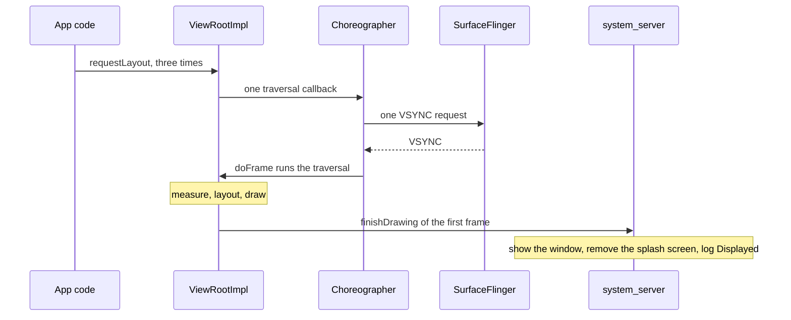

import Snippet from '../../../components/Snippet.astro';
import GoDeeper from '../../../components/GoDeeper.astro';

## The problem

Section 1 follows one cold start of the launch app. In `onCreate`, the activity of the launch app makes a `TextView`, sets its text and sets the `TextView` as its content view. When `onCreate` returns, the display does not show the text. The app must measure the view, lay it out and draw it. In this chapter, one pass of these three steps is a traversal.

Code can change a view many times before the display shows the next frame. Each change asks for new work. For example, if a `TextView` has a text layout, `setText` calls `checkForRelayout`[^textview-7524]. `checkForRelayout` calls `invalidate`. If the new text can change the size of the view, it also calls `requestLayout`[^textview-11770].

The display does not show each change. A VSYNC (vertical sync) is a signal at the start of a display frame. If an app asks for a VSYNC, the system sends one VSYNC when the next display frame begins[^displayeventreceiver-341]. For the next VSYNC, the app must ask again[^displayeventreceiver-240].

Thus the app must decide when it runs a traversal. This chapter builds a renderer that runs a traversal for each change, and shows where it breaks. Then it shows how `ViewRootImpl` and `Choreographer` collect the changes and run one traversal at the next VSYNC. At the end, it follows the first frame of the launch app to `system_server`, which measures the time to the first frame.

## Build it naive

The rebuild is a renderer in plain Kotlin, in the module `samples/first-frame`. It uses no `android.*` types. A data class with one text field stands in for `TextView`. A `Frame` is the result of one draw: the text, its x position and its width:

<Snippet file="first-frame/src/main/kotlin/NaiveRenderer.kt" region="view" />

A fake display stands in for the display and for its VSYNC source. The test fires each VSYNC with `vsync()`, so the rebuild has no clock and no thread. At each VSYNC, the fake display shows the newest frame and adds 1 to `shownFrames`. If the app drew nothing after the last VSYNC, the fake display shows no new frame. `post` keeps only the newest frame, so a later draw before the next VSYNC replaces an earlier draw. This is a choice of the fake display. It is not a claim about the real display:

<Snippet file="first-frame/src/main/kotlin/NaiveRenderer.kt" region="display" />

The renderer runs a full traversal for each `setText` call:

- Measure gives the width of the text: 10 px for each character. This value stands in for a font.
- Layout puts the view in the center of the display.
- Draw posts a `Frame` to the display and adds 1 to `draws`.

<Snippet file="first-frame/src/main/kotlin/NaiveRenderer.kt" region="renderer" />

Two tests show that the rebuild works. In the first test, the text "Hi" on a display 100 px wide gives `Frame("Hi", x = 40, width = 20)` at the next VSYNC. In the second test, a second VSYNC with no new draw keeps `shownFrames` at 1. Thus the display shows a new frame only if the app draws one.

## Where it breaks

The renderer runs a traversal at once for each change. It does not wait for the next VSYNC. The breaking test changes the text three times and then fires one VSYNC:

<Snippet file="first-frame/src/test/kotlin/NaiveRendererTest.kt" region="flaw" />

The test passes, so the flaw occurs. The renderer ran three traversals, but the display showed one frame. The work of two traversals did not reach the display.

Each `setText` call on a real `TextView` with a text layout asks for a new draw, and sometimes for a new layout[^textview-11770]. But the real code does not run a traversal for each request. It collects the requests and runs one traversal at the next VSYNC.

## The real thing

### One Choreographer for each Looper thread

Each `Looper` thread has its own `Choreographer`. Code on other threads can post callbacks to it, but the callbacks run on its `Looper` thread[^choreographer-88]. `Choreographer.getInstance()` returns the `Choreographer` of the thread that calls it. It makes the instance on the first call on each thread. If the thread has no `Looper`, it throws an exception[^choreographer-127][^choreographer-409].

For each window that the app adds, `WindowManagerGlobal.addView` makes a `ViewRootImpl`[^windowmanagerglobal-501]. `ViewRootImpl` is the parent of the root view of the window[^viewrootimpl-338][^viewrootimpl-1905]. The constructor of `ViewRootImpl` gets the `Choreographer` of its thread[^viewrootimpl-1440].

### A change asks for one traversal

`View.requestLayout` marks the view for a new layout. Then it calls `requestLayout` of its parent, unless the parent already has a layout request[^view-28744]. Thus the request goes up the view tree to `ViewRootImpl`. `ViewRootImpl.requestLayout` records the request and calls `scheduleTraversals`[^viewrootimpl-2842].

`scheduleTraversals` acts only if the flag `mTraversalScheduled` is false. It sets the flag. Then it posts a sync barrier to the message queue of the thread, and it posts the traversal to `Choreographer` as a `CALLBACK_TRAVERSAL` callback[^viewrootimpl-3307]. A comment in the method gives the reason for the barrier. Each message that code posts after this point runs after the traversal, unless the message is asynchronous. Thus a `Runnable` that code posts after `setText` can read the new width of the `TextView`[^viewrootimpl-3311].

This flag is the first half of the fix for the rebuild. The first `setText` sets the flag. The second and the third `setText` find the flag set, so they post no new traversal. Their `requestLayout` calls also stop at the first parent that has a layout request.

### Choreographer asks for one VSYNC

`Choreographer` keeps one callback queue for each callback type. If a posted callback is due now, `Choreographer` calls `scheduleFrameLocked`[^choreographer-622]. `scheduleFrameLocked` acts only if the flag `mFrameScheduled` is false. It sets the flag. On the `Looper` thread, it asks for a VSYNC at once. On another thread, it posts an asynchronous message that asks for the VSYNC on the `Looper` thread[^choreographer-919]. To ask, it calls `scheduleVsync` of its `DisplayEventReceiver`[^choreographer-1287]. `scheduleVsync` asks for one VSYNC when the next display frame begins[^displayeventreceiver-341].

This flag is the second half of the fix. Until the next frame runs, each new callback finds the flag set and asks for no new VSYNC.

<GoDeeper title="the path of a VSYNC from SurfaceFlinger to the main thread">

The native receiver of `DisplayEventReceiver` uses the `Looper` of the `MessageQueue` of its thread[^displayeventreceiver-jni-342][^displayeventreceiver-jni-136]. `DisplayEventDispatcher` adds the file descriptor of the receiver to that `Looper`[^displayeventdispatcher-53]. If the dispatcher does not wait for a VSYNC, `scheduleVsync` calls `requestNextVsync`. Then the dispatcher waits for a VSYNC[^displayeventdispatcher-79]. `handleEvent` reads the events from the file descriptor, keeps the last VSYNC and calls `dispatchVsync`[^displayeventdispatcher-113]. The native `dispatchVsync` calls the Java `dispatchVsync`[^displayeventreceiver-jni-203]. The Java `dispatchVsync` calls `onVsync`[^displayeventreceiver-362].

In SurfaceFlinger, `EventThread` keeps a VSYNC request for each connection. `requestNextVsync` changes the request of the connection from `None` to `Single`[^eventthread-417]. A connection with the request `Single` gets the next VSYNC, and its request changes to `SingleSuppressCallback`. At the VSYNC after that, the request changes to `None`. A connection with the request `None` gets no VSYNC[^eventthread-669]. If no connection has a request, `EventThread` cancels its VSYNC callback and waits[^eventthread-555].

`EventThread` schedules its VSYNC callback with its work duration and its ready duration[^eventthread-595]. SurfaceFlinger predicts the next VSYNC of the display. It calls the callback `workDuration + readyDuration` before that VSYNC. `workDuration` is the time that the client needs for its work[^vsyncdispatch-82][^vsyncdispatch-116].

</GoDeeper>

### One VSYNC runs one frame

When the VSYNC comes, `FrameDisplayEventReceiver.onVsync` posts an asynchronous message to the `Looper` thread. The message calls `doFrame`[^choreographer-1593]. The message is asynchronous, so the sync barrier of `ViewRootImpl` does not stop it[^viewrootimpl-3311].

If `mFrameScheduled` is false, `doFrame` does nothing[^choreographer-1113]. In some cases, for example if the frame time goes back, `doFrame` does not clear the flag. It asks for the next VSYNC and stops[^choreographer-1158]. Otherwise, it clears the flag[^choreographer-1187]. Then it runs the callback queues one time, in a fixed order: input, animation, insets animation, traversal and commit[^choreographer-1201]. Thus input and animations run before the traversal of the same frame.

The traversal callback calls `doTraversal`[^viewrootimpl-11445]. `doTraversal` clears `mTraversalScheduled`, removes the sync barrier and calls `performTraversals`[^viewrootimpl-3347]. `performTraversals` measures the view tree, lays it out and draws it[^viewrootimpl-5472][^viewrootimpl-5538][^viewrootimpl-4902].

For the three `setText` calls of the breaking test, the real code thus runs one traversal at the next VSYNC. This traversal measures the last text.

A trace shows each frame as a `Choreographer#doFrame` slice, with the VSYNC ID[^choreographer-1108]. Each callback queue that has due callbacks shows as a slice with its name, for example `traversal`[^choreographer-313][^choreographer-1229]. Measure and layout show as the slices `measure` and `layout`[^viewrootimpl-5472][^viewrootimpl-5538].

If `doFrame` starts one or more frame intervals after the VSYNC, it moves the frame time back to the last VSYNC. If the delay is 30 or more frame intervals, it logs `Skipped N frames!  The application may be doing too much work on its main thread.`[^choreographer-1121] The limit 30 is the default value of the system property `debug.choreographer.skipwarning`[^choreographer-176].

### Compose takes the same path

`AndroidComposeView`, the root of a Compose UI, is a `ViewGroup`[^androidcomposeview-259]. Thus `ViewRootImpl` measures, lays out and draws it on the same path as the `TextView` of the launch app. In its `dispatchDraw`, `AndroidComposeView` runs the Compose measure and layout (`measureAndLayout`)[^androidcomposeview-2220].

Compose also waits for frames through `Choreographer`. `withFrameNanos` posts a `Choreographer.FrameCallback`, through `AndroidUiDispatcher` or directly to `Choreographer`. The callback calls `onFrame` with the frame time. Then `withFrameNanos` resumes with the result of `onFrame`[^androiduiframeclock-32]. `Choreographer.postFrameCallback` puts the callback in the animation queue[^choreographer-732], so it runs before the traversal of the same frame[^choreographer-1201].

### The first frame of the launch app

After `onCreate`, the activity resumes. `handleResumeActivity` first calls `performResumeActivity`, and `performResumeActivity` calls `performResume` on the activity[^activitythread-6006][^activitythread-5963]. Then `handleResumeActivity` adds the decor view of the activity window with `wm.addView`[^activitythread-6035]. Thus the app has no window, and no frame, before the activity resumes.

`WindowManagerGlobal.addView` makes the `ViewRootImpl` of the window. It calls `setView` last. A comment gives the reason: `setView` posts messages that start the work[^windowmanagerglobal-501].

`setView` calls `requestLayout` before it adds the window with `addToDisplayAsUser`. A comment gives the reason: the first relayout must come before other events from the system[^viewrootimpl-1741]. Thus `setView` schedules the first traversal before it adds the window.

At the next VSYNC, the first traversal runs. It measures, lays out and draws the view tree, as each traversal does. It also does more work:

- It calls `relayoutWindow`[^viewrootimpl-4241]. If the window gets a new surface, the traversal initializes the renderer on that surface[^viewrootimpl-4376].
- If the result of the relayout has the flag `RELAYOUT_RES_FIRST_TIME`, `ViewRootImpl` marks the next draw for a report[^viewrootimpl-4831]. For the report, `ViewRootImpl` makes a sync group. The callback of the sync group gets the transaction of the frame and calls `reportDrawFinished`[^viewrootimpl-5002]. `reportDrawFinished` calls `finishDrawing` on the window session, with the transaction[^viewrootimpl-5844].

The draw step calls `ThreadedRenderer.draw`[^viewrootimpl-6319]. On the main thread, `ThreadedRenderer.draw` records the display list of the root view. Then it calls `syncAndDrawFrame`[^threadedrenderer-730][^threadedrenderer-827]. `ThreadedRenderer` sends the render work to a render thread[^threadedrenderer-48].

`ViewRootImpl` also records the start time of its first `ThreadedRenderer.draw` call and the present time of the first frame[^viewrootimpl-6319][^viewrootimpl-5036]. It sends the two times to `system_server` with `reportStartInfoViewTimestamps`[^viewrootimpl-5064].

### system_server shows the window and measures TTID

On a cold start, the process of the app does not run when the launch starts. If the process does not run, `getStartingWindowType` picks the splash screen as the starting window, unless the activity is the home activity[^activityrecord-2452].

Since Android 12, the system always shows the system default splash screen on cold and warm starts, for all apps[^android-12-splash]. Thus, on a cold start, the user sees the splash screen until the first frame.

In `system_server`, `WindowState.finishDrawing` takes the transaction of the frame[^windowstate-6109]. When `system_server` shows the first window of the activity, `ActivityRecord.onFirstWindowDrawn` removes the splash screen[^activityrecord-6573]. When `system_server` marks all windows of the activity as drawn, `onWindowsDrawn` tells `ActivityMetricsLogger`[^activityrecord-6696][^activityrecord-6649].

<GoDeeper title="the draw states of a window">

`WindowStateAnimator` gives a window one of five draw states: `NO_SURFACE`, `DRAW_PENDING`, `COMMIT_DRAW_PENDING`, `READY_TO_SHOW` and `HAS_DRAWN`. In `DRAW_PENDING`, the surface exists, but the app has not drawn the window, and the surface stays hidden[^windowstateanimator-119].

In some syncs, `WindowState.finishDrawing` merges the transaction of the app directly into the sync transaction of the window. Otherwise, it gives the transaction to `WindowStateAnimator.finishDrawingLocked`. `finishDrawingLocked` merges the transaction into the transaction that `getSyncTransaction` returns[^windowstate-6109][^windowstateanimator-227]. `finishDrawingLocked` moves the state from `DRAW_PENDING` to `COMMIT_DRAW_PENDING`[^windowstateanimator-227]. Later, `commitFinishDrawingLocked` moves the state to `READY_TO_SHOW`. If the activity can show its windows, it calls `performShowLocked`[^windowstateanimator-257].

If the state is `READY_TO_SHOW` or `HAS_DRAWN`, `performShowLocked` calls `ActivityRecord.onFirstWindowDrawn`. Then, if the state is `READY_TO_SHOW` and the window is ready for display, it sets the state to `HAS_DRAWN`[^windowstate-4606].

`onFirstWindowDrawn` calls `removeStartingWindow`. Then it updates the reported visibility of the activity[^activityrecord-6573]. If the activity is in a sync, the removal of the splash screen waits until the sync transaction commits[^activityrecord-2812][^activityrecord-2778]. When `system_server` marks all windows of the activity as drawn, `updateReportedVisibilityLocked` calls `onWindowsDrawn`[^activityrecord-6696].

</GoDeeper>

Time to initial display (TTID) is the time to display the first frame of the app. On a cold start, it includes the process start, the creation of the activity and the display of the first frame[^launch-time-ttid].

`system_server` measures TTID. `ActivityMetricsLogger.notifyWindowsDrawn` calculates the delay from the start of the launch to the time when `system_server` marks all windows of the activity as drawn[^activitymetricslogger-1047][^activitymetricslogger-516]. It also stores this time as `START_TIMESTAMP_FIRST_FRAME` in the `ApplicationStartInfo` of the process[^activitymetricslogger-1067]. Thus TTID ends when `system_server` marks the windows as drawn. It does not end when the display shows the frame.

For a cold or a warm start, `logAppDisplayed` writes the delay in the Logcat line `Displayed <component> for user <id>: +<time>`[^activitymetricslogger-1514][^activitymetricslogger-609]. `onWindowsDrawn` gives the same delay and the launch state to `ActivityTaskSupervisor.reportActivityLaunched`[^activityrecord-6649]. `reportActivityLaunched` writes them into the `WaitResult` of each `am start -W` call that waits for the activity[^activitytasksupervisor-657]. The Android docs give the `Displayed` line and `am start -S -W` as two ways to get TTID[^launch-time-retrieve-ttid]. Prompt 2 of "Try it" uses both.

## Mental model

A change to a view does not draw. It asks for one traversal. `ViewRootImpl` keeps at most one traversal request (`mTraversalScheduled`), and `Choreographer` keeps at most one VSYNC request (`mFrameScheduled`). At the VSYNC, `doFrame` runs the input and animation callbacks, and then the one traversal: measure, layout and draw. The draw records a display list, and the render thread draws the frame. If no code asks for a frame, no VSYNC comes, and the app draws nothing. On a cold start, `setView` asks for the first traversal after the activity resumes. The first traversal gets a surface and reports its draw to `system_server`. `system_server` shows the window, removes the splash screen and writes TTID in the `Displayed` line.



## Try it

### 1. Tie the rebuild to VSYNC

Change the rebuild so that `setText` asks for one traversal at the next VSYNC, as `scheduleTraversals` does:

1. In `FakeDisplay`, add `postFrameCallback(callback: () -> Unit)`. It adds the callback to a list. In `vsync()`, first run the callbacks and clear the list. Then show the newest frame.
2. In `NaiveRenderer`, add the flag `traversalScheduled`. In `setText`, change the text. If the flag is false, set it and post one callback with `postFrameCallback`. The callback clears the flag and calls `traverse()`.

From the repo root, run the tests of the rebuild:

```sh
samples/gradlew -p samples :first-frame:test
```

The breaking test fails, because the flaw is gone: three `setText` calls give one draw. The other two tests pass, so the display still shows the text at the next VSYNC, and it still shows no new frame without a draw. The Gradle output includes these lines:

```
NaiveRendererTest > naiveRenderer_drawsThreeTimes_whenTextChangesThreeTimesBeforeOneVsync() FAILED
    org.opentest4j.AssertionFailedError at NaiveRendererTest.kt:35

3 tests completed, 1 failed
```

### 2. Measure TTID of the launch app

Start an emulator with the system image of the checked stamp. From the repo root, install the release build of the launch app:

```sh
samples/gradlew -p samples :launch-app:installLaunchPathRelease
```

Stop the app, start it again and wait for its first frame:

```sh
adb shell am start -S -W -n io.github.imgurpreetsk.afp.launchapp/.MainActivity
```

{/* Edit step: capture this output on the emulator of the checked stamp. */}

```
Stopping: io.github.imgurpreetsk.afp.launchapp
Starting: Intent { … }
Status: ok
LaunchState: COLD
Activity: io.github.imgurpreetsk.afp.launchapp/.MainActivity
TotalTime: …
WaitTime: …
Complete
```

- With `-S`, `am start` stops the app first and prints `Stopping:`[^activitymanagershellcommand-809]. Thus the launch starts a new process. `LAUNCH_STATE_COLD` is a launch in which a new process starts, and `launchStateToString` gives `COLD` for it[^waitresult-57][^waitresult-133].
- With `-W`, `am start` calls `startActivityAndWait`. Then it prints `Status`, `LaunchState`, `Activity`, `TotalTime`, `WaitTime` and `Complete`[^activitymanagershellcommand-894][^activitymanagershellcommand-982]. `TotalTime` is the delay that `reportActivityLaunched` wrote into the `WaitResult`[^activitytasksupervisor-657]: the TTID that `system_server` measured.

Find the `Displayed` line of the launch:

```sh
adb logcat -d -e "Displayed io.github.imgurpreetsk.afp.launchapp"
```

{/* Edit step: capture this output on the emulator of the checked stamp. */}

```
… I ActivityTaskManager: Displayed io.github.imgurpreetsk.afp.launchapp/.MainActivity for user 0: +…ms
```

`system_server` writes this line in `logAppDisplayed`[^activitymetricslogger-1514]. The time after `+` and `TotalTime` are the same value, because both come from the delay of `notifyWindowsDrawn`[^activityrecord-6649][^activitymetricslogger-1047]. On this cold start, the time includes the process start, `onCreate`, the resume step, the first traversal and the first draw[^launch-time-ttid]. It ends when `system_server` marks the windows of the activity as drawn, not when the display shows the frame[^activitymetricslogger-1047].

### 3. Count the frames of an idle app

After prompt 2, do not touch the emulator. Print the frame count of the app two times, 10 seconds apart:

```sh
adb shell "dumpsys gfxinfo io.github.imgurpreetsk.afp.launchapp | grep -m 1 'Total frames rendered'"
sleep 10
adb shell "dumpsys gfxinfo io.github.imgurpreetsk.afp.launchapp | grep -m 1 'Total frames rendered'"
```

{/* Edit step: capture this output on the emulator of the checked stamp. */}

```
Total frames rendered: …
Total frames rendered: …
```

The two values are equal. Thus the idle app rendered no frame in 10 seconds.

- The app answers `dumpsys gfxinfo` in `handleDumpGfxInfo`[^activitythread-5724][^threadedrenderer-695]. `ProfileData::dump` prints the line `Total frames rendered`[^profiledata-112]. `reportFrame` adds 1 to the count[^profiledata-175]. `JankTracker::finishFrame` calls `reportFrame` for each finished frame[^janktracker-170]. With `-m 1`, `grep` prints only the first line that matches.
- The `TextView` of the launch app does not change, so no code posts a callback to `Choreographer`. Thus `Choreographer` does not call `scheduleVsync`[^choreographer-622][^choreographer-919]. SurfaceFlinger sends no VSYNC to a connection that did not ask for one[^eventthread-669]. Without a VSYNC, `doFrame` does not run[^choreographer-1593], and the app draws no frame.

The rebuild shows the same behavior. In its second test, a VSYNC with no new draw gives no new frame.

[^textview-7524]: TextView.java, lines 7524–7526: [https://android.googlesource.com/platform/frameworks/base/+/refs/tags/android-17.0.0_r1/core/java/android/widget/TextView.java#7524](https://android.googlesource.com/platform/frameworks/base/+/refs/tags/android-17.0.0_r1/core/java/android/widget/TextView.java#7524)
[^textview-11770]: TextView.java, lines 11770–11822: [https://android.googlesource.com/platform/frameworks/base/+/refs/tags/android-17.0.0_r1/core/java/android/widget/TextView.java#11770](https://android.googlesource.com/platform/frameworks/base/+/refs/tags/android-17.0.0_r1/core/java/android/widget/TextView.java#11770)
[^displayeventreceiver-341]: DisplayEventReceiver.java, lines 341–353: [https://android.googlesource.com/platform/frameworks/base/+/refs/tags/android-17.0.0_r1/core/java/android/view/DisplayEventReceiver.java#341](https://android.googlesource.com/platform/frameworks/base/+/refs/tags/android-17.0.0_r1/core/java/android/view/DisplayEventReceiver.java#341)
[^displayeventreceiver-240]: DisplayEventReceiver.java, lines 240–253: [https://android.googlesource.com/platform/frameworks/base/+/refs/tags/android-17.0.0_r1/core/java/android/view/DisplayEventReceiver.java#240](https://android.googlesource.com/platform/frameworks/base/+/refs/tags/android-17.0.0_r1/core/java/android/view/DisplayEventReceiver.java#240)
[^choreographer-88]: Choreographer.java, lines 88–91: [https://android.googlesource.com/platform/frameworks/base/+/refs/tags/android-17.0.0_r1/core/java/android/view/Choreographer.java#88](https://android.googlesource.com/platform/frameworks/base/+/refs/tags/android-17.0.0_r1/core/java/android/view/Choreographer.java#88)
[^choreographer-127]: Choreographer.java, lines 127–139: [https://android.googlesource.com/platform/frameworks/base/+/refs/tags/android-17.0.0_r1/core/java/android/view/Choreographer.java#127](https://android.googlesource.com/platform/frameworks/base/+/refs/tags/android-17.0.0_r1/core/java/android/view/Choreographer.java#127)
[^choreographer-409]: Choreographer.java, lines 409–411: [https://android.googlesource.com/platform/frameworks/base/+/refs/tags/android-17.0.0_r1/core/java/android/view/Choreographer.java#409](https://android.googlesource.com/platform/frameworks/base/+/refs/tags/android-17.0.0_r1/core/java/android/view/Choreographer.java#409)
[^windowmanagerglobal-501]: WindowManagerGlobal.java, lines 501–516: [https://android.googlesource.com/platform/frameworks/base/+/refs/tags/android-17.0.0_r1/core/java/android/view/WindowManagerGlobal.java#501](https://android.googlesource.com/platform/frameworks/base/+/refs/tags/android-17.0.0_r1/core/java/android/view/WindowManagerGlobal.java#501)
[^viewrootimpl-338]: ViewRootImpl.java, line 338: [https://android.googlesource.com/platform/frameworks/base/+/refs/tags/android-17.0.0_r1/core/java/android/view/ViewRootImpl.java#338](https://android.googlesource.com/platform/frameworks/base/+/refs/tags/android-17.0.0_r1/core/java/android/view/ViewRootImpl.java#338)
[^viewrootimpl-1905]: ViewRootImpl.java, line 1905: [https://android.googlesource.com/platform/frameworks/base/+/refs/tags/android-17.0.0_r1/core/java/android/view/ViewRootImpl.java#1905](https://android.googlesource.com/platform/frameworks/base/+/refs/tags/android-17.0.0_r1/core/java/android/view/ViewRootImpl.java#1905)
[^viewrootimpl-1440]: ViewRootImpl.java, line 1440: [https://android.googlesource.com/platform/frameworks/base/+/refs/tags/android-17.0.0_r1/core/java/android/view/ViewRootImpl.java#1440](https://android.googlesource.com/platform/frameworks/base/+/refs/tags/android-17.0.0_r1/core/java/android/view/ViewRootImpl.java#1440)
[^view-28744]: View.java, lines 28744–28749: [https://android.googlesource.com/platform/frameworks/base/+/refs/tags/android-17.0.0_r1/core/java/android/view/View.java#28744](https://android.googlesource.com/platform/frameworks/base/+/refs/tags/android-17.0.0_r1/core/java/android/view/View.java#28744)
[^viewrootimpl-2842]: ViewRootImpl.java, lines 2842–2848: [https://android.googlesource.com/platform/frameworks/base/+/refs/tags/android-17.0.0_r1/core/java/android/view/ViewRootImpl.java#2842](https://android.googlesource.com/platform/frameworks/base/+/refs/tags/android-17.0.0_r1/core/java/android/view/ViewRootImpl.java#2842)
[^viewrootimpl-3307]: ViewRootImpl.java, lines 3307–3335: [https://android.googlesource.com/platform/frameworks/base/+/refs/tags/android-17.0.0_r1/core/java/android/view/ViewRootImpl.java#3307](https://android.googlesource.com/platform/frameworks/base/+/refs/tags/android-17.0.0_r1/core/java/android/view/ViewRootImpl.java#3307)
[^viewrootimpl-3311]: ViewRootImpl.java, lines 3311–3328: [https://android.googlesource.com/platform/frameworks/base/+/refs/tags/android-17.0.0_r1/core/java/android/view/ViewRootImpl.java#3311](https://android.googlesource.com/platform/frameworks/base/+/refs/tags/android-17.0.0_r1/core/java/android/view/ViewRootImpl.java#3311)
[^choreographer-622]: Choreographer.java, lines 622–644: [https://android.googlesource.com/platform/frameworks/base/+/refs/tags/android-17.0.0_r1/core/java/android/view/Choreographer.java#622](https://android.googlesource.com/platform/frameworks/base/+/refs/tags/android-17.0.0_r1/core/java/android/view/Choreographer.java#622)
[^choreographer-919]: Choreographer.java, lines 919–948: [https://android.googlesource.com/platform/frameworks/base/+/refs/tags/android-17.0.0_r1/core/java/android/view/Choreographer.java#919](https://android.googlesource.com/platform/frameworks/base/+/refs/tags/android-17.0.0_r1/core/java/android/view/Choreographer.java#919)
[^choreographer-1287]: Choreographer.java, lines 1287–1294: [https://android.googlesource.com/platform/frameworks/base/+/refs/tags/android-17.0.0_r1/core/java/android/view/Choreographer.java#1287](https://android.googlesource.com/platform/frameworks/base/+/refs/tags/android-17.0.0_r1/core/java/android/view/Choreographer.java#1287)
[^displayeventreceiver-jni-342]: android_view_DisplayEventReceiver.cpp, lines 342–363: [https://android.googlesource.com/platform/frameworks/base/+/refs/tags/android-17.0.0_r1/core/jni/android_view_DisplayEventReceiver.cpp#342](https://android.googlesource.com/platform/frameworks/base/+/refs/tags/android-17.0.0_r1/core/jni/android_view_DisplayEventReceiver.cpp#342)
[^displayeventreceiver-jni-136]: android_view_DisplayEventReceiver.cpp, lines 136–145: [https://android.googlesource.com/platform/frameworks/base/+/refs/tags/android-17.0.0_r1/core/jni/android_view_DisplayEventReceiver.cpp#136](https://android.googlesource.com/platform/frameworks/base/+/refs/tags/android-17.0.0_r1/core/jni/android_view_DisplayEventReceiver.cpp#136)
[^displayeventdispatcher-53]: DisplayEventDispatcher.cpp, lines 53–69: [https://android.googlesource.com/platform/frameworks/native/+/refs/tags/android-17.0.0_r1/libs/gui/DisplayEventDispatcher.cpp#53](https://android.googlesource.com/platform/frameworks/native/+/refs/tags/android-17.0.0_r1/libs/gui/DisplayEventDispatcher.cpp#53)
[^displayeventdispatcher-79]: DisplayEventDispatcher.cpp, lines 79–103: [https://android.googlesource.com/platform/frameworks/native/+/refs/tags/android-17.0.0_r1/libs/gui/DisplayEventDispatcher.cpp#79](https://android.googlesource.com/platform/frameworks/native/+/refs/tags/android-17.0.0_r1/libs/gui/DisplayEventDispatcher.cpp#79)
[^displayeventdispatcher-113]: DisplayEventDispatcher.cpp, lines 113–141: [https://android.googlesource.com/platform/frameworks/native/+/refs/tags/android-17.0.0_r1/libs/gui/DisplayEventDispatcher.cpp#113](https://android.googlesource.com/platform/frameworks/native/+/refs/tags/android-17.0.0_r1/libs/gui/DisplayEventDispatcher.cpp#113)
[^displayeventreceiver-jni-203]: android_view_DisplayEventReceiver.cpp, lines 203–256: [https://android.googlesource.com/platform/frameworks/base/+/refs/tags/android-17.0.0_r1/core/jni/android_view_DisplayEventReceiver.cpp#203](https://android.googlesource.com/platform/frameworks/base/+/refs/tags/android-17.0.0_r1/core/jni/android_view_DisplayEventReceiver.cpp#203)
[^displayeventreceiver-362]: DisplayEventReceiver.java, lines 362–366: [https://android.googlesource.com/platform/frameworks/base/+/refs/tags/android-17.0.0_r1/core/java/android/view/DisplayEventReceiver.java#362](https://android.googlesource.com/platform/frameworks/base/+/refs/tags/android-17.0.0_r1/core/java/android/view/DisplayEventReceiver.java#362)
[^eventthread-417]: EventThread.cpp, lines 417–428: [https://android.googlesource.com/platform/frameworks/native/+/refs/tags/android-17.0.0_r1/services/surfaceflinger/Scheduler/EventThread.cpp#417](https://android.googlesource.com/platform/frameworks/native/+/refs/tags/android-17.0.0_r1/services/surfaceflinger/Scheduler/EventThread.cpp#417)
[^eventthread-669]: EventThread.cpp, lines 669–682: [https://android.googlesource.com/platform/frameworks/native/+/refs/tags/android-17.0.0_r1/services/surfaceflinger/Scheduler/EventThread.cpp#669](https://android.googlesource.com/platform/frameworks/native/+/refs/tags/android-17.0.0_r1/services/surfaceflinger/Scheduler/EventThread.cpp#669)
[^eventthread-555]: EventThread.cpp, lines 555–612: [https://android.googlesource.com/platform/frameworks/native/+/refs/tags/android-17.0.0_r1/services/surfaceflinger/Scheduler/EventThread.cpp#555](https://android.googlesource.com/platform/frameworks/native/+/refs/tags/android-17.0.0_r1/services/surfaceflinger/Scheduler/EventThread.cpp#555)
[^eventthread-595]: EventThread.cpp, lines 595–601: [https://android.googlesource.com/platform/frameworks/native/+/refs/tags/android-17.0.0_r1/services/surfaceflinger/Scheduler/EventThread.cpp#595](https://android.googlesource.com/platform/frameworks/native/+/refs/tags/android-17.0.0_r1/services/surfaceflinger/Scheduler/EventThread.cpp#595)
[^vsyncdispatch-82]: VSyncDispatch.h, lines 82–101: [https://android.googlesource.com/platform/frameworks/native/+/refs/tags/android-17.0.0_r1/services/surfaceflinger/Scheduler/VSyncDispatch.h#82](https://android.googlesource.com/platform/frameworks/native/+/refs/tags/android-17.0.0_r1/services/surfaceflinger/Scheduler/VSyncDispatch.h#82)
[^vsyncdispatch-116]: VSyncDispatch.h, lines 116–125: [https://android.googlesource.com/platform/frameworks/native/+/refs/tags/android-17.0.0_r1/services/surfaceflinger/Scheduler/VSyncDispatch.h#116](https://android.googlesource.com/platform/frameworks/native/+/refs/tags/android-17.0.0_r1/services/surfaceflinger/Scheduler/VSyncDispatch.h#116)
[^choreographer-1593]: Choreographer.java, lines 1593–1641: [https://android.googlesource.com/platform/frameworks/base/+/refs/tags/android-17.0.0_r1/core/java/android/view/Choreographer.java#1593](https://android.googlesource.com/platform/frameworks/base/+/refs/tags/android-17.0.0_r1/core/java/android/view/Choreographer.java#1593)
[^choreographer-1113]: Choreographer.java, lines 1113–1117: [https://android.googlesource.com/platform/frameworks/base/+/refs/tags/android-17.0.0_r1/core/java/android/view/Choreographer.java#1113](https://android.googlesource.com/platform/frameworks/base/+/refs/tags/android-17.0.0_r1/core/java/android/view/Choreographer.java#1113)
[^choreographer-1158]: Choreographer.java, lines 1158–1181: [https://android.googlesource.com/platform/frameworks/base/+/refs/tags/android-17.0.0_r1/core/java/android/view/Choreographer.java#1158](https://android.googlesource.com/platform/frameworks/base/+/refs/tags/android-17.0.0_r1/core/java/android/view/Choreographer.java#1158)
[^choreographer-1187]: Choreographer.java, line 1187: [https://android.googlesource.com/platform/frameworks/base/+/refs/tags/android-17.0.0_r1/core/java/android/view/Choreographer.java#1187](https://android.googlesource.com/platform/frameworks/base/+/refs/tags/android-17.0.0_r1/core/java/android/view/Choreographer.java#1187)
[^choreographer-1201]: Choreographer.java, lines 1201–1211: [https://android.googlesource.com/platform/frameworks/base/+/refs/tags/android-17.0.0_r1/core/java/android/view/Choreographer.java#1201](https://android.googlesource.com/platform/frameworks/base/+/refs/tags/android-17.0.0_r1/core/java/android/view/Choreographer.java#1201)
[^viewrootimpl-11445]: ViewRootImpl.java, lines 11445–11451: [https://android.googlesource.com/platform/frameworks/base/+/refs/tags/android-17.0.0_r1/core/java/android/view/ViewRootImpl.java#11445](https://android.googlesource.com/platform/frameworks/base/+/refs/tags/android-17.0.0_r1/core/java/android/view/ViewRootImpl.java#11445)
[^viewrootimpl-3347]: ViewRootImpl.java, lines 3347–3353: [https://android.googlesource.com/platform/frameworks/base/+/refs/tags/android-17.0.0_r1/core/java/android/view/ViewRootImpl.java#3347](https://android.googlesource.com/platform/frameworks/base/+/refs/tags/android-17.0.0_r1/core/java/android/view/ViewRootImpl.java#3347)
[^viewrootimpl-5472]: ViewRootImpl.java, lines 5472–5485: [https://android.googlesource.com/platform/frameworks/base/+/refs/tags/android-17.0.0_r1/core/java/android/view/ViewRootImpl.java#5472](https://android.googlesource.com/platform/frameworks/base/+/refs/tags/android-17.0.0_r1/core/java/android/view/ViewRootImpl.java#5472)
[^viewrootimpl-5538]: ViewRootImpl.java, lines 5538–5554: [https://android.googlesource.com/platform/frameworks/base/+/refs/tags/android-17.0.0_r1/core/java/android/view/ViewRootImpl.java#5538](https://android.googlesource.com/platform/frameworks/base/+/refs/tags/android-17.0.0_r1/core/java/android/view/ViewRootImpl.java#5538)
[^viewrootimpl-4902]: ViewRootImpl.java, lines 4902–4907: [https://android.googlesource.com/platform/frameworks/base/+/refs/tags/android-17.0.0_r1/core/java/android/view/ViewRootImpl.java#4902](https://android.googlesource.com/platform/frameworks/base/+/refs/tags/android-17.0.0_r1/core/java/android/view/ViewRootImpl.java#4902)
[^choreographer-1108]: Choreographer.java, lines 1108–1110: [https://android.googlesource.com/platform/frameworks/base/+/refs/tags/android-17.0.0_r1/core/java/android/view/Choreographer.java#1108](https://android.googlesource.com/platform/frameworks/base/+/refs/tags/android-17.0.0_r1/core/java/android/view/Choreographer.java#1108)
[^choreographer-313]: Choreographer.java, lines 313–315: [https://android.googlesource.com/platform/frameworks/base/+/refs/tags/android-17.0.0_r1/core/java/android/view/Choreographer.java#313](https://android.googlesource.com/platform/frameworks/base/+/refs/tags/android-17.0.0_r1/core/java/android/view/Choreographer.java#313)
[^choreographer-1229]: Choreographer.java, lines 1229–1265: [https://android.googlesource.com/platform/frameworks/base/+/refs/tags/android-17.0.0_r1/core/java/android/view/Choreographer.java#1229](https://android.googlesource.com/platform/frameworks/base/+/refs/tags/android-17.0.0_r1/core/java/android/view/Choreographer.java#1229)
[^choreographer-1121]: Choreographer.java, lines 1121–1136: [https://android.googlesource.com/platform/frameworks/base/+/refs/tags/android-17.0.0_r1/core/java/android/view/Choreographer.java#1121](https://android.googlesource.com/platform/frameworks/base/+/refs/tags/android-17.0.0_r1/core/java/android/view/Choreographer.java#1121)
[^choreographer-176]: Choreographer.java, lines 176–179: [https://android.googlesource.com/platform/frameworks/base/+/refs/tags/android-17.0.0_r1/core/java/android/view/Choreographer.java#176](https://android.googlesource.com/platform/frameworks/base/+/refs/tags/android-17.0.0_r1/core/java/android/view/Choreographer.java#176)
[^androidcomposeview-259]: AndroidComposeView.android.kt, lines 259–260: [https://android.googlesource.com/platform/frameworks/support/+/5e0747401bf56b243e3b5141ae080dc9bc61d29c/compose/ui/ui/src/androidMain/kotlin/androidx/compose/ui/platform/AndroidComposeView.android.kt#259](https://android.googlesource.com/platform/frameworks/support/+/5e0747401bf56b243e3b5141ae080dc9bc61d29c/compose/ui/ui/src/androidMain/kotlin/androidx/compose/ui/platform/AndroidComposeView.android.kt#259)
[^androidcomposeview-2220]: AndroidComposeView.android.kt, lines 2220–2224: [https://android.googlesource.com/platform/frameworks/support/+/5e0747401bf56b243e3b5141ae080dc9bc61d29c/compose/ui/ui/src/androidMain/kotlin/androidx/compose/ui/platform/AndroidComposeView.android.kt#2220](https://android.googlesource.com/platform/frameworks/support/+/5e0747401bf56b243e3b5141ae080dc9bc61d29c/compose/ui/ui/src/androidMain/kotlin/androidx/compose/ui/platform/AndroidComposeView.android.kt#2220)
[^androiduiframeclock-32]: AndroidUiFrameClock.android.kt, lines 32–57: [https://android.googlesource.com/platform/frameworks/support/+/5e0747401bf56b243e3b5141ae080dc9bc61d29c/compose/ui/ui/src/androidMain/kotlin/androidx/compose/ui/platform/AndroidUiFrameClock.android.kt#32](https://android.googlesource.com/platform/frameworks/support/+/5e0747401bf56b243e3b5141ae080dc9bc61d29c/compose/ui/ui/src/androidMain/kotlin/androidx/compose/ui/platform/AndroidUiFrameClock.android.kt#32)
[^choreographer-732]: Choreographer.java, lines 732–755: [https://android.googlesource.com/platform/frameworks/base/+/refs/tags/android-17.0.0_r1/core/java/android/view/Choreographer.java#732](https://android.googlesource.com/platform/frameworks/base/+/refs/tags/android-17.0.0_r1/core/java/android/view/Choreographer.java#732)
[^activitythread-6006]: ActivityThread.java, line 6006: [https://android.googlesource.com/platform/frameworks/base/+/refs/tags/android-17.0.0_r1/core/java/android/app/ActivityThread.java#6006](https://android.googlesource.com/platform/frameworks/base/+/refs/tags/android-17.0.0_r1/core/java/android/app/ActivityThread.java#6006)
[^activitythread-5963]: ActivityThread.java, line 5963: [https://android.googlesource.com/platform/frameworks/base/+/refs/tags/android-17.0.0_r1/core/java/android/app/ActivityThread.java#5963](https://android.googlesource.com/platform/frameworks/base/+/refs/tags/android-17.0.0_r1/core/java/android/app/ActivityThread.java#5963)
[^activitythread-6035]: ActivityThread.java, lines 6035–6059: [https://android.googlesource.com/platform/frameworks/base/+/refs/tags/android-17.0.0_r1/core/java/android/app/ActivityThread.java#6035](https://android.googlesource.com/platform/frameworks/base/+/refs/tags/android-17.0.0_r1/core/java/android/app/ActivityThread.java#6035)
[^viewrootimpl-1741]: ViewRootImpl.java, lines 1741–1786: [https://android.googlesource.com/platform/frameworks/base/+/refs/tags/android-17.0.0_r1/core/java/android/view/ViewRootImpl.java#1741](https://android.googlesource.com/platform/frameworks/base/+/refs/tags/android-17.0.0_r1/core/java/android/view/ViewRootImpl.java#1741)
[^viewrootimpl-4241]: ViewRootImpl.java, line 4241: [https://android.googlesource.com/platform/frameworks/base/+/refs/tags/android-17.0.0_r1/core/java/android/view/ViewRootImpl.java#4241](https://android.googlesource.com/platform/frameworks/base/+/refs/tags/android-17.0.0_r1/core/java/android/view/ViewRootImpl.java#4241)
[^viewrootimpl-4376]: ViewRootImpl.java, lines 4376–4399: [https://android.googlesource.com/platform/frameworks/base/+/refs/tags/android-17.0.0_r1/core/java/android/view/ViewRootImpl.java#4376](https://android.googlesource.com/platform/frameworks/base/+/refs/tags/android-17.0.0_r1/core/java/android/view/ViewRootImpl.java#4376)
[^viewrootimpl-4831]: ViewRootImpl.java, lines 4831–4833: [https://android.googlesource.com/platform/frameworks/base/+/refs/tags/android-17.0.0_r1/core/java/android/view/ViewRootImpl.java#4831](https://android.googlesource.com/platform/frameworks/base/+/refs/tags/android-17.0.0_r1/core/java/android/view/ViewRootImpl.java#4831)
[^viewrootimpl-6319]: ViewRootImpl.java, lines 6319–6325: [https://android.googlesource.com/platform/frameworks/base/+/refs/tags/android-17.0.0_r1/core/java/android/view/ViewRootImpl.java#6319](https://android.googlesource.com/platform/frameworks/base/+/refs/tags/android-17.0.0_r1/core/java/android/view/ViewRootImpl.java#6319)
[^threadedrenderer-730]: ThreadedRenderer.java, lines 730–788: [https://android.googlesource.com/platform/frameworks/base/+/refs/tags/android-17.0.0_r1/core/java/android/view/ThreadedRenderer.java#730](https://android.googlesource.com/platform/frameworks/base/+/refs/tags/android-17.0.0_r1/core/java/android/view/ThreadedRenderer.java#730)
[^threadedrenderer-827]: ThreadedRenderer.java, lines 827–859: [https://android.googlesource.com/platform/frameworks/base/+/refs/tags/android-17.0.0_r1/core/java/android/view/ThreadedRenderer.java#827](https://android.googlesource.com/platform/frameworks/base/+/refs/tags/android-17.0.0_r1/core/java/android/view/ThreadedRenderer.java#827)
[^threadedrenderer-48]: ThreadedRenderer.java, lines 48–66: [https://android.googlesource.com/platform/frameworks/base/+/refs/tags/android-17.0.0_r1/core/java/android/view/ThreadedRenderer.java#48](https://android.googlesource.com/platform/frameworks/base/+/refs/tags/android-17.0.0_r1/core/java/android/view/ThreadedRenderer.java#48)
[^viewrootimpl-5002]: ViewRootImpl.java, lines 5002–5032: [https://android.googlesource.com/platform/frameworks/base/+/refs/tags/android-17.0.0_r1/core/java/android/view/ViewRootImpl.java#5002](https://android.googlesource.com/platform/frameworks/base/+/refs/tags/android-17.0.0_r1/core/java/android/view/ViewRootImpl.java#5002)
[^viewrootimpl-5844]: ViewRootImpl.java, lines 5844–5858: [https://android.googlesource.com/platform/frameworks/base/+/refs/tags/android-17.0.0_r1/core/java/android/view/ViewRootImpl.java#5844](https://android.googlesource.com/platform/frameworks/base/+/refs/tags/android-17.0.0_r1/core/java/android/view/ViewRootImpl.java#5844)
[^viewrootimpl-5036]: ViewRootImpl.java, lines 5036–5055: [https://android.googlesource.com/platform/frameworks/base/+/refs/tags/android-17.0.0_r1/core/java/android/view/ViewRootImpl.java#5036](https://android.googlesource.com/platform/frameworks/base/+/refs/tags/android-17.0.0_r1/core/java/android/view/ViewRootImpl.java#5036)
[^viewrootimpl-5064]: ViewRootImpl.java, lines 5064–5088: [https://android.googlesource.com/platform/frameworks/base/+/refs/tags/android-17.0.0_r1/core/java/android/view/ViewRootImpl.java#5064](https://android.googlesource.com/platform/frameworks/base/+/refs/tags/android-17.0.0_r1/core/java/android/view/ViewRootImpl.java#5064)
[^activityrecord-2452]: ActivityRecord.java, lines 2452–2456: [https://android.googlesource.com/platform/frameworks/base/+/refs/tags/android-17.0.0_r1/services/core/java/com/android/server/wm/ActivityRecord.java#2452](https://android.googlesource.com/platform/frameworks/base/+/refs/tags/android-17.0.0_r1/services/core/java/com/android/server/wm/ActivityRecord.java#2452)
[^windowstate-6109]: WindowState.java, lines 6109–6127: [https://android.googlesource.com/platform/frameworks/base/+/refs/tags/android-17.0.0_r1/services/core/java/com/android/server/wm/WindowState.java#6109](https://android.googlesource.com/platform/frameworks/base/+/refs/tags/android-17.0.0_r1/services/core/java/com/android/server/wm/WindowState.java#6109)
[^activityrecord-6573]: ActivityRecord.java, lines 6573–6606: [https://android.googlesource.com/platform/frameworks/base/+/refs/tags/android-17.0.0_r1/services/core/java/com/android/server/wm/ActivityRecord.java#6573](https://android.googlesource.com/platform/frameworks/base/+/refs/tags/android-17.0.0_r1/services/core/java/com/android/server/wm/ActivityRecord.java#6573)
[^activityrecord-6696]: ActivityRecord.java, lines 6696–6730: [https://android.googlesource.com/platform/frameworks/base/+/refs/tags/android-17.0.0_r1/services/core/java/com/android/server/wm/ActivityRecord.java#6696](https://android.googlesource.com/platform/frameworks/base/+/refs/tags/android-17.0.0_r1/services/core/java/com/android/server/wm/ActivityRecord.java#6696)
[^activityrecord-6649]: ActivityRecord.java, lines 6649–6669: [https://android.googlesource.com/platform/frameworks/base/+/refs/tags/android-17.0.0_r1/services/core/java/com/android/server/wm/ActivityRecord.java#6649](https://android.googlesource.com/platform/frameworks/base/+/refs/tags/android-17.0.0_r1/services/core/java/com/android/server/wm/ActivityRecord.java#6649)
[^windowstateanimator-119]: WindowStateAnimator.java, lines 119–132: [https://android.googlesource.com/platform/frameworks/base/+/refs/tags/android-17.0.0_r1/services/core/java/com/android/server/wm/WindowStateAnimator.java#119](https://android.googlesource.com/platform/frameworks/base/+/refs/tags/android-17.0.0_r1/services/core/java/com/android/server/wm/WindowStateAnimator.java#119)
[^windowstateanimator-227]: WindowStateAnimator.java, lines 227–254: [https://android.googlesource.com/platform/frameworks/base/+/refs/tags/android-17.0.0_r1/services/core/java/com/android/server/wm/WindowStateAnimator.java#227](https://android.googlesource.com/platform/frameworks/base/+/refs/tags/android-17.0.0_r1/services/core/java/com/android/server/wm/WindowStateAnimator.java#227)
[^windowstateanimator-257]: WindowStateAnimator.java, lines 257–276: [https://android.googlesource.com/platform/frameworks/base/+/refs/tags/android-17.0.0_r1/services/core/java/com/android/server/wm/WindowStateAnimator.java#257](https://android.googlesource.com/platform/frameworks/base/+/refs/tags/android-17.0.0_r1/services/core/java/com/android/server/wm/WindowStateAnimator.java#257)
[^windowstate-4606]: WindowState.java, lines 4606–4641: [https://android.googlesource.com/platform/frameworks/base/+/refs/tags/android-17.0.0_r1/services/core/java/com/android/server/wm/WindowState.java#4606](https://android.googlesource.com/platform/frameworks/base/+/refs/tags/android-17.0.0_r1/services/core/java/com/android/server/wm/WindowState.java#4606)
[^activityrecord-2812]: ActivityRecord.java, lines 2812–2817: [https://android.googlesource.com/platform/frameworks/base/+/refs/tags/android-17.0.0_r1/services/core/java/com/android/server/wm/ActivityRecord.java#2812](https://android.googlesource.com/platform/frameworks/base/+/refs/tags/android-17.0.0_r1/services/core/java/com/android/server/wm/ActivityRecord.java#2812)
[^activityrecord-2778]: ActivityRecord.java, lines 2778–2790: [https://android.googlesource.com/platform/frameworks/base/+/refs/tags/android-17.0.0_r1/services/core/java/com/android/server/wm/ActivityRecord.java#2778](https://android.googlesource.com/platform/frameworks/base/+/refs/tags/android-17.0.0_r1/services/core/java/com/android/server/wm/ActivityRecord.java#2778)
[^activitymetricslogger-1047]: ActivityMetricsLogger.java, lines 1047–1059: [https://android.googlesource.com/platform/frameworks/base/+/refs/tags/android-17.0.0_r1/services/core/java/com/android/server/wm/ActivityMetricsLogger.java#1047](https://android.googlesource.com/platform/frameworks/base/+/refs/tags/android-17.0.0_r1/services/core/java/com/android/server/wm/ActivityMetricsLogger.java#1047)
[^activitymetricslogger-516]: ActivityMetricsLogger.java, lines 516–520: [https://android.googlesource.com/platform/frameworks/base/+/refs/tags/android-17.0.0_r1/services/core/java/com/android/server/wm/ActivityMetricsLogger.java#516](https://android.googlesource.com/platform/frameworks/base/+/refs/tags/android-17.0.0_r1/services/core/java/com/android/server/wm/ActivityMetricsLogger.java#516)
[^activitymetricslogger-1067]: ActivityMetricsLogger.java, lines 1067–1073: [https://android.googlesource.com/platform/frameworks/base/+/refs/tags/android-17.0.0_r1/services/core/java/com/android/server/wm/ActivityMetricsLogger.java#1067](https://android.googlesource.com/platform/frameworks/base/+/refs/tags/android-17.0.0_r1/services/core/java/com/android/server/wm/ActivityMetricsLogger.java#1067)
[^activitymetricslogger-1514]: ActivityMetricsLogger.java, lines 1514–1528: [https://android.googlesource.com/platform/frameworks/base/+/refs/tags/android-17.0.0_r1/services/core/java/com/android/server/wm/ActivityMetricsLogger.java#1514](https://android.googlesource.com/platform/frameworks/base/+/refs/tags/android-17.0.0_r1/services/core/java/com/android/server/wm/ActivityMetricsLogger.java#1514)
[^activitymetricslogger-609]: ActivityMetricsLogger.java, lines 609–611: [https://android.googlesource.com/platform/frameworks/base/+/refs/tags/android-17.0.0_r1/services/core/java/com/android/server/wm/ActivityMetricsLogger.java#609](https://android.googlesource.com/platform/frameworks/base/+/refs/tags/android-17.0.0_r1/services/core/java/com/android/server/wm/ActivityMetricsLogger.java#609)
[^activitytasksupervisor-657]: ActivityTaskSupervisor.java, lines 657–676: [https://android.googlesource.com/platform/frameworks/base/+/refs/tags/android-17.0.0_r1/services/core/java/com/android/server/wm/ActivityTaskSupervisor.java#657](https://android.googlesource.com/platform/frameworks/base/+/refs/tags/android-17.0.0_r1/services/core/java/com/android/server/wm/ActivityTaskSupervisor.java#657)
[^android-12-splash]: Android 12 behavior changes for all apps, "App splash screens": [https://developer.android.com/about/versions/12/behavior-changes-all#splash-screen-migration](https://developer.android.com/about/versions/12/behavior-changes-all#splash-screen-migration)
[^launch-time-ttid]: App startup time, "Time to initial display": [https://developer.android.com/topic/performance/vitals/launch-time#time-initial](https://developer.android.com/topic/performance/vitals/launch-time#time-initial)
[^launch-time-retrieve-ttid]: App startup time, "Retrieve TTID": [https://developer.android.com/topic/performance/vitals/launch-time#retrieve-TTID](https://developer.android.com/topic/performance/vitals/launch-time#retrieve-TTID)
[^activitymanagershellcommand-809]: ActivityManagerShellCommand.java, lines 809–815: [https://android.googlesource.com/platform/frameworks/base/+/refs/tags/android-17.0.0_r1/services/core/java/com/android/server/am/ActivityManagerShellCommand.java#809](https://android.googlesource.com/platform/frameworks/base/+/refs/tags/android-17.0.0_r1/services/core/java/com/android/server/am/ActivityManagerShellCommand.java#809)
[^waitresult-57]: WaitResult.java, lines 57–60: [https://android.googlesource.com/platform/frameworks/base/+/refs/tags/android-17.0.0_r1/core/java/android/app/WaitResult.java#57](https://android.googlesource.com/platform/frameworks/base/+/refs/tags/android-17.0.0_r1/core/java/android/app/WaitResult.java#57)
[^waitresult-133]: WaitResult.java, lines 133–136: [https://android.googlesource.com/platform/frameworks/base/+/refs/tags/android-17.0.0_r1/core/java/android/app/WaitResult.java#133](https://android.googlesource.com/platform/frameworks/base/+/refs/tags/android-17.0.0_r1/core/java/android/app/WaitResult.java#133)
[^activitymanagershellcommand-894]: ActivityManagerShellCommand.java, lines 894–898: [https://android.googlesource.com/platform/frameworks/base/+/refs/tags/android-17.0.0_r1/services/core/java/com/android/server/am/ActivityManagerShellCommand.java#894](https://android.googlesource.com/platform/frameworks/base/+/refs/tags/android-17.0.0_r1/services/core/java/com/android/server/am/ActivityManagerShellCommand.java#894)
[^activitymanagershellcommand-982]: ActivityManagerShellCommand.java, lines 982–991: [https://android.googlesource.com/platform/frameworks/base/+/refs/tags/android-17.0.0_r1/services/core/java/com/android/server/am/ActivityManagerShellCommand.java#982](https://android.googlesource.com/platform/frameworks/base/+/refs/tags/android-17.0.0_r1/services/core/java/com/android/server/am/ActivityManagerShellCommand.java#982)
[^activitythread-5724]: ActivityThread.java, lines 5724–5727: [https://android.googlesource.com/platform/frameworks/base/+/refs/tags/android-17.0.0_r1/core/java/android/app/ActivityThread.java#5724](https://android.googlesource.com/platform/frameworks/base/+/refs/tags/android-17.0.0_r1/core/java/android/app/ActivityThread.java#5724)
[^threadedrenderer-695]: ThreadedRenderer.java, lines 695–698: [https://android.googlesource.com/platform/frameworks/base/+/refs/tags/android-17.0.0_r1/core/java/android/view/ThreadedRenderer.java#695](https://android.googlesource.com/platform/frameworks/base/+/refs/tags/android-17.0.0_r1/core/java/android/view/ThreadedRenderer.java#695)
[^profiledata-112]: ProfileData.cpp, lines 112–115: [https://android.googlesource.com/platform/frameworks/base/+/refs/tags/android-17.0.0_r1/libs/hwui/ProfileData.cpp#112](https://android.googlesource.com/platform/frameworks/base/+/refs/tags/android-17.0.0_r1/libs/hwui/ProfileData.cpp#112)
[^profiledata-175]: ProfileData.cpp, lines 175–176: [https://android.googlesource.com/platform/frameworks/base/+/refs/tags/android-17.0.0_r1/libs/hwui/ProfileData.cpp#175](https://android.googlesource.com/platform/frameworks/base/+/refs/tags/android-17.0.0_r1/libs/hwui/ProfileData.cpp#175)
[^janktracker-170]: JankTracker.cpp, lines 170–185: [https://android.googlesource.com/platform/frameworks/base/+/refs/tags/android-17.0.0_r1/libs/hwui/JankTracker.cpp#170](https://android.googlesource.com/platform/frameworks/base/+/refs/tags/android-17.0.0_r1/libs/hwui/JankTracker.cpp#170)
