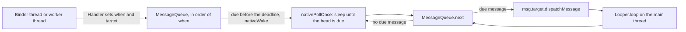

import Snippet from '../../../components/Snippet.astro';
import GoDeeper from '../../../components/GoDeeper.astro';

## The problem

The [Binder chapter](/launch-path/binder/) ends with a call from `system_server` into the launch app: `bindApplication`. A call from another process does not run on the main thread of the app. It runs on a thread from a pool that the system keeps in the process of the app[^pt-threadsafe]: a binder thread.

When an app starts, the system creates one main thread for it. This thread dispatches the events to the UI widgets, draw events included. The system callbacks of the components, for example the lifecycle callbacks, also run on this thread. The docs also call it the UI thread[^pt-threads]. The Android UI toolkit is not thread-safe. A long operation on the main thread, for example a network access, blocks all events. If the main thread stays blocked for more than a few seconds, the user sees the "application not responding" (ANR) dialog. Thus the docs give two rules[^pt-threads]:

1. Do not block the UI thread.
2. Do not access the UI toolkit from outside the UI thread.

The platform enforces the second rule. `ViewRootImpl` records the thread that creates it[^viewrootimpl-1416]. On each other thread, `checkThread()` throws `CalledFromWrongThreadException`: "Only the original thread that created a view hierarchy can touch its views."[^viewrootimpl-12136]

Thus other threads cannot do UI work. They must give the work to the main thread. Android uses a message loop for this. Three classes make the loop:

- A `MessageQueue` holds the messages that a `Looper` dispatches. Code does not add a message to the queue directly. It adds the message through a `Handler`[^messagequeue-55].
- A `Looper` runs the message loop of one thread[^looper-43].
- A `Handler` binds to one `Looper`. It puts messages into the queue of that `Looper`, and runs them on the thread of that `Looper`[^handler-33].

`bindApplication` uses this loop. On the binder thread, it puts its arguments into an `AppBindData` object. Then it sends the message `BIND_APPLICATION` to the main thread[^activitythread-1511].

This chapter builds a queue and a loop in plain Kotlin. Its breaking test shows a message that runs late. Then the chapter follows the real loop of the main thread, from `ActivityThread.main()` down to the kernel.

## Build it naive

The rebuild is in the module `samples/main-thread`. It has no threads and no real time. The looper reads the time and sleeps only through two interfaces, `Clock` and `Sleeper`. Thus a test can control both:

<Snippet file="main-thread/src/main/kotlin/NaiveLooper.kt" region="time" />

A message holds the code to run, `block`, and the time at which the message is due, `when`:

<Snippet file="main-thread/src/main/kotlin/NaiveLooper.kt" region="message" />

The queue keeps the messages in a list, in order of `when`. The head of the list is the next message to run. A new message goes after each message with the same `when`, so these messages run in the order of their posts:

<Snippet file="main-thread/src/main/kotlin/NaiveLooper.kt" region="queue" />

The handler posts a message with a delay. It sets `when` to the current time plus the delay:

<Snippet file="main-thread/src/main/kotlin/NaiveLooper.kt" region="handler" />

The looper runs the loop:

- If the head is due, the looper removes the head and runs it.
- If the head is not due, the looper sleeps until the `when` of the head.
- If the queue is empty, `loop()` returns, so that a test can end. At this point, a real `Looper` waits for a new message.

<Snippet file="main-thread/src/main/kotlin/NaiveLooper.kt" region="loop" />

Each test makes a looper and a handler. One fake, `FakeTime`, is both the clock and the sleeper. Each message adds its name and the time at which it ran to the list `ran`:

<Snippet file="main-thread/src/test/kotlin/NaiveLooperTest.kt" region="setup" />

The first test posts three messages with the delays 300, 100 and 200. The looper runs them at t=100, t=200 and t=300, in order of `when`:

<Snippet file="main-thread/src/test/kotlin/NaiveLooperTest.kt" region="order" />

Three other tests pass. Two messages with the same `when` run in the order of their posts. A message can post a new message. A message that another thread posts during a sleep runs on time if it is due after the head.

## Where it breaks

`enqueue` does not wake the looper. While the looper sleeps, it does not look at the queue. A message that another thread posts during the sleep waits until the sleep ends, also if the message is due before the end of the sleep.

`FakeTime` shows this with no threads. With `at`, a test scripts the work of another thread at a given time. A sleep runs each scripted event that is not after the end of the sleep, at the time of the event. Then the sleep sets the time to its end:

<Snippet file="main-thread/src/test/kotlin/NaiveLooperTest.kt" region="fakes" />

The breaking test posts A with the delay 1000, so the looper sleeps until t=1000. At t=10, another thread posts B with the delay 0:

<Snippet file="main-thread/src/test/kotlin/NaiveLooperTest.kt" region="flaw" />

B has `when` = 10, so B is due at t=10. The looper does not wake. It runs B at t=1000, 990 after its `when`, and then A. The test passes, so the flaw occurs.

On a real main thread, the flaw is worse. If the queue is empty, the real queue has no head to sleep until. The legacy queue polls with the timeout -1, no time limit[^mq-871][^mq-885]. DeliQueue, the new queue of Android 17, polls with a timeout of 600,000,000 ms, about 7 days[^mq-569][^mq-707]. Without a wake-up, a message that a binder thread posts to an idle main thread can wait that long.

## The real thing

### `ActivityThread.main()` runs the loop

`ActivityThread.main()` is the entry point of the main thread of the app process. The [Zygote chapter](/launch-path/zygote/) shows how the process gets there. `main()` calls `Looper.prepareMainLooper()`. Then it makes the `ActivityThread` and attaches it to `system_server`[^activitythread-9507]. At the end, it calls `Looper.loop()`. `loop()` must not return. If it returns, `main()` throws "Main thread loop unexpectedly exited"[^activitythread-9523].

`Looper.prepare()` gives the current thread a new `Looper`. A `ThreadLocal` keeps it[^looper-97]. If the thread already has a `Looper`, `prepare()` throws "Only one Looper may be created per thread"[^looper-151]. The new `Looper` makes its `MessageQueue` and records its thread[^looper-497]. `prepareMainLooper()` calls `prepare(false)`, so the queue of the main `Looper` does not allow a quit[^mq-1167]. `prepareMainLooper()` also keeps the `Looper` as the main `Looper`, which `Looper.getMainLooper()` returns[^looper-166].

`loop()` calls `loopOnce()` until `loopOnce()` returns false[^looper-373]. Each call of `loopOnce()` is one turn of the loop:

1. `loopOnce()` calls `mQueue.next()`. A comment says that this call might block. If `next()` returns null, the queue quits, and the loop ends[^looper-232].
2. It calls `msg.target.dispatchMessage(msg)`. Thus the target `Handler` runs the message on this thread[^looper-296].
3. It recycles the message[^looper-361].

The turn is the same as in the rebuild. Only the sleep is different. `NaiveLooper` calls its sleeper itself. A real `Looper` sleeps inside `next()`, in the queue.

If an app gives `setMessageLogging()` a `Printer`, `loopOnce()` prints `>>>>> Dispatching to` before each dispatch[^looper-255] and `<<<<< Finished to` after it[^looper-342].

Since Android 17, if an app targets `CINNAMON_BUN` (Android 17) or higher, `loopOnce()` clears the interrupted state of the thread after each dispatch. Thus an interrupt in one message does not reach the next message[^looper-127][^looper-297].

### A `Handler` puts a message into the queue

A `Handler` binds to one `Looper` and to the queue of that `Looper`[^handler-297]. If a constructor gets no `Looper`, it uses the `Looper` of the current thread. If the current thread has no `Looper`, the constructor throws "Can't create handler inside thread … that has not called Looper.prepare()"[^handler-260].

Since Android 11, the constructors `Handler()` and `Handler(Callback)`, which take no `Looper`, have the `@Deprecated` annotation. The reason: an implicit `Looper` can lose work, cause a crash, or run the work on a thread that the author did not expect. Give the `Looper` explicitly, for example `Handler(Looper.getMainLooper())`[^handler-11-117].

A `Message` has the public fields `what`, `arg1`, `arg2` and `obj` for its data[^message-57]. The queue uses three more fields: `when`, the time at which the message is due[^message-175], `target`, the `Handler`, and `callback`, a `Runnable`[^message-196].

To post a `Runnable`, a `Handler` does these steps:

1. `post(r)` gets a `Message` and sets its `callback` to `r`[^handler-1080]. Then it sends the message with the delay 0[^handler-487]. `postDelayed(r, delay)` sends the message with a delay[^handler-559].
2. `sendMessageDelayed()` changes a negative delay to 0. It sets the time of the message to `SystemClock.uptimeMillis()` + delay[^handler-764]. Thus the time base is `uptimeMillis`, and deep sleep adds to the delay[^handler-545].
3. `enqueueMessage()` sets `msg.target = this`. If the `Handler` is asynchronous, it also marks the message as asynchronous. Then it gives the message to `MessageQueue.enqueueMessage()`[^handler-845].

`NaiveHandler.postDelayed` only sets `when` and puts the message into the queue.

On the thread of the `Looper`, `dispatchMessage()` runs the message[^handler-124]:

- If the message has a `callback`, only that `Runnable` runs.
- If not, and the `Handler` has a `Handler.Callback`, the callback runs first. If the callback returns true, the dispatch stops.
- Otherwise, `handleMessage()` of the `Handler` runs.

### The cold start runs as messages

The binder object of the app is `ApplicationThread`, an `IApplicationThread.Stub`[^activitythread-1202]. Its methods run on binder threads[^pt-threadsafe]. For example, `bindApplication()` puts its arguments into an `AppBindData` and calls `sendMessage(H.BIND_APPLICATION, data)`[^activitythread-1511]. `sendMessage()` gets a `Message` and sets `what`, `obj`, `arg1` and `arg2`. Then it gives the message to `mH.sendMessage()`[^activitythread-4388].

`mH` is an `H`, a subclass of `Handler`[^activitythread-437][^activitythread-2611]. `H()` calls the `Handler` constructor with no arguments, which uses the `Looper` of the current thread[^handler-163][^handler-260]. `main()` makes the `ActivityThread`, and with it `mH`, on the main thread after `prepareMainLooper()`[^activitythread-9507]. Thus `mH` binds to the main `Looper`.

`H.handleMessage()` runs each message on the main thread. It selects the work by `what`:

- `BIND_APPLICATION` (110) calls `handleBindApplication()`[^activitythread-2616][^activitythread-2754].
- `EXECUTE_TRANSACTION` (159) runs a `ClientTransaction` with the `TransactionExecutor`[^activitythread-2668][^activitythread-3026]. `ApplicationThread.scheduleTransaction()` gives each transaction from `system_server` to the `ActivityThread`[^activitythread-2394].

Thus the cold start of the app is a series of messages on one loop. Prompt 3 of "Try it" lists them.

App code uses the same loop. The docs name `Activity.runOnUiThread(Runnable)`, `View.post(Runnable)` and `View.postDelayed(Runnable, long)` as ways to reach the main thread from other threads[^pt-worker]:

- `Activity.runOnUiThread()` runs the action at once if the caller is on the UI thread. On other threads, it posts the action with a `Handler` of the `Activity`[^activity-8339].
- If the view has an `AttachInfo`, `View.post()` posts the action with the `Handler` of that `AttachInfo`. If not, the view keeps the action in a run queue until it gets an `AttachInfo`[^view-21721].

Coroutines use the same loop. On Android, the main dispatcher factory of kotlinx.coroutines wraps `Looper.getMainLooper()` in an asynchronous `Handler`[^handlerdispatcher-50][^handlerdispatcher-80]. `dispatch()` calls `handler.post(block)`[^handlerdispatcher-133]. `scheduleResumeAfterDelay()` posts the resume of a delayed coroutine with `handler.postDelayed()`[^handlerdispatcher-139]. Thus each dispatch to `Dispatchers.Main` is one message in the main queue. `Dispatchers.Main.immediate` needs a dispatch only if the current `Looper` is not the `Looper` of the `Handler`[^handlerdispatcher-129].

### The queue wakes the looper

The real queue has the fix for the flaw of the rebuild. If a new message is due before the deadline of the current sleep, `enqueueMessage()` wakes the looper.

In Android 17, the class `MessageQueue` in `CombinedDeliMessageQueue/MessageQueue.java` holds two implementations: the legacy queue and DeliQueue. A process uses one of them[^mq-168]. If the arguments of `ActivityThread.main()` have `--use-deliqueue=`, `main()` selects the implementation from it, before `prepareMainLooper()` makes the queue[^activitythread-9496]. `enqueueMessage()` refuses a message without a target. Then it calls the implementation of the process[^mq-387].

Since Android 17, an app that targets Android 17 (API level 37) or higher gets a new lock-free implementation of `MessageQueue`. It improves performance and reduces missed frames. It can break code that uses reflection on private fields and methods of `MessageQueue`[^bc17-mq]. The launch app targets API level 37. Prompt 2 of "Try it" shows that its main thread uses DeliQueue.

The legacy queue keeps the messages in a linked list, in order of `when`:

- `enqueueMessage()` takes the lock of the queue (`synchronized`)[^mq-494]. If the list is empty, or if the new message is due before the head, the message becomes the new head[^mq-511]. Otherwise, the message goes after each message with the same or an earlier `when`[^mq-528][^mq-536]. Thus, as in the rebuild, messages with the same `when` run in the order of their posts.
- `next()` calls `nativePollOnce(ptr, timeout)`[^mq-871]. If the head is due, `next()` returns it. If the head is not due, the next timeout is `when - now`. If the list is empty, the next timeout is -1[^mq-885]. If no idle handler runs, `next()` sets `mBlocked` and polls again with the next timeout[^mq-101][^mq-930].
- The fix: if the new message becomes the head while `mBlocked` is set, `enqueueMessage()` calls `nativeWake()`[^mq-511][^mq-559].

DeliQueue takes no lock for a post:

- `enqueueMessage()` pushes the message onto a stack with an atomic compare-and-set[^mq-407][^messagestack-69].
- Before the looper sleeps, it stores its wake-up deadline in the atomic field `mWaitState`[^mq-738].
- After the push, the sender reads `mWaitState`. If the looper sleeps, and the new message is due before the deadline, the sender calls `concurrentWake()`. `concurrentWake()` calls `nativeWake()`. Otherwise, the sender does not wake the looper[^mq-430][^mq-301].
- `next()` calls `nextDeliQueue()`[^mq-769]. `nextDeliQueue()` calls `nativePollOnce()` with the timeout of the last turn, and then `nextMessage()`[^mq-791]. `nextMessage()` returns the due message. If no message is due, it calculates the next timeout: `when - now` of the next message, or 600,000,000 ms if the queue has no message[^mq-707].

The README of DeliQueue gives the reason for the wake-up state. The wake-up state keeps the looper from a sleep through a new message that is due before the deadline[^readme-wakeup].

<GoDeeper title="the native sleep">

`nativePollOnce()` and `nativeWake()` are native methods. JNI maps them to C++ functions[^amq-253]. Through `NativeMessageQueue`, these functions call `pollOnce()` and `wake()` of the native `Looper` of libutils[^amq-223][^amq-123][^amq-137].

The native `Looper` makes an eventfd[^looper-cpp-85]. It adds the eventfd to an epoll set, together with the file descriptors that code registers on the `Looper`[^looper-cpp-134]. `pollInner()` waits in `epoll_wait()` with the timeout from Java[^looper-cpp-244]. Thus the idle main thread sleeps in the kernel. Prompt 2 of "Try it" shows the main thread in `nativePollOnce`.

`wake()` writes the value 1 to the eventfd[^looper-cpp-413]. Then `epoll_wait()` returns at once with the event of the eventfd[^looper-cpp-288].

If a registered file descriptor is ready, `pollInner()` runs its callback before it returns[^looper-cpp-354]. These callbacks are not messages, so the Looper log of prompt 3 does not show them.

</GoDeeper>

<GoDeeper title="DeliQueue">

The legacy queue uses one global lock for a sorted singly-linked list. In most cases, an insertion is O(n). A thread with a low priority can hold the lock and block the UI thread. Then frames can drop[^readme-problem]. The Android 17 guidance page says the same: a background thread could block the main thread and cause jank[^mq-guide].

DeliQueue removes the lock from the post:

- A sender pushes the message onto a Treiber stack, a lock-free stack. A compare-and-set loop does the push[^readme-data][^messagestack-69].
- Only the looper thread moves the new messages from the stack into two min-heaps. One heap is for synchronous messages and barriers, and one heap is for asynchronous messages. The heaps keep the messages in order of time[^readme-data][^messagestack-43].
- Messages for the same time run in the order of their insertion[^readme-overview]. For this, each message gets a sequence number[^mq-116].
- While the looper is awake, `mWaitState` holds a counter, not a deadline. A sender adds 1 to the counter and does not wake the looper. Then the compare-and-set of the looper, before it sleeps, fails, and the looper looks at the new messages[^readme-wakeup][^mq-430].

DeliQueue does not pool `Message` objects[^readme-design]. With the legacy queue, `Message.obtain()` reuses a message from a pool, and `recycleUnchecked()` puts a message back into the pool, up to 50 messages. With DeliQueue, `obtain()` always makes a new message, and `recycleUnchecked()` does not use the pool[^message-219][^message-225][^message-388].

With the new queue, the private field `mMessages` is always null. If your tests use Espresso or Robolectric, update Espresso to 3.7.0 or newer and Robolectric to 4.17 or newer[^mq-guide-mitigate][^mq-guide-espresso][^mq-guide-robolectric]. To find out if the new queue causes a problem, turn it off for the app. Use the App Compatibility Changes menu in Developer Options, or disable the compat change `USE_NEW_MESSAGEQUEUE` with `am compat disable`[^mq-guide-test].

</GoDeeper>

<GoDeeper title="one MessageQueue.java in the build">

AOSP has more than one `MessageQueue.java`. The build of the framework excludes each file in `android/os/*MessageQueue/`. It adds exactly one file as `android/os/MessageQueue.java`[^android-bp-33]. The Soong config variable `release_package_messagequeue_implementation` selects the file. If the variable has no value, the build uses `CombinedMessageQueue`[^android-bp-252]. This chapter cites `CombinedDeliMessageQueue/MessageQueue.java`. Prompt 2 of "Try it" shows the frame `nextDeliQueue`, the DeliQueue path of `next()` in this file[^mq-769].

</GoDeeper>

<GoDeeper title="sync barriers and idle handlers">

A sync barrier is a message with no target[^mq-338]. While a barrier is at the head of the queue, the queue holds back the synchronous messages. Only asynchronous messages run[^mq-878][^mq-641]. An asynchronous `Handler` marks each message as asynchronous[^handler-845]. Barriers, for example the barriers of display vsync, do not hold back these messages[^handler-306]. `Dispatchers.Main` uses an asynchronous `Handler`[^handlerdispatcher-50].

In DeliQueue, a new synchronous message behind a barrier does not wake the looper[^mq-453].

If the queue has no due message, `next()` runs the `IdleHandler` objects of the queue. It does this one time in each call of `next()`, before it waits[^mq-923][^mq-807].

</GoDeeper>

## Mental model

The main thread of an app runs one message loop. `ActivityThread.main()` prepares the main `Looper` and calls `Looper.loop()`, which does not return. In each turn, the loop takes the next due message from the `MessageQueue` and calls `dispatchMessage()` of its target `Handler`. If no message is due, `next()` sleeps in `nativePollOnce()`, in the kernel, until the head is due. If the queue is empty, the legacy queue sleeps with no time limit, and DeliQueue sleeps for about 7 days. Other threads, for example binder threads, post work with a `Handler`. The `Handler` gives the message its time and its target, and the queue keeps the messages in order of `when`. If a new message is due before the deadline of the sleep, the queue wakes the looper with `nativeWake()`. The rebuild does not have this wake-up, so a new message waits until the old deadline. The cold start, `runOnUiThread()`, `View.post()` and `Dispatchers.Main` all run as messages on this one loop.



## Try it

### 1. Wake the looper in the rebuild

Give the rebuild the fix of the real queue:

1. Add `fun wake()` to `Sleeper`. Then `Sleeper` has two methods, so change `fun interface Sleeper` to `interface Sleeper`.
2. Give `NaiveMessageQueue` the sleeper and a field for the deadline of the current sleep. In `loop()`, set the deadline before the call to `sleepUntil()`, and clear it after the call.
3. In `enqueue`, if the queue has a deadline and the new message is due before it, call `sleeper.wake()`.
4. In `FakeTime`, make `wake()` set a flag. In `sleepUntil()`, after each event, if the flag is set, clear the flag and return. The time stays at the time of the event.

From the repo root, run the tests of the rebuild:

```sh
samples/gradlew -p samples :main-thread:test
```

The breaking test fails, because the flaw is gone. B now runs at t=10. The other tests pass. The Gradle output includes these lines:

```
NaiveLooperTest > naiveLooper_runsPostedMessageLate_whenLooperSleepsUntilLaterMessage() FAILED
    org.opentest4j.AssertionFailedError at NaiveLooperTest.kt:58

5 tests completed, 1 failed
```

The real queues do the same work. The legacy queue calls `nativeWake()` for a new head while `mBlocked` is set[^mq-511][^mq-559]. DeliQueue compares the `when` of the new message with the deadline in `mWaitState`[^mq-430].

### 2. Find the loop in the stack of the main thread

Start an emulator with the system image of the checked stamp, a `google_apis` image. Prompts 2 and 3 need `adb root`. `adb root` works only on a debuggable build, where `ro.debuggable` is 1. Eng and userdebug builds set this value[^adbd-66]. Make sure that the image is debuggable:

```sh
adb shell getprop ro.debuggable
```

{/* Edit step: capture this output on the emulator of the checked stamp. */}

```
1
```

From the repo root, install the release build of the launch app:

```sh
samples/gradlew -p samples :launch-app:installLaunchPathRelease
```

Start the app:

```sh
adb shell am start -W -n io.github.imgurpreetsk.afp.launchapp/.MainActivity
```

Wait until the app shows its text. Then restart adbd as root:

```sh
adb root
```

`debuggerd -j` collects the Java stacks of a process[^debuggerd-36][^debuggerd-54]. It needs root[^debuggerd-66]. Dump the Java stacks of the launch app:

```sh
adb shell 'debuggerd -j $(pidof io.github.imgurpreetsk.afp.launchapp)'
```

{/* Edit step: capture this output on the emulator of the checked stamp. */}

```
…
"main" …
…
  at android.os.MessageQueue.nativePollOnce(Native method)
  at android.os.MessageQueue.nextDeliQueue(MessageQueue.java:…)
  at android.os.MessageQueue.next(MessageQueue.java:…)
  at android.os.Looper.loopOnce(Looper.java:…)
  at android.os.Looper.loop(Looper.java:…)
  at android.app.ActivityThread.main(ActivityThread.java:…)
…
  at com.android.internal.os.ZygoteInit.main(ZygoteInit.java:…)
…
"binder:…_1" …
…
```

In the block, a line `…` stands for lines that the block leaves out. Find the thread "main". Its stack, from the top:

- `nativePollOnce` is the native sleep. The idle main thread does no work. It waits in the kernel for the next message[^mq-791][^looper-cpp-244].
- `nextDeliQueue` is the DeliQueue path of `next()`[^mq-769]. Thus the launch app, with `targetSdk` 37, uses the lock-free queue.
- `Looper.loopOnce` calls `next()`[^looper-232]. `Looper.loop` calls `loopOnce`[^looper-373].
- `ActivityThread.main` calls `Looper.loop()`[^activitythread-9523]. The frames below it start the process. The [Zygote chapter](/launch-path/zygote/) explains them.

The same dump shows the binder threads, `binder:<pid>_<number>`, next to the main thread. The [Binder chapter](/launch-path/binder/) explains them.

### 3. List the messages of the cold start

This prompt needs the root shell of prompt 2. If you did not run prompt 2, run `adb root` first.

`loop()` reads a threshold for the slow dispatch log from a system property. It reads the property one time, when the loop starts[^looper-390]. `getThresholdOverride()` reads three properties. For one thread of one app, the property is `log.looper.<uid>.<thread name>.slow`. If none of the three properties has a value, the threshold is -1[^looper-404]. If the threshold is 0 or more, `loopOnce()` logs each dispatch that takes at least the threshold. Thus the threshold 0 logs each dispatch[^looper-267][^looper-338][^looper-460].

Get the UID of the launch app:

```sh
adb shell pm list packages -U io.github.imgurpreetsk.afp.launchapp
```

{/* Edit step: capture this output on the emulator of the checked stamp. */}

```
package:io.github.imgurpreetsk.afp.launchapp uid:…
```

Run these commands in this order. Put the UID in place of `<uid>`:

```sh
adb shell am force-stop io.github.imgurpreetsk.afp.launchapp
adb shell setprop log.looper.<uid>.main.slow 0
adb logcat -c
adb shell am start -W -n io.github.imgurpreetsk.afp.launchapp/.MainActivity
```

The new process of the app reads the property when its main thread starts the loop. Print the slow dispatch lines of the log:

```sh
adb shell 'logcat -d -s Looper | grep "Slow dispatch"'
```

{/* Edit step: capture this output on the emulator of the checked stamp. */}

```
… Slow dispatch took …ms main app=io.github.imgurpreetsk.afp.launchapp main=true group=… h=android.app.ActivityThread$H c=null m=110
…
… Slow dispatch took …ms main app=io.github.imgurpreetsk.afp.launchapp main=true group=… h=android.app.ActivityThread$H c=null m=159
…
```

Each line is one turn of `loopOnce()` on the main thread. A line gives the duration of the dispatch, the thread name and the process name (`app=`). Then it gives `main=`, `group=`, the class of the `Handler` (`h=`), the callback (`c=`) and `what` (`m=`)[^looper-460]:

- `m=110` is `BIND_APPLICATION`[^activitythread-2616]. `bindApplication()` sent it from a binder thread[^activitythread-1511].
- `m=159` is `EXECUTE_TRANSACTION`. `H` runs a `ClientTransaction` from `system_server` in it[^activitythread-2668][^activitythread-3026].
- `c=null`: the `sendMessage()` of `ActivityThread` sets no callback[^activitythread-4388].
- Other lines can come between these two lines. For example, `handleBindApplication()` posts `m=164`, `SET_CONTENT_CAPTURE_OPTIONS_CALLBACK`[^activitythread-2673][^activitythread-8276]. More lines come after the `m=159` line.

At the end, set the property back to -1, so that the next process of the app does not log each dispatch. The process that runs now keeps the threshold 0 until it stops, because it read the property when its loop started[^looper-390]:

```sh
adb shell setprop log.looper.<uid>.main.slow -1
```

[^pt-threadsafe]: Processes and threads overview, "Thread-safe methods": [https://developer.android.com/guide/components/processes-and-threads#ThreadSafe](https://developer.android.com/guide/components/processes-and-threads#ThreadSafe)
[^pt-threads]: Processes and threads overview, "Threads": [https://developer.android.com/guide/components/processes-and-threads#Threads](https://developer.android.com/guide/components/processes-and-threads#Threads)
[^viewrootimpl-1416]: ViewRootImpl.java, line 1416: [https://android.googlesource.com/platform/frameworks/base/+/refs/tags/android-17.0.0_r1/core/java/android/view/ViewRootImpl.java#1416](https://android.googlesource.com/platform/frameworks/base/+/refs/tags/android-17.0.0_r1/core/java/android/view/ViewRootImpl.java#1416)
[^viewrootimpl-12136]: ViewRootImpl.java, lines 12136–12155: [https://android.googlesource.com/platform/frameworks/base/+/refs/tags/android-17.0.0_r1/core/java/android/view/ViewRootImpl.java#12136](https://android.googlesource.com/platform/frameworks/base/+/refs/tags/android-17.0.0_r1/core/java/android/view/ViewRootImpl.java#12136)
[^messagequeue-55]: MessageQueue.java, lines 55–62: [https://android.googlesource.com/platform/frameworks/base/+/refs/tags/android-17.0.0_r1/core/java/android/os/CombinedDeliMessageQueue/MessageQueue.java#55](https://android.googlesource.com/platform/frameworks/base/+/refs/tags/android-17.0.0_r1/core/java/android/os/CombinedDeliMessageQueue/MessageQueue.java#55)
[^looper-43]: Looper.java, lines 43–47: [https://android.googlesource.com/platform/frameworks/base/+/refs/tags/android-17.0.0_r1/core/java/android/os/Looper.java#43](https://android.googlesource.com/platform/frameworks/base/+/refs/tags/android-17.0.0_r1/core/java/android/os/Looper.java#43)
[^handler-33]: Handler.java, lines 33–39: [https://android.googlesource.com/platform/frameworks/base/+/refs/tags/android-17.0.0_r1/core/java/android/os/Handler.java#33](https://android.googlesource.com/platform/frameworks/base/+/refs/tags/android-17.0.0_r1/core/java/android/os/Handler.java#33)
[^activitythread-1511]: ActivityThread.java, lines 1511–1543: [https://android.googlesource.com/platform/frameworks/base/+/refs/tags/android-17.0.0_r1/core/java/android/app/ActivityThread.java#1511](https://android.googlesource.com/platform/frameworks/base/+/refs/tags/android-17.0.0_r1/core/java/android/app/ActivityThread.java#1511)
[^mq-871]: MessageQueue.java, line 871: [https://android.googlesource.com/platform/frameworks/base/+/refs/tags/android-17.0.0_r1/core/java/android/os/CombinedDeliMessageQueue/MessageQueue.java#871](https://android.googlesource.com/platform/frameworks/base/+/refs/tags/android-17.0.0_r1/core/java/android/os/CombinedDeliMessageQueue/MessageQueue.java#871)
[^mq-885]: MessageQueue.java, lines 885–915: [https://android.googlesource.com/platform/frameworks/base/+/refs/tags/android-17.0.0_r1/core/java/android/os/CombinedDeliMessageQueue/MessageQueue.java#885](https://android.googlesource.com/platform/frameworks/base/+/refs/tags/android-17.0.0_r1/core/java/android/os/CombinedDeliMessageQueue/MessageQueue.java#885)
[^mq-569]: MessageQueue.java, line 569: [https://android.googlesource.com/platform/frameworks/base/+/refs/tags/android-17.0.0_r1/core/java/android/os/CombinedDeliMessageQueue/MessageQueue.java#569](https://android.googlesource.com/platform/frameworks/base/+/refs/tags/android-17.0.0_r1/core/java/android/os/CombinedDeliMessageQueue/MessageQueue.java#569)
[^mq-707]: MessageQueue.java, lines 707–723: [https://android.googlesource.com/platform/frameworks/base/+/refs/tags/android-17.0.0_r1/core/java/android/os/CombinedDeliMessageQueue/MessageQueue.java#707](https://android.googlesource.com/platform/frameworks/base/+/refs/tags/android-17.0.0_r1/core/java/android/os/CombinedDeliMessageQueue/MessageQueue.java#707)
[^activitythread-9507]: ActivityThread.java, lines 9507–9510: [https://android.googlesource.com/platform/frameworks/base/+/refs/tags/android-17.0.0_r1/core/java/android/app/ActivityThread.java#9507](https://android.googlesource.com/platform/frameworks/base/+/refs/tags/android-17.0.0_r1/core/java/android/app/ActivityThread.java#9507)
[^activitythread-9523]: ActivityThread.java, lines 9523–9525: [https://android.googlesource.com/platform/frameworks/base/+/refs/tags/android-17.0.0_r1/core/java/android/app/ActivityThread.java#9523](https://android.googlesource.com/platform/frameworks/base/+/refs/tags/android-17.0.0_r1/core/java/android/app/ActivityThread.java#9523)
[^looper-97]: Looper.java, line 97: [https://android.googlesource.com/platform/frameworks/base/+/refs/tags/android-17.0.0_r1/core/java/android/os/Looper.java#97](https://android.googlesource.com/platform/frameworks/base/+/refs/tags/android-17.0.0_r1/core/java/android/os/Looper.java#97)
[^looper-151]: Looper.java, lines 151–156: [https://android.googlesource.com/platform/frameworks/base/+/refs/tags/android-17.0.0_r1/core/java/android/os/Looper.java#151](https://android.googlesource.com/platform/frameworks/base/+/refs/tags/android-17.0.0_r1/core/java/android/os/Looper.java#151)
[^looper-497]: Looper.java, lines 497–500: [https://android.googlesource.com/platform/frameworks/base/+/refs/tags/android-17.0.0_r1/core/java/android/os/Looper.java#497](https://android.googlesource.com/platform/frameworks/base/+/refs/tags/android-17.0.0_r1/core/java/android/os/Looper.java#497)
[^mq-1167]: MessageQueue.java, lines 1167–1170: [https://android.googlesource.com/platform/frameworks/base/+/refs/tags/android-17.0.0_r1/core/java/android/os/CombinedDeliMessageQueue/MessageQueue.java#1167](https://android.googlesource.com/platform/frameworks/base/+/refs/tags/android-17.0.0_r1/core/java/android/os/CombinedDeliMessageQueue/MessageQueue.java#1167)
[^looper-166]: Looper.java, lines 166–183: [https://android.googlesource.com/platform/frameworks/base/+/refs/tags/android-17.0.0_r1/core/java/android/os/Looper.java#166](https://android.googlesource.com/platform/frameworks/base/+/refs/tags/android-17.0.0_r1/core/java/android/os/Looper.java#166)
[^looper-373]: Looper.java, lines 373–401: [https://android.googlesource.com/platform/frameworks/base/+/refs/tags/android-17.0.0_r1/core/java/android/os/Looper.java#373](https://android.googlesource.com/platform/frameworks/base/+/refs/tags/android-17.0.0_r1/core/java/android/os/Looper.java#373)
[^looper-232]: Looper.java, lines 232–236: [https://android.googlesource.com/platform/frameworks/base/+/refs/tags/android-17.0.0_r1/core/java/android/os/Looper.java#232](https://android.googlesource.com/platform/frameworks/base/+/refs/tags/android-17.0.0_r1/core/java/android/os/Looper.java#232)
[^looper-296]: Looper.java, line 296: [https://android.googlesource.com/platform/frameworks/base/+/refs/tags/android-17.0.0_r1/core/java/android/os/Looper.java#296](https://android.googlesource.com/platform/frameworks/base/+/refs/tags/android-17.0.0_r1/core/java/android/os/Looper.java#296)
[^looper-361]: Looper.java, line 361: [https://android.googlesource.com/platform/frameworks/base/+/refs/tags/android-17.0.0_r1/core/java/android/os/Looper.java#361](https://android.googlesource.com/platform/frameworks/base/+/refs/tags/android-17.0.0_r1/core/java/android/os/Looper.java#361)
[^looper-255]: Looper.java, lines 255–259: [https://android.googlesource.com/platform/frameworks/base/+/refs/tags/android-17.0.0_r1/core/java/android/os/Looper.java#255](https://android.googlesource.com/platform/frameworks/base/+/refs/tags/android-17.0.0_r1/core/java/android/os/Looper.java#255)
[^looper-342]: Looper.java, lines 342–344: [https://android.googlesource.com/platform/frameworks/base/+/refs/tags/android-17.0.0_r1/core/java/android/os/Looper.java#342](https://android.googlesource.com/platform/frameworks/base/+/refs/tags/android-17.0.0_r1/core/java/android/os/Looper.java#342)
[^looper-127]: Looper.java, lines 127–139: [https://android.googlesource.com/platform/frameworks/base/+/refs/tags/android-17.0.0_r1/core/java/android/os/Looper.java#127](https://android.googlesource.com/platform/frameworks/base/+/refs/tags/android-17.0.0_r1/core/java/android/os/Looper.java#127)
[^looper-297]: Looper.java, lines 297–301: [https://android.googlesource.com/platform/frameworks/base/+/refs/tags/android-17.0.0_r1/core/java/android/os/Looper.java#297](https://android.googlesource.com/platform/frameworks/base/+/refs/tags/android-17.0.0_r1/core/java/android/os/Looper.java#297)
[^handler-297]: Handler.java, lines 297–304: [https://android.googlesource.com/platform/frameworks/base/+/refs/tags/android-17.0.0_r1/core/java/android/os/Handler.java#297](https://android.googlesource.com/platform/frameworks/base/+/refs/tags/android-17.0.0_r1/core/java/android/os/Handler.java#297)
[^handler-260]: Handler.java, lines 260–266: [https://android.googlesource.com/platform/frameworks/base/+/refs/tags/android-17.0.0_r1/core/java/android/os/Handler.java#260](https://android.googlesource.com/platform/frameworks/base/+/refs/tags/android-17.0.0_r1/core/java/android/os/Handler.java#260)
[^handler-11-117]: Handler.java at android-11.0.0_r1, lines 117–154: [https://android.googlesource.com/platform/frameworks/base/+/refs/tags/android-11.0.0_r1/core/java/android/os/Handler.java#117](https://android.googlesource.com/platform/frameworks/base/+/refs/tags/android-11.0.0_r1/core/java/android/os/Handler.java#117)
[^message-57]: Message.java, lines 57–83: [https://android.googlesource.com/platform/frameworks/base/+/refs/tags/android-17.0.0_r1/core/java/android/os/Message.java#57](https://android.googlesource.com/platform/frameworks/base/+/refs/tags/android-17.0.0_r1/core/java/android/os/Message.java#57)
[^message-175]: Message.java, lines 175–182: [https://android.googlesource.com/platform/frameworks/base/+/refs/tags/android-17.0.0_r1/core/java/android/os/Message.java#175](https://android.googlesource.com/platform/frameworks/base/+/refs/tags/android-17.0.0_r1/core/java/android/os/Message.java#175)
[^message-196]: Message.java, lines 196–199: [https://android.googlesource.com/platform/frameworks/base/+/refs/tags/android-17.0.0_r1/core/java/android/os/Message.java#196](https://android.googlesource.com/platform/frameworks/base/+/refs/tags/android-17.0.0_r1/core/java/android/os/Message.java#196)
[^handler-1080]: Handler.java, lines 1080–1084: [https://android.googlesource.com/platform/frameworks/base/+/refs/tags/android-17.0.0_r1/core/java/android/os/Handler.java#1080](https://android.googlesource.com/platform/frameworks/base/+/refs/tags/android-17.0.0_r1/core/java/android/os/Handler.java#1080)
[^handler-487]: Handler.java, lines 487–489: [https://android.googlesource.com/platform/frameworks/base/+/refs/tags/android-17.0.0_r1/core/java/android/os/Handler.java#487](https://android.googlesource.com/platform/frameworks/base/+/refs/tags/android-17.0.0_r1/core/java/android/os/Handler.java#487)
[^handler-559]: Handler.java, lines 559–561: [https://android.googlesource.com/platform/frameworks/base/+/refs/tags/android-17.0.0_r1/core/java/android/os/Handler.java#559](https://android.googlesource.com/platform/frameworks/base/+/refs/tags/android-17.0.0_r1/core/java/android/os/Handler.java#559)
[^handler-764]: Handler.java, lines 764–769: [https://android.googlesource.com/platform/frameworks/base/+/refs/tags/android-17.0.0_r1/core/java/android/os/Handler.java#764](https://android.googlesource.com/platform/frameworks/base/+/refs/tags/android-17.0.0_r1/core/java/android/os/Handler.java#764)
[^handler-545]: Handler.java, lines 545–546: [https://android.googlesource.com/platform/frameworks/base/+/refs/tags/android-17.0.0_r1/core/java/android/os/Handler.java#545](https://android.googlesource.com/platform/frameworks/base/+/refs/tags/android-17.0.0_r1/core/java/android/os/Handler.java#545)
[^handler-845]: Handler.java, lines 845–855: [https://android.googlesource.com/platform/frameworks/base/+/refs/tags/android-17.0.0_r1/core/java/android/os/Handler.java#845](https://android.googlesource.com/platform/frameworks/base/+/refs/tags/android-17.0.0_r1/core/java/android/os/Handler.java#845)
[^handler-124]: Handler.java, lines 124–144: [https://android.googlesource.com/platform/frameworks/base/+/refs/tags/android-17.0.0_r1/core/java/android/os/Handler.java#124](https://android.googlesource.com/platform/frameworks/base/+/refs/tags/android-17.0.0_r1/core/java/android/os/Handler.java#124)
[^activitythread-1202]: ActivityThread.java, line 1202: [https://android.googlesource.com/platform/frameworks/base/+/refs/tags/android-17.0.0_r1/core/java/android/app/ActivityThread.java#1202](https://android.googlesource.com/platform/frameworks/base/+/refs/tags/android-17.0.0_r1/core/java/android/app/ActivityThread.java#1202)
[^activitythread-4388]: ActivityThread.java, lines 4388–4402: [https://android.googlesource.com/platform/frameworks/base/+/refs/tags/android-17.0.0_r1/core/java/android/app/ActivityThread.java#4388](https://android.googlesource.com/platform/frameworks/base/+/refs/tags/android-17.0.0_r1/core/java/android/app/ActivityThread.java#4388)
[^activitythread-437]: ActivityThread.java, line 437: [https://android.googlesource.com/platform/frameworks/base/+/refs/tags/android-17.0.0_r1/core/java/android/app/ActivityThread.java#437](https://android.googlesource.com/platform/frameworks/base/+/refs/tags/android-17.0.0_r1/core/java/android/app/ActivityThread.java#437)
[^activitythread-2611]: ActivityThread.java, lines 2611–2614: [https://android.googlesource.com/platform/frameworks/base/+/refs/tags/android-17.0.0_r1/core/java/android/app/ActivityThread.java#2611](https://android.googlesource.com/platform/frameworks/base/+/refs/tags/android-17.0.0_r1/core/java/android/app/ActivityThread.java#2611)
[^handler-163]: Handler.java, lines 163–166: [https://android.googlesource.com/platform/frameworks/base/+/refs/tags/android-17.0.0_r1/core/java/android/os/Handler.java#163](https://android.googlesource.com/platform/frameworks/base/+/refs/tags/android-17.0.0_r1/core/java/android/os/Handler.java#163)
[^activitythread-2616]: ActivityThread.java, line 2616: [https://android.googlesource.com/platform/frameworks/base/+/refs/tags/android-17.0.0_r1/core/java/android/app/ActivityThread.java#2616](https://android.googlesource.com/platform/frameworks/base/+/refs/tags/android-17.0.0_r1/core/java/android/app/ActivityThread.java#2616)
[^activitythread-2754]: ActivityThread.java, lines 2754–2766: [https://android.googlesource.com/platform/frameworks/base/+/refs/tags/android-17.0.0_r1/core/java/android/app/ActivityThread.java#2754](https://android.googlesource.com/platform/frameworks/base/+/refs/tags/android-17.0.0_r1/core/java/android/app/ActivityThread.java#2754)
[^activitythread-2668]: ActivityThread.java, line 2668: [https://android.googlesource.com/platform/frameworks/base/+/refs/tags/android-17.0.0_r1/core/java/android/app/ActivityThread.java#2668](https://android.googlesource.com/platform/frameworks/base/+/refs/tags/android-17.0.0_r1/core/java/android/app/ActivityThread.java#2668)
[^activitythread-3026]: ActivityThread.java, lines 3026–3036: [https://android.googlesource.com/platform/frameworks/base/+/refs/tags/android-17.0.0_r1/core/java/android/app/ActivityThread.java#3026](https://android.googlesource.com/platform/frameworks/base/+/refs/tags/android-17.0.0_r1/core/java/android/app/ActivityThread.java#3026)
[^activitythread-2394]: ActivityThread.java, lines 2394–2396: [https://android.googlesource.com/platform/frameworks/base/+/refs/tags/android-17.0.0_r1/core/java/android/app/ActivityThread.java#2394](https://android.googlesource.com/platform/frameworks/base/+/refs/tags/android-17.0.0_r1/core/java/android/app/ActivityThread.java#2394)
[^pt-worker]: Processes and threads overview, "Worker threads": [https://developer.android.com/guide/components/processes-and-threads#WorkerThreads](https://developer.android.com/guide/components/processes-and-threads#WorkerThreads)
[^activity-8339]: Activity.java, lines 8339–8345: [https://android.googlesource.com/platform/frameworks/base/+/refs/tags/android-17.0.0_r1/core/java/android/app/Activity.java#8339](https://android.googlesource.com/platform/frameworks/base/+/refs/tags/android-17.0.0_r1/core/java/android/app/Activity.java#8339)
[^view-21721]: View.java, lines 21721–21730: [https://android.googlesource.com/platform/frameworks/base/+/refs/tags/android-17.0.0_r1/core/java/android/view/View.java#21721](https://android.googlesource.com/platform/frameworks/base/+/refs/tags/android-17.0.0_r1/core/java/android/view/View.java#21721)
[^handlerdispatcher-50]: HandlerDispatcher.kt, lines 50–53: [https://github.com/Kotlin/kotlinx.coroutines/blob/1.11.0/ui/kotlinx-coroutines-android/src/HandlerDispatcher.kt#L50-L53](https://github.com/Kotlin/kotlinx.coroutines/blob/1.11.0/ui/kotlinx-coroutines-android/src/HandlerDispatcher.kt#L50-L53)
[^handlerdispatcher-80]: HandlerDispatcher.kt, lines 80–90: [https://github.com/Kotlin/kotlinx.coroutines/blob/1.11.0/ui/kotlinx-coroutines-android/src/HandlerDispatcher.kt#L80-L90](https://github.com/Kotlin/kotlinx.coroutines/blob/1.11.0/ui/kotlinx-coroutines-android/src/HandlerDispatcher.kt#L80-L90)
[^handlerdispatcher-133]: HandlerDispatcher.kt, lines 133–137: [https://github.com/Kotlin/kotlinx.coroutines/blob/1.11.0/ui/kotlinx-coroutines-android/src/HandlerDispatcher.kt#L133-L137](https://github.com/Kotlin/kotlinx.coroutines/blob/1.11.0/ui/kotlinx-coroutines-android/src/HandlerDispatcher.kt#L133-L137)
[^handlerdispatcher-139]: HandlerDispatcher.kt, lines 139–148: [https://github.com/Kotlin/kotlinx.coroutines/blob/1.11.0/ui/kotlinx-coroutines-android/src/HandlerDispatcher.kt#L139-L148](https://github.com/Kotlin/kotlinx.coroutines/blob/1.11.0/ui/kotlinx-coroutines-android/src/HandlerDispatcher.kt#L139-L148)
[^handlerdispatcher-129]: HandlerDispatcher.kt, lines 129–131: [https://github.com/Kotlin/kotlinx.coroutines/blob/1.11.0/ui/kotlinx-coroutines-android/src/HandlerDispatcher.kt#L129-L131](https://github.com/Kotlin/kotlinx.coroutines/blob/1.11.0/ui/kotlinx-coroutines-android/src/HandlerDispatcher.kt#L129-L131)
[^mq-168]: MessageQueue.java, lines 168–178: [https://android.googlesource.com/platform/frameworks/base/+/refs/tags/android-17.0.0_r1/core/java/android/os/CombinedDeliMessageQueue/MessageQueue.java#168](https://android.googlesource.com/platform/frameworks/base/+/refs/tags/android-17.0.0_r1/core/java/android/os/CombinedDeliMessageQueue/MessageQueue.java#168)
[^activitythread-9496]: ActivityThread.java, lines 9496–9501: [https://android.googlesource.com/platform/frameworks/base/+/refs/tags/android-17.0.0_r1/core/java/android/app/ActivityThread.java#9496](https://android.googlesource.com/platform/frameworks/base/+/refs/tags/android-17.0.0_r1/core/java/android/app/ActivityThread.java#9496)
[^mq-387]: MessageQueue.java, lines 387–397: [https://android.googlesource.com/platform/frameworks/base/+/refs/tags/android-17.0.0_r1/core/java/android/os/CombinedDeliMessageQueue/MessageQueue.java#387](https://android.googlesource.com/platform/frameworks/base/+/refs/tags/android-17.0.0_r1/core/java/android/os/CombinedDeliMessageQueue/MessageQueue.java#387)
[^bc17-mq]: Android 17 behavior changes, "New lock-free implementation of MessageQueue": [https://developer.android.com/about/versions/17/behavior-changes-17#lock-free-messagequeue](https://developer.android.com/about/versions/17/behavior-changes-17#lock-free-messagequeue)
[^mq-494]: MessageQueue.java, lines 494–505: [https://android.googlesource.com/platform/frameworks/base/+/refs/tags/android-17.0.0_r1/core/java/android/os/CombinedDeliMessageQueue/MessageQueue.java#494](https://android.googlesource.com/platform/frameworks/base/+/refs/tags/android-17.0.0_r1/core/java/android/os/CombinedDeliMessageQueue/MessageQueue.java#494)
[^mq-511]: MessageQueue.java, lines 511–518: [https://android.googlesource.com/platform/frameworks/base/+/refs/tags/android-17.0.0_r1/core/java/android/os/CombinedDeliMessageQueue/MessageQueue.java#511](https://android.googlesource.com/platform/frameworks/base/+/refs/tags/android-17.0.0_r1/core/java/android/os/CombinedDeliMessageQueue/MessageQueue.java#511)
[^mq-528]: MessageQueue.java, lines 528–532: [https://android.googlesource.com/platform/frameworks/base/+/refs/tags/android-17.0.0_r1/core/java/android/os/CombinedDeliMessageQueue/MessageQueue.java#528](https://android.googlesource.com/platform/frameworks/base/+/refs/tags/android-17.0.0_r1/core/java/android/os/CombinedDeliMessageQueue/MessageQueue.java#528)
[^mq-536]: MessageQueue.java, lines 536–552: [https://android.googlesource.com/platform/frameworks/base/+/refs/tags/android-17.0.0_r1/core/java/android/os/CombinedDeliMessageQueue/MessageQueue.java#536](https://android.googlesource.com/platform/frameworks/base/+/refs/tags/android-17.0.0_r1/core/java/android/os/CombinedDeliMessageQueue/MessageQueue.java#536)
[^mq-101]: MessageQueue.java, lines 101–102: [https://android.googlesource.com/platform/frameworks/base/+/refs/tags/android-17.0.0_r1/core/java/android/os/CombinedDeliMessageQueue/MessageQueue.java#101](https://android.googlesource.com/platform/frameworks/base/+/refs/tags/android-17.0.0_r1/core/java/android/os/CombinedDeliMessageQueue/MessageQueue.java#101)
[^mq-930]: MessageQueue.java, lines 930–934: [https://android.googlesource.com/platform/frameworks/base/+/refs/tags/android-17.0.0_r1/core/java/android/os/CombinedDeliMessageQueue/MessageQueue.java#930](https://android.googlesource.com/platform/frameworks/base/+/refs/tags/android-17.0.0_r1/core/java/android/os/CombinedDeliMessageQueue/MessageQueue.java#930)
[^mq-559]: MessageQueue.java, lines 559–562: [https://android.googlesource.com/platform/frameworks/base/+/refs/tags/android-17.0.0_r1/core/java/android/os/CombinedDeliMessageQueue/MessageQueue.java#559](https://android.googlesource.com/platform/frameworks/base/+/refs/tags/android-17.0.0_r1/core/java/android/os/CombinedDeliMessageQueue/MessageQueue.java#559)
[^mq-407]: MessageQueue.java, lines 407–411: [https://android.googlesource.com/platform/frameworks/base/+/refs/tags/android-17.0.0_r1/core/java/android/os/CombinedDeliMessageQueue/MessageQueue.java#407](https://android.googlesource.com/platform/frameworks/base/+/refs/tags/android-17.0.0_r1/core/java/android/os/CombinedDeliMessageQueue/MessageQueue.java#407)
[^messagestack-69]: MessageStack.java, lines 69–83: [https://android.googlesource.com/platform/frameworks/base/+/refs/tags/android-17.0.0_r1/core/java/android/os/MessageStack.java#69](https://android.googlesource.com/platform/frameworks/base/+/refs/tags/android-17.0.0_r1/core/java/android/os/MessageStack.java#69)
[^mq-738]: MessageQueue.java, lines 738–741: [https://android.googlesource.com/platform/frameworks/base/+/refs/tags/android-17.0.0_r1/core/java/android/os/CombinedDeliMessageQueue/MessageQueue.java#738](https://android.googlesource.com/platform/frameworks/base/+/refs/tags/android-17.0.0_r1/core/java/android/os/CombinedDeliMessageQueue/MessageQueue.java#738)
[^mq-430]: MessageQueue.java, lines 430–485: [https://android.googlesource.com/platform/frameworks/base/+/refs/tags/android-17.0.0_r1/core/java/android/os/CombinedDeliMessageQueue/MessageQueue.java#430](https://android.googlesource.com/platform/frameworks/base/+/refs/tags/android-17.0.0_r1/core/java/android/os/CombinedDeliMessageQueue/MessageQueue.java#430)
[^mq-301]: MessageQueue.java, lines 301–309: [https://android.googlesource.com/platform/frameworks/base/+/refs/tags/android-17.0.0_r1/core/java/android/os/CombinedDeliMessageQueue/MessageQueue.java#301](https://android.googlesource.com/platform/frameworks/base/+/refs/tags/android-17.0.0_r1/core/java/android/os/CombinedDeliMessageQueue/MessageQueue.java#301)
[^mq-769]: MessageQueue.java, lines 769–775: [https://android.googlesource.com/platform/frameworks/base/+/refs/tags/android-17.0.0_r1/core/java/android/os/CombinedDeliMessageQueue/MessageQueue.java#769](https://android.googlesource.com/platform/frameworks/base/+/refs/tags/android-17.0.0_r1/core/java/android/os/CombinedDeliMessageQueue/MessageQueue.java#769)
[^mq-791]: MessageQueue.java, lines 791–798: [https://android.googlesource.com/platform/frameworks/base/+/refs/tags/android-17.0.0_r1/core/java/android/os/CombinedDeliMessageQueue/MessageQueue.java#791](https://android.googlesource.com/platform/frameworks/base/+/refs/tags/android-17.0.0_r1/core/java/android/os/CombinedDeliMessageQueue/MessageQueue.java#791)
[^readme-wakeup]: DeliQueue README, "Thread Wakeup Coordination": [https://android.googlesource.com/platform/frameworks/base/+/refs/tags/android-17.0.0_r1/core/java/android/os/CombinedDeliMessageQueue/README.md#thread-wakeup-coordination](https://android.googlesource.com/platform/frameworks/base/+/refs/tags/android-17.0.0_r1/core/java/android/os/CombinedDeliMessageQueue/README.md#thread-wakeup-coordination)
[^amq-253]: android_os_MessageQueue.cpp, lines 253–258: [https://android.googlesource.com/platform/frameworks/base/+/refs/tags/android-17.0.0_r1/core/jni/android_os_MessageQueue.cpp#253](https://android.googlesource.com/platform/frameworks/base/+/refs/tags/android-17.0.0_r1/core/jni/android_os_MessageQueue.cpp#253)
[^amq-223]: android_os_MessageQueue.cpp, lines 223–232: [https://android.googlesource.com/platform/frameworks/base/+/refs/tags/android-17.0.0_r1/core/jni/android_os_MessageQueue.cpp#223](https://android.googlesource.com/platform/frameworks/base/+/refs/tags/android-17.0.0_r1/core/jni/android_os_MessageQueue.cpp#223)
[^amq-123]: android_os_MessageQueue.cpp, lines 123–126: [https://android.googlesource.com/platform/frameworks/base/+/refs/tags/android-17.0.0_r1/core/jni/android_os_MessageQueue.cpp#123](https://android.googlesource.com/platform/frameworks/base/+/refs/tags/android-17.0.0_r1/core/jni/android_os_MessageQueue.cpp#123)
[^amq-137]: android_os_MessageQueue.cpp, lines 137–139: [https://android.googlesource.com/platform/frameworks/base/+/refs/tags/android-17.0.0_r1/core/jni/android_os_MessageQueue.cpp#137](https://android.googlesource.com/platform/frameworks/base/+/refs/tags/android-17.0.0_r1/core/jni/android_os_MessageQueue.cpp#137)
[^looper-cpp-85]: Looper.cpp, line 85: [https://android.googlesource.com/platform/system/core/+/refs/tags/android-17.0.0_r1/libutils/Looper.cpp#85](https://android.googlesource.com/platform/system/core/+/refs/tags/android-17.0.0_r1/libutils/Looper.cpp#85)
[^looper-cpp-134]: Looper.cpp, lines 134–151: [https://android.googlesource.com/platform/system/core/+/refs/tags/android-17.0.0_r1/libutils/Looper.cpp#134](https://android.googlesource.com/platform/system/core/+/refs/tags/android-17.0.0_r1/libutils/Looper.cpp#134)
[^looper-cpp-244]: Looper.cpp, lines 244–252: [https://android.googlesource.com/platform/system/core/+/refs/tags/android-17.0.0_r1/libutils/Looper.cpp#244](https://android.googlesource.com/platform/system/core/+/refs/tags/android-17.0.0_r1/libutils/Looper.cpp#244)
[^looper-cpp-413]: Looper.cpp, lines 413–426: [https://android.googlesource.com/platform/system/core/+/refs/tags/android-17.0.0_r1/libutils/Looper.cpp#413](https://android.googlesource.com/platform/system/core/+/refs/tags/android-17.0.0_r1/libutils/Looper.cpp#413)
[^looper-cpp-288]: Looper.cpp, lines 288–297: [https://android.googlesource.com/platform/system/core/+/refs/tags/android-17.0.0_r1/libutils/Looper.cpp#288](https://android.googlesource.com/platform/system/core/+/refs/tags/android-17.0.0_r1/libutils/Looper.cpp#288)
[^looper-cpp-354]: Looper.cpp, lines 354–383: [https://android.googlesource.com/platform/system/core/+/refs/tags/android-17.0.0_r1/libutils/Looper.cpp#354](https://android.googlesource.com/platform/system/core/+/refs/tags/android-17.0.0_r1/libutils/Looper.cpp#354)
[^readme-problem]: DeliQueue README, "Problem Statement": [https://android.googlesource.com/platform/frameworks/base/+/refs/tags/android-17.0.0_r1/core/java/android/os/CombinedDeliMessageQueue/README.md#problem-statement](https://android.googlesource.com/platform/frameworks/base/+/refs/tags/android-17.0.0_r1/core/java/android/os/CombinedDeliMessageQueue/README.md#problem-statement)
[^mq-guide]: MessageQueue behavior change guidance: [https://developer.android.com/about/versions/17/changes/messagequeue](https://developer.android.com/about/versions/17/changes/messagequeue)
[^readme-data]: DeliQueue README, "Data Structure": [https://android.googlesource.com/platform/frameworks/base/+/refs/tags/android-17.0.0_r1/core/java/android/os/CombinedDeliMessageQueue/README.md#data-structure](https://android.googlesource.com/platform/frameworks/base/+/refs/tags/android-17.0.0_r1/core/java/android/os/CombinedDeliMessageQueue/README.md#data-structure)
[^messagestack-43]: MessageStack.java, lines 43–45: [https://android.googlesource.com/platform/frameworks/base/+/refs/tags/android-17.0.0_r1/core/java/android/os/MessageStack.java#43](https://android.googlesource.com/platform/frameworks/base/+/refs/tags/android-17.0.0_r1/core/java/android/os/MessageStack.java#43)
[^readme-overview]: DeliQueue README, "DeliQueue Overview": [https://android.googlesource.com/platform/frameworks/base/+/refs/tags/android-17.0.0_r1/core/java/android/os/CombinedDeliMessageQueue/README.md#deliqueue-overview](https://android.googlesource.com/platform/frameworks/base/+/refs/tags/android-17.0.0_r1/core/java/android/os/CombinedDeliMessageQueue/README.md#deliqueue-overview)
[^mq-116]: MessageQueue.java, lines 116–122: [https://android.googlesource.com/platform/frameworks/base/+/refs/tags/android-17.0.0_r1/core/java/android/os/CombinedDeliMessageQueue/MessageQueue.java#116](https://android.googlesource.com/platform/frameworks/base/+/refs/tags/android-17.0.0_r1/core/java/android/os/CombinedDeliMessageQueue/MessageQueue.java#116)
[^readme-design]: DeliQueue README, "Design Goals": [https://android.googlesource.com/platform/frameworks/base/+/refs/tags/android-17.0.0_r1/core/java/android/os/CombinedDeliMessageQueue/README.md#design-goals](https://android.googlesource.com/platform/frameworks/base/+/refs/tags/android-17.0.0_r1/core/java/android/os/CombinedDeliMessageQueue/README.md#design-goals)
[^message-219]: Message.java, line 219: [https://android.googlesource.com/platform/frameworks/base/+/refs/tags/android-17.0.0_r1/core/java/android/os/Message.java#219](https://android.googlesource.com/platform/frameworks/base/+/refs/tags/android-17.0.0_r1/core/java/android/os/Message.java#219)
[^message-225]: Message.java, lines 225–239: [https://android.googlesource.com/platform/frameworks/base/+/refs/tags/android-17.0.0_r1/core/java/android/os/Message.java#225](https://android.googlesource.com/platform/frameworks/base/+/refs/tags/android-17.0.0_r1/core/java/android/os/Message.java#225)
[^message-388]: Message.java, lines 388–406: [https://android.googlesource.com/platform/frameworks/base/+/refs/tags/android-17.0.0_r1/core/java/android/os/Message.java#388](https://android.googlesource.com/platform/frameworks/base/+/refs/tags/android-17.0.0_r1/core/java/android/os/Message.java#388)
[^mq-guide-mitigate]: MessageQueue behavior change guidance, "Mitigate impact": [https://developer.android.com/about/versions/17/changes/messagequeue#mitigate-impact](https://developer.android.com/about/versions/17/changes/messagequeue#mitigate-impact)
[^mq-guide-espresso]: MessageQueue behavior change guidance, Espresso "Action": [https://developer.android.com/about/versions/17/changes/messagequeue#espresso-action](https://developer.android.com/about/versions/17/changes/messagequeue#espresso-action)
[^mq-guide-robolectric]: MessageQueue behavior change guidance, Robolectric "Action": [https://developer.android.com/about/versions/17/changes/messagequeue#roboelectric-action](https://developer.android.com/about/versions/17/changes/messagequeue#roboelectric-action)
[^mq-guide-test]: MessageQueue behavior change guidance, "Test the behavior": [https://developer.android.com/about/versions/17/changes/messagequeue#test](https://developer.android.com/about/versions/17/changes/messagequeue#test)
[^android-bp-33]: Android.bp, lines 33–40: [https://android.googlesource.com/platform/frameworks/base/+/refs/tags/android-17.0.0_r1/core/java/Android.bp#33](https://android.googlesource.com/platform/frameworks/base/+/refs/tags/android-17.0.0_r1/core/java/Android.bp#33)
[^android-bp-252]: Android.bp, lines 252–265: [https://android.googlesource.com/platform/frameworks/base/+/refs/tags/android-17.0.0_r1/core/java/Android.bp#252](https://android.googlesource.com/platform/frameworks/base/+/refs/tags/android-17.0.0_r1/core/java/Android.bp#252)
[^mq-338]: MessageQueue.java, lines 338–340: [https://android.googlesource.com/platform/frameworks/base/+/refs/tags/android-17.0.0_r1/core/java/android/os/CombinedDeliMessageQueue/MessageQueue.java#338](https://android.googlesource.com/platform/frameworks/base/+/refs/tags/android-17.0.0_r1/core/java/android/os/CombinedDeliMessageQueue/MessageQueue.java#338)
[^mq-878]: MessageQueue.java, lines 878–884: [https://android.googlesource.com/platform/frameworks/base/+/refs/tags/android-17.0.0_r1/core/java/android/os/CombinedDeliMessageQueue/MessageQueue.java#878](https://android.googlesource.com/platform/frameworks/base/+/refs/tags/android-17.0.0_r1/core/java/android/os/CombinedDeliMessageQueue/MessageQueue.java#878)
[^mq-641]: MessageQueue.java, lines 641–647: [https://android.googlesource.com/platform/frameworks/base/+/refs/tags/android-17.0.0_r1/core/java/android/os/CombinedDeliMessageQueue/MessageQueue.java#641](https://android.googlesource.com/platform/frameworks/base/+/refs/tags/android-17.0.0_r1/core/java/android/os/CombinedDeliMessageQueue/MessageQueue.java#641)
[^handler-306]: Handler.java, lines 306–311: [https://android.googlesource.com/platform/frameworks/base/+/refs/tags/android-17.0.0_r1/core/java/android/os/Handler.java#306](https://android.googlesource.com/platform/frameworks/base/+/refs/tags/android-17.0.0_r1/core/java/android/os/Handler.java#306)
[^mq-453]: MessageQueue.java, lines 453–467: [https://android.googlesource.com/platform/frameworks/base/+/refs/tags/android-17.0.0_r1/core/java/android/os/CombinedDeliMessageQueue/MessageQueue.java#453](https://android.googlesource.com/platform/frameworks/base/+/refs/tags/android-17.0.0_r1/core/java/android/os/CombinedDeliMessageQueue/MessageQueue.java#453)
[^mq-923]: MessageQueue.java, lines 923–967: [https://android.googlesource.com/platform/frameworks/base/+/refs/tags/android-17.0.0_r1/core/java/android/os/CombinedDeliMessageQueue/MessageQueue.java#923](https://android.googlesource.com/platform/frameworks/base/+/refs/tags/android-17.0.0_r1/core/java/android/os/CombinedDeliMessageQueue/MessageQueue.java#923)
[^mq-807]: MessageQueue.java, lines 807–851: [https://android.googlesource.com/platform/frameworks/base/+/refs/tags/android-17.0.0_r1/core/java/android/os/CombinedDeliMessageQueue/MessageQueue.java#807](https://android.googlesource.com/platform/frameworks/base/+/refs/tags/android-17.0.0_r1/core/java/android/os/CombinedDeliMessageQueue/MessageQueue.java#807)
[^adbd-66]: main.cpp, lines 66–96: [https://android.googlesource.com/platform/packages/modules/adb/+/refs/tags/android-17.0.0_r1/daemon/main.cpp#66](https://android.googlesource.com/platform/packages/modules/adb/+/refs/tags/android-17.0.0_r1/daemon/main.cpp#66)
[^debuggerd-36]: debuggerd.cpp, lines 36–41: [https://android.googlesource.com/platform/system/core/+/refs/tags/android-17.0.0_r1/debuggerd/debuggerd.cpp#36](https://android.googlesource.com/platform/system/core/+/refs/tags/android-17.0.0_r1/debuggerd/debuggerd.cpp#36)
[^debuggerd-54]: debuggerd.cpp, lines 54–55: [https://android.googlesource.com/platform/system/core/+/refs/tags/android-17.0.0_r1/debuggerd/debuggerd.cpp#54](https://android.googlesource.com/platform/system/core/+/refs/tags/android-17.0.0_r1/debuggerd/debuggerd.cpp#54)
[^debuggerd-66]: debuggerd.cpp, lines 66–68: [https://android.googlesource.com/platform/system/core/+/refs/tags/android-17.0.0_r1/debuggerd/debuggerd.cpp#66](https://android.googlesource.com/platform/system/core/+/refs/tags/android-17.0.0_r1/debuggerd/debuggerd.cpp#66)
[^looper-390]: Looper.java, lines 390–392: [https://android.googlesource.com/platform/frameworks/base/+/refs/tags/android-17.0.0_r1/core/java/android/os/Looper.java#390](https://android.googlesource.com/platform/frameworks/base/+/refs/tags/android-17.0.0_r1/core/java/android/os/Looper.java#390)
[^looper-404]: Looper.java, lines 404–426: [https://android.googlesource.com/platform/frameworks/base/+/refs/tags/android-17.0.0_r1/core/java/android/os/Looper.java#404](https://android.googlesource.com/platform/frameworks/base/+/refs/tags/android-17.0.0_r1/core/java/android/os/Looper.java#404)
[^looper-267]: Looper.java, lines 267–274: [https://android.googlesource.com/platform/frameworks/base/+/refs/tags/android-17.0.0_r1/core/java/android/os/Looper.java#267](https://android.googlesource.com/platform/frameworks/base/+/refs/tags/android-17.0.0_r1/core/java/android/os/Looper.java#267)
[^looper-338]: Looper.java, lines 338–340: [https://android.googlesource.com/platform/frameworks/base/+/refs/tags/android-17.0.0_r1/core/java/android/os/Looper.java#338](https://android.googlesource.com/platform/frameworks/base/+/refs/tags/android-17.0.0_r1/core/java/android/os/Looper.java#338)
[^looper-460]: Looper.java, lines 460–478: [https://android.googlesource.com/platform/frameworks/base/+/refs/tags/android-17.0.0_r1/core/java/android/os/Looper.java#460](https://android.googlesource.com/platform/frameworks/base/+/refs/tags/android-17.0.0_r1/core/java/android/os/Looper.java#460)
[^activitythread-8276]: ActivityThread.java, line 8276: [https://android.googlesource.com/platform/frameworks/base/+/refs/tags/android-17.0.0_r1/core/java/android/app/ActivityThread.java#8276](https://android.googlesource.com/platform/frameworks/base/+/refs/tags/android-17.0.0_r1/core/java/android/app/ActivityThread.java#8276)
[^activitythread-2673]: ActivityThread.java, line 2673: [https://android.googlesource.com/platform/frameworks/base/+/refs/tags/android-17.0.0_r1/core/java/android/app/ActivityThread.java#2673](https://android.googlesource.com/platform/frameworks/base/+/refs/tags/android-17.0.0_r1/core/java/android/app/ActivityThread.java#2673)
