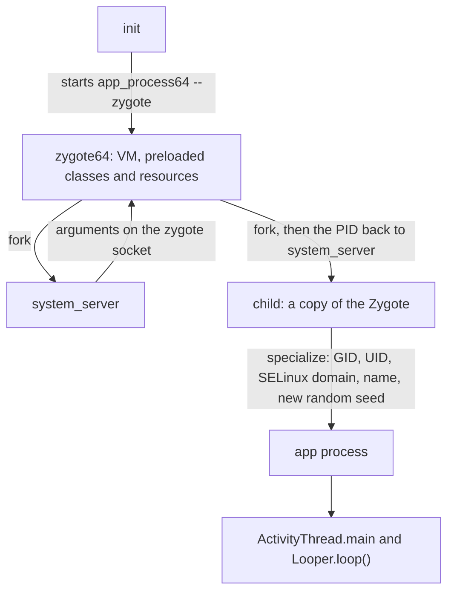

import Snippet from '../../../components/Snippet.astro';
import GoDeeper from '../../../components/GoDeeper.astro';

## The problem

Section 1 follows one cold start of the launch app. The [APK chapter](/launch-path/apk/) ends with `base.apk` on the device. Before the code in `base.apk` can run, the app needs a process.

If a component of an app starts and no other component of the app runs, the system starts a new Linux process for the app. By default, all components of the app run in that process, on one thread: the main thread[^processes-and-threads].

An app process needs the ART virtual machine (VM), the framework classes and the framework resources before it can run app code. If each new process starts the VM and loads these classes and resources, each cold start does this work again. Each process also keeps its own copy of the same data in RAM.

Android does this work one time. When the system boots, a process with the name Zygote starts and loads the common framework code and resources. To start a new app process, the system forks the Zygote. Then the new process loads and runs the code of the app. Thus all app processes share most of the RAM pages of the framework code and resources[^memory-overview-sharing].

The child of a fork starts with the state of the Zygote. Some of that state must be different in each app process, so Android changes it in each child after the fork[^math-1020]. This chapter builds a zygote that copies one prepared image for each app. Then it shows state that a child must not get from the zygote. Then it follows the real Zygote from boot to `ActivityThread.main`, the entry point of the app process[^processlist-2078].

## Build it naive

The rebuild is a zygote in plain Kotlin, in the module `samples/zygote`. The JVM cannot call `fork()`. Thus the rebuild copies a stand-in for the memory of a process, `ProcessImage`:

<Snippet file="zygote/src/main/kotlin/NaiveZygote.kt" region="image" />

`ProcessImage` holds a table of classes and a random number generator. The real `Math.random()` also uses one `java.util.Random` object in each process[^math-978][^math-1016]. The tests give the rebuild three placeholder class names, because the rebuild does not run the classes.

`NaiveZygote` prepares the image one time and copies it for each app:

<Snippet file="zygote/src/main/kotlin/NaiveZygote.kt" region="zygote" />

- `preload()` makes the image and loads each class into it. `classLoads` counts the loads.
- `fork()` writes the image to bytes with Java serialization, and reads a new image from the bytes. Thus each child gets its own copy of all the state of the zygote. The code does not select what to copy.

A test makes one zygote and forks five children:

<Snippet file="zygote/src/test/kotlin/NaiveZygoteTest.kt" region="preload" />

After five forks, `classLoads` is 3, and each child has the three classes. Thus the zygote loads each class one time, not one time for each app. This test is not a breaking test.

The deep copy shows what each child sees. It does not show the cost of a real fork. The rebuild writes all the bytes again for each child. A real child shares most of the RAM pages of the framework code and resources with the Zygote[^memory-overview-sharing]. After the fork, a shared page can become a private dirty page, for example when `malloc` changes its data on the page[^zygote-cpp-2521].

## Where it breaks

`fork()` also copies state that must be different in each process. The breaking test forks two children from one zygote and reads the first random number of each child:

<Snippet file="zygote/src/test/kotlin/NaiveZygoteTest.kt" region="flaw" />

The test passes, so the flaw occurs. The two children start from the same state of the generator, so they get the same "random" numbers. The seed of the zygote is fixed, so the test gives the same result on each run. The test uses no threads and no clock.

The real Zygote must prevent the same flaw for `Math.random()`, which uses one generator in each process[^math-978][^math-1016]. After a fork, Android gives this generator a new seed in the child. A comment in `Math.java` gives the reason: "This allows different processes to have different random seeds"[^math-1020]. "The real thing" shows where the child sets the seed.

## The real thing

### init starts the Zygote

`init.rc` imports the service file `init.${ro.zygote}.rc`[^init-rc-12]. On the trigger `zygote-start`, init starts the services `zygote` and `zygote_secondary`[^init-rc-1091]. The file `init.zygote64.rc` defines the service `zygote`. The service runs `/system/bin/app_process64 -Xzygote /system/bin --zygote --start-system-server --socket-name=zygote` as the user root[^init-zygote64-rc-1]. init also creates the Unix socket `zygote`, with the mode 660, the owner root and the group system[^init-zygote64-rc-6]. Thus only root and the group system can connect to the socket.

The Zygote is the root of all system processes and app processes of one ABI[^zygote-doc]. A device can have a 64-bit Zygote and a 32-bit Zygote. Android also has a WebView Zygote for processes that run WebViews[^zygote-doc]. This chapter follows the 64-bit Zygote.

### app_process starts the VM

`app_process` is the program of the Zygote. With the argument `--zygote`, it sets the process name to `zygote64` in a 64-bit build[^app-main-165][^app-main-266]. Then it starts the VM and runs the class `com.android.internal.os.ZygoteInit`[^app-main-331].

<GoDeeper title="AndroidRuntime::start">

`app_process` starts the VM with `AndroidRuntime::start`. This function starts the ART VM[^androidruntime-1288]. Then it finds the static method `main(String[])` of the start class and calls it. The thread that calls `main` becomes the main thread of the VM[^androidruntime-1328].

</GoDeeper>

### ZygoteInit prepares the template

`ZygoteInit.main` prepares the state that each app process gets:

1. It makes thread creation an error[^zygoteinit-827]. Only the internal daemon threads of the runtime can start[^zygotehooks-61].
2. It preloads the classes in `/system/etc/preloaded-classes`[^zygoteinit-112], the resources, the graphics driver and the shared libraries[^zygoteinit-128]. It loads and initializes each preloaded class with `Class.forName`[^zygoteinit-340].
3. It runs a garbage collection[^zygoteinit-898].
4. It allows thread creation again, and opens the `zygote` socket that init created[^zygoteinit-905][^zygoteserver-152].
5. It forks `system_server`. In the child, it runs `system_server`[^zygoteinit-911].
6. In the Zygote, it starts a loop on the socket. The loop returns only in a child after a fork. Then `main` runs the `Runnable` that the loop returned[^zygoteinit-922][^zygoteinit-936].

Step 2 matches `preload()` of the rebuild. The loop of step 6 forks the app processes, as `fork()` of the rebuild does.

### system_server asks for a process

The launch app has no process, so `system_server` asks the Zygote for one. In `system_server`, `ProcessList` sets the entry point of the new process to `android.app.ActivityThread`[^processlist-2078]. It adds the memory-safety runtime flags[^processlist-2062] and calls `Process.start`[^processlist-2666]. For a usual app, `Process.start` sends the request to `ZYGOTE_PROCESS`, the client of the Zygote[^process-795].

The client, `ZygoteProcess`, makes a list of arguments: `--runtime-args`, `--setuid`, `--setgid`, `--target-sdk-version`, `--nice-name` and the start class[^zygoteprocess-621][^zygoteprocess-640][^zygoteprocess-658][^zygoteprocess-769]. Before it sends the list, it rejects an argument that has a newline, a carriage return or a null character[^zygoteprocess-390]. Then it writes the number of arguments and the arguments, one on each line, to the socket. It reads the PID of the child from the socket[^zygoteprocess-404][^zygoteprocess-436].

<GoDeeper title="other zygotes">

`HostingRecord` records which zygote forks a process: the regular Zygote, the WebView Zygote or an app zygote[^hostingrecord-87]. `ProcessList` reads this choice. It calls `startWebView` for the WebView Zygote, `AppZygote.startProcess` for an app zygote and `Process.start` for the regular Zygote[^processlist-2635]. `Process.start` sends the request to `NATIVE_ZYGOTE_PROCESS` only if the flag `nativeFrameworkPrototype` is on and the policy flags have `ZYGOTE_POLICY_FLAG_NATIVE_PROCESS`[^process-795].

</GoDeeper>

### The Zygote forks

The loop of the Zygote, `runSelectLoop`, polls the `zygote` socket and each open session socket[^zygoteserver-394][^zygoteserver-486]. If a peer connects to the `zygote` socket, the loop accepts the peer. If a session socket has data, the loop calls `processCommand`[^zygoteserver-508]. The Zygote refuses a peer whose UID is not `SYSTEM_UID`, 1000[^zygoteconnection-96][^process-82].

`processCommand` reads and parses the arguments[^zygoteconnection-120]. The parser rejects a second copy of a critical argument, for example `--setuid`, "to make injection harder"[^zygotearguments-279][^zygotearguments-305]. Then `processCommand` applies the UID policy[^zygoteconnection-192]. On the usual path, it calls `ZygoteHooks.preFork` and then `Zygote.forkSimpleApps`[^zygoteconnection-283]. `preFork` stops the daemon threads of the runtime before the fork[^zygotehooks-188].

`forkSimpleApps` calls `forkRepeatedly`, which continues in native code[^zygote-java-744][^zygotecommandbuffer-152]. In the child, `forkSimpleApps` then calls `childMain`[^zygote-java-744]. The native loop calls `zygote::forkApp` for each simple fork command. In the Zygote, the loop writes the PID of the child (big-endian) and a "not wrapped" flag back on the session socket[^zygotecommandbuffer-cpp-470]. `ZygoteProcess` reads this PID. `forkApp` calls `ForkCommon`[^zygote-cpp-2795], and `ForkCommon` calls `fork()`[^zygote-cpp-2532]. In the child, `ForkCommon` resets the stack guards. It also opens again each file descriptor that the child still has, so that the child does not share it with the Zygote[^zygote-cpp-2554].

The Zygote reads each command into a native buffer. Thus it can fork apps again and again with no new memory allocation, and its memory stays stable[^zygotecommandbuffer-27]. `forkRepeatedly` forks one child for each simple fork command[^zygotecommandbuffer-152].

Since Android 12, the Zygote has this native command buffer[^zygotecommandbuffer-12-26].

<GoDeeper title="the other fork path and the USAP pool">

`processCommand` uses `Zygote.forkAndSpecialize` in place of `forkSimpleApps` for a wrapped process (`--invoke-with`), for a child zygote, and if it cannot do more than one fork[^zygoteconnection-245]. For example, it cannot do more than one fork if the USAP pool is on[^zygoteserver-518]. `forkAndSpecialize` calls `ZygoteHooks.preFork` before the native fork and `ZygoteHooks.postForkCommon` after it[^zygote-java-376]. In the child, `handleChildProc` calls `ZygoteInit.zygoteInit` for a usual app, `WrapperInit.execApplication` for a wrapped process and `ZygoteInit.childZygoteInit` for a child zygote[^zygoteconnection-507].

The USAP pool holds unspecialized app processes (USAPs) that the Zygote forks before an app needs them. The pool is off, unless a system property or an adb command turns it on[^zygote-doc-enable]. In `ZygoteServer`, the pool starts in the off state[^zygoteserver-65].

</GoDeeper>

### The child becomes the app

After the fork, the child still runs as root[^zygote-cpp-2041]. `childMain` parses the command and calls `specializeAppProcess`[^zygote-java-809][^zygote-java-888]. In native code, `SpecializeCommon` changes the child into the app process:

1. It sets the group ID with `setresgid`. It installs the seccomp filter while the process is still root. Then it sets the user ID with `setresuid`[^zygote-cpp-2041].
2. It sets the heap tagging level from the runtime flags[^zygote-cpp-2094].
3. It sets the SELinux context of the process[^zygote-cpp-2172].
4. It sets the name of the main thread to the nice name of the process[^zygote-cpp-2186].
5. It calls the post-fork hooks of the child[^zygote-cpp-2215].

The file `seapp_contexts` defines how the system selects the security context of an app[^seapp-contexts-1]. If a usual app has a `targetSdk` of 37 or higher, its domain is `untrusted_app`. For a lower `targetSdk`, the domain is `untrusted_app_34`, `untrusted_app_32`, `untrusted_app_30`, `untrusted_app_29`, `untrusted_app_27` or `untrusted_app_25`[^seapp-contexts-209]. The launch app sets `targetSdk` to 37, so it runs in the domain `untrusted_app`.

The post-fork hook of the child is `ZygoteHooks.postForkChild`[^zygote-java-1181]. It calls `Math.setRandomSeedInternal(System.currentTimeMillis())`[^zygotehooks-237]. `setRandomSeedInternal` sets the seed of the generator of `Math.random()`[^math-1020]. This is the real fix for the flaw of the rebuild. The seed is the wall-clock time in milliseconds. Thus two children get the same seed only if they read the clock in the same millisecond. The rebuild copies all the state. The real child changes the state that must be different in each process, for example the random seed and the stack guards[^zygotehooks-237][^zygote-cpp-2554].

`childMain` then sets the process name (`argv[0]`) to the nice name. It returns the `Runnable` of `ZygoteInit.zygoteInit`[^zygote-java-896][^zygote-java-932]. `zygoteInit` runs `nativeZygoteInit` and then `RuntimeInit.applicationInit`[^zygoteinit-983]. `nativeZygoteInit` starts the Binder thread pool of the process[^androidruntime-284][^app-main-92]. `applicationInit` sets the target SDK version of the VM[^runtimeinit-372]. Then `findStaticMain` loads the start class and finds its `public static main(String[])` method[^runtimeinit-313]. It returns a `Runnable` that calls this method[^runtimeinit-342].

In the child, `runSelectLoop` returns this `Runnable`[^zygoteserver-524], and `ZygoteInit.main` runs it after the loop[^zygoteinit-936]. A comment in `RuntimeInit` says that this step clears the stack frames of the process setup[^runtimeinit-342].

<GoDeeper title="pointer tags and 16 KB pages">

In `system_server`, `ProcessList` adds the memory-safety runtime flags of the app[^processlist-2062]. `Zygote.getMemorySafetyRuntimeFlags` calls `decideTaggingLevel`, unless the new process uses an instruction set other than arm64[^zygote-java-1462]. The system enables the compat change `NATIVE_HEAP_POINTER_TAGGING` for apps whose `targetSdk` is higher than Android 10 (Q)[^zygote-java-1251]. If the app and the system select no other tagging level, this change requests the Top-Byte Ignore (TBI) level[^zygote-java-1323]. `decideTaggingLevel` keeps TBI only on a device that supports tagged pointers and does not support the Memory Tagging Extension (MTE). On an MTE device, it changes TBI to no tagging[^zygote-java-1375]. In the child, `SpecializeCommon` gives the level to the native allocator with `mallopt`[^zygote-cpp-2094].

Since Android 11, if an app targets API level 30 or higher, heap pointers have a non-zero tag in the most significant byte (MSB)[^android-11-tagging].

If the runtime flags have `ENABLE_PAGE_SIZE_APP_COMPAT`, `SpecializeCommon` turns on the 16 KB page size compatibility mode in the child[^zygote-cpp-2162].

Since Android 16, a compatibility mode lets some apps that are built for 4 KB memory pages run on a device with 16 KB memory pages[^android-16-16-kb].

</GoDeeper>

### ActivityThread.main starts the app

The `Runnable` calls `ActivityThread.main`. `main` sets `argv[0]` to `<pre-initialized>`[^activitythread-9485]. It prepares the main `Looper`, makes an `ActivityThread` and attaches it to `system_server`[^activitythread-9507][^activitythread-9286]. Then it starts the loop with `Looper.loop()`[^activitythread-9523]. Later, `handleBindApplication` sets `argv[0]` to the process name[^activitythread-8028]. This chapter stops at `Looper.loop()`. The next chapters of Section 1 continue from there.

After the Zygote sends back the PID, `ProcessList.handleProcessStartedLocked` in `system_server` writes the event `am_proc_start`. The event has these fields: the user, the PID, the UID, the process name, the hosting type and the hosting name[^processlist-2979]. `handleProcessStartedLocked` also logs a line that starts with `Start proc`[^processlist-2996]. The hosting type is the reason for the process start, for example `activity`, `top-activity`, `next-activity` or `next-top-activity`[^hostingrecord-102]. Prompt 2 of "Try it" reads this event.

## Mental model

At boot, init starts the Zygote as `app_process64 --zygote`. The Zygote starts the VM, preloads the common classes and resources, and forks `system_server`. Then it waits on its socket. To start an app, `system_server` writes the arguments of the new process to the socket. The Zygote forks and writes the PID of the child back to `system_server`. The child starts as a copy of the Zygote and shares its pages. Then the child specializes: it gets the GID, the UID, the SELinux domain and the name of the app, and a new random seed. Last, it calls `ActivityThread.main`, which starts the main `Looper`. The rebuild copies all the state and keeps the flaw. The real child changes the state that must be different in each process.



## Try it

### 1. Give each child a new seed

Change the rebuild so that each child gets a new seed, as `postForkChild` does. Give `NaiveZygote` a third constructor parameter, `seeds: () -> Long`, as the seed source. In `fork()`, call `setSeed(seeds())` on the `random` of the copy before you return the copy. The seed source replaces the clock, so the tests stay deterministic. In `NaiveZygoteTest`, add a counter, `private var next = 0L`. Give each zygote the seed source `{ next++ }`. From the repo root, run the tests of the rebuild:

```sh
samples/gradlew -p samples :zygote:test
```

The breaking test fails, because each child gets a different seed. The Gradle output includes these lines:

```
NaiveZygoteTest > naiveFork_givesSameRandomNumber_toEveryChild() FAILED
    org.opentest4j.AssertionFailedError at NaiveZygoteTest.kt:…

3 tests completed, 1 failed
```

The line number depends on your change.

Then give the zygote of the breaking test the seed source `{ next }`. This source gives the same value for each fork, as the clock does for two forks in the same millisecond. Run the tests again. All three tests pass, so the flaw is back. The real fix has the same limit, because `postForkChild` uses the time in milliseconds as the seed[^zygotehooks-237].

### 2. Read the start record of system_server

Start an emulator with the system image of the checked stamp. From the repo root, install the release build of the launch app:

```sh
samples/gradlew -p samples :launch-app:installLaunchPathRelease
```

Stop the app, so that the next start is a cold start. Start the app and wait for the launch to complete. Then print the newest `am_proc_start` event of the launch app:

```sh
adb shell am force-stop io.github.imgurpreetsk.afp.launchapp
adb shell am start -W -n io.github.imgurpreetsk.afp.launchapp/.MainActivity
adb shell "logcat -b events -d | grep am_proc_start | grep launchapp | tail -n 1"
```

{/* Edit step: capture this output on the emulator of the checked stamp. */}

```
Starting: Intent { cmp=io.github.imgurpreetsk.afp.launchapp/.MainActivity }
Status: ok
LaunchState: COLD
Activity: io.github.imgurpreetsk.afp.launchapp/.MainActivity
TotalTime: …
WaitTime: …
Complete
… I am_proc_start: [0,…,…,io.github.imgurpreetsk.afp.launchapp,…,{io.github.imgurpreetsk.afp.launchapp/io.github.imgurpreetsk.afp.launchapp.MainActivity}]
```

`am force-stop` stops all of the app[^adb-am]. `am start -W` starts the activity and waits for the launch to complete[^adb-am]. Thus the event is in the log before `logcat` reads the log.

The event has these fields: the user (0), the PID that the Zygote sent back, the UID of the app, the process name, the hosting type and the hosting name[^processlist-2979]. The hosting type is one of the start reasons of `HostingRecord`[^hostingrecord-102]. The hosting name is the activity that needed the process. Thus `system_server` asked the Zygote for a new process because an activity needed one, and it got a PID back.

### 3. List the Zygote and its children

List the Zygote, `system_server` and the launch app, with their parent PIDs, users and SELinux labels:

```sh
adb shell "ps -A -w -o PID,PPID,USER,LABEL,NAME | grep -E 'zygote|system_server|launchapp'"
```

{/* Edit step: capture this output on the emulator of the checked stamp. */}

```
     …      1 root         u:r:zygote:s0                  zygote64
     …      … system       u:r:system_server:s0           system_server
     …      … u0_a…        u:r:untrusted_app:s0:c…        io.github.imgurpreetsk.afp.launchapp
```

`-A` lists all processes, `-w` does not cut the fields, and `-o` selects the fields[^ps-67]. `PPID` is the PID of the parent. `USER` is the user name. `LABEL` is the security label. `NAME` is `argv[0]` of the process[^ps-326].

- init starts `zygote64`[^init-rc-1091], so the parent of `zygote64` is init. `zygote64` runs as root[^init-zygote64-rc-1], in the SELinux domain `zygote`.
- The `PPID` of `system_server` and of the launch app is the PID of `zygote64`. Thus the Zygote forked both.
- The launch app runs as an app user, `u0_a…`, in the domain `untrusted_app`. `SpecializeCommon` set the UID and the SELinux context after the fork[^zygote-cpp-2041][^zygote-cpp-2172]. The launch app has a `targetSdk` of 37, so its domain is `untrusted_app`[^seapp-contexts-209].
- The `NAME` of the launch app is its package name, because `handleBindApplication` set `argv[0]` to the process name[^activitythread-8028].

The output can have more lines, for example a line for the WebView Zygote[^zygote-doc].

[^processes-and-threads]: Processes and threads overview: [https://developer.android.com/guide/components/processes-and-threads](https://developer.android.com/guide/components/processes-and-threads)
[^memory-overview-sharing]: Memory overview, "Share memory": [https://developer.android.com/topic/performance/memory-overview#SharingRAM](https://developer.android.com/topic/performance/memory-overview#SharingRAM)
[^math-1020]: Math.java, lines 1020–1030: [https://android.googlesource.com/platform/libcore/+/refs/tags/android-17.0.0_r1/ojluni/src/main/java/java/lang/Math.java#1020](https://android.googlesource.com/platform/libcore/+/refs/tags/android-17.0.0_r1/ojluni/src/main/java/java/lang/Math.java#1020)
[^processlist-2078]: ProcessList.java, lines 2078–2080: [https://android.googlesource.com/platform/frameworks/base/+/refs/tags/android-17.0.0_r1/services/core/java/com/android/server/am/ProcessList.java#2078](https://android.googlesource.com/platform/frameworks/base/+/refs/tags/android-17.0.0_r1/services/core/java/com/android/server/am/ProcessList.java#2078)
[^math-978]: Math.java, lines 978–980: [https://android.googlesource.com/platform/libcore/+/refs/tags/android-17.0.0_r1/ojluni/src/main/java/java/lang/Math.java#978](https://android.googlesource.com/platform/libcore/+/refs/tags/android-17.0.0_r1/ojluni/src/main/java/java/lang/Math.java#978)
[^math-1016]: Math.java, lines 1016–1018: [https://android.googlesource.com/platform/libcore/+/refs/tags/android-17.0.0_r1/ojluni/src/main/java/java/lang/Math.java#1016](https://android.googlesource.com/platform/libcore/+/refs/tags/android-17.0.0_r1/ojluni/src/main/java/java/lang/Math.java#1016)
[^zygote-cpp-2521]: com_android_internal_os_Zygote.cpp, lines 2521–2530: [https://android.googlesource.com/platform/frameworks/base/+/refs/tags/android-17.0.0_r1/core/jni/com_android_internal_os_Zygote.cpp#2521](https://android.googlesource.com/platform/frameworks/base/+/refs/tags/android-17.0.0_r1/core/jni/com_android_internal_os_Zygote.cpp#2521)
[^init-rc-12]: init.rc, line 12: [https://android.googlesource.com/platform/system/core/+/refs/tags/android-17.0.0_r1/rootdir/init.rc#12](https://android.googlesource.com/platform/system/core/+/refs/tags/android-17.0.0_r1/rootdir/init.rc#12)
[^init-rc-1091]: init.rc, lines 1091–1095: [https://android.googlesource.com/platform/system/core/+/refs/tags/android-17.0.0_r1/rootdir/init.rc#1091](https://android.googlesource.com/platform/system/core/+/refs/tags/android-17.0.0_r1/rootdir/init.rc#1091)
[^init-zygote64-rc-1]: init.zygote64.rc, lines 1–4: [https://android.googlesource.com/platform/system/core/+/refs/tags/android-17.0.0_r1/rootdir/init.zygote64.rc#1](https://android.googlesource.com/platform/system/core/+/refs/tags/android-17.0.0_r1/rootdir/init.zygote64.rc#1)
[^init-zygote64-rc-6]: init.zygote64.rc, line 6: [https://android.googlesource.com/platform/system/core/+/refs/tags/android-17.0.0_r1/rootdir/init.zygote64.rc#6](https://android.googlesource.com/platform/system/core/+/refs/tags/android-17.0.0_r1/rootdir/init.zygote64.rc#6)
[^zygote-doc]: About the Zygote processes: [https://source.android.com/docs/core/runtime/zygote](https://source.android.com/docs/core/runtime/zygote)
[^app-main-165]: app_main.cpp, lines 165–171: [https://android.googlesource.com/platform/frameworks/base/+/refs/tags/android-17.0.0_r1/cmds/app_process/app_main.cpp#165](https://android.googlesource.com/platform/frameworks/base/+/refs/tags/android-17.0.0_r1/cmds/app_process/app_main.cpp#165)
[^app-main-266]: app_main.cpp, lines 266–268: [https://android.googlesource.com/platform/frameworks/base/+/refs/tags/android-17.0.0_r1/cmds/app_process/app_main.cpp#266](https://android.googlesource.com/platform/frameworks/base/+/refs/tags/android-17.0.0_r1/cmds/app_process/app_main.cpp#266)
[^app-main-331]: app_main.cpp, lines 331–336: [https://android.googlesource.com/platform/frameworks/base/+/refs/tags/android-17.0.0_r1/cmds/app_process/app_main.cpp#331](https://android.googlesource.com/platform/frameworks/base/+/refs/tags/android-17.0.0_r1/cmds/app_process/app_main.cpp#331)
[^androidruntime-1288]: AndroidRuntime.cpp, lines 1288–1295: [https://android.googlesource.com/platform/frameworks/base/+/refs/tags/android-17.0.0_r1/core/jni/AndroidRuntime.cpp#1288](https://android.googlesource.com/platform/frameworks/base/+/refs/tags/android-17.0.0_r1/core/jni/AndroidRuntime.cpp#1288)
[^androidruntime-1328]: AndroidRuntime.cpp, lines 1328–1344: [https://android.googlesource.com/platform/frameworks/base/+/refs/tags/android-17.0.0_r1/core/jni/AndroidRuntime.cpp#1328](https://android.googlesource.com/platform/frameworks/base/+/refs/tags/android-17.0.0_r1/core/jni/AndroidRuntime.cpp#1328)
[^zygoteinit-827]: ZygoteInit.java, lines 827–829: [https://android.googlesource.com/platform/frameworks/base/+/refs/tags/android-17.0.0_r1/core/java/com/android/internal/os/ZygoteInit.java#827](https://android.googlesource.com/platform/frameworks/base/+/refs/tags/android-17.0.0_r1/core/java/com/android/internal/os/ZygoteInit.java#827)
[^zygotehooks-61]: ZygoteHooks.java, lines 61–68: [https://android.googlesource.com/platform/libcore/+/refs/tags/android-17.0.0_r1/dalvik/src/main/java/dalvik/system/ZygoteHooks.java#61](https://android.googlesource.com/platform/libcore/+/refs/tags/android-17.0.0_r1/dalvik/src/main/java/dalvik/system/ZygoteHooks.java#61)
[^zygoteinit-112]: ZygoteInit.java, line 112: [https://android.googlesource.com/platform/frameworks/base/+/refs/tags/android-17.0.0_r1/core/java/com/android/internal/os/ZygoteInit.java#112](https://android.googlesource.com/platform/frameworks/base/+/refs/tags/android-17.0.0_r1/core/java/com/android/internal/os/ZygoteInit.java#112)
[^zygoteinit-128]: ZygoteInit.java, lines 128–150: [https://android.googlesource.com/platform/frameworks/base/+/refs/tags/android-17.0.0_r1/core/java/com/android/internal/os/ZygoteInit.java#128](https://android.googlesource.com/platform/frameworks/base/+/refs/tags/android-17.0.0_r1/core/java/com/android/internal/os/ZygoteInit.java#128)
[^zygoteinit-340]: ZygoteInit.java, lines 340–345: [https://android.googlesource.com/platform/frameworks/base/+/refs/tags/android-17.0.0_r1/core/java/com/android/internal/os/ZygoteInit.java#340](https://android.googlesource.com/platform/frameworks/base/+/refs/tags/android-17.0.0_r1/core/java/com/android/internal/os/ZygoteInit.java#340)
[^zygoteinit-898]: ZygoteInit.java, lines 898–901: [https://android.googlesource.com/platform/frameworks/base/+/refs/tags/android-17.0.0_r1/core/java/com/android/internal/os/ZygoteInit.java#898](https://android.googlesource.com/platform/frameworks/base/+/refs/tags/android-17.0.0_r1/core/java/com/android/internal/os/ZygoteInit.java#898)
[^zygoteinit-905]: ZygoteInit.java, lines 905–909: [https://android.googlesource.com/platform/frameworks/base/+/refs/tags/android-17.0.0_r1/core/java/com/android/internal/os/ZygoteInit.java#905](https://android.googlesource.com/platform/frameworks/base/+/refs/tags/android-17.0.0_r1/core/java/com/android/internal/os/ZygoteInit.java#905)
[^zygoteserver-152]: ZygoteServer.java, lines 152–169: [https://android.googlesource.com/platform/frameworks/base/+/refs/tags/android-17.0.0_r1/core/java/com/android/internal/os/ZygoteServer.java#152](https://android.googlesource.com/platform/frameworks/base/+/refs/tags/android-17.0.0_r1/core/java/com/android/internal/os/ZygoteServer.java#152)
[^zygoteinit-911]: ZygoteInit.java, lines 911–920: [https://android.googlesource.com/platform/frameworks/base/+/refs/tags/android-17.0.0_r1/core/java/com/android/internal/os/ZygoteInit.java#911](https://android.googlesource.com/platform/frameworks/base/+/refs/tags/android-17.0.0_r1/core/java/com/android/internal/os/ZygoteInit.java#911)
[^zygoteinit-922]: ZygoteInit.java, lines 922–926: [https://android.googlesource.com/platform/frameworks/base/+/refs/tags/android-17.0.0_r1/core/java/com/android/internal/os/ZygoteInit.java#922](https://android.googlesource.com/platform/frameworks/base/+/refs/tags/android-17.0.0_r1/core/java/com/android/internal/os/ZygoteInit.java#922)
[^zygoteinit-936]: ZygoteInit.java, lines 936–940: [https://android.googlesource.com/platform/frameworks/base/+/refs/tags/android-17.0.0_r1/core/java/com/android/internal/os/ZygoteInit.java#936](https://android.googlesource.com/platform/frameworks/base/+/refs/tags/android-17.0.0_r1/core/java/com/android/internal/os/ZygoteInit.java#936)
[^processlist-2062]: ProcessList.java, lines 2062–2063: [https://android.googlesource.com/platform/frameworks/base/+/refs/tags/android-17.0.0_r1/services/core/java/com/android/server/am/ProcessList.java#2062](https://android.googlesource.com/platform/frameworks/base/+/refs/tags/android-17.0.0_r1/services/core/java/com/android/server/am/ProcessList.java#2062)
[^processlist-2666]: ProcessList.java, lines 2666–2676: [https://android.googlesource.com/platform/frameworks/base/+/refs/tags/android-17.0.0_r1/services/core/java/com/android/server/am/ProcessList.java#2666](https://android.googlesource.com/platform/frameworks/base/+/refs/tags/android-17.0.0_r1/services/core/java/com/android/server/am/ProcessList.java#2666)
[^process-795]: Process.java, lines 795–797: [https://android.googlesource.com/platform/frameworks/base/+/refs/tags/android-17.0.0_r1/core/java/android/os/Process.java#795](https://android.googlesource.com/platform/frameworks/base/+/refs/tags/android-17.0.0_r1/core/java/android/os/Process.java#795)
[^zygoteprocess-621]: ZygoteProcess.java, lines 621–627: [https://android.googlesource.com/platform/frameworks/base/+/refs/tags/android-17.0.0_r1/core/java/android/os/ZygoteProcess.java#621](https://android.googlesource.com/platform/frameworks/base/+/refs/tags/android-17.0.0_r1/core/java/android/os/ZygoteProcess.java#621)
[^zygoteprocess-640]: ZygoteProcess.java, line 640: [https://android.googlesource.com/platform/frameworks/base/+/refs/tags/android-17.0.0_r1/core/java/android/os/ZygoteProcess.java#640](https://android.googlesource.com/platform/frameworks/base/+/refs/tags/android-17.0.0_r1/core/java/android/os/ZygoteProcess.java#640)
[^zygoteprocess-658]: ZygoteProcess.java, lines 658–660: [https://android.googlesource.com/platform/frameworks/base/+/refs/tags/android-17.0.0_r1/core/java/android/os/ZygoteProcess.java#658](https://android.googlesource.com/platform/frameworks/base/+/refs/tags/android-17.0.0_r1/core/java/android/os/ZygoteProcess.java#658)
[^zygoteprocess-769]: ZygoteProcess.java, line 769: [https://android.googlesource.com/platform/frameworks/base/+/refs/tags/android-17.0.0_r1/core/java/android/os/ZygoteProcess.java#769](https://android.googlesource.com/platform/frameworks/base/+/refs/tags/android-17.0.0_r1/core/java/android/os/ZygoteProcess.java#769)
[^zygoteprocess-390]: ZygoteProcess.java, lines 390–402: [https://android.googlesource.com/platform/frameworks/base/+/refs/tags/android-17.0.0_r1/core/java/android/os/ZygoteProcess.java#390](https://android.googlesource.com/platform/frameworks/base/+/refs/tags/android-17.0.0_r1/core/java/android/os/ZygoteProcess.java#390)
[^zygoteprocess-404]: ZygoteProcess.java, lines 404–414: [https://android.googlesource.com/platform/frameworks/base/+/refs/tags/android-17.0.0_r1/core/java/android/os/ZygoteProcess.java#404](https://android.googlesource.com/platform/frameworks/base/+/refs/tags/android-17.0.0_r1/core/java/android/os/ZygoteProcess.java#404)
[^zygoteprocess-436]: ZygoteProcess.java, lines 436–444: [https://android.googlesource.com/platform/frameworks/base/+/refs/tags/android-17.0.0_r1/core/java/android/os/ZygoteProcess.java#436](https://android.googlesource.com/platform/frameworks/base/+/refs/tags/android-17.0.0_r1/core/java/android/os/ZygoteProcess.java#436)
[^hostingrecord-87]: HostingRecord.java, lines 87–97: [https://android.googlesource.com/platform/frameworks/base/+/refs/tags/android-17.0.0_r1/services/core/java/com/android/server/am/HostingRecord.java#87](https://android.googlesource.com/platform/frameworks/base/+/refs/tags/android-17.0.0_r1/services/core/java/com/android/server/am/HostingRecord.java#87)
[^processlist-2635]: ProcessList.java, lines 2635–2679: [https://android.googlesource.com/platform/frameworks/base/+/refs/tags/android-17.0.0_r1/services/core/java/com/android/server/am/ProcessList.java#2635](https://android.googlesource.com/platform/frameworks/base/+/refs/tags/android-17.0.0_r1/services/core/java/com/android/server/am/ProcessList.java#2635)
[^zygoteserver-394]: ZygoteServer.java, lines 394–399: [https://android.googlesource.com/platform/frameworks/base/+/refs/tags/android-17.0.0_r1/core/java/com/android/internal/os/ZygoteServer.java#394](https://android.googlesource.com/platform/frameworks/base/+/refs/tags/android-17.0.0_r1/core/java/com/android/internal/os/ZygoteServer.java#394)
[^zygoteserver-486]: ZygoteServer.java, line 486: [https://android.googlesource.com/platform/frameworks/base/+/refs/tags/android-17.0.0_r1/core/java/com/android/internal/os/ZygoteServer.java#486](https://android.googlesource.com/platform/frameworks/base/+/refs/tags/android-17.0.0_r1/core/java/com/android/internal/os/ZygoteServer.java#486)
[^zygoteserver-508]: ZygoteServer.java, lines 508–521: [https://android.googlesource.com/platform/frameworks/base/+/refs/tags/android-17.0.0_r1/core/java/com/android/internal/os/ZygoteServer.java#508](https://android.googlesource.com/platform/frameworks/base/+/refs/tags/android-17.0.0_r1/core/java/com/android/internal/os/ZygoteServer.java#508)
[^zygoteconnection-96]: ZygoteConnection.java, lines 96–98: [https://android.googlesource.com/platform/frameworks/base/+/refs/tags/android-17.0.0_r1/core/java/com/android/internal/os/ZygoteConnection.java#96](https://android.googlesource.com/platform/frameworks/base/+/refs/tags/android-17.0.0_r1/core/java/com/android/internal/os/ZygoteConnection.java#96)
[^process-82]: Process.java, line 82: [https://android.googlesource.com/platform/frameworks/base/+/refs/tags/android-17.0.0_r1/core/java/android/os/Process.java#82](https://android.googlesource.com/platform/frameworks/base/+/refs/tags/android-17.0.0_r1/core/java/android/os/Process.java#82)
[^zygoteconnection-120]: ZygoteConnection.java, lines 120–134: [https://android.googlesource.com/platform/frameworks/base/+/refs/tags/android-17.0.0_r1/core/java/com/android/internal/os/ZygoteConnection.java#120](https://android.googlesource.com/platform/frameworks/base/+/refs/tags/android-17.0.0_r1/core/java/com/android/internal/os/ZygoteConnection.java#120)
[^zygotearguments-279]: ZygoteArguments.java, lines 279–281: [https://android.googlesource.com/platform/frameworks/base/+/refs/tags/android-17.0.0_r1/core/java/com/android/internal/os/ZygoteArguments.java#279](https://android.googlesource.com/platform/frameworks/base/+/refs/tags/android-17.0.0_r1/core/java/com/android/internal/os/ZygoteArguments.java#279)
[^zygotearguments-305]: ZygoteArguments.java, lines 305–311: [https://android.googlesource.com/platform/frameworks/base/+/refs/tags/android-17.0.0_r1/core/java/com/android/internal/os/ZygoteArguments.java#305](https://android.googlesource.com/platform/frameworks/base/+/refs/tags/android-17.0.0_r1/core/java/com/android/internal/os/ZygoteArguments.java#305)
[^zygoteconnection-192]: ZygoteConnection.java, line 192: [https://android.googlesource.com/platform/frameworks/base/+/refs/tags/android-17.0.0_r1/core/java/com/android/internal/os/ZygoteConnection.java#192](https://android.googlesource.com/platform/frameworks/base/+/refs/tags/android-17.0.0_r1/core/java/com/android/internal/os/ZygoteConnection.java#192)
[^zygoteconnection-283]: ZygoteConnection.java, lines 283–299: [https://android.googlesource.com/platform/frameworks/base/+/refs/tags/android-17.0.0_r1/core/java/com/android/internal/os/ZygoteConnection.java#283](https://android.googlesource.com/platform/frameworks/base/+/refs/tags/android-17.0.0_r1/core/java/com/android/internal/os/ZygoteConnection.java#283)
[^zygotehooks-188]: ZygoteHooks.java, lines 188–203: [https://android.googlesource.com/platform/libcore/+/refs/tags/android-17.0.0_r1/dalvik/src/main/java/dalvik/system/ZygoteHooks.java#188](https://android.googlesource.com/platform/libcore/+/refs/tags/android-17.0.0_r1/dalvik/src/main/java/dalvik/system/ZygoteHooks.java#188)
[^zygote-java-744]: Zygote.java, lines 744–751: [https://android.googlesource.com/platform/frameworks/base/+/refs/tags/android-17.0.0_r1/core/java/com/android/internal/os/Zygote.java#744](https://android.googlesource.com/platform/frameworks/base/+/refs/tags/android-17.0.0_r1/core/java/com/android/internal/os/Zygote.java#744)
[^zygotecommandbuffer-cpp-470]: com_android_internal_os_ZygoteCommandBuffer.cpp, lines 470–488: [https://android.googlesource.com/platform/frameworks/base/+/refs/tags/android-17.0.0_r1/core/jni/com_android_internal_os_ZygoteCommandBuffer.cpp#470](https://android.googlesource.com/platform/frameworks/base/+/refs/tags/android-17.0.0_r1/core/jni/com_android_internal_os_ZygoteCommandBuffer.cpp#470)
[^zygote-cpp-2795]: com_android_internal_os_Zygote.cpp, lines 2795–2796: [https://android.googlesource.com/platform/frameworks/base/+/refs/tags/android-17.0.0_r1/core/jni/com_android_internal_os_Zygote.cpp#2795](https://android.googlesource.com/platform/frameworks/base/+/refs/tags/android-17.0.0_r1/core/jni/com_android_internal_os_Zygote.cpp#2795)
[^zygote-cpp-2532]: com_android_internal_os_Zygote.cpp, line 2532: [https://android.googlesource.com/platform/frameworks/base/+/refs/tags/android-17.0.0_r1/core/jni/com_android_internal_os_Zygote.cpp#2532](https://android.googlesource.com/platform/frameworks/base/+/refs/tags/android-17.0.0_r1/core/jni/com_android_internal_os_Zygote.cpp#2532)
[^zygote-cpp-2554]: com_android_internal_os_Zygote.cpp, lines 2554–2570: [https://android.googlesource.com/platform/frameworks/base/+/refs/tags/android-17.0.0_r1/core/jni/com_android_internal_os_Zygote.cpp#2554](https://android.googlesource.com/platform/frameworks/base/+/refs/tags/android-17.0.0_r1/core/jni/com_android_internal_os_Zygote.cpp#2554)
[^zygotecommandbuffer-27]: ZygoteCommandBuffer.java, lines 27–30: [https://android.googlesource.com/platform/frameworks/base/+/refs/tags/android-17.0.0_r1/core/java/com/android/internal/os/ZygoteCommandBuffer.java#27](https://android.googlesource.com/platform/frameworks/base/+/refs/tags/android-17.0.0_r1/core/java/com/android/internal/os/ZygoteCommandBuffer.java#27)
[^zygotecommandbuffer-152]: ZygoteCommandBuffer.java, lines 152–172: [https://android.googlesource.com/platform/frameworks/base/+/refs/tags/android-17.0.0_r1/core/java/com/android/internal/os/ZygoteCommandBuffer.java#152](https://android.googlesource.com/platform/frameworks/base/+/refs/tags/android-17.0.0_r1/core/java/com/android/internal/os/ZygoteCommandBuffer.java#152)
[^zygotecommandbuffer-12-26]: ZygoteCommandBuffer.java at android-12.0.0_r1, lines 26–29: [https://android.googlesource.com/platform/frameworks/base/+/refs/tags/android-12.0.0_r1/core/java/com/android/internal/os/ZygoteCommandBuffer.java#26](https://android.googlesource.com/platform/frameworks/base/+/refs/tags/android-12.0.0_r1/core/java/com/android/internal/os/ZygoteCommandBuffer.java#26)
[^zygoteconnection-245]: ZygoteConnection.java, lines 245–258: [https://android.googlesource.com/platform/frameworks/base/+/refs/tags/android-17.0.0_r1/core/java/com/android/internal/os/ZygoteConnection.java#245](https://android.googlesource.com/platform/frameworks/base/+/refs/tags/android-17.0.0_r1/core/java/com/android/internal/os/ZygoteConnection.java#245)
[^zygoteserver-518]: ZygoteServer.java, lines 518–521: [https://android.googlesource.com/platform/frameworks/base/+/refs/tags/android-17.0.0_r1/core/java/com/android/internal/os/ZygoteServer.java#518](https://android.googlesource.com/platform/frameworks/base/+/refs/tags/android-17.0.0_r1/core/java/com/android/internal/os/ZygoteServer.java#518)
[^zygote-java-376]: Zygote.java, lines 376–405: [https://android.googlesource.com/platform/frameworks/base/+/refs/tags/android-17.0.0_r1/core/java/com/android/internal/os/Zygote.java#376](https://android.googlesource.com/platform/frameworks/base/+/refs/tags/android-17.0.0_r1/core/java/com/android/internal/os/Zygote.java#376)
[^zygoteconnection-507]: ZygoteConnection.java, lines 507–540: [https://android.googlesource.com/platform/frameworks/base/+/refs/tags/android-17.0.0_r1/core/java/com/android/internal/os/ZygoteConnection.java#507](https://android.googlesource.com/platform/frameworks/base/+/refs/tags/android-17.0.0_r1/core/java/com/android/internal/os/ZygoteConnection.java#507)
[^zygote-doc-enable]: About the Zygote processes, "Enable USAP pool": [https://source.android.com/docs/core/runtime/zygote#enable](https://source.android.com/docs/core/runtime/zygote#enable)
[^zygoteserver-65]: ZygoteServer.java, lines 65–72: [https://android.googlesource.com/platform/frameworks/base/+/refs/tags/android-17.0.0_r1/core/java/com/android/internal/os/ZygoteServer.java#65](https://android.googlesource.com/platform/frameworks/base/+/refs/tags/android-17.0.0_r1/core/java/com/android/internal/os/ZygoteServer.java#65)
[^zygote-cpp-2041]: com_android_internal_os_Zygote.cpp, lines 2041–2057: [https://android.googlesource.com/platform/frameworks/base/+/refs/tags/android-17.0.0_r1/core/jni/com_android_internal_os_Zygote.cpp#2041](https://android.googlesource.com/platform/frameworks/base/+/refs/tags/android-17.0.0_r1/core/jni/com_android_internal_os_Zygote.cpp#2041)
[^zygote-java-809]: Zygote.java, lines 809–819: [https://android.googlesource.com/platform/frameworks/base/+/refs/tags/android-17.0.0_r1/core/java/com/android/internal/os/Zygote.java#809](https://android.googlesource.com/platform/frameworks/base/+/refs/tags/android-17.0.0_r1/core/java/com/android/internal/os/Zygote.java#809)
[^zygote-java-888]: Zygote.java, lines 888–894: [https://android.googlesource.com/platform/frameworks/base/+/refs/tags/android-17.0.0_r1/core/java/com/android/internal/os/Zygote.java#888](https://android.googlesource.com/platform/frameworks/base/+/refs/tags/android-17.0.0_r1/core/java/com/android/internal/os/Zygote.java#888)
[^zygote-cpp-2094]: com_android_internal_os_Zygote.cpp, lines 2094–2109: [https://android.googlesource.com/platform/frameworks/base/+/refs/tags/android-17.0.0_r1/core/jni/com_android_internal_os_Zygote.cpp#2094](https://android.googlesource.com/platform/frameworks/base/+/refs/tags/android-17.0.0_r1/core/jni/com_android_internal_os_Zygote.cpp#2094)
[^zygote-cpp-2172]: com_android_internal_os_Zygote.cpp, lines 2172–2177: [https://android.googlesource.com/platform/frameworks/base/+/refs/tags/android-17.0.0_r1/core/jni/com_android_internal_os_Zygote.cpp#2172](https://android.googlesource.com/platform/frameworks/base/+/refs/tags/android-17.0.0_r1/core/jni/com_android_internal_os_Zygote.cpp#2172)
[^zygote-cpp-2186]: com_android_internal_os_Zygote.cpp, lines 2186–2193: [https://android.googlesource.com/platform/frameworks/base/+/refs/tags/android-17.0.0_r1/core/jni/com_android_internal_os_Zygote.cpp#2186](https://android.googlesource.com/platform/frameworks/base/+/refs/tags/android-17.0.0_r1/core/jni/com_android_internal_os_Zygote.cpp#2186)
[^zygote-cpp-2215]: com_android_internal_os_Zygote.cpp, lines 2215–2216: [https://android.googlesource.com/platform/frameworks/base/+/refs/tags/android-17.0.0_r1/core/jni/com_android_internal_os_Zygote.cpp#2215](https://android.googlesource.com/platform/frameworks/base/+/refs/tags/android-17.0.0_r1/core/jni/com_android_internal_os_Zygote.cpp#2215)
[^seapp-contexts-1]: seapp_contexts, lines 1–3: [https://android.googlesource.com/platform/system/sepolicy/+/refs/tags/android-17.0.0_r1/private/seapp_contexts#1](https://android.googlesource.com/platform/system/sepolicy/+/refs/tags/android-17.0.0_r1/private/seapp_contexts#1)
[^seapp-contexts-209]: seapp_contexts, lines 209–216: [https://android.googlesource.com/platform/system/sepolicy/+/refs/tags/android-17.0.0_r1/private/seapp_contexts#209](https://android.googlesource.com/platform/system/sepolicy/+/refs/tags/android-17.0.0_r1/private/seapp_contexts#209)
[^zygote-java-1181]: Zygote.java, lines 1181–1184: [https://android.googlesource.com/platform/frameworks/base/+/refs/tags/android-17.0.0_r1/core/java/com/android/internal/os/Zygote.java#1181](https://android.googlesource.com/platform/frameworks/base/+/refs/tags/android-17.0.0_r1/core/java/com/android/internal/os/Zygote.java#1181)
[^zygotehooks-237]: ZygoteHooks.java, line 237: [https://android.googlesource.com/platform/libcore/+/refs/tags/android-17.0.0_r1/dalvik/src/main/java/dalvik/system/ZygoteHooks.java#237](https://android.googlesource.com/platform/libcore/+/refs/tags/android-17.0.0_r1/dalvik/src/main/java/dalvik/system/ZygoteHooks.java#237)
[^zygote-java-896]: Zygote.java, lines 896–907: [https://android.googlesource.com/platform/frameworks/base/+/refs/tags/android-17.0.0_r1/core/java/com/android/internal/os/Zygote.java#896](https://android.googlesource.com/platform/frameworks/base/+/refs/tags/android-17.0.0_r1/core/java/com/android/internal/os/Zygote.java#896)
[^zygote-java-932]: Zygote.java, lines 932–940: [https://android.googlesource.com/platform/frameworks/base/+/refs/tags/android-17.0.0_r1/core/java/com/android/internal/os/Zygote.java#932](https://android.googlesource.com/platform/frameworks/base/+/refs/tags/android-17.0.0_r1/core/java/com/android/internal/os/Zygote.java#932)
[^zygoteinit-983]: ZygoteInit.java, lines 983–996: [https://android.googlesource.com/platform/frameworks/base/+/refs/tags/android-17.0.0_r1/core/java/com/android/internal/os/ZygoteInit.java#983](https://android.googlesource.com/platform/frameworks/base/+/refs/tags/android-17.0.0_r1/core/java/com/android/internal/os/ZygoteInit.java#983)
[^androidruntime-284]: AndroidRuntime.cpp, lines 284–287: [https://android.googlesource.com/platform/frameworks/base/+/refs/tags/android-17.0.0_r1/core/jni/AndroidRuntime.cpp#284](https://android.googlesource.com/platform/frameworks/base/+/refs/tags/android-17.0.0_r1/core/jni/AndroidRuntime.cpp#284)
[^app-main-92]: app_main.cpp, lines 92–97: [https://android.googlesource.com/platform/frameworks/base/+/refs/tags/android-17.0.0_r1/cmds/app_process/app_main.cpp#92](https://android.googlesource.com/platform/frameworks/base/+/refs/tags/android-17.0.0_r1/cmds/app_process/app_main.cpp#92)
[^runtimeinit-372]: RuntimeInit.java, lines 372–381: [https://android.googlesource.com/platform/frameworks/base/+/refs/tags/android-17.0.0_r1/core/java/com/android/internal/os/RuntimeInit.java#372](https://android.googlesource.com/platform/frameworks/base/+/refs/tags/android-17.0.0_r1/core/java/com/android/internal/os/RuntimeInit.java#372)
[^runtimeinit-313]: RuntimeInit.java, lines 313–340: [https://android.googlesource.com/platform/frameworks/base/+/refs/tags/android-17.0.0_r1/core/java/com/android/internal/os/RuntimeInit.java#313](https://android.googlesource.com/platform/frameworks/base/+/refs/tags/android-17.0.0_r1/core/java/com/android/internal/os/RuntimeInit.java#313)
[^zygoteserver-524]: ZygoteServer.java, lines 524–531: [https://android.googlesource.com/platform/frameworks/base/+/refs/tags/android-17.0.0_r1/core/java/com/android/internal/os/ZygoteServer.java#524](https://android.googlesource.com/platform/frameworks/base/+/refs/tags/android-17.0.0_r1/core/java/com/android/internal/os/ZygoteServer.java#524)
[^runtimeinit-342]: RuntimeInit.java, lines 342–348: [https://android.googlesource.com/platform/frameworks/base/+/refs/tags/android-17.0.0_r1/core/java/com/android/internal/os/RuntimeInit.java#342](https://android.googlesource.com/platform/frameworks/base/+/refs/tags/android-17.0.0_r1/core/java/com/android/internal/os/RuntimeInit.java#342)
[^zygote-java-1462]: Zygote.java, lines 1462–1480: [https://android.googlesource.com/platform/frameworks/base/+/refs/tags/android-17.0.0_r1/core/java/com/android/internal/os/Zygote.java#1462](https://android.googlesource.com/platform/frameworks/base/+/refs/tags/android-17.0.0_r1/core/java/com/android/internal/os/Zygote.java#1462)
[^zygote-java-1251]: Zygote.java, lines 1251–1259: [https://android.googlesource.com/platform/frameworks/base/+/refs/tags/android-17.0.0_r1/core/java/com/android/internal/os/Zygote.java#1251](https://android.googlesource.com/platform/frameworks/base/+/refs/tags/android-17.0.0_r1/core/java/com/android/internal/os/Zygote.java#1251)
[^zygote-java-1323]: Zygote.java, lines 1323–1373: [https://android.googlesource.com/platform/frameworks/base/+/refs/tags/android-17.0.0_r1/core/java/com/android/internal/os/Zygote.java#1323](https://android.googlesource.com/platform/frameworks/base/+/refs/tags/android-17.0.0_r1/core/java/com/android/internal/os/Zygote.java#1323)
[^zygote-java-1375]: Zygote.java, lines 1375–1399: [https://android.googlesource.com/platform/frameworks/base/+/refs/tags/android-17.0.0_r1/core/java/com/android/internal/os/Zygote.java#1375](https://android.googlesource.com/platform/frameworks/base/+/refs/tags/android-17.0.0_r1/core/java/com/android/internal/os/Zygote.java#1375)
[^android-11-tagging]: Android 11 behavior changes, "Heap pointer tagging": [https://developer.android.com/about/versions/11/behavior-changes-11#heap-pointer-tagging](https://developer.android.com/about/versions/11/behavior-changes-11#heap-pointer-tagging)
[^zygote-cpp-2162]: com_android_internal_os_Zygote.cpp, lines 2162–2167: [https://android.googlesource.com/platform/frameworks/base/+/refs/tags/android-17.0.0_r1/core/jni/com_android_internal_os_Zygote.cpp#2162](https://android.googlesource.com/platform/frameworks/base/+/refs/tags/android-17.0.0_r1/core/jni/com_android_internal_os_Zygote.cpp#2162)
[^android-16-16-kb]: Android 16 behavior changes, "16 KB page size compatibility mode": [https://developer.android.com/about/versions/16/behavior-changes-all#16-kb-compatibility-mode](https://developer.android.com/about/versions/16/behavior-changes-all#16-kb-compatibility-mode)
[^activitythread-9485]: ActivityThread.java, line 9485: [https://android.googlesource.com/platform/frameworks/base/+/refs/tags/android-17.0.0_r1/core/java/android/app/ActivityThread.java#9485](https://android.googlesource.com/platform/frameworks/base/+/refs/tags/android-17.0.0_r1/core/java/android/app/ActivityThread.java#9485)
[^activitythread-9507]: ActivityThread.java, lines 9507–9510: [https://android.googlesource.com/platform/frameworks/base/+/refs/tags/android-17.0.0_r1/core/java/android/app/ActivityThread.java#9507](https://android.googlesource.com/platform/frameworks/base/+/refs/tags/android-17.0.0_r1/core/java/android/app/ActivityThread.java#9507)
[^activitythread-9286]: ActivityThread.java, lines 9286–9288: [https://android.googlesource.com/platform/frameworks/base/+/refs/tags/android-17.0.0_r1/core/java/android/app/ActivityThread.java#9286](https://android.googlesource.com/platform/frameworks/base/+/refs/tags/android-17.0.0_r1/core/java/android/app/ActivityThread.java#9286)
[^activitythread-9523]: ActivityThread.java, line 9523: [https://android.googlesource.com/platform/frameworks/base/+/refs/tags/android-17.0.0_r1/core/java/android/app/ActivityThread.java#9523](https://android.googlesource.com/platform/frameworks/base/+/refs/tags/android-17.0.0_r1/core/java/android/app/ActivityThread.java#9523)
[^activitythread-8028]: ActivityThread.java, line 8028: [https://android.googlesource.com/platform/frameworks/base/+/refs/tags/android-17.0.0_r1/core/java/android/app/ActivityThread.java#8028](https://android.googlesource.com/platform/frameworks/base/+/refs/tags/android-17.0.0_r1/core/java/android/app/ActivityThread.java#8028)
[^processlist-2979]: ProcessList.java, lines 2979–2982: [https://android.googlesource.com/platform/frameworks/base/+/refs/tags/android-17.0.0_r1/services/core/java/com/android/server/am/ProcessList.java#2979](https://android.googlesource.com/platform/frameworks/base/+/refs/tags/android-17.0.0_r1/services/core/java/com/android/server/am/ProcessList.java#2979)
[^processlist-2996]: ProcessList.java, lines 2996–3012: [https://android.googlesource.com/platform/frameworks/base/+/refs/tags/android-17.0.0_r1/services/core/java/com/android/server/am/ProcessList.java#2996](https://android.googlesource.com/platform/frameworks/base/+/refs/tags/android-17.0.0_r1/services/core/java/com/android/server/am/ProcessList.java#2996)
[^hostingrecord-102]: HostingRecord.java, lines 102–115: [https://android.googlesource.com/platform/frameworks/base/+/refs/tags/android-17.0.0_r1/services/core/java/com/android/server/am/HostingRecord.java#102](https://android.googlesource.com/platform/frameworks/base/+/refs/tags/android-17.0.0_r1/services/core/java/com/android/server/am/HostingRecord.java#102)
[^adb-am]: adb, "Call activity manager": [https://developer.android.com/tools/adb#am](https://developer.android.com/tools/adb#am)
[^ps-67]: ps.c, lines 67–84: [https://android.googlesource.com/platform/external/toybox/+/refs/tags/android-17.0.0_r1/toys/posix/ps.c#67](https://android.googlesource.com/platform/external/toybox/+/refs/tags/android-17.0.0_r1/toys/posix/ps.c#67)
[^ps-326]: ps.c, lines 326–360: [https://android.googlesource.com/platform/external/toybox/+/refs/tags/android-17.0.0_r1/toys/posix/ps.c#326](https://android.googlesource.com/platform/external/toybox/+/refs/tags/android-17.0.0_r1/toys/posix/ps.c#326)
