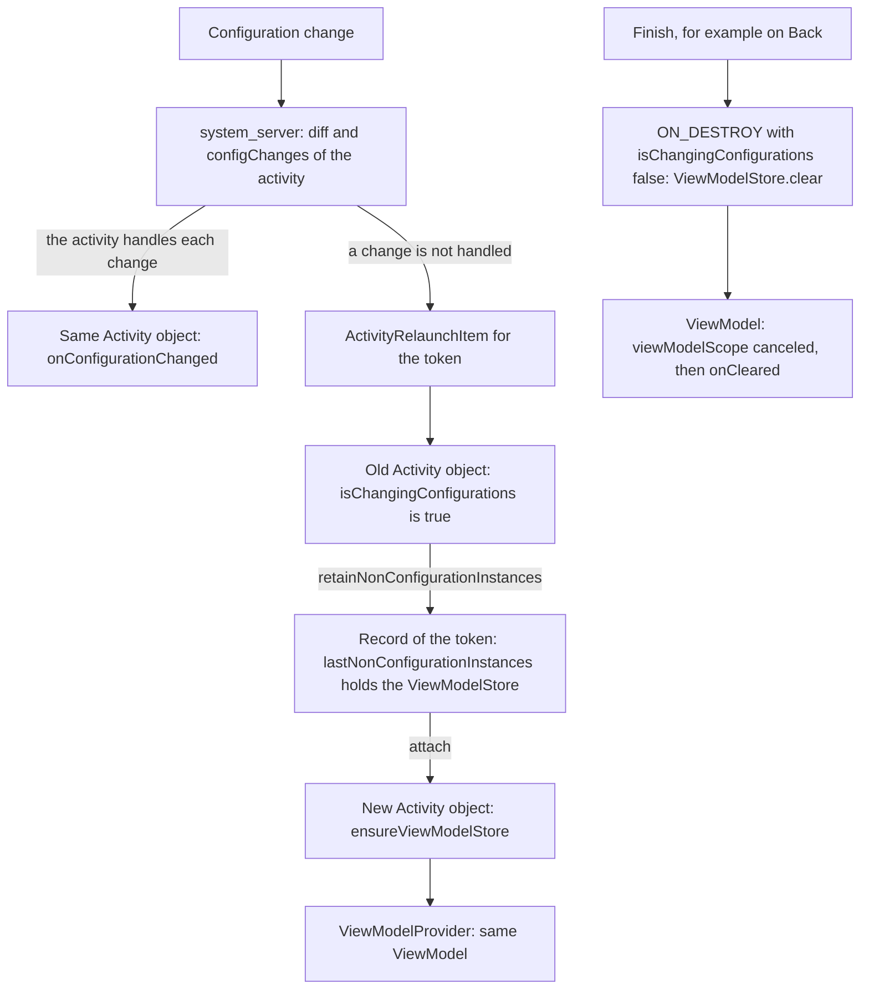

import Snippet from '../../../components/Snippet.astro';
import GoDeeper from '../../../components/GoDeeper.astro';

## The problem

Section 1 followed the launch app from the launcher tap to its first frame. While an app runs, the configuration of the device can change. Examples are the display size, the screen orientation, the font size, the locale, the dark theme and the keyboard availability[^runtime-changes].

By default, a configuration change recreates the activity. The system calls `onDestroy` and destroys the `Activity` object. Then it creates a new `Activity` object, calls `onCreate`, and gives the new object the new configuration. The recreation also clears the state in the fields of the old `Activity` object. Compose also recreates the UI[^runtime-activity-recreation]. In Compose, `remember` keeps state across recompositions, but not across configuration changes[^compose-state-in-composables].

A `ViewModel` survives the recreation. The system can call `onCreate` several times for one activity, for example after a rotation. A `ViewModel` stays in memory from the first request until the activity finishes[^viewmodel-lifecycle].

In this chapter, an activity is one screen of the app, with one token. An `Activity` object is one Java object for that screen. A recreation keeps the activity and its token, and replaces the object. Thus a `ViewModel` outlives the `Activity` object that asked for it, but not the activity. This chapter answers two questions:

- Where does the `ViewModel` stay between the destroy of the old object and the creation of the new object?
- How does the code know if a destroy is a recreation or a finish?

The chapter builds a store for `ViewModel` objects, shows where it breaks, and then shows how the platform and AndroidX keep and clear the real store.

## Build it naive

The rebuild is in the module `samples/config-changes`, in plain Kotlin. It has small stand-ins for the platform types. `Configuration` has two of the fields of the real class:

<Snippet file="config-changes/src/main/kotlin/FakeActivityThread.kt" region="config" />

An `Activity` has a token, a configuration, `onCreate` and `onDestroy`:

<Snippet file="config-changes/src/main/kotlin/FakeActivityThread.kt" region="activity" />

The real `ActivityThread` keeps one record for each activity in the map `mActivities`. The key of the map is the token of the activity[^activitythread-447]. `FakeActivityThread` also keeps a map from each token to the `Activity` object of the token. `relaunch` calls `onDestroy` on the old object. Then it creates a new object on the same token, with the new configuration. `finish` calls `onDestroy` and removes the token:

<Snippet file="config-changes/src/main/kotlin/FakeActivityThread.kt" region="thread" />

A test checks `relaunch`. After `relaunch`, `isDestroyed` of the old object is true. The new object is a different object, with the same token and the new configuration.

### A ViewModel in a field

The `ViewModel` stand-in counts the calls to `onCleared`. `CounterViewModel` adds a counter:

<Snippet file="config-changes/src/main/kotlin/NaiveViewModelStore.kt" region="viewmodel" />

`FieldActivity` creates its `CounterViewModel` in a field. Its `onCreate` adds 1 to the counter:

<Snippet file="config-changes/src/main/kotlin/NaiveViewModelStore.kt" region="problem" />

The tests use two configurations, `day` and `night`. The store of the next step is one object for the whole JVM, and all tests share the JVM. Thus each test first empties the store, as in a new process:

<Snippet file="config-changes/src/test/kotlin/NaiveViewModelStoreTest.kt" region="setup" />

The test calls `relaunch` with the token of a `FieldActivity` and the `night` configuration. The new object has a new `ViewModel`, and the counter is 1 again:

<Snippet file="config-changes/src/test/kotlin/NaiveViewModelStoreTest.kt" region="problem" />

A field lives only as long as its `Activity` object. This is the problem of the chapter, in the rebuild.

### A store for the process

The naive fix keeps the `ViewModel` outside the `Activity` object. `NaiveViewModelStore` is one map for the whole process. The key of the map is the class name of the `Activity`:

<Snippet file="config-changes/src/main/kotlin/NaiveViewModelStore.kt" region="store" />

`StoreActivity` gets its `CounterViewModel` from the store in `onCreate`:

<Snippet file="config-changes/src/main/kotlin/NaiveViewModelStore.kt" region="store-activity" />

Now the new object finds the `ViewModel` of the old object. After one `relaunch`, the counter is 2:

<Snippet file="config-changes/src/test/kotlin/NaiveViewModelStoreTest.kt" region="relaunch" />

## Where it breaks

No code removes an entry from the store. The store cannot tell a recreation from a finish, because it gets only the `Activity` object, and its key is only the class name. Two breaking tests show the flaw.

The first test launches a `StoreActivity` and finishes it. After the finish, the store still holds the `ViewModel`, and nothing called `onCleared`:

<Snippet file="config-changes/src/test/kotlin/NaiveViewModelStoreTest.kt" region="leak" />

When the owner of a real store destroys a `ViewModel`, the `ViewModel` calls `onCleared`. There, the `ViewModel` can stop its work[^viewmodel-clear-dependencies]. Its `viewModelScope` is a `CoroutineScope` that the library cancels when it clears the `ViewModel`[^viewmodel-207]. With the naive store, the `ViewModel` stays in memory after the finish, and nothing cancels its `viewModelScope`.

The second test launches two `StoreActivity` objects on two tokens. Both objects get the same `ViewModel` object:

<Snippet file="config-changes/src/test/kotlin/NaiveViewModelStoreTest.kt" region="share" />

The real `ActivityThread` keeps a separate record for each token[^activitythread-447]. Thus two activities of one class are two separate screens. With the naive store, they share one counter.

Both tests pass, so both flaws occur. A correct store needs two facts that the naive store does not have: the activity of each `ViewModel`, and the reason for each destroy.

## The real thing

### system_server decides

The app does not decide if a change recreates an activity. `system_server` decides. When the configuration of an activity changes, `ActivityRecord` compares the configuration that it last reported to the activity with the new configuration[^activityrecord-8618]. `Configuration.diff` returns a bit mask of the values that changed[^configuration-1908]. Each bit is an `ActivityInfo.CONFIG_*` constant. For example, a change of `uiMode` sets `CONFIG_UI_MODE`[^configuration-2006], with the value `0x0200`[^activityinfo-1034]. `getConfigurationChanges` gets the mask from `diff`. Then it removes the size changes that are not important to the app[^activityrecord-8862]. The Go deeper box "the filters of system_server" gives the details.

`ActivityInfo.configChanges` is the bit mask of the changes that the activity handles itself. The manifest attribute `android:configChanges` sets it[^activityinfo-1854]. `shouldRelaunchLocked` starts its skip mask from `configChanges`, and changes the mask for some special cases. If a changed bit is not in the skip mask, it returns true[^activityrecord-8740]. Then `system_server` recreates the activity with `relaunchActivityLocked`[^activityrecord-8672].

If the activity handles each change, `system_server` only sends the new configuration to the app, with `scheduleConfigurationChanged`[^activityrecord-8701]. The app calls `onConfigurationChanged` on the same `Activity` object[^activitythread-7138]. The object stays, so its fields stay. Only the `Configuration` changes, and Compose recomposes the UI with the new values[^runtime-restrict-activity].

`relaunchActivityLocked` writes an event to the event log. If the activity is resumed, or if `system_server` must resume it, the event is `wm_relaunch_resume_activity`. Otherwise, the event is `wm_relaunch_activity`. The last field of the event is the mask of changes, in hexadecimal[^activityrecord-8948]. Then `relaunchActivityLocked` sends an `ActivityRelaunchItem` with the token of the activity to the app. With it, it sends a resume item or a pause item[^activityrecord-8969]. Prompt 2 of "Try it" shows the event.

<GoDeeper title="the filters of system_server">

After each launch, the app reads the configurations of its resources with `getResourceConfigurations`. It sends them to `system_server` as `SizeConfigurationBuckets`[^activitythread-4783][^activitythread-4803]. `SizeConfigurationBuckets.filterDiff` uses these buckets:

- It removes `CONFIG_SCREEN_SIZE` if the new width and the new height cross no threshold of the buckets.
- It removes `CONFIG_SMALLEST_SCREEN_SIZE` if the new smallest width crosses no threshold.
- It removes `CONFIG_SCREEN_LAYOUT` only if the fields of the screen layout that are not sizes did not change, and the layout crosses no threshold[^sizeconfigurationbuckets-104]. A smaller layout size always crosses a threshold[^sizeconfigurationbuckets-154].

`filterDiff` does not remove `CONFIG_ORIENTATION`[^sizeconfigurationbuckets-104]. Thus a rotation recreates an activity that does not handle `orientation`, also if the new size crosses no threshold.

`shouldRelaunchLocked` also adds bits to the skip mask. For example, in picture-in-picture mode, it adds `CONFIG_DENSITY`, so a density change does not recreate the activity[^activityrecord-8769].

</GoDeeper>

Since Android 16, if an app targets Android 16 or higher, the system ignores the orientation, resizability and aspect ratio restrictions of the app on displays with a smallest width of 600dp or more[^android-16-ignore-orientation]. Thus a locked orientation does not prevent a rotation there, and the system recreates activities more often[^android-16-common-breaking]. Since Android 17, an app that targets Android 17 or higher cannot opt out of this rule[^android-17-large-screen].

Since Android 17, by default, the system does not recreate an activity for a change of `keyboard`, `keyboardHidden`, `navigation`, `touchscreen` or `colorMode`, or for a `uiMode` change to or from the desk type. The activity gets `onConfigurationChanged` instead. The manifest attribute `android:recreateOnConfigChanges` turns the recreation on again for the changes that it names[^runtime-android-17]. The change ID `SKIP_ACTIVITY_RECREATION_ON_CONFIG_CHANGE` controls this behavior. Its declaration has no `targetSdk` condition[^activityinfo-1775], so it applies to apps with each `targetSdk`. For the desk type, if the skip is on, `shouldRelaunchLocked` adds `CONFIG_UI_MODE` to the skip mask only if the desk type is the only change of `uiMode`, and the app has no desk resources[^activityrecord-8763][^activityrecord-8808]. A change of the night mode is not a desk change, so it still recreates the activity. Prompt 2 of "Try it" uses this change.

<GoDeeper title="the Android 17 skip in the code">

The manifest parser makes most of the skip. If the feature flag `enableLessActivityRecreationOnConfigChange` and the change ID are both on, the mask `RECREATE_ON_CONFIG_CHANGES_MASK` has the bits of `keyboard`, `keyboardHidden`, `navigation`, `touchscreen` and `colorMode`. The mask always has the bits of `mcc` and `mnc`[^parsedactivityutils-81][^parsedactivityutils-702]. The parser adds each bit of the mask to the `configChanges` of the activity, unless `android:recreateOnConfigChanges` names the bit[^parsedactivityutils-184][^parsedactivityutils-716]. Thus the activity seems to handle these changes itself. For the desk type, `shouldSkipActivityRelaunchWhenDocking` checks the same feature flag and change ID[^activityrecord-8856].

`AppCompatRecreateOnConfigChangePolicy` reads the resource configurations of the package. If a resource has a qualifier for `keyboard`, `keyboardHidden`, `navigation`, `touchscreen` or `colorMode`, the policy puts that bit into its recreate mask[^appcompatrecreate-89]. If the feature flag or the change ID is off, the mask is empty[^appcompatrecreate-64]. `shouldRelaunchLocked` removes the bits of this mask from the skip mask[^activityrecord-8791]. Thus an app with such resources still gets a recreation for these changes.

</GoDeeper>

Since Android 17, if an app does not handle a configuration change, the system does not restore the last visibility of the soft keyboard (the IME) after the change. If the app needs the keyboard after the change, the app must ask for it again[^android-17-ime].

### One record, two objects

The recreation runs in the app process. `handleRelaunchActivity` gets the record of the token from `mActivities`[^activitythread-6853]. It sets `mChangingConfigurations` of the old `Activity` object to true[^activitythread-6862]. `isChangingConfigurations` returns this field. It is true if the system destroys the `Activity` object to recreate the activity with a new configuration[^activity-7513].

Then `handleRelaunchActivityInner` pauses the old object, if it is not paused. If the old object is not stopped, `handleRelaunchActivityInner` stops it and saves its state. It destroys the old object with `getNonConfigInstance` set to true. Then it calls `handleLaunchActivity` with the same record[^activitythread-6933]. Thus one method call destroys the old object and creates the new object. The Javadoc of `onRetainNonConfigurationInstance` states that a new object always comes immediately after the `onDestroy` of the old object, and that no messages run between them[^activity-3527].

The hand-over is a field of the record:

1. In the destroy, `performDestroyActivity` calls `retainNonConfigurationInstances` on the old object, before it calls `onDestroy`. It puts the result into `lastNonConfigurationInstances` of the record[^activitythread-6607]. `retainNonConfigurationInstances` calls `onRetainNonConfigurationInstance` and puts the result into a `NonConfigurationInstances` object[^activity-3602].
2. In the launch, `handleLaunchActivity` calls `performLaunchActivity`[^activitythread-4781], which creates a new `Activity` object from the class name[^activitythread-4471]. It gives `lastNonConfigurationInstances` of the record to `attach` of the new object. Then it sets the field of the record to null[^activitythread-4528]. `attach` keeps the object in `mLastNonConfigurationInstances`[^activity-9257].
3. In `onCreate` and `onStart`, the new object can get the object that the old object returned, with `getLastNonConfigurationInstance`[^activity-3485].

The hand-over belongs to the record of one token, not to a class. The record is in `mActivities`, in the memory of the app process[^activitythread-447]. Thus the hand-over survives a recreation, but not the death of the process. The next chapter is about process death.

### ComponentActivity keeps the ViewModelStore

`androidx.activity.ComponentActivity` uses this platform hook. Its `onRetainNonConfigurationInstance` is final. It returns a `NonConfigurationInstances` object of AndroidX that holds `custom` and the `viewModelStore`. If both are null, it returns null[^componentactivity-366]. `ensureViewModelStore` takes the `ViewModelStore` from `lastNonConfigurationInstance`. If there is no store there, it creates a new store[^componentactivity-551].

A `ViewModelStore` is a map from a key to a `ViewModel`. Its KDoc states that a new owner after a configuration change must use the store of the old owner. The KDoc also states that the owner should call `clear` if its destroy is permanent[^viewmodelstore-23].

`ViewModelProviderImpl` is the internal implementation of `ViewModelProvider`. Its `getViewModel` looks for a key in the store. By default, `getDefaultKey(modelClass)` makes the key from the class of the `ViewModel`. If the store has an instance of the class for the key, `getViewModel` returns it. If not, it creates an instance with the factory and puts it into the store[^viewmodelproviderimpl-26]. Thus the new `Activity` object gets the old `ViewModel` object.

The real store also has a class in its key, but it is the class of the `ViewModel`, in one store for each activity. The naive store used the class of the `Activity`, in one store for the whole process.

<GoDeeper title="how Compose finds the store">

If the activity has no `ComposeView`, `setContent` of `activity-compose` makes one. It sets the `Activity` as the `ViewModelStoreOwner` of the decor view, if the decor view has no owner. Then it calls `setContentView`[^compose-componentactivity-50][^compose-componentactivity-83]. `ComponentActivity.setContentView` calls `initializeViewTreeOwners`, which sets the owner again[^componentactivity-404][^componentactivity-433]. `setViewTreeViewModelStoreOwner` writes the owner into the view tag `R.id.view_tree_view_model_store_owner`[^viewtreeviewmodelstoreowner-35].

If no composable provides an owner, `LocalViewModelStoreOwner` uses a host default key[^localviewmodelstoreowner-26]. On Android, this key is a view tree key with the tag `R.id.view_tree_view_model_store_owner`[^localviewmodelstoreowner-android-24]. The Compose `viewModel()` call gets the owner from `LocalViewModelStoreOwner.current` and gets the `ViewModel` from a `ViewModelProvider`[^compose-viewmodel-89]. Thus a composable in a `ComponentActivity` gets its `ViewModel` from the store of the activity.

</GoDeeper>

### The store clears on each destroy that is not a recreation

`ComponentActivity` adds a lifecycle observer. On `ON_DESTROY`, the observer clears the `ViewModelStore`, but only if `isChangingConfigurations` is false[^componentactivity-278]. Thus a recreation keeps the store, and a finish clears it. The rebuild did not have this fact. The system can also destroy an activity that does not finish, to save space[^activity-2962]. That destroy is not a recreation, so `ComponentActivity` also clears the store.

`ON_DESTROY` comes before `Activity.onDestroy`. `ComponentActivity.onCreate` calls `ReportFragment.injectIfNeededIn`[^componentactivity-344]. On API level 29 and higher, `injectIfNeededIn` registers activity lifecycle callbacks[^reportfragment-154]. These callbacks send `ON_DESTROY` from `onActivityPreDestroyed`[^reportfragment-136]. `Activity.performDestroy` calls `dispatchActivityPreDestroyed` before `onDestroy`[^activity-9652]. The [components and lifecycle chapter](/launch-path/components-lifecycle/) explains these callbacks. Prompt 3 of "Try it" shows this order.

`ViewModelStore.clear` empties the map, and then clears each `ViewModel`[^viewmodelstore-85]. On Android, `ViewModel.clear` first clears its `ViewModelImpl`, and then calls `onCleared`[^viewmodel-jvm-66]. `ViewModelImpl.clear` closes the closeables with a key first, and then the other closeables[^viewmodelimpl-74]. `viewModelScope` is a closeable with a key, so the clear cancels it[^viewmodel-207].

On Back, the activity tells `system_server`[^activity-4383]. If no task organizer takes the Back press and `shouldMoveTaskToBack` is false, `system_server` tells the app to finish the activity[^activityclientcontroller-1960]. By default, `shouldMoveTaskToBack` is true only if all these conditions are true[^activityclientcontroller-2000]:

- The activity is the root of its task and the top activity of its `TaskFragment`.
- The home screen started the activity.
- The intent of the task is the main intent.

If `shouldMoveTaskToBack` is true, the task moves to the back[^activityclientcontroller-1960]. The activity does not finish, so its `ViewModel` objects stay. The [components and lifecycle chapter](/launch-path/components-lifecycle/) shows this case.

Since Android 12, Back on a launcher activity at the root of its task moves the task to the background, and the activity does not finish. Other activities still finish on Back[^android-12-back]. Thus Back does not destroy such an activity, and nothing clears its `ViewModel` objects.

## Mental model

A configuration change is the diff of two `Configuration` objects. `system_server` compares the diff with the `configChanges` of the activity. If the activity handles each change, the same `Activity` object gets `onConfigurationChanged`. If not, `system_server` tells the app to recreate the activity on its token. On the main thread, `ActivityThread` sets `isChangingConfigurations` on the old object. It keeps the non-configuration instances of the old object in the record of the token. Then it destroys the old object and creates a new object on the same record. No other message runs between these steps. `ComponentActivity` puts its `ViewModelStore` into these instances, and the new object takes the store back. `ViewModelProvider` finds the same `ViewModel` in the store. On a destroy that is not a recreation, `ComponentActivity` clears the store. Each `ViewModel` then cancels its `viewModelScope` and calls `onCleared`. The hand-over is only in the memory of the app process.



## Try it

### 1. Give each activity its own entry

Change the rebuild, so that the store can tell two activities apart, and can tell a recreation from a finish:

1. In `NaiveViewModelStore.getOrCreate`, use `activity.token` as the key.
2. In `FakeActivityThread.finish`, after the thread removes the token, remove the entry of the token from `NaiveViewModelStore.viewModels`. Call `onCleared` on the `ViewModel` of the removed entry.

From the repo root, run the tests of the rebuild:

```sh
samples/gradlew -p samples :config-changes:test
```

The two breaking tests fail, because the flaws are gone. The other three tests pass, so a recreation still keeps the `ViewModel`. The Gradle output includes these lines:

```
NaiveViewModelStoreTest > naiveStore_keepsViewModel_afterActivityFinishes() FAILED
    org.opentest4j.AssertionFailedError at NaiveViewModelStoreTest.kt:57

NaiveViewModelStoreTest > naiveStore_sharesViewModel_betweenTwoActivityInstances() FAILED
    org.opentest4j.AssertionFailedError at NaiveViewModelStoreTest.kt:68

5 tests completed, 2 failed
```

Compare your fix with the real code. The real `ActivityThread` does not clear a store. It marks a recreation: `handleRelaunchActivity` sets `mChangingConfigurations` to true[^activitythread-6862]. On `ON_DESTROY`, `ComponentActivity` reads the mark, and clears its own store only if the mark is not set[^componentactivity-278]. Each store belongs to one activity, and the record of the token keeps it across the recreation[^activitythread-6607][^activitythread-4528].

### 2. Watch a recreation keep the ViewModel

This prompt and the next prompt use the `configChanges` flavor of the launch app, in `samples/launch-app/src/configChanges/`. The flavor adds two classes:

- `RetainActivity`, a `ComponentActivity` with no `android:configChanges`. In `onCreate`, it gets its `CounterViewModel` from a `ViewModelProvider`, and adds 1 to the counter.
- `CounterViewModel`, a `ViewModel` with a counter.

Each class numbers its objects from 1 in each process. Both classes write to the log with the tag `ConfigChanges`.

Start an emulator with the system image of the checked stamp. From the repo root, install the release build of the flavor. Turn off the dark theme, start `RetainActivity`, and clear the log:

```sh
samples/gradlew -p samples :launch-app:installConfigChangesRelease
adb shell cmd uimode night no
adb shell am start -S -W -n io.github.imgurpreetsk.afp.launchapp.configChanges/io.github.imgurpreetsk.afp.launchapp.RetainActivity
adb logcat -b main -b events -c
```

`cmd uimode night` calls `setNightMode`[^uimodemanagerservice-2544]. `setNightMode` changes the configuration only if the night mode changes[^uimodemanagerservice-1015]. Thus the first `cmd uimode night` makes sure that the next one is a change. The [first frame chapter](/launch-path/first-frame/) explains `am start -S -W`.

Turn on the dark theme:

```sh
adb shell cmd uimode night yes
```

{/* Edit step: capture this output on the emulator of the checked stamp. */}

```
Night mode: yes
```

After the change, the command prints the night mode[^uimodemanagerservice-2570]. Wait two seconds. Then print the log of the app and three events:

```sh
adb logcat -d -b main -b events -s ConfigChanges wm_relaunch_resume_activity wm_on_destroy_called wm_on_create_called
```

{/* Edit step: capture this output on the emulator of the checked stamp. */}

```
… I wm_relaunch_resume_activity: [0,…,…,io.github.imgurpreetsk.afp.launchapp.configChanges/io.github.imgurpreetsk.afp.launchapp.RetainActivity,200]
… I ConfigChanges: onDestroy activity=#1 isChangingConfigurations=true
… I wm_on_destroy_called: […,io.github.imgurpreetsk.afp.launchapp.RetainActivity,performDestroy,…]
… I ConfigChanges: onCreate activity=#2 viewModel=#1 count=2
… I wm_on_create_called: […,io.github.imgurpreetsk.afp.launchapp.RetainActivity,performCreate,…]
```

Each line starts with the date, the time, the PID and the thread ID. The block shows them as `…`.

- `system_server` decides first. `wm_relaunch_resume_activity` has the user, the hash code of the `ActivityRecord`, the task ID, the component and the mask of changes[^activityrecord-8948]. The mask is `200` in hexadecimal: `CONFIG_UI_MODE`[^activityinfo-1034]. `RetainActivity` does not handle `uiMode`, so `system_server` recreates it.
- The old object `#1` gets `onDestroy` with `isChangingConfigurations=true`[^activitythread-6862]. `wm_on_destroy_called` comes after `onDestroy` returns[^activity-9652].
- The new object `#2` gets `CounterViewModel` `#1`, and the counter is 2. Thus the second `onCreate` added 1 to the counter of the first `onCreate`. With a new `ViewModel`, the line shows `viewModel=#2 count=1`. `wm_on_create_called` comes after `onCreate` returns[^activity-9336].
- The log has no `onCleared` line. `ComponentActivity` did not clear the store, because `isChangingConfigurations` was true[^componentactivity-278].

Turn off the dark theme again:

```sh
adb shell cmd uimode night no
```

### 3. Press Back and watch the clear

Start `RetainActivity` in a new process, clear the log, and press Back:

```sh
adb shell am start -S -W -n io.github.imgurpreetsk.afp.launchapp.configChanges/io.github.imgurpreetsk.afp.launchapp.RetainActivity
adb logcat -b main -b events -c
adb shell input keyevent KEYCODE_BACK
```

Wait two seconds. Then print the log of the app and three events:

```sh
adb logcat -d -b main -b events -s ConfigChanges wm_relaunch_resume_activity wm_relaunch_activity wm_on_destroy_called
```

{/* Edit step: capture this output on the emulator of the checked stamp. */}

```
… I ConfigChanges: onCleared viewModel=#1
… I ConfigChanges: onDestroy activity=#1 isChangingConfigurations=false
… I wm_on_destroy_called: […,io.github.imgurpreetsk.afp.launchapp.RetainActivity,performDestroy,…]
```

- The shell started `RetainActivity`, not the home screen, so the launch source is not the home screen[^activityrecord-2242]. Thus `shouldMoveTaskToBack` is false[^activityclientcontroller-2000], and `system_server` tells the app to finish the activity[^activityclientcontroller-1960].
- `onCleared` comes before `onDestroy`. `ReportFragment` sends `ON_DESTROY` before `Activity.onDestroy` runs[^reportfragment-136][^activity-9652]. On `ON_DESTROY`, `isChangingConfigurations` is false, so `ComponentActivity` clears the store[^componentactivity-278].
- The log has no `wm_relaunch` event. A finish is not a recreation.

[^runtime-changes]: Handle configuration changes: [https://developer.android.com/guide/topics/resources/runtime-changes](https://developer.android.com/guide/topics/resources/runtime-changes)
[^runtime-activity-recreation]: Handle configuration changes, "Activity recreation": [https://developer.android.com/guide/topics/resources/runtime-changes#activity-recreation](https://developer.android.com/guide/topics/resources/runtime-changes#activity-recreation)
[^compose-state-in-composables]: State and Jetpack Compose, "State in composables": [https://developer.android.com/develop/ui/compose/state#state-in-composables](https://developer.android.com/develop/ui/compose/state#state-in-composables)
[^viewmodel-lifecycle]: ViewModel overview, "The lifecycle of a ViewModel": [https://developer.android.com/topic/libraries/architecture/viewmodel#lifecycle](https://developer.android.com/topic/libraries/architecture/viewmodel#lifecycle)
[^activitythread-447]: ActivityThread.java, line 447: [https://android.googlesource.com/platform/frameworks/base/+/refs/tags/android-17.0.0_r1/core/java/android/app/ActivityThread.java#447](https://android.googlesource.com/platform/frameworks/base/+/refs/tags/android-17.0.0_r1/core/java/android/app/ActivityThread.java#447)
[^viewmodel-clear-dependencies]: ViewModel overview, "Clearing ViewModel dependencies": [https://developer.android.com/topic/libraries/architecture/viewmodel#clear-dependencies](https://developer.android.com/topic/libraries/architecture/viewmodel#clear-dependencies)
[^viewmodel-207]: lifecycle-viewmodel ViewModel.kt, lines 207–231: [https://android.googlesource.com/platform/frameworks/support/+/a01f1a6c29523dd9b046b7f2a383d7d24559e316/lifecycle/lifecycle-viewmodel/src/commonMain/kotlin/androidx/lifecycle/ViewModel.kt#207](https://android.googlesource.com/platform/frameworks/support/+/a01f1a6c29523dd9b046b7f2a383d7d24559e316/lifecycle/lifecycle-viewmodel/src/commonMain/kotlin/androidx/lifecycle/ViewModel.kt#207)
[^runtime-restrict-activity]: Handle configuration changes, "Restrict activity recreation": [https://developer.android.com/guide/topics/resources/runtime-changes#restrict-activity](https://developer.android.com/guide/topics/resources/runtime-changes#restrict-activity)
[^android-16-ignore-orientation]: Android 16 behavior changes, "Ignore orientation, resizability, and aspect ratio restrictions": [https://developer.android.com/about/versions/16/behavior-changes-16#ignore-orientation](https://developer.android.com/about/versions/16/behavior-changes-16#ignore-orientation)
[^android-16-common-breaking]: Android 16 behavior changes, "Common breaking changes": [https://developer.android.com/about/versions/16/behavior-changes-16#common-breaking](https://developer.android.com/about/versions/16/behavior-changes-16#common-breaking)
[^android-17-large-screen]: Android 17 behavior changes, "Platform API changes to ignore orientation, resizability, and aspect ratio constraints on large screens": [https://developer.android.com/about/versions/17/behavior-changes-17#large-screen-ignore-constraints](https://developer.android.com/about/versions/17/behavior-changes-17#large-screen-ignore-constraints)
[^runtime-android-17]: Handle configuration changes, "Android 17": [https://developer.android.com/guide/topics/resources/runtime-changes#android_17](https://developer.android.com/guide/topics/resources/runtime-changes#android_17)
[^android-17-ime]: Android 17 behavior changes for all apps, "Restoring default IME visibility after rotation": [https://developer.android.com/about/versions/17/behavior-changes-all#ime-rotate](https://developer.android.com/about/versions/17/behavior-changes-all#ime-rotate)
[^android-12-back]: Android 12 behavior changes for all apps, "Root launcher activities are no longer finished on Back press": [https://developer.android.com/about/versions/12/behavior-changes-all#back-press](https://developer.android.com/about/versions/12/behavior-changes-all#back-press)
[^activityrecord-8618]: ActivityRecord.java, lines 8618–8620: [https://android.googlesource.com/platform/frameworks/base/+/refs/tags/android-17.0.0_r1/services/core/java/com/android/server/wm/ActivityRecord.java#8618](https://android.googlesource.com/platform/frameworks/base/+/refs/tags/android-17.0.0_r1/services/core/java/com/android/server/wm/ActivityRecord.java#8618)
[^configuration-1908]: Configuration.java, lines 1908–1917: [https://android.googlesource.com/platform/frameworks/base/+/refs/tags/android-17.0.0_r1/core/java/android/content/res/Configuration.java#1908](https://android.googlesource.com/platform/frameworks/base/+/refs/tags/android-17.0.0_r1/core/java/android/content/res/Configuration.java#1908)
[^configuration-2006]: Configuration.java, lines 2006–2009: [https://android.googlesource.com/platform/frameworks/base/+/refs/tags/android-17.0.0_r1/core/java/android/content/res/Configuration.java#2006](https://android.googlesource.com/platform/frameworks/base/+/refs/tags/android-17.0.0_r1/core/java/android/content/res/Configuration.java#2006)
[^activityinfo-1034]: ActivityInfo.java, line 1034: [https://android.googlesource.com/platform/frameworks/base/+/refs/tags/android-17.0.0_r1/core/java/android/content/pm/ActivityInfo.java#1034](https://android.googlesource.com/platform/frameworks/base/+/refs/tags/android-17.0.0_r1/core/java/android/content/pm/ActivityInfo.java#1034)
[^activityrecord-8862]: ActivityRecord.java, lines 8862–8875: [https://android.googlesource.com/platform/frameworks/base/+/refs/tags/android-17.0.0_r1/services/core/java/com/android/server/wm/ActivityRecord.java#8862](https://android.googlesource.com/platform/frameworks/base/+/refs/tags/android-17.0.0_r1/services/core/java/com/android/server/wm/ActivityRecord.java#8862)
[^activityinfo-1854]: ActivityInfo.java, lines 1854–1867: [https://android.googlesource.com/platform/frameworks/base/+/refs/tags/android-17.0.0_r1/core/java/android/content/pm/ActivityInfo.java#1854](https://android.googlesource.com/platform/frameworks/base/+/refs/tags/android-17.0.0_r1/core/java/android/content/pm/ActivityInfo.java#1854)
[^activityrecord-8740]: ActivityRecord.java, lines 8740–8796: [https://android.googlesource.com/platform/frameworks/base/+/refs/tags/android-17.0.0_r1/services/core/java/com/android/server/wm/ActivityRecord.java#8740](https://android.googlesource.com/platform/frameworks/base/+/refs/tags/android-17.0.0_r1/services/core/java/com/android/server/wm/ActivityRecord.java#8740)
[^activityrecord-8672]: ActivityRecord.java, lines 8672–8699: [https://android.googlesource.com/platform/frameworks/base/+/refs/tags/android-17.0.0_r1/services/core/java/com/android/server/wm/ActivityRecord.java#8672](https://android.googlesource.com/platform/frameworks/base/+/refs/tags/android-17.0.0_r1/services/core/java/com/android/server/wm/ActivityRecord.java#8672)
[^activityrecord-8701]: ActivityRecord.java, lines 8701–8713: [https://android.googlesource.com/platform/frameworks/base/+/refs/tags/android-17.0.0_r1/services/core/java/com/android/server/wm/ActivityRecord.java#8701](https://android.googlesource.com/platform/frameworks/base/+/refs/tags/android-17.0.0_r1/services/core/java/com/android/server/wm/ActivityRecord.java#8701)
[^activitythread-7138]: ActivityThread.java, lines 7138–7147: [https://android.googlesource.com/platform/frameworks/base/+/refs/tags/android-17.0.0_r1/core/java/android/app/ActivityThread.java#7138](https://android.googlesource.com/platform/frameworks/base/+/refs/tags/android-17.0.0_r1/core/java/android/app/ActivityThread.java#7138)
[^activityrecord-8948]: ActivityRecord.java, lines 8948–8965: [https://android.googlesource.com/platform/frameworks/base/+/refs/tags/android-17.0.0_r1/services/core/java/com/android/server/wm/ActivityRecord.java#8948](https://android.googlesource.com/platform/frameworks/base/+/refs/tags/android-17.0.0_r1/services/core/java/com/android/server/wm/ActivityRecord.java#8948)
[^activityrecord-8969]: ActivityRecord.java, lines 8969–8982: [https://android.googlesource.com/platform/frameworks/base/+/refs/tags/android-17.0.0_r1/services/core/java/com/android/server/wm/ActivityRecord.java#8969](https://android.googlesource.com/platform/frameworks/base/+/refs/tags/android-17.0.0_r1/services/core/java/com/android/server/wm/ActivityRecord.java#8969)
[^activitythread-4783]: ActivityThread.java, lines 4783–4785: [https://android.googlesource.com/platform/frameworks/base/+/refs/tags/android-17.0.0_r1/core/java/android/app/ActivityThread.java#4783](https://android.googlesource.com/platform/frameworks/base/+/refs/tags/android-17.0.0_r1/core/java/android/app/ActivityThread.java#4783)
[^activitythread-4803]: ActivityThread.java, lines 4803–4813: [https://android.googlesource.com/platform/frameworks/base/+/refs/tags/android-17.0.0_r1/core/java/android/app/ActivityThread.java#4803](https://android.googlesource.com/platform/frameworks/base/+/refs/tags/android-17.0.0_r1/core/java/android/app/ActivityThread.java#4803)
[^sizeconfigurationbuckets-104]: SizeConfigurationBuckets.java, lines 104–139: [https://android.googlesource.com/platform/frameworks/base/+/refs/tags/android-17.0.0_r1/core/java/android/window/SizeConfigurationBuckets.java#104](https://android.googlesource.com/platform/frameworks/base/+/refs/tags/android-17.0.0_r1/core/java/android/window/SizeConfigurationBuckets.java#104)
[^sizeconfigurationbuckets-154]: SizeConfigurationBuckets.java, lines 154–184: [https://android.googlesource.com/platform/frameworks/base/+/refs/tags/android-17.0.0_r1/core/java/android/window/SizeConfigurationBuckets.java#154](https://android.googlesource.com/platform/frameworks/base/+/refs/tags/android-17.0.0_r1/core/java/android/window/SizeConfigurationBuckets.java#154)
[^activityrecord-8769]: ActivityRecord.java, lines 8769–8772: [https://android.googlesource.com/platform/frameworks/base/+/refs/tags/android-17.0.0_r1/services/core/java/com/android/server/wm/ActivityRecord.java#8769](https://android.googlesource.com/platform/frameworks/base/+/refs/tags/android-17.0.0_r1/services/core/java/com/android/server/wm/ActivityRecord.java#8769)
[^activityinfo-1775]: ActivityInfo.java, lines 1775–1788: [https://android.googlesource.com/platform/frameworks/base/+/refs/tags/android-17.0.0_r1/core/java/android/content/pm/ActivityInfo.java#1775](https://android.googlesource.com/platform/frameworks/base/+/refs/tags/android-17.0.0_r1/core/java/android/content/pm/ActivityInfo.java#1775)
[^activityrecord-8763]: ActivityRecord.java, lines 8763–8767: [https://android.googlesource.com/platform/frameworks/base/+/refs/tags/android-17.0.0_r1/services/core/java/com/android/server/wm/ActivityRecord.java#8763](https://android.googlesource.com/platform/frameworks/base/+/refs/tags/android-17.0.0_r1/services/core/java/com/android/server/wm/ActivityRecord.java#8763)
[^activityrecord-8808]: ActivityRecord.java, lines 8808–8824: [https://android.googlesource.com/platform/frameworks/base/+/refs/tags/android-17.0.0_r1/services/core/java/com/android/server/wm/ActivityRecord.java#8808](https://android.googlesource.com/platform/frameworks/base/+/refs/tags/android-17.0.0_r1/services/core/java/com/android/server/wm/ActivityRecord.java#8808)
[^parsedactivityutils-81]: ParsedActivityUtils.java, lines 81–89: [https://android.googlesource.com/platform/frameworks/base/+/refs/tags/android-17.0.0_r1/core/java/com/android/internal/pm/pkg/component/ParsedActivityUtils.java#81](https://android.googlesource.com/platform/frameworks/base/+/refs/tags/android-17.0.0_r1/core/java/com/android/internal/pm/pkg/component/ParsedActivityUtils.java#81)
[^parsedactivityutils-702]: ParsedActivityUtils.java, lines 702–714: [https://android.googlesource.com/platform/frameworks/base/+/refs/tags/android-17.0.0_r1/core/java/com/android/internal/pm/pkg/component/ParsedActivityUtils.java#702](https://android.googlesource.com/platform/frameworks/base/+/refs/tags/android-17.0.0_r1/core/java/com/android/internal/pm/pkg/component/ParsedActivityUtils.java#702)
[^parsedactivityutils-184]: ParsedActivityUtils.java, lines 184–187: [https://android.googlesource.com/platform/frameworks/base/+/refs/tags/android-17.0.0_r1/core/java/com/android/internal/pm/pkg/component/ParsedActivityUtils.java#184](https://android.googlesource.com/platform/frameworks/base/+/refs/tags/android-17.0.0_r1/core/java/com/android/internal/pm/pkg/component/ParsedActivityUtils.java#184)
[^parsedactivityutils-716]: ParsedActivityUtils.java, lines 716–724: [https://android.googlesource.com/platform/frameworks/base/+/refs/tags/android-17.0.0_r1/core/java/com/android/internal/pm/pkg/component/ParsedActivityUtils.java#716](https://android.googlesource.com/platform/frameworks/base/+/refs/tags/android-17.0.0_r1/core/java/com/android/internal/pm/pkg/component/ParsedActivityUtils.java#716)
[^activityrecord-8856]: ActivityRecord.java, lines 8856–8860: [https://android.googlesource.com/platform/frameworks/base/+/refs/tags/android-17.0.0_r1/services/core/java/com/android/server/wm/ActivityRecord.java#8856](https://android.googlesource.com/platform/frameworks/base/+/refs/tags/android-17.0.0_r1/services/core/java/com/android/server/wm/ActivityRecord.java#8856)
[^appcompatrecreate-89]: AppCompatRecreateOnConfigChangePolicy.java, lines 89–133: [https://android.googlesource.com/platform/frameworks/base/+/refs/tags/android-17.0.0_r1/services/core/java/com/android/server/wm/AppCompatRecreateOnConfigChangePolicy.java#89](https://android.googlesource.com/platform/frameworks/base/+/refs/tags/android-17.0.0_r1/services/core/java/com/android/server/wm/AppCompatRecreateOnConfigChangePolicy.java#89)
[^appcompatrecreate-64]: AppCompatRecreateOnConfigChangePolicy.java, lines 64–87: [https://android.googlesource.com/platform/frameworks/base/+/refs/tags/android-17.0.0_r1/services/core/java/com/android/server/wm/AppCompatRecreateOnConfigChangePolicy.java#64](https://android.googlesource.com/platform/frameworks/base/+/refs/tags/android-17.0.0_r1/services/core/java/com/android/server/wm/AppCompatRecreateOnConfigChangePolicy.java#64)
[^activityrecord-8791]: ActivityRecord.java, lines 8791–8793: [https://android.googlesource.com/platform/frameworks/base/+/refs/tags/android-17.0.0_r1/services/core/java/com/android/server/wm/ActivityRecord.java#8791](https://android.googlesource.com/platform/frameworks/base/+/refs/tags/android-17.0.0_r1/services/core/java/com/android/server/wm/ActivityRecord.java#8791)
[^activitythread-6853]: ActivityThread.java, lines 6853–6857: [https://android.googlesource.com/platform/frameworks/base/+/refs/tags/android-17.0.0_r1/core/java/android/app/ActivityThread.java#6853](https://android.googlesource.com/platform/frameworks/base/+/refs/tags/android-17.0.0_r1/core/java/android/app/ActivityThread.java#6853)
[^activitythread-6862]: ActivityThread.java, line 6862: [https://android.googlesource.com/platform/frameworks/base/+/refs/tags/android-17.0.0_r1/core/java/android/app/ActivityThread.java#6862](https://android.googlesource.com/platform/frameworks/base/+/refs/tags/android-17.0.0_r1/core/java/android/app/ActivityThread.java#6862)
[^activity-7513]: Activity.java, lines 7513–7533: [https://android.googlesource.com/platform/frameworks/base/+/refs/tags/android-17.0.0_r1/core/java/android/app/Activity.java#7513](https://android.googlesource.com/platform/frameworks/base/+/refs/tags/android-17.0.0_r1/core/java/android/app/Activity.java#7513)
[^activitythread-6933]: ActivityThread.java, lines 6933–6974: [https://android.googlesource.com/platform/frameworks/base/+/refs/tags/android-17.0.0_r1/core/java/android/app/ActivityThread.java#6933](https://android.googlesource.com/platform/frameworks/base/+/refs/tags/android-17.0.0_r1/core/java/android/app/ActivityThread.java#6933)
[^activity-3527]: Activity.java, lines 3527–3538: [https://android.googlesource.com/platform/frameworks/base/+/refs/tags/android-17.0.0_r1/core/java/android/app/Activity.java#3527](https://android.googlesource.com/platform/frameworks/base/+/refs/tags/android-17.0.0_r1/core/java/android/app/Activity.java#3527)
[^activitythread-6607]: ActivityThread.java, lines 6607–6619: [https://android.googlesource.com/platform/frameworks/base/+/refs/tags/android-17.0.0_r1/core/java/android/app/ActivityThread.java#6607](https://android.googlesource.com/platform/frameworks/base/+/refs/tags/android-17.0.0_r1/core/java/android/app/ActivityThread.java#6607)
[^activitythread-4781]: ActivityThread.java, line 4781: [https://android.googlesource.com/platform/frameworks/base/+/refs/tags/android-17.0.0_r1/core/java/android/app/ActivityThread.java#4781](https://android.googlesource.com/platform/frameworks/base/+/refs/tags/android-17.0.0_r1/core/java/android/app/ActivityThread.java#4781)
[^activity-3602]: Activity.java, lines 3602–3629: [https://android.googlesource.com/platform/frameworks/base/+/refs/tags/android-17.0.0_r1/core/java/android/app/Activity.java#3602](https://android.googlesource.com/platform/frameworks/base/+/refs/tags/android-17.0.0_r1/core/java/android/app/Activity.java#3602)
[^activitythread-4471]: ActivityThread.java, lines 4471–4472: [https://android.googlesource.com/platform/frameworks/base/+/refs/tags/android-17.0.0_r1/core/java/android/app/ActivityThread.java#4471](https://android.googlesource.com/platform/frameworks/base/+/refs/tags/android-17.0.0_r1/core/java/android/app/ActivityThread.java#4471)
[^activitythread-4528]: ActivityThread.java, lines 4528–4537: [https://android.googlesource.com/platform/frameworks/base/+/refs/tags/android-17.0.0_r1/core/java/android/app/ActivityThread.java#4528](https://android.googlesource.com/platform/frameworks/base/+/refs/tags/android-17.0.0_r1/core/java/android/app/ActivityThread.java#4528)
[^activity-9257]: Activity.java, line 9257: [https://android.googlesource.com/platform/frameworks/base/+/refs/tags/android-17.0.0_r1/core/java/android/app/Activity.java#9257](https://android.googlesource.com/platform/frameworks/base/+/refs/tags/android-17.0.0_r1/core/java/android/app/Activity.java#9257)
[^activity-3485]: Activity.java, lines 3485–3509: [https://android.googlesource.com/platform/frameworks/base/+/refs/tags/android-17.0.0_r1/core/java/android/app/Activity.java#3485](https://android.googlesource.com/platform/frameworks/base/+/refs/tags/android-17.0.0_r1/core/java/android/app/Activity.java#3485)
[^componentactivity-366]: activity ComponentActivity.kt, lines 366–385: [https://android.googlesource.com/platform/frameworks/support/+/475afe04599ffc0893939effda40187916c4ceb0/activity/activity/src/main/java/androidx/activity/ComponentActivity.kt#366](https://android.googlesource.com/platform/frameworks/support/+/475afe04599ffc0893939effda40187916c4ceb0/activity/activity/src/main/java/androidx/activity/ComponentActivity.kt#366)
[^componentactivity-551]: activity ComponentActivity.kt, lines 551–562: [https://android.googlesource.com/platform/frameworks/support/+/475afe04599ffc0893939effda40187916c4ceb0/activity/activity/src/main/java/androidx/activity/ComponentActivity.kt#551](https://android.googlesource.com/platform/frameworks/support/+/475afe04599ffc0893939effda40187916c4ceb0/activity/activity/src/main/java/androidx/activity/ComponentActivity.kt#551)
[^viewmodelstore-23]: ViewModelStore.kt, lines 23–44: [https://android.googlesource.com/platform/frameworks/support/+/a01f1a6c29523dd9b046b7f2a383d7d24559e316/lifecycle/lifecycle-viewmodel/src/commonMain/kotlin/androidx/lifecycle/ViewModelStore.kt#23](https://android.googlesource.com/platform/frameworks/support/+/a01f1a6c29523dd9b046b7f2a383d7d24559e316/lifecycle/lifecycle-viewmodel/src/commonMain/kotlin/androidx/lifecycle/ViewModelStore.kt#23)
[^viewmodelproviderimpl-26]: ViewModelProviderImpl.kt, lines 26–63: [https://android.googlesource.com/platform/frameworks/support/+/a01f1a6c29523dd9b046b7f2a383d7d24559e316/lifecycle/lifecycle-viewmodel/src/commonMain/kotlin/androidx/lifecycle/viewmodel/internal/ViewModelProviderImpl.kt#26](https://android.googlesource.com/platform/frameworks/support/+/a01f1a6c29523dd9b046b7f2a383d7d24559e316/lifecycle/lifecycle-viewmodel/src/commonMain/kotlin/androidx/lifecycle/viewmodel/internal/ViewModelProviderImpl.kt#26)
[^compose-componentactivity-50]: activity-compose ComponentActivity.kt, lines 50–74: [https://android.googlesource.com/platform/frameworks/support/+/475afe04599ffc0893939effda40187916c4ceb0/activity/activity-compose/src/main/java/androidx/activity/compose/ComponentActivity.kt#50](https://android.googlesource.com/platform/frameworks/support/+/475afe04599ffc0893939effda40187916c4ceb0/activity/activity-compose/src/main/java/androidx/activity/compose/ComponentActivity.kt#50)
[^compose-componentactivity-83]: activity-compose ComponentActivity.kt, lines 83–94: [https://android.googlesource.com/platform/frameworks/support/+/475afe04599ffc0893939effda40187916c4ceb0/activity/activity-compose/src/main/java/androidx/activity/compose/ComponentActivity.kt#83](https://android.googlesource.com/platform/frameworks/support/+/475afe04599ffc0893939effda40187916c4ceb0/activity/activity-compose/src/main/java/androidx/activity/compose/ComponentActivity.kt#83)
[^componentactivity-404]: activity ComponentActivity.kt, lines 404–420: [https://android.googlesource.com/platform/frameworks/support/+/475afe04599ffc0893939effda40187916c4ceb0/activity/activity/src/main/java/androidx/activity/ComponentActivity.kt#404](https://android.googlesource.com/platform/frameworks/support/+/475afe04599ffc0893939effda40187916c4ceb0/activity/activity/src/main/java/androidx/activity/ComponentActivity.kt#404)
[^componentactivity-433]: activity ComponentActivity.kt, lines 433–435: [https://android.googlesource.com/platform/frameworks/support/+/475afe04599ffc0893939effda40187916c4ceb0/activity/activity/src/main/java/androidx/activity/ComponentActivity.kt#433](https://android.googlesource.com/platform/frameworks/support/+/475afe04599ffc0893939effda40187916c4ceb0/activity/activity/src/main/java/androidx/activity/ComponentActivity.kt#433)
[^viewtreeviewmodelstoreowner-35]: ViewTreeViewModelStoreOwner.android.kt, lines 35–38: [https://android.googlesource.com/platform/frameworks/support/+/a01f1a6c29523dd9b046b7f2a383d7d24559e316/lifecycle/lifecycle-viewmodel/src/androidMain/kotlin/androidx/lifecycle/ViewTreeViewModelStoreOwner.android.kt#35](https://android.googlesource.com/platform/frameworks/support/+/a01f1a6c29523dd9b046b7f2a383d7d24559e316/lifecycle/lifecycle-viewmodel/src/androidMain/kotlin/androidx/lifecycle/ViewTreeViewModelStoreOwner.android.kt#35)
[^localviewmodelstoreowner-26]: LocalViewModelStoreOwner.kt, lines 26–38: [https://android.googlesource.com/platform/frameworks/support/+/a01f1a6c29523dd9b046b7f2a383d7d24559e316/lifecycle/lifecycle-viewmodel-compose/src/commonMain/kotlin/androidx/lifecycle/viewmodel/compose/LocalViewModelStoreOwner.kt#26](https://android.googlesource.com/platform/frameworks/support/+/a01f1a6c29523dd9b046b7f2a383d7d24559e316/lifecycle/lifecycle-viewmodel-compose/src/commonMain/kotlin/androidx/lifecycle/viewmodel/compose/LocalViewModelStoreOwner.kt#26)
[^localviewmodelstoreowner-android-24]: LocalViewModelStoreOwner.android.kt, lines 24–28: [https://android.googlesource.com/platform/frameworks/support/+/a01f1a6c29523dd9b046b7f2a383d7d24559e316/lifecycle/lifecycle-viewmodel-compose/src/androidMain/kotlin/androidx/lifecycle/viewmodel/compose/LocalViewModelStoreOwner.android.kt#24](https://android.googlesource.com/platform/frameworks/support/+/a01f1a6c29523dd9b046b7f2a383d7d24559e316/lifecycle/lifecycle-viewmodel-compose/src/androidMain/kotlin/androidx/lifecycle/viewmodel/compose/LocalViewModelStoreOwner.android.kt#24)
[^compose-viewmodel-89]: lifecycle-viewmodel-compose ViewModel.kt, lines 89–106: [https://android.googlesource.com/platform/frameworks/support/+/a01f1a6c29523dd9b046b7f2a383d7d24559e316/lifecycle/lifecycle-viewmodel-compose/src/commonMain/kotlin/androidx/lifecycle/viewmodel/compose/ViewModel.kt#89](https://android.googlesource.com/platform/frameworks/support/+/a01f1a6c29523dd9b046b7f2a383d7d24559e316/lifecycle/lifecycle-viewmodel-compose/src/commonMain/kotlin/androidx/lifecycle/viewmodel/compose/ViewModel.kt#89)
[^componentactivity-278]: activity ComponentActivity.kt, lines 278–291: [https://android.googlesource.com/platform/frameworks/support/+/475afe04599ffc0893939effda40187916c4ceb0/activity/activity/src/main/java/androidx/activity/ComponentActivity.kt#278](https://android.googlesource.com/platform/frameworks/support/+/475afe04599ffc0893939effda40187916c4ceb0/activity/activity/src/main/java/androidx/activity/ComponentActivity.kt#278)
[^activity-2962]: Activity.java, lines 2962–2967: [https://android.googlesource.com/platform/frameworks/base/+/refs/tags/android-17.0.0_r1/core/java/android/app/Activity.java#2962](https://android.googlesource.com/platform/frameworks/base/+/refs/tags/android-17.0.0_r1/core/java/android/app/Activity.java#2962)
[^componentactivity-344]: activity ComponentActivity.kt, line 344: [https://android.googlesource.com/platform/frameworks/support/+/475afe04599ffc0893939effda40187916c4ceb0/activity/activity/src/main/java/androidx/activity/ComponentActivity.kt#344](https://android.googlesource.com/platform/frameworks/support/+/475afe04599ffc0893939effda40187916c4ceb0/activity/activity/src/main/java/androidx/activity/ComponentActivity.kt#344)
[^reportfragment-154]: ReportFragment.android.kt, lines 154–159: [https://android.googlesource.com/platform/frameworks/support/+/a01f1a6c29523dd9b046b7f2a383d7d24559e316/lifecycle/lifecycle-runtime/src/androidMain/kotlin/androidx/lifecycle/ReportFragment.android.kt#154](https://android.googlesource.com/platform/frameworks/support/+/a01f1a6c29523dd9b046b7f2a383d7d24559e316/lifecycle/lifecycle-runtime/src/androidMain/kotlin/androidx/lifecycle/ReportFragment.android.kt#154)
[^reportfragment-136]: ReportFragment.android.kt, lines 136–138: [https://android.googlesource.com/platform/frameworks/support/+/a01f1a6c29523dd9b046b7f2a383d7d24559e316/lifecycle/lifecycle-runtime/src/androidMain/kotlin/androidx/lifecycle/ReportFragment.android.kt#136](https://android.googlesource.com/platform/frameworks/support/+/a01f1a6c29523dd9b046b7f2a383d7d24559e316/lifecycle/lifecycle-runtime/src/androidMain/kotlin/androidx/lifecycle/ReportFragment.android.kt#136)
[^activity-9652]: Activity.java, lines 9652–9672: [https://android.googlesource.com/platform/frameworks/base/+/refs/tags/android-17.0.0_r1/core/java/android/app/Activity.java#9652](https://android.googlesource.com/platform/frameworks/base/+/refs/tags/android-17.0.0_r1/core/java/android/app/Activity.java#9652)
[^viewmodelstore-85]: ViewModelStore.kt, lines 85–91: [https://android.googlesource.com/platform/frameworks/support/+/a01f1a6c29523dd9b046b7f2a383d7d24559e316/lifecycle/lifecycle-viewmodel/src/commonMain/kotlin/androidx/lifecycle/ViewModelStore.kt#85](https://android.googlesource.com/platform/frameworks/support/+/a01f1a6c29523dd9b046b7f2a383d7d24559e316/lifecycle/lifecycle-viewmodel/src/commonMain/kotlin/androidx/lifecycle/ViewModelStore.kt#85)
[^viewmodel-jvm-66]: ViewModel.jvmAndAndroid.kt, lines 66–70: [https://android.googlesource.com/platform/frameworks/support/+/a01f1a6c29523dd9b046b7f2a383d7d24559e316/lifecycle/lifecycle-viewmodel/src/jvmAndAndroidMain/kotlin/androidx/lifecycle/ViewModel.jvmAndAndroid.kt#66](https://android.googlesource.com/platform/frameworks/support/+/a01f1a6c29523dd9b046b7f2a383d7d24559e316/lifecycle/lifecycle-viewmodel/src/jvmAndAndroidMain/kotlin/androidx/lifecycle/ViewModel.jvmAndAndroid.kt#66)
[^viewmodelimpl-74]: ViewModelImpl.kt, lines 74–91: [https://android.googlesource.com/platform/frameworks/support/+/a01f1a6c29523dd9b046b7f2a383d7d24559e316/lifecycle/lifecycle-viewmodel/src/commonMain/kotlin/androidx/lifecycle/viewmodel/internal/ViewModelImpl.kt#74](https://android.googlesource.com/platform/frameworks/support/+/a01f1a6c29523dd9b046b7f2a383d7d24559e316/lifecycle/lifecycle-viewmodel/src/commonMain/kotlin/androidx/lifecycle/viewmodel/internal/ViewModelImpl.kt#74)
[^activity-4383]: Activity.java, lines 4383–4388: [https://android.googlesource.com/platform/frameworks/base/+/refs/tags/android-17.0.0_r1/core/java/android/app/Activity.java#4383](https://android.googlesource.com/platform/frameworks/base/+/refs/tags/android-17.0.0_r1/core/java/android/app/Activity.java#4383)
[^activityclientcontroller-1960]: ActivityClientController.java, lines 1960–1989: [https://android.googlesource.com/platform/frameworks/base/+/refs/tags/android-17.0.0_r1/services/core/java/com/android/server/wm/ActivityClientController.java#1960](https://android.googlesource.com/platform/frameworks/base/+/refs/tags/android-17.0.0_r1/services/core/java/com/android/server/wm/ActivityClientController.java#1960)
[^activityclientcontroller-2000]: ActivityClientController.java, lines 2000–2032: [https://android.googlesource.com/platform/frameworks/base/+/refs/tags/android-17.0.0_r1/services/core/java/com/android/server/wm/ActivityClientController.java#2000](https://android.googlesource.com/platform/frameworks/base/+/refs/tags/android-17.0.0_r1/services/core/java/com/android/server/wm/ActivityClientController.java#2000)
[^uimodemanagerservice-2544]: UiModeManagerService.java, lines 2544–2568: [https://android.googlesource.com/platform/frameworks/base/+/refs/tags/android-17.0.0_r1/services/core/java/com/android/server/UiModeManagerService.java#2544](https://android.googlesource.com/platform/frameworks/base/+/refs/tags/android-17.0.0_r1/services/core/java/com/android/server/UiModeManagerService.java#2544)
[^uimodemanagerservice-1015]: UiModeManagerService.java, lines 1015–1036: [https://android.googlesource.com/platform/frameworks/base/+/refs/tags/android-17.0.0_r1/services/core/java/com/android/server/UiModeManagerService.java#1015](https://android.googlesource.com/platform/frameworks/base/+/refs/tags/android-17.0.0_r1/services/core/java/com/android/server/UiModeManagerService.java#1015)
[^uimodemanagerservice-2570]: UiModeManagerService.java, lines 2570–2576: [https://android.googlesource.com/platform/frameworks/base/+/refs/tags/android-17.0.0_r1/services/core/java/com/android/server/UiModeManagerService.java#2570](https://android.googlesource.com/platform/frameworks/base/+/refs/tags/android-17.0.0_r1/services/core/java/com/android/server/UiModeManagerService.java#2570)
[^activity-9336]: Activity.java, lines 9336–9344: [https://android.googlesource.com/platform/frameworks/base/+/refs/tags/android-17.0.0_r1/core/java/android/app/Activity.java#9336](https://android.googlesource.com/platform/frameworks/base/+/refs/tags/android-17.0.0_r1/core/java/android/app/Activity.java#9336)
[^activityrecord-2242]: ActivityRecord.java, lines 2242–2256: [https://android.googlesource.com/platform/frameworks/base/+/refs/tags/android-17.0.0_r1/services/core/java/com/android/server/wm/ActivityRecord.java#2242](https://android.googlesource.com/platform/frameworks/base/+/refs/tags/android-17.0.0_r1/services/core/java/com/android/server/wm/ActivityRecord.java#2242)
