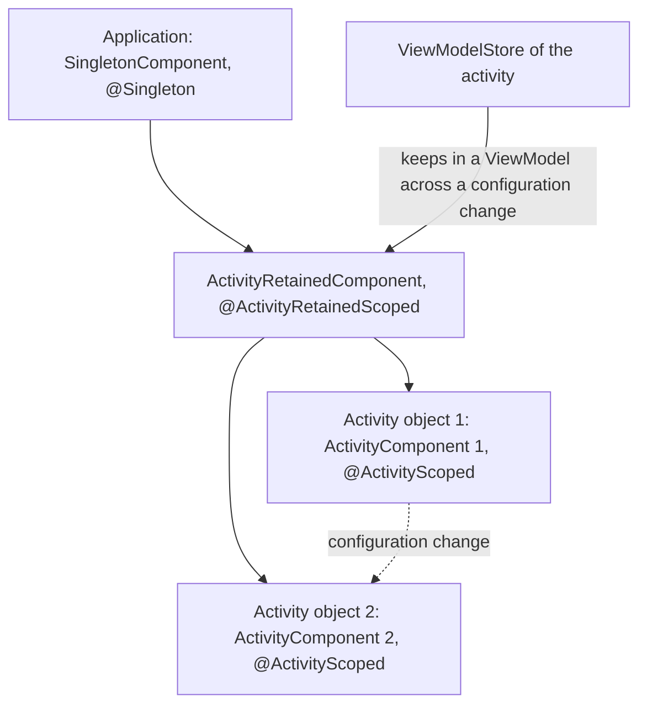

import Snippet from '../../../components/Snippet.astro';
import GoDeeper from '../../../components/GoDeeper.astro';

## The problem

A class often needs objects of other classes. These objects are the dependencies of the class. A class can get a dependency in three ways: it creates the dependency, it gets the dependency from somewhere else, or it gets the dependency as a parameter. The third way is dependency injection (DI). With DI, a test can give the class a test double in place of the real dependency[^di-what].

On Android, DI has two main forms[^di-what]:

- Constructor injection: the class gets its dependencies as constructor parameters.
- Field injection: the class gets its dependencies as fields, after the system or the app creates the class.

The DI guide says that the system creates activities, so constructor injection is not possible for an activity[^di-what]. This is true for the default factory of the platform. The system creates each `Activity` object through an `AppComponentFactory`. The default `instantiateActivity` loads the class and calls its constructor with no arguments[^appcomponentfactory-96]. An app can replace the factory, for example for dependency injection[^appcomponentfactory-83]. The [Components & lifecycle chapter](/launch-path/components-lifecycle/) shows where the cold start calls the factory. Prompt 2 of "Try it" replaces the factory.

If you do DI by hand, you create each object and give it its dependencies. In a large app, this needs much boilerplate code. Sometimes you cannot create a dependency before you pass it, for example if an object belongs to one flow of the app. Then you must write a container: a class that creates the dependencies and manages their lifetimes in memory[^di-automated]. DI libraries do this work for you. Some libraries connect the dependencies with reflection at run time. Other libraries generate the code at compile time. Dagger generates the code at compile time[^di-automated].

A service locator is an alternative to DI. Each class asks one global service locator for its dependencies. Thus all tests use the same global service locator. With a service locator, it is also more difficult to give an object a lifetime that is shorter than the lifetime of the app[^di-alternatives].

A container must decide two things for each object:

- Does each caller get the same object, or a new object?
- How long does the object live?

An object that a container keeps lives as long as the container instance. On Android, an `Activity` object can live for a shorter time than the screen that the user sees. Hilt creates its `ActivityRetainedComponent` at the first `Activity#onCreate()` and destroys it at the last `Activity#onDestroy()`, because the component lives across configuration changes[^hilt-component-lifetimes]. Thus one screen can get more than one `onCreate()` and `onDestroy()`. A configuration change destroys the `Activity` object and creates a new one. The [Config changes & ViewModel chapter](/state-survival/config-changes/) shows why. If a container belongs to one `Activity` object, its objects end with that `Activity` object. This chapter builds such a container and shows where it breaks. Then it shows how Hilt keeps a container across a configuration change.

## Build it naive

The rebuild is a hand-written container in plain Kotlin, in the module `samples/dependency-injection`. It follows the login example of the manual DI guide. In that example, `LoginActivity` needs a `LoginViewModel`, and `LoginViewModel` needs a `UserRepository`[^manual-basics]. `LoginUserData` holds the input of one login flow, for example the username and the password[^manual-flows]. The rebuild keeps only these three classes, and `LoginUserData` keeps only the username:

<Snippet file="dependency-injection/src/main/kotlin/Containers.kt" region="graph" />

`AppContainer` is the container of the whole app. In the manual DI guide, the `Application` class holds the `AppContainer`, so that all activities can use it[^manual-container]. A binding gives a container the information that it needs to supply an object of a type[^hilt-define-bindings]. `AppContainer` has two kinds of bindings:

- A scoped binding: `userRepository` uses `lazy`. The first call creates the `UserRepository`, and `lazy` keeps it. Each later call gets the same object. The first test below checks this.
- An unscoped binding: `loginViewModel()` creates a new `LoginViewModel` at each call. It gives each `LoginViewModel` the scoped `UserRepository`. The manual DI guide uses a factory for this[^manual-container].

<Snippet file="dependency-injection/src/main/kotlin/Containers.kt" region="app-container" />

Some objects belong to one flow of the app, not to the whole app. In the manual DI guide, a `LoginContainer` holds the `LoginUserData` of one login flow. It gets the `UserRepository` from the `AppContainer`[^manual-views-flows]. The rebuild has the same child container, `ScreenContainer`. Each `ScreenContainer` keeps one `LoginUserData`. It gets the objects of the whole app from its parent:

<Snippet file="dependency-injection/src/main/kotlin/Containers.kt" region="screen-container" />

In the Views version of the guide, `LoginActivity` creates the `LoginContainer` in `onCreate()` and removes it in `onDestroy()`[^manual-views-flows]. A rebuild never imports `android.*`, so `FakeActivity` stands in for the `Activity`. Its `onCreate()` creates the `ScreenContainer` and takes the objects from it. `recreate()` stands in for a configuration change: it creates a new `FakeActivity` with the same `AppContainer` and calls `onCreate()` on it:

<Snippet file="dependency-injection/src/main/kotlin/Containers.kt" region="activity" />

Three tests check the containers. The `AppContainer` gives each caller the same `UserRepository`. It creates a new `LoginViewModel` at each call, and each `LoginViewModel` gets the same `UserRepository`. A `FakeActivity` gets the `UserRepository` of the `AppContainer` through its `ScreenContainer`:

<Snippet file="dependency-injection/src/test/kotlin/ContainersTest.kt" region="containers" />

## Where it breaks

An object that a container keeps lives as long as the container instance. The `ScreenContainer` belongs to one `FakeActivity` object. The breaking test writes a username through the first `FakeActivity` and calls `recreate()`:

<Snippet file="dependency-injection/src/test/kotlin/ContainersTest.kt" region="flaw" />

The new `FakeActivity` creates a new `ScreenContainer`, and the new `ScreenContainer` creates a new `LoginUserData`. Thus the new `FakeActivity` has a different `LoginUserData` object with an empty username. The test passes, so the flaw occurs: a configuration change loses the input of the login flow.

Both versions of the manual DI guide say: if the container must survive configuration changes, follow the Saving UI States guide[^manual-flows][^manual-views-flows].

A move of `LoginUserData` into `AppContainer` is not a fix. Then the object survives the configuration change, but it also survives into the next login flow. The manual DI guide wants a new `LoginUserData` for each new flow, so that the data of an old login flow of a different user does not stay[^manual-flows]. Prompt 1 of "Try it" shows this second flaw.

In Compose, the lifetime of the flow container is the composition, not the activity[^manual-flows]. The problem stays the same: you manage the scope and the lifetime of each container yourself. If you do this incorrectly, you can get subtle bugs and memory leaks[^manual-conclusion].

Thus the flow container needs a lifetime between the two lifetimes of the rebuild. The lifetime must be longer than one `Activity` object and shorter than the app.

## The real thing

### Hilt generates one component for each Android class

Hilt is a DI library on top of Dagger. Hilt gives a container to each Android class of the project and manages the lifecycle of each container[^di-hilt]. Hilt calls these containers components. For each Android class that Hilt can inject, Hilt has a component, and the component injects its bindings into that class[^hilt-generated-components].

By default, a binding is unscoped: each request gets a new object. A scoped binding belongs to one component. Hilt creates a scoped binding only one time for each instance of that component, and all requests share that object[^hilt-component-scopes]. The rebuild has the same two kinds of bindings: `loginViewModel()` is unscoped, and the `lazy` property is scoped.

Each component has a scope annotation and a lifetime[^dagger-component-lifetimes]:

| Component | Scope | Start | End |
| --- | --- | --- | --- |
| `SingletonComponent` | `@Singleton` | `Application#onCreate()` | End of the process of the app |
| `ActivityRetainedComponent` | `@ActivityRetainedScoped` | The first `Activity#onCreate()` | The last `Activity#onDestroy()` |
| `ViewModelComponent` | `@ViewModelScoped` | Creation of the `ViewModel` | Destruction of the `ViewModel` |
| `ActivityComponent` | `@ActivityScoped` | `Activity#onCreate()` | `Activity#onDestroy()` |
| `FragmentComponent` | `@FragmentScoped` | `Fragment#onAttach()` | `Fragment#onDestroy()` |
| `ViewComponent` | `@ViewScoped` | `View#super()` | Destruction of the `View` |
| `ServiceComponent` | `@ServiceScoped` | `Service#onCreate()` | `Service#onDestroy()` |

Each new instance of an Android class gets a new instance of its component, and thus new instances of all its scoped bindings. The Hilt docs give this warning for fragments[^dagger-scoped-bindings]. Thus `ActivityComponent` has the lifetime of the `ScreenContainer` of the rebuild: one `Activity` object.

`ActivityRetainedComponent` has the lifetime that the rebuild needs. It lives across configuration changes. Hilt creates it at the first `Activity#onCreate()` and destroys it at the last `Activity#onDestroy()`[^hilt-component-lifetimes]. Thus, in a Hilt app, give `LoginUserData` the scope `@ActivityRetainedScoped`.

At build time, Dagger builds and validates the graph. It makes sure that each dependency has a binding and that the graph has no cycles. Then it generates the classes that create the objects at run time[^hilt-define-bindings]. Hilt supports only activities that extend `ComponentActivity`[^hilt-android-classes]. The next sections show that Hilt uses the `ViewModelStore` and the `OnContextAvailableListener` of `ComponentActivity`.

### The application component

The `Application` class of a Hilt app has the annotation `@HiltAndroidApp`. Hilt generates a base class for it. The component of that base class is the container of the whole app. The component follows the lifecycle of the `Application` object, and it is the parent of the other components[^hilt-application-class]. `ApplicationComponentManager` creates this component only one time. It keeps the component in a `volatile` field and uses a double-checked lock[^applicationcomponentmanager-21]. This component has the role of the `AppContainer` of the rebuild.

### The retained component lives in a ViewModel

`ActivityRetainedComponentManager` is "a manager for the creation of components that survives activity configuration changes"[^activityretainedcomponentmanager-41]. The component lives in a `ViewModel`, `ActivityRetainedComponentViewModel`[^activityretainedcomponentmanager-60]:

1. `createComponent()` gets the `ActivityRetainedComponentViewModel` from a `ViewModelProvider` of the activity and takes the component from it[^activityretainedcomponentmanager-142].
2. The factory of that `ViewModelProvider` builds a new `ActivityRetainedComponent` from the application component. It puts the component into a new `ActivityRetainedComponentViewModel`[^activityretainedcomponentmanager-99].
3. From `onRetainNonConfigurationInstance()`, `ComponentActivity` returns an object that holds its `ViewModelStore`[^componentactivity-366]. A new `Activity` object gets that object from `lastNonConfigurationInstance` and takes the `ViewModelStore` from it[^componentactivity-551]. The [Config changes & ViewModel chapter](/state-survival/config-changes/) shows how the platform passes this object to the new `Activity` object. Thus the new `Activity` object gets the same `ViewModel`, with the same component.
4. At `ON_DESTROY`, `ComponentActivity` clears its `ViewModelStore` only if `isChangingConfigurations` is false[^componentactivity-278]. When the `ViewModelStore` clears the `ViewModel`, the `ViewModel` dispatches `onCleared` to the `ActivityRetainedLifecycle` of the component[^activityretainedcomponentmanager-60].

`ActivityComponent` is different. An `ActivityComponentManager` belongs to one `Activity` object. It builds the `ActivityComponent` of that object as a child of the retained component[^activitycomponentmanager-60][^activitycomponentmanager-95]. Thus after a configuration change, the `@ActivityScoped` objects are new, but the `@ActivityRetainedScoped` objects are the same. If the `Application` does not have the annotation `@HiltAndroidApp`, `createComponent()` throws an `IllegalStateException`[^activitycomponentmanager-95].

Since Android 12, if the user presses Back on a root launcher activity, the system moves the activity and its task to the background. The activity does not finish[^android-12-back-press]. Hilt destroys the `ActivityRetainedComponent` at the last `Activity#onDestroy()`[^hilt-component-lifetimes], and `ComponentActivity` clears the `ViewModelStore` only at `ON_DESTROY`[^componentactivity-278]. Thus the component and its `@ActivityRetainedScoped` objects stay in memory while the task is in the background.

### One ViewModelComponent for each ViewModel

An `@AndroidEntryPoint` activity uses `HiltViewModelFactory` as its default factory[^hiltviewmodelfactory-41]. For each new `@HiltViewModel`, the factory builds a new `ViewModelComponent` with a `SavedStateHandle`. It gets the `ViewModel` from that component. Then it adds a closeable to the `ViewModel` that dispatches `onCleared` to the lifecycle of the component[^hiltviewmodelfactory-91]. Thus `@ViewModelScoped` means one object for each `ViewModel`.

<GoDeeper title="how Hilt injects an activity">

Hilt injects the `@Inject` fields of an `@AndroidEntryPoint` activity in `super.onCreate()`[^android-entry-point-types]. For such an activity, Hilt generates an abstract class `Hilt_<Name>` that extends the base class of the activity[^activitygenerator-71]. Each constructor of `Hilt_<Name>` adds an `OnContextAvailableListener`, and the listener calls `inject()`[^activitygenerator-85][^activitygenerator-119]. `ComponentActivity.onCreate` calls each `OnContextAvailableListener` before it calls `Activity.onCreate`[^componentactivity-338]. `Hilt_<Name>` also overrides `getDefaultViewModelProviderFactory()`, so that the activity gets the factory of Hilt[^activitygenerator-145].

With the Hilt Gradle plugin, the source code of the activity can extend its real base class, not `Hilt_<Name>`. The plugin runs a bytecode transformation[^hilt-gradle-plugin]. Without the plugin, the annotated class must extend `Hilt_<Name>`[^hilt-gradle-plugin-why]. The plugin registers `AndroidEntryPointClassVisitor` for each variant[^hiltgradleplugin-183]. The visitor changes the superclass of each `@AndroidEntryPoint` class and of the `@HiltAndroidApp` class to `Hilt_<Name>` in the bytecode[^androidentrypointclassvisitor-27][^androidentrypointclassvisitor-64]. It also changes the owner of each `super` call to the old superclass. Thus a call such as `super.onCreate()` goes to `Hilt_<Name>`[^androidentrypointclassvisitor-103][^androidentrypointclassvisitor-140].

</GoDeeper>

<GoDeeper title="the cache of a scoped binding">

By default, the Hilt Gradle plugin turns on the fast-init mode of Dagger. The project property `dagger.hilt.fastInit` can override this value[^hiltgradleplugin-553]. In fast-init mode, the plugin passes the option `dagger.fastInit=enabled` to the annotation processor. A code comment calls fast-init "the best mode for Hilt"[^hiltcommandlineargumentprovider-34].

In fast-init mode, if Dagger needs a provider for an `@Inject` or `@Provides` binding, it uses a `SwitchingProvider`. Only fast-init mode uses a `SwitchingProvider`[^frameworkinstancekind-30][^frameworkinstancekind-45]. For a scoped binding, Dagger wraps the `SwitchingProvider` in `DoubleCheck.provider(...)`, or in `SingleCheck.provider(...)` for `@Reusable`. The component keeps this provider in a field[^switchingproviderinstancesupplier-32][^switchingproviderinstancesupplier-68]. Dagger does not use a direct instance expression for a binding that needs a cache. A scoped binding needs a cache, except a `@Binds` binding whose scope is not stronger than the scope of its dependency[^provisionbindingrepresentation-113][^provisionbindingrepresentation-119]. Thus each request of a scoped `@Inject` or `@Provides` binding goes through the provider field of its component. Each component instance has its own fields, so each component instance has its own cache.

`DoubleCheck` is that cache. It keeps the result of its delegate provider in a `volatile` field, with the double-check idiom[^doublecheck-25]. `get()` reads the field. If the field has no value yet, `get()` calls a `synchronized` method. That method calls the delegate one time, keeps the result and drops the delegate[^doublecheck-42]. If the delegate asks the same `DoubleCheck` for its value, and the two calls give different objects, `DoubleCheck` throws an `IllegalStateException`. The message says that the cause is likely a circular dependency[^doublecheck-68]. In the rebuild, `lazy` has the role of `DoubleCheck`.

</GoDeeper>

<GoDeeper title="retained fragments">

A retained fragment stays across a configuration change and attaches to the new `Activity` object. The Hilt docs say: never retain a Hilt fragment. Its component holds references to the previous `Activity` object, so a retained Hilt fragment can leak that object. If Hilt finds a retained Hilt fragment at a configuration change, Hilt throws an exception[^android-entry-point-retained]. The generated `onAttach(Activity)` of a Hilt fragment makes sure that the fragment attaches to the same activity as before. If not, the check fails with the message "onAttach called multiple times with different Context! Hilt Fragments should not be retained."[^fragmentgenerator-140]

This failure is the opposite of the flaw of the rebuild. The rebuild loses an object that it must keep. A retained Hilt fragment keeps an object that it must lose.

</GoDeeper>

### The platform creates each activity through a factory

Hilt uses field injection for an activity[^android-entry-point-types]. The platform also permits constructor injection. The platform creates manifest elements, for example activities, through `AppComponentFactory`[^appcomponentfactory-28]. An app can supply its own factory, for example for dependency injection. The `Activity` object that the factory returns is not a `Context` yet, so the factory must not use it with other Android APIs[^appcomponentfactory-83]. `Instrumentation.newActivity` calls the factory for each new `Activity` object[^instrumentation-1454]. Thus a container that the factory gives to one `Activity` object also ends with that object. Prompts 2 and 3 of "Try it" show these calls.

<GoDeeper title="how the platform finds the factory">

`Instrumentation.newActivity` creates the `Activity` with `getFactory(pkg).instantiateActivity(...)`. `pkg` is the package of the component of the intent[^instrumentation-1454]. `getFactory` returns the `AppComponentFactory` of the `LoadedApk` of that package. If the intent names no package, `getFactory` returns the default factory[^instrumentation-1463]. When the platform loads the code of the app, `LoadedApk` loads the class that `appComponentFactory` of the `ApplicationInfo` names. It creates the factory with the constructor with no arguments. If the app names no class, or if the class does not load, `LoadedApk` uses the default factory[^loadedapk-296][^loadedapk-1187].

</GoDeeper>

## Mental model

A DI container creates the objects of a graph and gives each object its dependencies. An unscoped binding gives a new object at each request. A scoped binding gives one object for each container instance, so a scoped object lives as long as its container. A container in an `Activity` object ends at each configuration change. A container in the `Application` lives as long as the process, so a flow object in it survives into the next flow. Hilt generates one component for each Android class. It keeps the `ActivityRetainedComponent` in a `ViewModel` in the `ViewModelStore` of the activity. `ComponentActivity` clears that store only at a destroy that is not a configuration change. Each new `Activity` object gets a new `ActivityComponent`, as a child of the same retained component.



## Try it

### 1. Move LoginUserData into AppContainer

Change the rebuild, so that `LoginUserData` survives `recreate()`. Add a scoped `loginData` property with `lazy` to `AppContainer`, as `userRepository` has. In `FakeActivity.onCreate()`, take `loginData` from the `AppContainer`, not from the `ScreenContainer`. Then add a test for the next login flow at the end of `ContainersTest`:

1. Create a `FakeActivity` with the `AppContainer` of the test. Call `onCreate()`, and set the username to `"alice"`.
2. Create a second `FakeActivity` with the same `AppContainer`, and call `onCreate()`. This `FakeActivity` starts the next login flow.
3. Assert that the username of the second `FakeActivity` is `"alice"`.

From the repo root, run the tests of the rebuild:

```sh
samples/gradlew -p samples :dependency-injection:test
```

The breaking test fails, because the `LoginUserData` survives `recreate()`. The new test passes, so the next login flow gets the username of the old flow. The Gradle output includes these lines:

```
ContainersTest > screenContainer_losesLoginData_whenActivityIsRecreated() FAILED
    org.opentest4j.AssertionFailedError at ContainersTest.kt:40

5 tests completed, 1 failed
```

The manual DI guide wants a new `LoginUserData` for each new flow[^manual-flows]. An `@ActivityRetainedScoped` binding gives both lifetimes: it survives a configuration change, and it ends at the last `Activity#onDestroy()`[^hilt-component-lifetimes].

### 2. Inject an activity through its constructor

Start an emulator with the system image of the checked stamp. From the repo root, install the release build of the `dependencyInjection` flavor of the launch app:

```sh
samples/gradlew -p samples :launch-app:installDependencyInjectionRelease
```

The flavor adds a platform `Activity`, `GreetingActivity`. Its only constructor takes a `Greeter` and logs both objects with the tag `DI`:

<Snippet file="launch-app/src/dependencyInjection/java/io/github/imgurpreetsk/afp/launchapp/GreetingActivity.java" region="constructor" />

The manifest of the flavor names `DiComponentFactory` in `android:appComponentFactory`. The factory logs the name of each `Activity` class that it creates. It creates `GreetingActivity` with a new `Greeter`. It gives each other class to the default factory:

<Snippet file="launch-app/src/dependencyInjection/java/io/github/imgurpreetsk/afp/launchapp/DiComponentFactory.java" region="factory" />

Clear the log, start `GreetingActivity`, and print the lines with the tag `DI`:

```sh
adb logcat -c
adb shell am start -W -n io.github.imgurpreetsk.afp.launchapp.dependencyInjection/io.github.imgurpreetsk.afp.launchapp.GreetingActivity
adb logcat -d -s DI
```

{/* Edit step: capture this output on the emulator of the checked stamp. */}

```
… instantiateActivity io.github.imgurpreetsk.afp.launchapp.GreetingActivity
… new GreetingActivity@… with io.github.imgurpreetsk.afp.launchapp.Greeter@…
```

The first line comes from the factory. The second line comes from the constructor, with the `Greeter` of the factory. `Instrumentation.newActivity` asks the factory of the package of the intent for the `Activity`[^instrumentation-1454], and `LoadedApk` loaded the factory that the manifest names[^loadedapk-296]. Thus constructor injection into an activity works, if the app supplies the factory.

### 3. Change the configuration

Keep `GreetingActivity` on the screen. Clear the log, turn on night mode, and print the lines with the tag `DI` again:

```sh
adb logcat -c
adb shell cmd uimode night yes
adb logcat -d -s DI
```

If the output is empty, run the last command again.

{/* Edit step: capture this output on the emulator of the checked stamp. */}

```
… instantiateActivity io.github.imgurpreetsk.afp.launchapp.GreetingActivity
… new GreetingActivity@… with io.github.imgurpreetsk.afp.launchapp.Greeter@…
```

The factory runs again. The constructor line shows a new `GreetingActivity` object with a new `Greeter`: the value after `GreetingActivity@` is different from the value in prompt 2. Thus the system creates a new `Activity` object through the factory after the configuration change[^instrumentation-1454]. Each container that only the old `Activity` object holds ends with that object, as in the breaking test. The [Config changes & ViewModel chapter](/state-survival/config-changes/) shows the recreation itself.

Turn off night mode:

```sh
adb shell cmd uimode night no
```

[^di-what]: Dependency injection in Android, "What is dependency injection?": [https://developer.android.com/training/dependency-injection#what-is-di](https://developer.android.com/training/dependency-injection#what-is-di)
[^appcomponentfactory-96]: AppComponentFactory.java, lines 96–100: [https://android.googlesource.com/platform/frameworks/base/+/refs/tags/android-17.0.0_r1/core/java/android/app/AppComponentFactory.java#96](https://android.googlesource.com/platform/frameworks/base/+/refs/tags/android-17.0.0_r1/core/java/android/app/AppComponentFactory.java#96)
[^appcomponentfactory-83]: AppComponentFactory.java, lines 83–95: [https://android.googlesource.com/platform/frameworks/base/+/refs/tags/android-17.0.0_r1/core/java/android/app/AppComponentFactory.java#83](https://android.googlesource.com/platform/frameworks/base/+/refs/tags/android-17.0.0_r1/core/java/android/app/AppComponentFactory.java#83)
[^di-automated]: Dependency injection in Android, "Automated dependency injection": [https://developer.android.com/training/dependency-injection#automated-di](https://developer.android.com/training/dependency-injection#automated-di)
[^di-alternatives]: Dependency injection in Android, "Alternatives to dependency injection": [https://developer.android.com/training/dependency-injection#di-alternatives](https://developer.android.com/training/dependency-injection#di-alternatives)
[^hilt-component-lifetimes]: Dependency injection with Hilt, "Component lifetimes": [https://developer.android.com/training/dependency-injection/hilt-android#component-lifetimes](https://developer.android.com/training/dependency-injection/hilt-android#component-lifetimes)
[^manual-basics]: Manual dependency injection, "Basics of manual dependency injection": [https://developer.android.com/training/dependency-injection/manual#basics-manual-di](https://developer.android.com/training/dependency-injection/manual#basics-manual-di)
[^manual-flows]: Manual dependency injection, "Managing dependencies in application flows": [https://developer.android.com/training/dependency-injection/manual#dependencies-flows](https://developer.android.com/training/dependency-injection/manual#dependencies-flows)
[^manual-container]: Manual dependency injection, "Managing dependencies with a container": [https://developer.android.com/training/dependency-injection/manual#dependencies-container](https://developer.android.com/training/dependency-injection/manual#dependencies-container)
[^hilt-define-bindings]: Dependency injection with Hilt, "Define Hilt bindings": [https://developer.android.com/training/dependency-injection/hilt-android#define-bindings](https://developer.android.com/training/dependency-injection/hilt-android#define-bindings)
[^manual-views-flows]: Manual dependency injection (Views), "Managing dependencies in application flows": [https://developer.android.com/topic/architecture/views/dependency-injection/manual-views#managing-in-app-flows](https://developer.android.com/topic/architecture/views/dependency-injection/manual-views#managing-in-app-flows)
[^manual-conclusion]: Manual dependency injection, "Conclusion": [https://developer.android.com/training/dependency-injection/manual#conclusion](https://developer.android.com/training/dependency-injection/manual#conclusion)
[^di-hilt]: Dependency injection in Android, "Use Hilt in your Android app": [https://developer.android.com/training/dependency-injection#hilt](https://developer.android.com/training/dependency-injection#hilt)
[^hilt-generated-components]: Dependency injection with Hilt, "Generated components for Android classes": [https://developer.android.com/training/dependency-injection/hilt-android#generated-components](https://developer.android.com/training/dependency-injection/hilt-android#generated-components)
[^hilt-component-scopes]: Dependency injection with Hilt, "Component scopes": [https://developer.android.com/training/dependency-injection/hilt-android#component-scopes](https://developer.android.com/training/dependency-injection/hilt-android#component-scopes)
[^dagger-component-lifetimes]: Hilt Components, "Component lifetimes": [https://dagger.dev/hilt/components#component-lifetimes](https://dagger.dev/hilt/components#component-lifetimes)
[^dagger-scoped-bindings]: Hilt Components, "Scoped vs unscoped bindings": [https://dagger.dev/hilt/components#scoped-vs-unscoped-bindings](https://dagger.dev/hilt/components#scoped-vs-unscoped-bindings)
[^hilt-android-classes]: Dependency injection with Hilt, "Inject dependencies into Android classes": [https://developer.android.com/training/dependency-injection/hilt-android#android-classes](https://developer.android.com/training/dependency-injection/hilt-android#android-classes)
[^hilt-application-class]: Dependency injection with Hilt, "Hilt application class": [https://developer.android.com/training/dependency-injection/hilt-android#application-class](https://developer.android.com/training/dependency-injection/hilt-android#application-class)
[^applicationcomponentmanager-21]: ApplicationComponentManager.java, lines 21–45: [https://github.com/google/dagger/blob/dagger-2.60.1/hilt-android/main/java/dagger/hilt/android/internal/managers/ApplicationComponentManager.java#L21-L45](https://github.com/google/dagger/blob/dagger-2.60.1/hilt-android/main/java/dagger/hilt/android/internal/managers/ApplicationComponentManager.java#L21-L45)
[^activityretainedcomponentmanager-41]: ActivityRetainedComponentManager.java, line 41: [https://github.com/google/dagger/blob/dagger-2.60.1/hilt-android/main/java/dagger/hilt/android/internal/managers/ActivityRetainedComponentManager.java#L41](https://github.com/google/dagger/blob/dagger-2.60.1/hilt-android/main/java/dagger/hilt/android/internal/managers/ActivityRetainedComponentManager.java#L41)
[^activityretainedcomponentmanager-60]: ActivityRetainedComponentManager.java, lines 60–86: [https://github.com/google/dagger/blob/dagger-2.60.1/hilt-android/main/java/dagger/hilt/android/internal/managers/ActivityRetainedComponentManager.java#L60-L86](https://github.com/google/dagger/blob/dagger-2.60.1/hilt-android/main/java/dagger/hilt/android/internal/managers/ActivityRetainedComponentManager.java#L60-L86)
[^activityretainedcomponentmanager-142]: ActivityRetainedComponentManager.java, lines 142–146: [https://github.com/google/dagger/blob/dagger-2.60.1/hilt-android/main/java/dagger/hilt/android/internal/managers/ActivityRetainedComponentManager.java#L142-L146](https://github.com/google/dagger/blob/dagger-2.60.1/hilt-android/main/java/dagger/hilt/android/internal/managers/ActivityRetainedComponentManager.java#L142-L146)
[^activityretainedcomponentmanager-99]: ActivityRetainedComponentManager.java, lines 99–120: [https://github.com/google/dagger/blob/dagger-2.60.1/hilt-android/main/java/dagger/hilt/android/internal/managers/ActivityRetainedComponentManager.java#L99-L120](https://github.com/google/dagger/blob/dagger-2.60.1/hilt-android/main/java/dagger/hilt/android/internal/managers/ActivityRetainedComponentManager.java#L99-L120)
[^componentactivity-278]: ComponentActivity.kt, lines 278–291: [https://android.googlesource.com/platform/frameworks/support/+/475afe04599ffc0893939effda40187916c4ceb0/activity/activity/src/main/java/androidx/activity/ComponentActivity.kt#278](https://android.googlesource.com/platform/frameworks/support/+/475afe04599ffc0893939effda40187916c4ceb0/activity/activity/src/main/java/androidx/activity/ComponentActivity.kt#278)
[^activitycomponentmanager-60]: ActivityComponentManager.java, lines 60–64: [https://github.com/google/dagger/blob/dagger-2.60.1/hilt-android/main/java/dagger/hilt/android/internal/managers/ActivityComponentManager.java#L60-L64](https://github.com/google/dagger/blob/dagger-2.60.1/hilt-android/main/java/dagger/hilt/android/internal/managers/ActivityComponentManager.java#L60-L64)
[^activitycomponentmanager-95]: ActivityComponentManager.java, lines 95–110: [https://github.com/google/dagger/blob/dagger-2.60.1/hilt-android/main/java/dagger/hilt/android/internal/managers/ActivityComponentManager.java#L95-L110](https://github.com/google/dagger/blob/dagger-2.60.1/hilt-android/main/java/dagger/hilt/android/internal/managers/ActivityComponentManager.java#L95-L110)
[^android-12-back-press]: Android 12 behavior changes, "Root launcher activities are no longer finished on Back press": [https://developer.android.com/about/versions/12/behavior-changes-all#back-press](https://developer.android.com/about/versions/12/behavior-changes-all#back-press)
[^hiltviewmodelfactory-41]: HiltViewModelFactory.java, lines 41–50: [https://github.com/google/dagger/blob/dagger-2.60.1/hilt-android/main/java/dagger/hilt/android/internal/lifecycle/HiltViewModelFactory.java#L41-L50](https://github.com/google/dagger/blob/dagger-2.60.1/hilt-android/main/java/dagger/hilt/android/internal/lifecycle/HiltViewModelFactory.java#L41-L50)
[^hiltviewmodelfactory-91]: HiltViewModelFactory.java, lines 91–106: [https://github.com/google/dagger/blob/dagger-2.60.1/hilt-android/main/java/dagger/hilt/android/internal/lifecycle/HiltViewModelFactory.java#L91-L106](https://github.com/google/dagger/blob/dagger-2.60.1/hilt-android/main/java/dagger/hilt/android/internal/lifecycle/HiltViewModelFactory.java#L91-L106)
[^android-entry-point-types]: Hilt Android Entry Points, "Android types": [https://dagger.dev/hilt/android-entry-point#android-types](https://dagger.dev/hilt/android-entry-point#android-types)
[^activitygenerator-71]: ActivityGenerator.java, lines 71–79: [https://github.com/google/dagger/blob/dagger-2.60.1/hilt-compiler/main/java/dagger/hilt/android/processor/internal/androidentrypoint/ActivityGenerator.java#L71-L79](https://github.com/google/dagger/blob/dagger-2.60.1/hilt-compiler/main/java/dagger/hilt/android/processor/internal/androidentrypoint/ActivityGenerator.java#L71-L79)
[^activitygenerator-85]: ActivityGenerator.java, lines 85–90: [https://github.com/google/dagger/blob/dagger-2.60.1/hilt-compiler/main/java/dagger/hilt/android/processor/internal/androidentrypoint/ActivityGenerator.java#L85-L90](https://github.com/google/dagger/blob/dagger-2.60.1/hilt-compiler/main/java/dagger/hilt/android/processor/internal/androidentrypoint/ActivityGenerator.java#L85-L90)
[^activitygenerator-119]: ActivityGenerator.java, lines 119–143: [https://github.com/google/dagger/blob/dagger-2.60.1/hilt-compiler/main/java/dagger/hilt/android/processor/internal/androidentrypoint/ActivityGenerator.java#L119-L143](https://github.com/google/dagger/blob/dagger-2.60.1/hilt-compiler/main/java/dagger/hilt/android/processor/internal/androidentrypoint/ActivityGenerator.java#L119-L143)
[^componentactivity-338]: ComponentActivity.kt, lines 338–343: [https://android.googlesource.com/platform/frameworks/support/+/475afe04599ffc0893939effda40187916c4ceb0/activity/activity/src/main/java/androidx/activity/ComponentActivity.kt#338](https://android.googlesource.com/platform/frameworks/support/+/475afe04599ffc0893939effda40187916c4ceb0/activity/activity/src/main/java/androidx/activity/ComponentActivity.kt#338)
[^activitygenerator-145]: ActivityGenerator.java, lines 145–168: [https://github.com/google/dagger/blob/dagger-2.60.1/hilt-compiler/main/java/dagger/hilt/android/processor/internal/androidentrypoint/ActivityGenerator.java#L145-L168](https://github.com/google/dagger/blob/dagger-2.60.1/hilt-compiler/main/java/dagger/hilt/android/processor/internal/androidentrypoint/ActivityGenerator.java#L145-L168)
[^hilt-gradle-plugin]: Hilt Gradle Setup, "Hilt Gradle plugin": [https://dagger.dev/hilt/gradle-setup#hilt-gradle-plugin](https://dagger.dev/hilt/gradle-setup#hilt-gradle-plugin)
[^hilt-gradle-plugin-why]: Hilt Gradle Setup, "Why use the plugin?": [https://dagger.dev/hilt/gradle-setup#why-use-the-plugin](https://dagger.dev/hilt/gradle-setup#why-use-the-plugin)
[^hiltgradleplugin-183]: HiltGradlePlugin.kt, lines 183–194: [https://github.com/google/dagger/blob/dagger-2.60.1/java/dagger/hilt/android/plugin/main/src/main/kotlin/dagger/hilt/android/plugin/HiltGradlePlugin.kt#L183-L194](https://github.com/google/dagger/blob/dagger-2.60.1/java/dagger/hilt/android/plugin/main/src/main/kotlin/dagger/hilt/android/plugin/HiltGradlePlugin.kt#L183-L194)
[^androidentrypointclassvisitor-27]: AndroidEntryPointClassVisitor.kt, lines 27–30: [https://github.com/google/dagger/blob/dagger-2.60.1/java/dagger/hilt/android/plugin/main/src/main/kotlin/dagger/hilt/android/plugin/transform/AndroidEntryPointClassVisitor.kt#L27-L30](https://github.com/google/dagger/blob/dagger-2.60.1/java/dagger/hilt/android/plugin/main/src/main/kotlin/dagger/hilt/android/plugin/transform/AndroidEntryPointClassVisitor.kt#L27-L30)
[^androidentrypointclassvisitor-64]: AndroidEntryPointClassVisitor.kt, lines 64–79: [https://github.com/google/dagger/blob/dagger-2.60.1/java/dagger/hilt/android/plugin/main/src/main/kotlin/dagger/hilt/android/plugin/transform/AndroidEntryPointClassVisitor.kt#L64-L79](https://github.com/google/dagger/blob/dagger-2.60.1/java/dagger/hilt/android/plugin/main/src/main/kotlin/dagger/hilt/android/plugin/transform/AndroidEntryPointClassVisitor.kt#L64-L79)
[^androidentrypointclassvisitor-103]: AndroidEntryPointClassVisitor.kt, lines 103–105: [https://github.com/google/dagger/blob/dagger-2.60.1/java/dagger/hilt/android/plugin/main/src/main/kotlin/dagger/hilt/android/plugin/transform/AndroidEntryPointClassVisitor.kt#L103-L105](https://github.com/google/dagger/blob/dagger-2.60.1/java/dagger/hilt/android/plugin/main/src/main/kotlin/dagger/hilt/android/plugin/transform/AndroidEntryPointClassVisitor.kt#L103-L105)
[^androidentrypointclassvisitor-140]: AndroidEntryPointClassVisitor.kt, lines 140–142: [https://github.com/google/dagger/blob/dagger-2.60.1/java/dagger/hilt/android/plugin/main/src/main/kotlin/dagger/hilt/android/plugin/transform/AndroidEntryPointClassVisitor.kt#L140-L142](https://github.com/google/dagger/blob/dagger-2.60.1/java/dagger/hilt/android/plugin/main/src/main/kotlin/dagger/hilt/android/plugin/transform/AndroidEntryPointClassVisitor.kt#L140-L142)
[^hiltgradleplugin-553]: HiltGradlePlugin.kt, lines 553–563: [https://github.com/google/dagger/blob/dagger-2.60.1/java/dagger/hilt/android/plugin/main/src/main/kotlin/dagger/hilt/android/plugin/HiltGradlePlugin.kt#L553-L563](https://github.com/google/dagger/blob/dagger-2.60.1/java/dagger/hilt/android/plugin/main/src/main/kotlin/dagger/hilt/android/plugin/HiltGradlePlugin.kt#L553-L563)
[^hiltcommandlineargumentprovider-34]: HiltCommandLineArgumentProvider.kt, lines 34–39: [https://github.com/google/dagger/blob/dagger-2.60.1/java/dagger/hilt/android/plugin/main/src/main/kotlin/dagger/hilt/android/plugin/HiltCommandLineArgumentProvider.kt#L34-L39](https://github.com/google/dagger/blob/dagger-2.60.1/java/dagger/hilt/android/plugin/main/src/main/kotlin/dagger/hilt/android/plugin/HiltCommandLineArgumentProvider.kt#L34-L39)
[^frameworkinstancekind-30]: FrameworkInstanceKind.java, lines 30–43: [https://github.com/google/dagger/blob/dagger-2.60.1/dagger-compiler/main/java/dagger/internal/codegen/writing/FrameworkInstanceKind.java#L30-L43](https://github.com/google/dagger/blob/dagger-2.60.1/dagger-compiler/main/java/dagger/internal/codegen/writing/FrameworkInstanceKind.java#L30-L43)
[^frameworkinstancekind-45]: FrameworkInstanceKind.java, lines 45–77: [https://github.com/google/dagger/blob/dagger-2.60.1/dagger-compiler/main/java/dagger/internal/codegen/writing/FrameworkInstanceKind.java#L45-L77](https://github.com/google/dagger/blob/dagger-2.60.1/dagger-compiler/main/java/dagger/internal/codegen/writing/FrameworkInstanceKind.java#L45-L77)
[^switchingproviderinstancesupplier-32]: SwitchingProviderInstanceSupplier.java, lines 32–35: [https://github.com/google/dagger/blob/dagger-2.60.1/dagger-compiler/main/java/dagger/internal/codegen/writing/SwitchingProviderInstanceSupplier.java#L32-L35](https://github.com/google/dagger/blob/dagger-2.60.1/dagger-compiler/main/java/dagger/internal/codegen/writing/SwitchingProviderInstanceSupplier.java#L32-L35)
[^switchingproviderinstancesupplier-68]: SwitchingProviderInstanceSupplier.java, lines 68–84: [https://github.com/google/dagger/blob/dagger-2.60.1/dagger-compiler/main/java/dagger/internal/codegen/writing/SwitchingProviderInstanceSupplier.java#L68-L84](https://github.com/google/dagger/blob/dagger-2.60.1/dagger-compiler/main/java/dagger/internal/codegen/writing/SwitchingProviderInstanceSupplier.java#L68-L84)
[^provisionbindingrepresentation-113]: ProvisionBindingRepresentation.java, lines 113–115: [https://github.com/google/dagger/blob/dagger-2.60.1/dagger-compiler/main/java/dagger/internal/codegen/writing/ProvisionBindingRepresentation.java#L113-L115](https://github.com/google/dagger/blob/dagger-2.60.1/dagger-compiler/main/java/dagger/internal/codegen/writing/ProvisionBindingRepresentation.java#L113-L115)
[^provisionbindingrepresentation-119]: ProvisionBindingRepresentation.java, lines 119–133: [https://github.com/google/dagger/blob/dagger-2.60.1/dagger-compiler/main/java/dagger/internal/codegen/writing/ProvisionBindingRepresentation.java#L119-L133](https://github.com/google/dagger/blob/dagger-2.60.1/dagger-compiler/main/java/dagger/internal/codegen/writing/ProvisionBindingRepresentation.java#L119-L133)
[^doublecheck-25]: DoubleCheck.java, lines 25–33: [https://github.com/google/dagger/blob/dagger-2.60.1/dagger-runtime/main/java/dagger/internal/DoubleCheck.java#L25-L33](https://github.com/google/dagger/blob/dagger-2.60.1/dagger-runtime/main/java/dagger/internal/DoubleCheck.java#L25-L33)
[^doublecheck-42]: DoubleCheck.java, lines 42–61: [https://github.com/google/dagger/blob/dagger-2.60.1/dagger-runtime/main/java/dagger/internal/DoubleCheck.java#L42-L61](https://github.com/google/dagger/blob/dagger-2.60.1/dagger-runtime/main/java/dagger/internal/DoubleCheck.java#L42-L61)
[^doublecheck-68]: DoubleCheck.java, lines 68–77: [https://github.com/google/dagger/blob/dagger-2.60.1/dagger-runtime/main/java/dagger/internal/DoubleCheck.java#L68-L77](https://github.com/google/dagger/blob/dagger-2.60.1/dagger-runtime/main/java/dagger/internal/DoubleCheck.java#L68-L77)
[^android-entry-point-retained]: Hilt Android Entry Points, "Retained Fragments": [https://dagger.dev/hilt/android-entry-point#retained-fragments](https://dagger.dev/hilt/android-entry-point#retained-fragments)
[^fragmentgenerator-140]: FragmentGenerator.java, lines 140–160: [https://github.com/google/dagger/blob/dagger-2.60.1/hilt-compiler/main/java/dagger/hilt/android/processor/internal/androidentrypoint/FragmentGenerator.java#L140-L160](https://github.com/google/dagger/blob/dagger-2.60.1/hilt-compiler/main/java/dagger/hilt/android/processor/internal/androidentrypoint/FragmentGenerator.java#L140-L160)
[^appcomponentfactory-28]: AppComponentFactory.java, lines 28–29: [https://android.googlesource.com/platform/frameworks/base/+/refs/tags/android-17.0.0_r1/core/java/android/app/AppComponentFactory.java#28](https://android.googlesource.com/platform/frameworks/base/+/refs/tags/android-17.0.0_r1/core/java/android/app/AppComponentFactory.java#28)
[^instrumentation-1454]: Instrumentation.java, lines 1454–1461: [https://android.googlesource.com/platform/frameworks/base/+/refs/tags/android-17.0.0_r1/core/java/android/app/Instrumentation.java#1454](https://android.googlesource.com/platform/frameworks/base/+/refs/tags/android-17.0.0_r1/core/java/android/app/Instrumentation.java#1454)
[^instrumentation-1463]: Instrumentation.java, lines 1463–1478: [https://android.googlesource.com/platform/frameworks/base/+/refs/tags/android-17.0.0_r1/core/java/android/app/Instrumentation.java#1463](https://android.googlesource.com/platform/frameworks/base/+/refs/tags/android-17.0.0_r1/core/java/android/app/Instrumentation.java#1463)
[^loadedapk-296]: LoadedApk.java, lines 296–306: [https://android.googlesource.com/platform/frameworks/base/+/refs/tags/android-17.0.0_r1/core/java/android/app/LoadedApk.java#296](https://android.googlesource.com/platform/frameworks/base/+/refs/tags/android-17.0.0_r1/core/java/android/app/LoadedApk.java#296)
[^loadedapk-1187]: LoadedApk.java, line 1187: [https://android.googlesource.com/platform/frameworks/base/+/refs/tags/android-17.0.0_r1/core/java/android/app/LoadedApk.java#1187](https://android.googlesource.com/platform/frameworks/base/+/refs/tags/android-17.0.0_r1/core/java/android/app/LoadedApk.java#1187)
[^componentactivity-366]: ComponentActivity.kt, lines 366–385: [https://android.googlesource.com/platform/frameworks/support/+/475afe04599ffc0893939effda40187916c4ceb0/activity/activity/src/main/java/androidx/activity/ComponentActivity.kt#366](https://android.googlesource.com/platform/frameworks/support/+/475afe04599ffc0893939effda40187916c4ceb0/activity/activity/src/main/java/androidx/activity/ComponentActivity.kt#366)
[^componentactivity-551]: ComponentActivity.kt, lines 551–562: [https://android.googlesource.com/platform/frameworks/support/+/475afe04599ffc0893939effda40187916c4ceb0/activity/activity/src/main/java/androidx/activity/ComponentActivity.kt#551](https://android.googlesource.com/platform/frameworks/support/+/475afe04599ffc0893939effda40187916c4ceb0/activity/activity/src/main/java/androidx/activity/ComponentActivity.kt#551)
