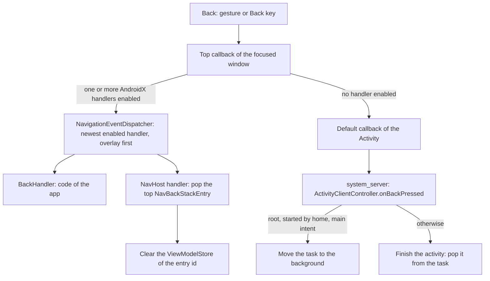

import Snippet from '../../../components/Snippet.astro';
import GoDeeper from '../../../components/GoDeeper.astro';

## The problem

An app has more than one screen. The user goes from a list to a detail screen. Back returns the user to the list. Thus the app must keep the screens in the order in which the user opened them. This order is a back stack.

The platform keeps one back stack for each task. A task is a collection of activities in a stack, the back stack. The stack holds the activities in the order in which each activity started[^tasks-intro]. When an activity starts another activity, the new activity goes on the top of the stack. On Back, the system pops the top activity and destroys it. The activity below it resumes[^tasks-life-cycle]. An app can start a second instance of an activity that is already on the stack. Back shows each instance with its own UI state[^tasks-multiple-instances].

The Navigation library keeps a second back stack in the `NavController`: an `ArrayDeque` of `NavBackStackEntry` objects[^navcontrollerimpl-90]. Each back stack must answer two questions:

- Many parts of an app can handle Back: the window, AndroidX, Navigation and the code of the app. Which part gets Back?
- Which state belongs to which entry of the stack, and when does the stack delete that state?

Since Android 10, the user can turn on gesture navigation. Then the system reads a swipe in from the edge of the screen as Back. This applies to all apps, for each `targetSdk`[^android-10-gesture-nav].

This chapter builds a back stack that keeps the state of each screen, and shows where it breaks. Then it shows how the platform, AndroidX and Navigation send Back to one callback and keep the state of each entry.

## Build it naive

The rebuild is in the module `samples/navigation`, in plain Kotlin. `NaiveBackStack` keeps the routes of the screens in an `ArrayDeque`. A route is the name of a destination, for example `list` or `detail`. `navigate` pushes a route. `back` pops the top route. `top` returns the top route.

The stack also keeps the state of each screen, for example a scroll position. This state is a stand-in for a `ViewModel` or for saved UI state. A map holds the state, and the key of the map is the route. `topState` reads and writes the state of the top route. `back` deletes the state of the popped route, because the popped screen cannot come back:

<Snippet file="navigation/src/main/kotlin/NaiveBackStack.kt" region="stack" />

Three tests check the normal cases:

- After `back`, `top` is the route below the popped route.
- After `back`, the route below keeps its state.
- If the app navigates to a route again after `back`, the new screen starts with no state.

## Where it breaks

The key of the state map is the route, not the entry. But one route can be on the stack two times. For example, a detail screen has a "related item" link, and the link opens a second detail screen. Then the two entries share one state. The breaking test shows the result:

<Snippet file="navigation/src/test/kotlin/NaiveBackStackTest.kt" region="flaw" />

1. The first `detail` sets its state to 40.
2. The second `detail` sets the state to 0. This writes over the state of the first `detail`.
3. `back` pops the second `detail`, and deletes the state of the route `detail`.
4. The first `detail` is on top again, with no state.

The test passes, so the flaw occurs. The user goes Back to the first detail screen, and the scroll position 40 is gone.

The platform does not have this flaw for activities. If an app starts a second instance of an activity, Back shows each instance with its own UI state[^tasks-multiple-instances]. A correct back stack gives an identity to each entry, not only to each destination.

## The real thing

### The task is the back stack of the platform

A task holds activities in the order in which they started. On Back, the system pops the top activity and destroys it[^tasks-life-cycle]. Launch modes and intent flags change how a start puts an activity into a task[^tasks-launch-modes]. The Go deeper box "launch modes and Back in system_server" gives the details.

Back does not always pop the top activity. `system_server` decides in `ActivityClientController.onBackPressed`:

- If `shouldMoveTaskToBack` is true, the system moves the task to the background[^activityclientcontroller-1978].
- Otherwise, `system_server` asks the activity to finish. This is the default[^activityclientcontroller-1984]. The activity then calls `finishAfterTransition`[^activity-4318].

By default, `shouldMoveTaskToBack` is true only if all these conditions are true:

- The activity is the root activity of its task[^activityclientcontroller-2000]. The Go deeper box "launch modes and Back in system_server" gives one more case.
- No other running activity is above the activity.
- The home app started the root activity.
- The intent of the root activity is a main intent[^activityclientcontroller-2021].

Since Android 12, Back on a root launcher activity moves the activity and its task to the background, and does not finish the activity. A root launcher activity declares an intent filter with `ACTION_MAIN` and `CATEGORY_LAUNCHER`. Other activities still finish on Back[^android-12-back-press].

Since Android 15, if an app targets Android 15 or higher, the system returns to a different place after an activity finishes its task. If the top activity finishes its task, the system returns to the task that was active last. If an activity that is not the top activity finishes its task, the system returns to the home screen[^android-15-secured-bal].

<GoDeeper title="launch modes and Back in system_server">

`ActivityStarter` applies the launch flags and the launch mode to the target task:

- In `complyActivityFlags`, with `FLAG_ACTIVITY_CLEAR_TOP`, `singleTask` or `singleInstance`, `ActivityStarter` removes the activities above the target with `performClearTop`. If the target stays, the target gets the new intent[^activitystarter-2678]. The docs give the same behavior. For `singleTask`, the system destroys the other activities on top of the instance[^tasks-manifest-for-tasks]. For `FLAG_ACTIVITY_CLEAR_TOP`, the system destroys the other activities on top of the target, and sends the intent to `onNewIntent()` of the target[^tasks-intent-flags].
- With `singleTop` or `FLAG_ACTIVITY_SINGLE_TOP`, `deliverToCurrentTopIfNeeded` checks the top activity. If it is the same activity, the system sends the new intent to the top instance. It starts no new instance[^activitystarter-2607].
- If a start targets the root activity of the task with a different intent, the start adds a new instance on top of the same task[^activitystarter-2757]. Prompt 2 of "Try it" uses this case.

`ActivityClientController.onBackPressed` has more cases. A task organizer can handle Back on the root activity of a task[^activityclientcontroller-1970]. An activity also counts as a root if it is the root of a companion `TaskFragment` of the root activity[^activityclientcontroller-2000]. The check of the top activity uses the `TaskFragment` of the activity[^activityclientcontroller-2021].

</GoDeeper>

### Back goes to one callback

With predictive back, the user sees where Back goes before the gesture ends[^predictive-back]. Thus the system must know before the gesture if the app handles Back. The app enables or disables each callback when its UI state changes, not when Back comes[^predictive-back-ui-state].

Each window has an `OnBackInvokedDispatcher`. An app registers each `OnBackInvokedCallback` on it with a priority. `PRIORITY_OVERLAY` (1000000) is for overlays, for example menus and navigation drawers. `PRIORITY_DEFAULT` is 0[^onbackinvokeddispatcher-51]. A callback with a higher priority gets Back first. In one priority, the callback that the app registered last gets Back first[^onbackinvokeddispatcher-93].

`WindowOnBackInvokedDispatcher` keeps the callbacks in a `TreeMap`. The key of the map is the priority, and each value is a list of callbacks[^windowonbackinvokeddispatcher-106]. The top callback is the last callback in the list of the highest priority[^windowonbackinvokeddispatcher-492]. If a new callback becomes the top callback and the window is attached, the dispatcher sends it to `system_server` at once[^windowonbackinvokeddispatcher-229][^windowonbackinvokeddispatcher-460]. If the window is not attached, the dispatcher sends the top callback when the window attaches[^windowonbackinvokeddispatcher-148]. Thus `system_server` knows the top callback before Back comes.

Each activity also registers a callback. If the callback model is on, `Activity.onCreate` registers `onBackInvoked` as the default back behavior[^activity-1922]. The registration uses `PRIORITY_SYSTEM`[^windowonbackinvokeddispatcher-349]. `PRIORITY_SYSTEM` is -1, and it is hidden. If the callback that gets Back has this priority, the system plays its own back animation[^onbackinvokeddispatcher-62]. `onBackInvoked` tells `system_server` about Back with `ActivityClient.onBackPressed`[^activity-4383]. Then `ActivityClientController` asks the activity to finish or moves the task to the background, as the previous section shows.

If the activity sets `android:enableOnBackInvokedCallback`, the value of the activity decides if the callback model is on. If not, the value of the application decides[^windowonbackinvokeddispatcher-791]. If the manifest does not set the attribute, the parser sets it to true for apps that target API level 36 or higher[^parsingpackageutils-2461]. The launch app targets API level 37, so its `MainActivity` registers the default callback. Prompt 2 of "Try it" shows this callback.

If the callback model is on, `ViewRootImpl` in the app process catches the Back key before the view tree and the IME get it. Then it calls the top callback[^viewrootimpl-8232]. Key down starts the back event. Key up calls `onBackInvoked`. If the key up is canceled, the callback gets `onBackCancelled`[^viewrootimpl-8271].

`Activity.onBackPressed` is deprecated. `OnBackInvokedCallback` and the AndroidX `OnBackPressedCallback` replace it[^activity-4358].

If an app enables a callback at `PRIORITY_DEFAULT` or `PRIORITY_OVERLAY`, the predictive back animations do not run, and the app must handle Back[^predictive-back-ui-logic]. Thus an app enables a callback only while it has work to do on Back.

A callback at `PRIORITY_SYSTEM_NAVIGATION_OBSERVER` (-2) only observes Back. It gets Back only if no callback at `PRIORITY_DEFAULT` or higher handles Back. It cannot stop the back behavior of the system. On API level 37 and higher, an app can register more than one observer[^onbackinvokeddispatcher-70]. The window keeps the observers in a separate set, not in the map of the other callbacks[^windowonbackinvokeddispatcher-106][^windowonbackinvokeddispatcher-217]. `Activity.onCreate` registers one observer, which calls `onUserInteraction` on each Back[^activity-1929]. This observer is an `ObserverOnBackAnimationCallback`, a type for system code. The window calls this type also when an app callback handles Back[^windowonbackinvokeddispatcher-427].

Since Android 13, the platform has the `OnBackInvokedCallback` model. An app opts in with `android:enableOnBackInvokedCallback`. If the app does not opt in, the system uses the legacy behavior and sends `KEYCODE_BACK`[^windowonbackinvokeddispatcher-13-279].

Since Android 14, an app can register an `OnBackAnimationCallback`. This callback also gets `onBackStarted` and `onBackProgressed`, each with a `BackEvent`, and `onBackCancelled`. Thus the app can animate its own back preview[^onbackanimationcallback-14-41].

Since Android 14, an activity can set `android:enableOnBackInvokedCallback`. If the activity sets it, the value of the activity decides[^windowonbackinvokeddispatcher-14-471]. In Android 13, only the value of the application counts[^windowonbackinvokeddispatcher-13-279].

Since Android 15, the developer option for predictive back animations is not available. The system back-to-home, cross-task and cross-activity animations show for apps that opt in to predictive back[^android-15-predictive-back].

Since Android 16, if an app targets API level 36 or higher and runs on Android 16 or higher, the predictive back system animations are on by default. The system does not call `onBackPressed`, and it does not send `KEYCODE_BACK`. For now, the app can opt out with `android:enableOnBackInvokedCallback="false"`[^android-16-predictive-back].

Since Android 16, 3-button navigation also supports predictive back for apps that migrated to predictive back. A long press on the Back button starts the predictive back animation[^android-16-three-button].

Since Android 16, an app can register an observer callback at `PRIORITY_SYSTEM_NAVIGATION_OBSERVER`. The observer gets Back when the system handles Back, and it cannot stop the back behavior of the system. Android 16 allows only one observer at a time[^onbackinvokeddispatcher-16-73].

<GoDeeper title="how system_server picks the back animation">

When a back gesture starts, `BackNavigationController.startBackNavigation` reads the top callback of the focused window. If the callback is not a system callback, the back type is `TYPE_CALLBACK`[^backnavigationcontroller-284]. For `TYPE_CALLBACK`, the system sets up no animation of its own and returns at once[^backnavigationcontroller-327]. If the top callback is the default callback of the system, the system finds the destination of Back in advance:

- If another activity of the task is the destination, the type is `TYPE_CROSS_ACTIVITY`[^backnavigationcontroller-386].
- If the home task is the destination, the type is `TYPE_RETURN_TO_HOME`. If another task is the destination, the type is `TYPE_CROSS_TASK`[^backnavigationcontroller-424].

</GoDeeper>

### AndroidX keeps a stack of handlers

`androidx.activity.ComponentActivity` creates an `OnBackPressedDispatcher`. On API level 33 and higher, at `ON_CREATE`, `ComponentActivity` connects the dispatcher to the `OnBackInvokedDispatcher` of the window[^componentactivity-638][^componentactivity-666]. If the callback model is off, `Activity.onKeyUp` calls `onBackPressed` on `KEYCODE_BACK`[^activity-4281]. `ComponentActivity.onBackPressed` sends Back to the same AndroidX dispatcher[^componentactivity-605][^componentactivity-248][^componentactivity-663]. AndroidX uses this path below API level 33, or if `android:enableOnBackInvokedCallback` is false[^componentactivity-248]. In this path, if no AndroidX callback handles Back, the dispatcher calls its fallback, the platform `Activity.onBackPressed`[^componentactivity-614]. If no action view and no platform fragment handles Back, the platform `onBackPressed` calls the same `onBackInvoked` as the default callback[^activity-4369].

`OnBackPressedDispatcher` keeps no stack of its own. It sends each call to a `NavigationEventDispatcher`[^onbackpresseddispatcher-83]. `ComponentActivity` gives this dispatcher as its own `navigationEventDispatcher`[^componentactivity-663]. `addCallback` makes a `NavigationEventHandler` from each `OnBackPressedCallback`, and adds the handler to that dispatcher[^onbackpresseddispatcher-125]. If the app gives a `LifecycleOwner`, the callback is enabled only while the lifecycle is at least `STARTED`[^onbackpresseddispatcher-132]. `setOnBackInvokedDispatcher` adds two platform inputs: one at the default priority and one at the overlay priority[^onbackpresseddispatcher-101].

`NavigationEventProcessor` keeps one stack of handlers for each priority: overlay and default[^navigationeventprocessor-70]. It adds each new handler at the front of its stack[^navigationeventprocessor-342]. On Back, it takes the first enabled handler of the overlay stack. If no overlay handler is enabled, it takes the first enabled handler of the default stack[^navigationeventprocessor-654].

The platform callback of AndroidX is not always registered. If the number of enabled back handlers of a priority changes from zero to one or more, or from one or more to zero, the processor tells each input of that priority[^navigationeventprocessor-215]. Then the platform input registers or unregisters its `OnBackInvokedCallback`[^onbackinvokedinput-76]. Thus, if no AndroidX handler is enabled, the window has no AndroidX callback. If the app registered no other callback, the default callback of the `Activity` is the top callback again. Then the system can play its own back animation[^onbackinvokeddispatcher-62].

On API level 33, the platform input registers a plain `OnBackInvokedCallback`, which gets only `onBackInvoked`. On API level 34 and higher, it registers an `OnBackAnimationCallback`, and it sends the progress of the gesture to the handlers[^onbackinvokedinput-63][^onbackinvokedinput-93].

### Navigation gives each entry an id

The back stack of `NavController` is an `ArrayDeque` of `NavBackStackEntry` objects[^navcontrollerimpl-90]. Each entry has an `id`, and by default the id is a random UUID. Each entry is a `LifecycleOwner`, a `ViewModelStoreOwner` and a `SavedStateRegistryOwner`[^navbackstackentry-65]. Thus each entry has its own lifecycle, its own `ViewModel` objects and its own saved state. These objects are valid while the entry is on the back stack. When the controller pops the entry, the library destroys the lifecycle. If the pop does not save the state, the library also clears the `ViewModel` objects[^navbackstackentry-58][^navcontrollerimpl-618].

The entry gets its `ViewModelStore` from a provider. The key is the id of the entry, not the route[^navbackstackentry-172]. This is the fix for the flaw of the rebuild. Two entries of `detail` have two ids, so they get two stores.

A pop clears only the store of the popped id:

- `popEntryFromBackStack` checks if the entry has a transition in progress or a linked child entry[^navcontrollerimpl-601]. If it has neither, and the pop does not save the state, the pop clears the store of the entry id at once[^navcontrollerimpl-618].
- If not, `markTransitionComplete` clears the store later. It clears the store only if no entry with that id is in the back stack, and only if the pop did not save the state[^navcontrollerimpl-268].

A pop can save the state, for multiple back stacks. Then `NavController` keeps the saved entries of each back stack by an id[^navcontrollerimpl-126], and the pop does not clear the store[^navcontrollerimpl-618].

### Who pops the Navigation back stack

`NavController` has one `OnBackPressedCallback`, which calls `popBackStack`[^navcontroller-111]. `NavController` adds this callback to a dispatcher only in `setOnBackPressedDispatcher`[^navcontroller-1086]. The callback is enabled only while the back stack has more than one destination that is not a graph[^navcontroller-441][^navcontroller-1115].

The Compose `NavHost` uses its own handler, a `NavHostEventHandler`. `NavHost` enables the handler only while the back stack of the `ComposeNavigator` has more than one entry[^navhost-823]. `rememberNavHostEventHandler` gets the `NavigationEventDispatcher` from `LocalNavigationEventDispatcherOwner`, and adds the handler to it[^navhosteventhandler-39][^navhosteventhandler-52]. The handler is enabled only while the lifecycle is at least `STARTED`[^navhosteventhandler-47]. On Back, the handler pops the top entry of the `ComposeNavigator`[^navhosteventhandler-115].

At the start destination, the `NavHost` handler is disabled, so the next enabled handler gets Back. If `LocalNavigationEventDispatcherOwner` gives the `ComponentActivity`, and no handler is enabled, AndroidX unregisters its platform callback[^onbackinvokedinput-76], and the default callback of the `Activity` gets Back.

`BackHandler` adds its handler to the dispatcher of `LocalNavigationEventDispatcherOwner`, the same dispatcher as `NavHost`[^backhandler-108][^backhandler-146]. If more than one `BackHandler` is enabled, the `BackHandler` that entered the composition last gets Back[^backhandler-85]. The docs give the same model. The last enabled callback of the stack handles the next Back. The system handles Back only if all callbacks are disabled[^predictive-back-single-responsibility].

### Navigation 3: the app owns the list

In Navigation 3, the app owns the back stack. A `NavBackStack` is a mutable list of keys that wraps a Compose `SnapshotStateList`. To push, add a key. To pop, remove the last key[^navbackstack-25].

The `contentKey` of a `NavEntry` identifies its content and the state of its decorators. Entries with the same `contentKey` share content and decorator state[^naventry-28]. By default, the `contentKey` comes from the key: it is the string of the key and its class[^naventry-100]. Thus two keys with the same string and class share one state, as in the rebuild. To keep two entries of one destination apart, the app must give them different keys. Navigation 2 is different: it gives each entry its own UUID[^navbackstackentry-65].

## Mental model

Two kinds of back stack work together. The platform keeps a task, a stack of activities. Inside an activity, AndroidX keeps a stack of handlers for each priority, and Navigation keeps a stack of entries. Back goes to one callback: the top callback of the focused window. The window sends this callback to `system_server` before Back comes. If an AndroidX handler is enabled, the AndroidX callback is on the window, and the newest enabled handler gets Back. For example, the `NavHost` handler pops the top `NavBackStackEntry`. Navigation then clears the `ViewModelStore` of that entry by its id, not by its route. If no handler is enabled, the default callback of the `Activity` gets Back. Then `system_server` asks the activity to finish. If the activity is the root that the home app started with a main intent, `system_server` moves the task to the background instead.



## Try it

### 1. Give each entry an id

Change `NaiveBackStack`, so that each entry has its own id, as each `NavBackStackEntry` has[^navbackstackentry-65]:

1. Add a counter. In `navigate`, push an entry with the route and the next value of the counter.
2. In `topState` and in `back`, use the id of the top entry as the key of the state map.
3. Keep `top`. It returns the route of the top entry.

From the repo root, run the tests of the rebuild:

```sh
samples/gradlew -p samples :navigation:test
```

The breaking test fails, because the flaw is gone. The other three tests pass, so Back still shows the route below, and a new entry still starts with no state. The Gradle output includes these lines:

```
NaiveBackStackTest > naiveBackStack_losesState_whenSameRouteIsTwiceOnStack() FAILED
    org.opentest4j.AssertionFailedError at NaiveBackStackTest.kt:48

4 tests completed, 1 failed
```

Compare your fix with the real code. The key of the real store is the id of the entry[^navbackstackentry-172]. A pop clears only the store of that id[^navcontrollerimpl-618].

### 2. See the task and the default callback

Start an emulator with the system image of the checked stamp. From the repo root, install the release build of the launch app, and stop the app:

```sh
samples/gradlew -p samples :launch-app:installLaunchPathRelease
adb shell am force-stop io.github.imgurpreetsk.afp.launchapp
```

In the emulator, tap the icon of the app on the home screen. Then start `MainActivity` again from the shell, and print the activities:

```sh
adb shell am start -W -n io.github.imgurpreetsk.afp.launchapp/.MainActivity
adb shell dumpsys activity activities
```

In the output, find the task of the app. The task has these two lines:

{/* Edit step: capture this output on the emulator of the checked stamp. */}

```
* Hist  #1: ActivityRecord{… u0 io.github.imgurpreetsk.afp.launchapp/.MainActivity t…}
* Hist  #0: ActivityRecord{… u0 io.github.imgurpreetsk.afp.launchapp/.MainActivity t…}
```

Print the dump of the top activity:

```sh
adb shell dumpsys activity top
```

In the output, find the `WindowOnBackDispatcher:` lines:

{/* Edit step: capture this output on the emulator of the checked stamp. */}

```
WindowOnBackDispatcher:
    Top Callback: …
    Callbacks: 
      Callback: … Priority=-1
```

The [Zygote chapter](/launch-path/zygote/) explains `am force-stop` and `am start -W`. The blocks show hash codes, task IDs and the names of callback objects as `…`.

- The tap started a new task, with `MainActivity` as its root activity[^tasks-life-cycle]. The intent of the shell has no `MAIN` action and no `LAUNCHER` category, so it is different from the intent of the root. Thus `ActivityStarter` adds a new instance on top of the same task[^activitystarter-2757]. The task holds two `ActivityRecord` entries of `MainActivity`. This task is the back stack of the platform.
- In the dump of the activity, `Activity` prints the dump of its `ViewRootImpl`[^activity-8529], and that dump contains the back dispatcher[^viewrootimpl-10797]. The dispatcher prints the top callback, and then each callback with its priority[^windowonbackinvokeddispatcher-549].
- The list has one callback, with `Priority=-1`: `PRIORITY_SYSTEM`[^onbackinvokeddispatcher-62]. It is the default callback that `Activity.onCreate` registered[^activity-1922]. The launch app targets API level 37, so the callback model is on[^parsingpackageutils-2461].
- The list does not show the observer that `Activity.onCreate` also registered[^activity-1929]. The dump prints only the callbacks of `mAllCallbacks`[^windowonbackinvokeddispatcher-549], and the window keeps the observers in a separate set[^windowonbackinvokeddispatcher-106].
- The launch app registers no callback of its own. Thus `system_server` knows before Back that Back runs the default behavior of the activity.

### 3. Press Back two times

Press Back, and print the activities again:

```sh
adb shell input keyevent KEYCODE_BACK
adb shell dumpsys activity activities
```

The task of the app has one line:

{/* Edit step: capture this output on the emulator of the checked stamp. */}

```
* Hist  #0: ActivityRecord{… u0 io.github.imgurpreetsk.afp.launchapp/.MainActivity t…}
```

Press Back again. Then print the activities and the PID of the app:

```sh
adb shell input keyevent KEYCODE_BACK
adb shell dumpsys activity activities
adb shell pidof io.github.imgurpreetsk.afp.launchapp
```

The task still has its line, and `pidof` prints a PID:

{/* Edit step: capture this output on the emulator of the checked stamp. */}

```
* Hist  #0: ActivityRecord{… u0 io.github.imgurpreetsk.afp.launchapp/.MainActivity t…}
…
```

Start the app with the intent of the launcher:

```sh
adb shell am start -W -a android.intent.action.MAIN -c android.intent.category.LAUNCHER -n io.github.imgurpreetsk.afp.launchapp/.MainActivity
```

{/* Edit step: capture this output on the emulator of the checked stamp. */}

```
Starting: Intent { act=android.intent.action.MAIN cat=[android.intent.category.LAUNCHER] cmp=io.github.imgurpreetsk.afp.launchapp/.MainActivity }
Warning: Activity not started, its current task has been brought to the front
Status: ok
LaunchState: HOT
Activity: io.github.imgurpreetsk.afp.launchapp/.MainActivity
TotalTime: …
WaitTime: …
Complete
```

The blocks show the hash codes, the task IDs, the PID and the times as `…`.

- `ViewRootImpl` catches each Back key and calls the top callback[^viewrootimpl-8232][^viewrootimpl-8271]. The top callback is the default callback, and it calls `ActivityClient.onBackPressed`[^activity-4383].
- First Back: the top instance is not the root of the task, so `shouldMoveTaskToBack` is false[^activityclientcontroller-2000]. `system_server` asks the activity to finish[^activityclientcontroller-1984], and the task has one `ActivityRecord` again.
- Second Back: the root is the top activity of the task. The home app started it with a main intent. Thus `system_server` moves the task to the background and does not finish the activity[^activityclientcontroller-2021][^activityclientcontroller-1978]. The task keeps its `ActivityRecord`, and the process of the app stays.
- The last `am start` finds the task and brings it to the front. The start returns `START_TASK_TO_FRONT` and starts no new activity[^activitystarter-2588]. The [first frame chapter](/launch-path/first-frame/) explains the other lines of `am start -W`.

[^tasks-intro]: Tasks and the back stack: [https://developer.android.com/guide/components/activities/tasks-and-back-stack](https://developer.android.com/guide/components/activities/tasks-and-back-stack)
[^tasks-life-cycle]: Tasks and the back stack, "Lifecycle of a task and its back stack": [https://developer.android.com/guide/components/activities/tasks-and-back-stack#life-cycle](https://developer.android.com/guide/components/activities/tasks-and-back-stack#life-cycle)
[^tasks-multiple-instances]: Tasks and the back stack, "Multiple activity instances": [https://developer.android.com/guide/components/activities/tasks-and-back-stack#multiple-instances](https://developer.android.com/guide/components/activities/tasks-and-back-stack#multiple-instances)
[^navcontrollerimpl-90]: NavControllerImpl.kt, line 90: [https://android.googlesource.com/platform/frameworks/support/+/b103583c697f6eae01cb451193bc90d56034380b/navigation/navigation-runtime/src/commonMain/kotlin/androidx/navigation/internal/NavControllerImpl.kt#90](https://android.googlesource.com/platform/frameworks/support/+/b103583c697f6eae01cb451193bc90d56034380b/navigation/navigation-runtime/src/commonMain/kotlin/androidx/navigation/internal/NavControllerImpl.kt#90)
[^android-10-gesture-nav]: Android 10 behavior changes, "Gesture Navigation": [https://developer.android.com/about/versions/10/behavior-changes-all#gesture-nav](https://developer.android.com/about/versions/10/behavior-changes-all#gesture-nav)
[^tasks-launch-modes]: Tasks and the back stack, "Define launch modes": [https://developer.android.com/guide/components/activities/tasks-and-back-stack#TaskLaunchModes](https://developer.android.com/guide/components/activities/tasks-and-back-stack#TaskLaunchModes)
[^android-12-back-press]: Android 12 behavior changes, "Root launcher activities are no longer finished on Back press": [https://developer.android.com/about/versions/12/behavior-changes-all#back-press](https://developer.android.com/about/versions/12/behavior-changes-all#back-press)
[^android-15-secured-bal]: Android 15 behavior changes for apps that target Android 15, "Secured background activity launches": [https://developer.android.com/about/versions/15/behavior-changes-15#secured-bal](https://developer.android.com/about/versions/15/behavior-changes-15#secured-bal)
[^tasks-manifest-for-tasks]: Tasks and the back stack, "Define launch modes using the manifest file": [https://developer.android.com/guide/components/activities/tasks-and-back-stack#ManifestForTasks](https://developer.android.com/guide/components/activities/tasks-and-back-stack#ManifestForTasks)
[^tasks-intent-flags]: Tasks and the back stack, "Define launch modes using Intent flags": [https://developer.android.com/guide/components/activities/tasks-and-back-stack#IntentFlagsForTasks](https://developer.android.com/guide/components/activities/tasks-and-back-stack#IntentFlagsForTasks)
[^predictive-back]: Add support for the predictive back gesture: [https://developer.android.com/guide/navigation/custom-back/predictive-back-gesture](https://developer.android.com/guide/navigation/custom-back/predictive-back-gesture)
[^predictive-back-ui-state]: Add support for the predictive back gesture, "Determine the UI State that enables and disables each callback": [https://developer.android.com/guide/navigation/custom-back/predictive-back-gesture#ui-state](https://developer.android.com/guide/navigation/custom-back/predictive-back-gesture#ui-state)
[^predictive-back-ui-logic]: Add support for the predictive back gesture, "Use system back callbacks for UI Logic": [https://developer.android.com/guide/navigation/custom-back/predictive-back-gesture#ui-logic](https://developer.android.com/guide/navigation/custom-back/predictive-back-gesture#ui-logic)
[^android-15-predictive-back]: Android 15 behavior changes, "Predictive back animations enabled for apps that opted in": [https://developer.android.com/about/versions/15/behavior-changes-all#predictive-back](https://developer.android.com/about/versions/15/behavior-changes-all#predictive-back)
[^android-16-predictive-back]: Android 16 behavior changes for apps that target Android 16, "Migration or opt-out required for predictive back": [https://developer.android.com/about/versions/16/behavior-changes-16#predictive-back](https://developer.android.com/about/versions/16/behavior-changes-16#predictive-back)
[^android-16-three-button]: Android 16 behavior changes, "Support for 3-button navigation": [https://developer.android.com/about/versions/16/behavior-changes-all#three-button-predictive-back](https://developer.android.com/about/versions/16/behavior-changes-all#three-button-predictive-back)
[^predictive-back-single-responsibility]: Add support for the predictive back gesture, "Create single responsibility callbacks": [https://developer.android.com/guide/navigation/custom-back/predictive-back-gesture#single-responsibility](https://developer.android.com/guide/navigation/custom-back/predictive-back-gesture#single-responsibility)
[^activityclientcontroller-1970]: ActivityClientController.java, lines 1970–1976: [https://android.googlesource.com/platform/frameworks/base/+/refs/tags/android-17.0.0_r1/services/core/java/com/android/server/wm/ActivityClientController.java#1970](https://android.googlesource.com/platform/frameworks/base/+/refs/tags/android-17.0.0_r1/services/core/java/com/android/server/wm/ActivityClientController.java#1970)
[^activityclientcontroller-1978]: ActivityClientController.java, lines 1978–1980: [https://android.googlesource.com/platform/frameworks/base/+/refs/tags/android-17.0.0_r1/services/core/java/com/android/server/wm/ActivityClientController.java#1978](https://android.googlesource.com/platform/frameworks/base/+/refs/tags/android-17.0.0_r1/services/core/java/com/android/server/wm/ActivityClientController.java#1978)
[^activityclientcontroller-1984]: ActivityClientController.java, lines 1984–1985: [https://android.googlesource.com/platform/frameworks/base/+/refs/tags/android-17.0.0_r1/services/core/java/com/android/server/wm/ActivityClientController.java#1984](https://android.googlesource.com/platform/frameworks/base/+/refs/tags/android-17.0.0_r1/services/core/java/com/android/server/wm/ActivityClientController.java#1984)
[^activity-4318]: Activity.java, lines 4318–4324: [https://android.googlesource.com/platform/frameworks/base/+/refs/tags/android-17.0.0_r1/core/java/android/app/Activity.java#4318](https://android.googlesource.com/platform/frameworks/base/+/refs/tags/android-17.0.0_r1/core/java/android/app/Activity.java#4318)
[^activityclientcontroller-2000]: ActivityClientController.java, lines 2000–2003: [https://android.googlesource.com/platform/frameworks/base/+/refs/tags/android-17.0.0_r1/services/core/java/com/android/server/wm/ActivityClientController.java#2000](https://android.googlesource.com/platform/frameworks/base/+/refs/tags/android-17.0.0_r1/services/core/java/com/android/server/wm/ActivityClientController.java#2000)
[^activityclientcontroller-2021]: ActivityClientController.java, lines 2021–2031: [https://android.googlesource.com/platform/frameworks/base/+/refs/tags/android-17.0.0_r1/services/core/java/com/android/server/wm/ActivityClientController.java#2021](https://android.googlesource.com/platform/frameworks/base/+/refs/tags/android-17.0.0_r1/services/core/java/com/android/server/wm/ActivityClientController.java#2021)
[^activitystarter-2678]: ActivityStarter.java, lines 2678–2699: [https://android.googlesource.com/platform/frameworks/base/+/refs/tags/android-17.0.0_r1/services/core/java/com/android/server/wm/ActivityStarter.java#2678](https://android.googlesource.com/platform/frameworks/base/+/refs/tags/android-17.0.0_r1/services/core/java/com/android/server/wm/ActivityStarter.java#2678)
[^activitystarter-2607]: ActivityStarter.java, lines 2607–2650: [https://android.googlesource.com/platform/frameworks/base/+/refs/tags/android-17.0.0_r1/services/core/java/com/android/server/wm/ActivityStarter.java#2607](https://android.googlesource.com/platform/frameworks/base/+/refs/tags/android-17.0.0_r1/services/core/java/com/android/server/wm/ActivityStarter.java#2607)
[^activitystarter-2757]: ActivityStarter.java, lines 2757–2760: [https://android.googlesource.com/platform/frameworks/base/+/refs/tags/android-17.0.0_r1/services/core/java/com/android/server/wm/ActivityStarter.java#2757](https://android.googlesource.com/platform/frameworks/base/+/refs/tags/android-17.0.0_r1/services/core/java/com/android/server/wm/ActivityStarter.java#2757)
[^onbackinvokeddispatcher-51]: OnBackInvokedDispatcher.java, lines 51–60: [https://android.googlesource.com/platform/frameworks/base/+/refs/tags/android-17.0.0_r1/core/java/android/window/OnBackInvokedDispatcher.java#51](https://android.googlesource.com/platform/frameworks/base/+/refs/tags/android-17.0.0_r1/core/java/android/window/OnBackInvokedDispatcher.java#51)
[^onbackinvokeddispatcher-93]: OnBackInvokedDispatcher.java, lines 93–107: [https://android.googlesource.com/platform/frameworks/base/+/refs/tags/android-17.0.0_r1/core/java/android/window/OnBackInvokedDispatcher.java#93](https://android.googlesource.com/platform/frameworks/base/+/refs/tags/android-17.0.0_r1/core/java/android/window/OnBackInvokedDispatcher.java#93)
[^windowonbackinvokeddispatcher-106]: WindowOnBackInvokedDispatcher.java, lines 106–117: [https://android.googlesource.com/platform/frameworks/base/+/refs/tags/android-17.0.0_r1/core/java/android/window/WindowOnBackInvokedDispatcher.java#106](https://android.googlesource.com/platform/frameworks/base/+/refs/tags/android-17.0.0_r1/core/java/android/window/WindowOnBackInvokedDispatcher.java#106)
[^windowonbackinvokeddispatcher-492]: WindowOnBackInvokedDispatcher.java, lines 492–505: [https://android.googlesource.com/platform/frameworks/base/+/refs/tags/android-17.0.0_r1/core/java/android/window/WindowOnBackInvokedDispatcher.java#492](https://android.googlesource.com/platform/frameworks/base/+/refs/tags/android-17.0.0_r1/core/java/android/window/WindowOnBackInvokedDispatcher.java#492)
[^windowonbackinvokeddispatcher-229]: WindowOnBackInvokedDispatcher.java, lines 229–257: [https://android.googlesource.com/platform/frameworks/base/+/refs/tags/android-17.0.0_r1/core/java/android/window/WindowOnBackInvokedDispatcher.java#229](https://android.googlesource.com/platform/frameworks/base/+/refs/tags/android-17.0.0_r1/core/java/android/window/WindowOnBackInvokedDispatcher.java#229)
[^windowonbackinvokeddispatcher-460]: WindowOnBackInvokedDispatcher.java, lines 460–490: [https://android.googlesource.com/platform/frameworks/base/+/refs/tags/android-17.0.0_r1/core/java/android/window/WindowOnBackInvokedDispatcher.java#460](https://android.googlesource.com/platform/frameworks/base/+/refs/tags/android-17.0.0_r1/core/java/android/window/WindowOnBackInvokedDispatcher.java#460)
[^windowonbackinvokeddispatcher-148]: WindowOnBackInvokedDispatcher.java, lines 148–164: [https://android.googlesource.com/platform/frameworks/base/+/refs/tags/android-17.0.0_r1/core/java/android/window/WindowOnBackInvokedDispatcher.java#148](https://android.googlesource.com/platform/frameworks/base/+/refs/tags/android-17.0.0_r1/core/java/android/window/WindowOnBackInvokedDispatcher.java#148)
[^activity-1922]: Activity.java, lines 1922–1928: [https://android.googlesource.com/platform/frameworks/base/+/refs/tags/android-17.0.0_r1/core/java/android/app/Activity.java#1922](https://android.googlesource.com/platform/frameworks/base/+/refs/tags/android-17.0.0_r1/core/java/android/app/Activity.java#1922)
[^windowonbackinvokeddispatcher-349]: WindowOnBackInvokedDispatcher.java, lines 349–351: [https://android.googlesource.com/platform/frameworks/base/+/refs/tags/android-17.0.0_r1/core/java/android/window/WindowOnBackInvokedDispatcher.java#349](https://android.googlesource.com/platform/frameworks/base/+/refs/tags/android-17.0.0_r1/core/java/android/window/WindowOnBackInvokedDispatcher.java#349)
[^onbackinvokeddispatcher-62]: OnBackInvokedDispatcher.java, lines 62–68: [https://android.googlesource.com/platform/frameworks/base/+/refs/tags/android-17.0.0_r1/core/java/android/window/OnBackInvokedDispatcher.java#62](https://android.googlesource.com/platform/frameworks/base/+/refs/tags/android-17.0.0_r1/core/java/android/window/OnBackInvokedDispatcher.java#62)
[^activity-4383]: Activity.java, lines 4383–4393: [https://android.googlesource.com/platform/frameworks/base/+/refs/tags/android-17.0.0_r1/core/java/android/app/Activity.java#4383](https://android.googlesource.com/platform/frameworks/base/+/refs/tags/android-17.0.0_r1/core/java/android/app/Activity.java#4383)
[^windowonbackinvokeddispatcher-791]: WindowOnBackInvokedDispatcher.java, lines 791–826: [https://android.googlesource.com/platform/frameworks/base/+/refs/tags/android-17.0.0_r1/core/java/android/window/WindowOnBackInvokedDispatcher.java#791](https://android.googlesource.com/platform/frameworks/base/+/refs/tags/android-17.0.0_r1/core/java/android/window/WindowOnBackInvokedDispatcher.java#791)
[^parsingpackageutils-2461]: ParsingPackageUtils.java, lines 2461–2463: [https://android.googlesource.com/platform/frameworks/base/+/refs/tags/android-17.0.0_r1/core/java/com/android/internal/pm/pkg/parsing/ParsingPackageUtils.java#2461](https://android.googlesource.com/platform/frameworks/base/+/refs/tags/android-17.0.0_r1/core/java/com/android/internal/pm/pkg/parsing/ParsingPackageUtils.java#2461)
[^viewrootimpl-8232]: ViewRootImpl.java, lines 8232–8256: [https://android.googlesource.com/platform/frameworks/base/+/refs/tags/android-17.0.0_r1/core/java/android/view/ViewRootImpl.java#8232](https://android.googlesource.com/platform/frameworks/base/+/refs/tags/android-17.0.0_r1/core/java/android/view/ViewRootImpl.java#8232)
[^viewrootimpl-8271]: ViewRootImpl.java, lines 8271–8304: [https://android.googlesource.com/platform/frameworks/base/+/refs/tags/android-17.0.0_r1/core/java/android/view/ViewRootImpl.java#8271](https://android.googlesource.com/platform/frameworks/base/+/refs/tags/android-17.0.0_r1/core/java/android/view/ViewRootImpl.java#8271)
[^activity-4358]: Activity.java, lines 4358–4368: [https://android.googlesource.com/platform/frameworks/base/+/refs/tags/android-17.0.0_r1/core/java/android/app/Activity.java#4358](https://android.googlesource.com/platform/frameworks/base/+/refs/tags/android-17.0.0_r1/core/java/android/app/Activity.java#4358)
[^onbackinvokeddispatcher-70]: OnBackInvokedDispatcher.java, lines 70–91: [https://android.googlesource.com/platform/frameworks/base/+/refs/tags/android-17.0.0_r1/core/java/android/window/OnBackInvokedDispatcher.java#70](https://android.googlesource.com/platform/frameworks/base/+/refs/tags/android-17.0.0_r1/core/java/android/window/OnBackInvokedDispatcher.java#70)
[^windowonbackinvokeddispatcher-217]: WindowOnBackInvokedDispatcher.java, lines 217–220: [https://android.googlesource.com/platform/frameworks/base/+/refs/tags/android-17.0.0_r1/core/java/android/window/WindowOnBackInvokedDispatcher.java#217](https://android.googlesource.com/platform/frameworks/base/+/refs/tags/android-17.0.0_r1/core/java/android/window/WindowOnBackInvokedDispatcher.java#217)
[^activity-1929]: Activity.java, lines 1929–1947: [https://android.googlesource.com/platform/frameworks/base/+/refs/tags/android-17.0.0_r1/core/java/android/app/Activity.java#1929](https://android.googlesource.com/platform/frameworks/base/+/refs/tags/android-17.0.0_r1/core/java/android/app/Activity.java#1929)
[^windowonbackinvokeddispatcher-427]: WindowOnBackInvokedDispatcher.java, lines 427–442: [https://android.googlesource.com/platform/frameworks/base/+/refs/tags/android-17.0.0_r1/core/java/android/window/WindowOnBackInvokedDispatcher.java#427](https://android.googlesource.com/platform/frameworks/base/+/refs/tags/android-17.0.0_r1/core/java/android/window/WindowOnBackInvokedDispatcher.java#427)
[^windowonbackinvokeddispatcher-13-279]: WindowOnBackInvokedDispatcher.java at android-13.0.0_r1, lines 279–300: [https://android.googlesource.com/platform/frameworks/base/+/refs/tags/android-13.0.0_r1/core/java/android/window/WindowOnBackInvokedDispatcher.java#279](https://android.googlesource.com/platform/frameworks/base/+/refs/tags/android-13.0.0_r1/core/java/android/window/WindowOnBackInvokedDispatcher.java#279)
[^onbackanimationcallback-14-41]: OnBackAnimationCallback.java at android-14.0.0_r1, lines 41–62: [https://android.googlesource.com/platform/frameworks/base/+/refs/tags/android-14.0.0_r1/core/java/android/window/OnBackAnimationCallback.java#41](https://android.googlesource.com/platform/frameworks/base/+/refs/tags/android-14.0.0_r1/core/java/android/window/OnBackAnimationCallback.java#41)
[^windowonbackinvokeddispatcher-14-471]: WindowOnBackInvokedDispatcher.java at android-14.0.0_r1, lines 471–491: [https://android.googlesource.com/platform/frameworks/base/+/refs/tags/android-14.0.0_r1/core/java/android/window/WindowOnBackInvokedDispatcher.java#471](https://android.googlesource.com/platform/frameworks/base/+/refs/tags/android-14.0.0_r1/core/java/android/window/WindowOnBackInvokedDispatcher.java#471)
[^onbackinvokeddispatcher-16-73]: OnBackInvokedDispatcher.java at android-16.0.0_r1, lines 73–85: [https://android.googlesource.com/platform/frameworks/base/+/refs/tags/android-16.0.0_r1/core/java/android/window/OnBackInvokedDispatcher.java#73](https://android.googlesource.com/platform/frameworks/base/+/refs/tags/android-16.0.0_r1/core/java/android/window/OnBackInvokedDispatcher.java#73)
[^backnavigationcontroller-284]: BackNavigationController.java, lines 284–293: [https://android.googlesource.com/platform/frameworks/base/+/refs/tags/android-17.0.0_r1/services/core/java/com/android/server/wm/BackNavigationController.java#284](https://android.googlesource.com/platform/frameworks/base/+/refs/tags/android-17.0.0_r1/services/core/java/com/android/server/wm/BackNavigationController.java#284)
[^backnavigationcontroller-327]: BackNavigationController.java, lines 327–344: [https://android.googlesource.com/platform/frameworks/base/+/refs/tags/android-17.0.0_r1/services/core/java/com/android/server/wm/BackNavigationController.java#327](https://android.googlesource.com/platform/frameworks/base/+/refs/tags/android-17.0.0_r1/services/core/java/com/android/server/wm/BackNavigationController.java#327)
[^backnavigationcontroller-386]: BackNavigationController.java, lines 386–414: [https://android.googlesource.com/platform/frameworks/base/+/refs/tags/android-17.0.0_r1/services/core/java/com/android/server/wm/BackNavigationController.java#386](https://android.googlesource.com/platform/frameworks/base/+/refs/tags/android-17.0.0_r1/services/core/java/com/android/server/wm/BackNavigationController.java#386)
[^backnavigationcontroller-424]: BackNavigationController.java, lines 424–465: [https://android.googlesource.com/platform/frameworks/base/+/refs/tags/android-17.0.0_r1/services/core/java/com/android/server/wm/BackNavigationController.java#424](https://android.googlesource.com/platform/frameworks/base/+/refs/tags/android-17.0.0_r1/services/core/java/com/android/server/wm/BackNavigationController.java#424)
[^componentactivity-614]: ComponentActivity.kt, lines 614–637: [https://android.googlesource.com/platform/frameworks/support/+/475afe04599ffc0893939effda40187916c4ceb0/activity/activity/src/main/java/androidx/activity/ComponentActivity.kt#614](https://android.googlesource.com/platform/frameworks/support/+/475afe04599ffc0893939effda40187916c4ceb0/activity/activity/src/main/java/androidx/activity/ComponentActivity.kt#614)
[^activity-4369]: Activity.java, lines 4369–4381: [https://android.googlesource.com/platform/frameworks/base/+/refs/tags/android-17.0.0_r1/core/java/android/app/Activity.java#4369](https://android.googlesource.com/platform/frameworks/base/+/refs/tags/android-17.0.0_r1/core/java/android/app/Activity.java#4369)
[^componentactivity-638]: ComponentActivity.kt, lines 638–648: [https://android.googlesource.com/platform/frameworks/support/+/475afe04599ffc0893939effda40187916c4ceb0/activity/activity/src/main/java/androidx/activity/ComponentActivity.kt#638](https://android.googlesource.com/platform/frameworks/support/+/475afe04599ffc0893939effda40187916c4ceb0/activity/activity/src/main/java/androidx/activity/ComponentActivity.kt#638)
[^componentactivity-666]: ComponentActivity.kt, lines 666–675: [https://android.googlesource.com/platform/frameworks/support/+/475afe04599ffc0893939effda40187916c4ceb0/activity/activity/src/main/java/androidx/activity/ComponentActivity.kt#666](https://android.googlesource.com/platform/frameworks/support/+/475afe04599ffc0893939effda40187916c4ceb0/activity/activity/src/main/java/androidx/activity/ComponentActivity.kt#666)
[^activity-4281]: Activity.java, lines 4281–4291: [https://android.googlesource.com/platform/frameworks/base/+/refs/tags/android-17.0.0_r1/core/java/android/app/Activity.java#4281](https://android.googlesource.com/platform/frameworks/base/+/refs/tags/android-17.0.0_r1/core/java/android/app/Activity.java#4281)
[^componentactivity-605]: ComponentActivity.kt, lines 605–607: [https://android.googlesource.com/platform/frameworks/support/+/475afe04599ffc0893939effda40187916c4ceb0/activity/activity/src/main/java/androidx/activity/ComponentActivity.kt#605](https://android.googlesource.com/platform/frameworks/support/+/475afe04599ffc0893939effda40187916c4ceb0/activity/activity/src/main/java/androidx/activity/ComponentActivity.kt#605)
[^componentactivity-248]: ComponentActivity.kt, lines 248–254: [https://android.googlesource.com/platform/frameworks/support/+/475afe04599ffc0893939effda40187916c4ceb0/activity/activity/src/main/java/androidx/activity/ComponentActivity.kt#248](https://android.googlesource.com/platform/frameworks/support/+/475afe04599ffc0893939effda40187916c4ceb0/activity/activity/src/main/java/androidx/activity/ComponentActivity.kt#248)
[^componentactivity-663]: ComponentActivity.kt, lines 663–664: [https://android.googlesource.com/platform/frameworks/support/+/475afe04599ffc0893939effda40187916c4ceb0/activity/activity/src/main/java/androidx/activity/ComponentActivity.kt#663](https://android.googlesource.com/platform/frameworks/support/+/475afe04599ffc0893939effda40187916c4ceb0/activity/activity/src/main/java/androidx/activity/ComponentActivity.kt#663)
[^onbackpresseddispatcher-83]: OnBackPressedDispatcher.kt, lines 83–91: [https://android.googlesource.com/platform/frameworks/support/+/475afe04599ffc0893939effda40187916c4ceb0/activity/activity/src/main/java/androidx/activity/OnBackPressedDispatcher.kt#83](https://android.googlesource.com/platform/frameworks/support/+/475afe04599ffc0893939effda40187916c4ceb0/activity/activity/src/main/java/androidx/activity/OnBackPressedDispatcher.kt#83)
[^onbackpresseddispatcher-125]: OnBackPressedDispatcher.kt, lines 125–130: [https://android.googlesource.com/platform/frameworks/support/+/475afe04599ffc0893939effda40187916c4ceb0/activity/activity/src/main/java/androidx/activity/OnBackPressedDispatcher.kt#125](https://android.googlesource.com/platform/frameworks/support/+/475afe04599ffc0893939effda40187916c4ceb0/activity/activity/src/main/java/androidx/activity/OnBackPressedDispatcher.kt#125)
[^onbackpresseddispatcher-132]: OnBackPressedDispatcher.kt, lines 132–142: [https://android.googlesource.com/platform/frameworks/support/+/475afe04599ffc0893939effda40187916c4ceb0/activity/activity/src/main/java/androidx/activity/OnBackPressedDispatcher.kt#132](https://android.googlesource.com/platform/frameworks/support/+/475afe04599ffc0893939effda40187916c4ceb0/activity/activity/src/main/java/androidx/activity/OnBackPressedDispatcher.kt#132)
[^onbackpresseddispatcher-101]: OnBackPressedDispatcher.kt, lines 101–111: [https://android.googlesource.com/platform/frameworks/support/+/475afe04599ffc0893939effda40187916c4ceb0/activity/activity/src/main/java/androidx/activity/OnBackPressedDispatcher.kt#101](https://android.googlesource.com/platform/frameworks/support/+/475afe04599ffc0893939effda40187916c4ceb0/activity/activity/src/main/java/androidx/activity/OnBackPressedDispatcher.kt#101)
[^navigationeventprocessor-70]: NavigationEventProcessor.kt, lines 70–91: [https://android.googlesource.com/platform/frameworks/support/+/64e18c3822f0ccd7460956afd6ae6f9848877ea7/navigationevent/navigationevent/src/commonMain/kotlin/androidx/navigationevent/NavigationEventProcessor.kt#70](https://android.googlesource.com/platform/frameworks/support/+/64e18c3822f0ccd7460956afd6ae6f9848877ea7/navigationevent/navigationevent/src/commonMain/kotlin/androidx/navigationevent/NavigationEventProcessor.kt#70)
[^navigationeventprocessor-342]: NavigationEventProcessor.kt, lines 342–345: [https://android.googlesource.com/platform/frameworks/support/+/64e18c3822f0ccd7460956afd6ae6f9848877ea7/navigationevent/navigationevent/src/commonMain/kotlin/androidx/navigationevent/NavigationEventProcessor.kt#342](https://android.googlesource.com/platform/frameworks/support/+/64e18c3822f0ccd7460956afd6ae6f9848877ea7/navigationevent/navigationevent/src/commonMain/kotlin/androidx/navigationevent/NavigationEventProcessor.kt#342)
[^navigationeventprocessor-654]: NavigationEventProcessor.kt, lines 654–660: [https://android.googlesource.com/platform/frameworks/support/+/64e18c3822f0ccd7460956afd6ae6f9848877ea7/navigationevent/navigationevent/src/commonMain/kotlin/androidx/navigationevent/NavigationEventProcessor.kt#654](https://android.googlesource.com/platform/frameworks/support/+/64e18c3822f0ccd7460956afd6ae6f9848877ea7/navigationevent/navigationevent/src/commonMain/kotlin/androidx/navigationevent/NavigationEventProcessor.kt#654)
[^navigationeventprocessor-215]: NavigationEventProcessor.kt, lines 215–249: [https://android.googlesource.com/platform/frameworks/support/+/64e18c3822f0ccd7460956afd6ae6f9848877ea7/navigationevent/navigationevent/src/commonMain/kotlin/androidx/navigationevent/NavigationEventProcessor.kt#215](https://android.googlesource.com/platform/frameworks/support/+/64e18c3822f0ccd7460956afd6ae6f9848877ea7/navigationevent/navigationevent/src/commonMain/kotlin/androidx/navigationevent/NavigationEventProcessor.kt#215)
[^onbackinvokedinput-76]: OnBackInvokedInput.android.kt, lines 76–91: [https://android.googlesource.com/platform/frameworks/support/+/64e18c3822f0ccd7460956afd6ae6f9848877ea7/navigationevent/navigationevent/src/androidMain/kotlin/androidx/navigationevent/OnBackInvokedInput.android.kt#76](https://android.googlesource.com/platform/frameworks/support/+/64e18c3822f0ccd7460956afd6ae6f9848877ea7/navigationevent/navigationevent/src/androidMain/kotlin/androidx/navigationevent/OnBackInvokedInput.android.kt#76)
[^onbackinvokedinput-63]: OnBackInvokedInput.android.kt, lines 63–68: [https://android.googlesource.com/platform/frameworks/support/+/64e18c3822f0ccd7460956afd6ae6f9848877ea7/navigationevent/navigationevent/src/androidMain/kotlin/androidx/navigationevent/OnBackInvokedInput.android.kt#63](https://android.googlesource.com/platform/frameworks/support/+/64e18c3822f0ccd7460956afd6ae6f9848877ea7/navigationevent/navigationevent/src/androidMain/kotlin/androidx/navigationevent/OnBackInvokedInput.android.kt#63)
[^onbackinvokedinput-93]: OnBackInvokedInput.android.kt, lines 93–112: [https://android.googlesource.com/platform/frameworks/support/+/64e18c3822f0ccd7460956afd6ae6f9848877ea7/navigationevent/navigationevent/src/androidMain/kotlin/androidx/navigationevent/OnBackInvokedInput.android.kt#93](https://android.googlesource.com/platform/frameworks/support/+/64e18c3822f0ccd7460956afd6ae6f9848877ea7/navigationevent/navigationevent/src/androidMain/kotlin/androidx/navigationevent/OnBackInvokedInput.android.kt#93)
[^navbackstackentry-65]: NavBackStackEntry.kt, lines 65–78: [https://android.googlesource.com/platform/frameworks/support/+/b103583c697f6eae01cb451193bc90d56034380b/navigation/navigation-common/src/commonMain/kotlin/androidx/navigation/NavBackStackEntry.kt#65](https://android.googlesource.com/platform/frameworks/support/+/b103583c697f6eae01cb451193bc90d56034380b/navigation/navigation-common/src/commonMain/kotlin/androidx/navigation/NavBackStackEntry.kt#65)
[^navbackstackentry-58]: NavBackStackEntry.kt, lines 58–64: [https://android.googlesource.com/platform/frameworks/support/+/b103583c697f6eae01cb451193bc90d56034380b/navigation/navigation-common/src/commonMain/kotlin/androidx/navigation/NavBackStackEntry.kt#58](https://android.googlesource.com/platform/frameworks/support/+/b103583c697f6eae01cb451193bc90d56034380b/navigation/navigation-common/src/commonMain/kotlin/androidx/navigation/NavBackStackEntry.kt#58)
[^navbackstackentry-172]: NavBackStackEntry.kt, lines 172–188: [https://android.googlesource.com/platform/frameworks/support/+/b103583c697f6eae01cb451193bc90d56034380b/navigation/navigation-common/src/commonMain/kotlin/androidx/navigation/NavBackStackEntry.kt#172](https://android.googlesource.com/platform/frameworks/support/+/b103583c697f6eae01cb451193bc90d56034380b/navigation/navigation-common/src/commonMain/kotlin/androidx/navigation/NavBackStackEntry.kt#172)
[^navcontrollerimpl-601]: NavControllerImpl.kt, lines 601–603: [https://android.googlesource.com/platform/frameworks/support/+/b103583c697f6eae01cb451193bc90d56034380b/navigation/navigation-runtime/src/commonMain/kotlin/androidx/navigation/internal/NavControllerImpl.kt#601](https://android.googlesource.com/platform/frameworks/support/+/b103583c697f6eae01cb451193bc90d56034380b/navigation/navigation-runtime/src/commonMain/kotlin/androidx/navigation/internal/NavControllerImpl.kt#601)
[^navcontrollerimpl-618]: NavControllerImpl.kt, lines 618–620: [https://android.googlesource.com/platform/frameworks/support/+/b103583c697f6eae01cb451193bc90d56034380b/navigation/navigation-runtime/src/commonMain/kotlin/androidx/navigation/internal/NavControllerImpl.kt#618](https://android.googlesource.com/platform/frameworks/support/+/b103583c697f6eae01cb451193bc90d56034380b/navigation/navigation-runtime/src/commonMain/kotlin/androidx/navigation/internal/NavControllerImpl.kt#618)
[^navcontrollerimpl-268]: NavControllerImpl.kt, lines 268–277: [https://android.googlesource.com/platform/frameworks/support/+/b103583c697f6eae01cb451193bc90d56034380b/navigation/navigation-runtime/src/commonMain/kotlin/androidx/navigation/internal/NavControllerImpl.kt#268](https://android.googlesource.com/platform/frameworks/support/+/b103583c697f6eae01cb451193bc90d56034380b/navigation/navigation-runtime/src/commonMain/kotlin/androidx/navigation/internal/NavControllerImpl.kt#268)
[^navcontrollerimpl-126]: NavControllerImpl.kt, lines 126–127: [https://android.googlesource.com/platform/frameworks/support/+/b103583c697f6eae01cb451193bc90d56034380b/navigation/navigation-runtime/src/commonMain/kotlin/androidx/navigation/internal/NavControllerImpl.kt#126](https://android.googlesource.com/platform/frameworks/support/+/b103583c697f6eae01cb451193bc90d56034380b/navigation/navigation-runtime/src/commonMain/kotlin/androidx/navigation/internal/NavControllerImpl.kt#126)
[^navcontroller-111]: NavController.android.kt, lines 111–116: [https://android.googlesource.com/platform/frameworks/support/+/b103583c697f6eae01cb451193bc90d56034380b/navigation/navigation-runtime/src/androidMain/kotlin/androidx/navigation/NavController.android.kt#111](https://android.googlesource.com/platform/frameworks/support/+/b103583c697f6eae01cb451193bc90d56034380b/navigation/navigation-runtime/src/androidMain/kotlin/androidx/navigation/NavController.android.kt#111)
[^navcontroller-1086]: NavController.android.kt, lines 1086–1099: [https://android.googlesource.com/platform/frameworks/support/+/b103583c697f6eae01cb451193bc90d56034380b/navigation/navigation-runtime/src/androidMain/kotlin/androidx/navigation/NavController.android.kt#1086](https://android.googlesource.com/platform/frameworks/support/+/b103583c697f6eae01cb451193bc90d56034380b/navigation/navigation-runtime/src/androidMain/kotlin/androidx/navigation/NavController.android.kt#1086)
[^navcontroller-441]: NavController.android.kt, lines 441–442: [https://android.googlesource.com/platform/frameworks/support/+/b103583c697f6eae01cb451193bc90d56034380b/navigation/navigation-runtime/src/androidMain/kotlin/androidx/navigation/NavController.android.kt#441](https://android.googlesource.com/platform/frameworks/support/+/b103583c697f6eae01cb451193bc90d56034380b/navigation/navigation-runtime/src/androidMain/kotlin/androidx/navigation/NavController.android.kt#441)
[^navcontroller-1115]: NavController.android.kt, lines 1115–1117: [https://android.googlesource.com/platform/frameworks/support/+/b103583c697f6eae01cb451193bc90d56034380b/navigation/navigation-runtime/src/androidMain/kotlin/androidx/navigation/NavController.android.kt#1115](https://android.googlesource.com/platform/frameworks/support/+/b103583c697f6eae01cb451193bc90d56034380b/navigation/navigation-runtime/src/androidMain/kotlin/androidx/navigation/NavController.android.kt#1115)
[^navhost-823]: NavHost.kt, lines 823–838: [https://android.googlesource.com/platform/frameworks/support/+/b103583c697f6eae01cb451193bc90d56034380b/navigation/navigation-compose/src/commonMain/kotlin/androidx/navigation/compose/NavHost.kt#823](https://android.googlesource.com/platform/frameworks/support/+/b103583c697f6eae01cb451193bc90d56034380b/navigation/navigation-compose/src/commonMain/kotlin/androidx/navigation/compose/NavHost.kt#823)
[^navhosteventhandler-39]: NavHostEventHandler.kt, lines 39–43: [https://android.googlesource.com/platform/frameworks/support/+/b103583c697f6eae01cb451193bc90d56034380b/navigation/navigation-compose/src/commonMain/kotlin/androidx/navigation/compose/NavHostEventHandler.kt#39](https://android.googlesource.com/platform/frameworks/support/+/b103583c697f6eae01cb451193bc90d56034380b/navigation/navigation-compose/src/commonMain/kotlin/androidx/navigation/compose/NavHostEventHandler.kt#39)
[^navhosteventhandler-52]: NavHostEventHandler.kt, lines 52–55: [https://android.googlesource.com/platform/frameworks/support/+/b103583c697f6eae01cb451193bc90d56034380b/navigation/navigation-compose/src/commonMain/kotlin/androidx/navigation/compose/NavHostEventHandler.kt#52](https://android.googlesource.com/platform/frameworks/support/+/b103583c697f6eae01cb451193bc90d56034380b/navigation/navigation-compose/src/commonMain/kotlin/androidx/navigation/compose/NavHostEventHandler.kt#52)
[^navhosteventhandler-47]: NavHostEventHandler.kt, lines 47–50: [https://android.googlesource.com/platform/frameworks/support/+/b103583c697f6eae01cb451193bc90d56034380b/navigation/navigation-compose/src/commonMain/kotlin/androidx/navigation/compose/NavHostEventHandler.kt#47](https://android.googlesource.com/platform/frameworks/support/+/b103583c697f6eae01cb451193bc90d56034380b/navigation/navigation-compose/src/commonMain/kotlin/androidx/navigation/compose/NavHostEventHandler.kt#47)
[^navhosteventhandler-115]: NavHostEventHandler.kt, lines 115–124: [https://android.googlesource.com/platform/frameworks/support/+/b103583c697f6eae01cb451193bc90d56034380b/navigation/navigation-compose/src/commonMain/kotlin/androidx/navigation/compose/NavHostEventHandler.kt#115](https://android.googlesource.com/platform/frameworks/support/+/b103583c697f6eae01cb451193bc90d56034380b/navigation/navigation-compose/src/commonMain/kotlin/androidx/navigation/compose/NavHostEventHandler.kt#115)
[^backhandler-108]: BackHandler.kt, lines 108–127: [https://android.googlesource.com/platform/frameworks/support/+/475afe04599ffc0893939effda40187916c4ceb0/activity/activity-compose/src/main/java/androidx/activity/compose/BackHandler.kt#108](https://android.googlesource.com/platform/frameworks/support/+/475afe04599ffc0893939effda40187916c4ceb0/activity/activity-compose/src/main/java/androidx/activity/compose/BackHandler.kt#108)
[^backhandler-146]: BackHandler.kt, lines 146–149: [https://android.googlesource.com/platform/frameworks/support/+/475afe04599ffc0893939effda40187916c4ceb0/activity/activity-compose/src/main/java/androidx/activity/compose/BackHandler.kt#146](https://android.googlesource.com/platform/frameworks/support/+/475afe04599ffc0893939effda40187916c4ceb0/activity/activity-compose/src/main/java/androidx/activity/compose/BackHandler.kt#146)
[^backhandler-85]: BackHandler.kt, lines 85–87: [https://android.googlesource.com/platform/frameworks/support/+/475afe04599ffc0893939effda40187916c4ceb0/activity/activity-compose/src/main/java/androidx/activity/compose/BackHandler.kt#85](https://android.googlesource.com/platform/frameworks/support/+/475afe04599ffc0893939effda40187916c4ceb0/activity/activity-compose/src/main/java/androidx/activity/compose/BackHandler.kt#85)
[^navbackstack-25]: NavBackStack.kt, lines 25–55: [https://android.googlesource.com/platform/frameworks/support/+/65822252146d26e872acf03dc11bda43f11efa3b/navigation3/navigation3-runtime/src/commonMain/kotlin/androidx/navigation3/runtime/NavBackStack.kt#25](https://android.googlesource.com/platform/frameworks/support/+/65822252146d26e872acf03dc11bda43f11efa3b/navigation3/navigation3-runtime/src/commonMain/kotlin/androidx/navigation3/runtime/NavBackStack.kt#25)
[^naventry-28]: NavEntry.kt, lines 28–35: [https://android.googlesource.com/platform/frameworks/support/+/65822252146d26e872acf03dc11bda43f11efa3b/navigation3/navigation3-runtime/src/commonMain/kotlin/androidx/navigation3/runtime/NavEntry.kt#28](https://android.googlesource.com/platform/frameworks/support/+/65822252146d26e872acf03dc11bda43f11efa3b/navigation3/navigation3-runtime/src/commonMain/kotlin/androidx/navigation3/runtime/NavEntry.kt#28)
[^naventry-100]: NavEntry.kt, line 100: [https://android.googlesource.com/platform/frameworks/support/+/65822252146d26e872acf03dc11bda43f11efa3b/navigation3/navigation3-runtime/src/commonMain/kotlin/androidx/navigation3/runtime/NavEntry.kt#100](https://android.googlesource.com/platform/frameworks/support/+/65822252146d26e872acf03dc11bda43f11efa3b/navigation3/navigation3-runtime/src/commonMain/kotlin/androidx/navigation3/runtime/NavEntry.kt#100)
[^activitystarter-2588]: ActivityStarter.java, lines 2588–2600: [https://android.googlesource.com/platform/frameworks/base/+/refs/tags/android-17.0.0_r1/services/core/java/com/android/server/wm/ActivityStarter.java#2588](https://android.googlesource.com/platform/frameworks/base/+/refs/tags/android-17.0.0_r1/services/core/java/com/android/server/wm/ActivityStarter.java#2588)
[^activity-8529]: Activity.java, lines 8529–8533: [https://android.googlesource.com/platform/frameworks/base/+/refs/tags/android-17.0.0_r1/core/java/android/app/Activity.java#8529](https://android.googlesource.com/platform/frameworks/base/+/refs/tags/android-17.0.0_r1/core/java/android/app/Activity.java#8529)
[^viewrootimpl-10797]: ViewRootImpl.java, line 10797: [https://android.googlesource.com/platform/frameworks/base/+/refs/tags/android-17.0.0_r1/core/java/android/view/ViewRootImpl.java#10797](https://android.googlesource.com/platform/frameworks/base/+/refs/tags/android-17.0.0_r1/core/java/android/view/ViewRootImpl.java#10797)
[^windowonbackinvokeddispatcher-549]: WindowOnBackInvokedDispatcher.java, lines 549–568: [https://android.googlesource.com/platform/frameworks/base/+/refs/tags/android-17.0.0_r1/core/java/android/window/WindowOnBackInvokedDispatcher.java#549](https://android.googlesource.com/platform/frameworks/base/+/refs/tags/android-17.0.0_r1/core/java/android/window/WindowOnBackInvokedDispatcher.java#549)
