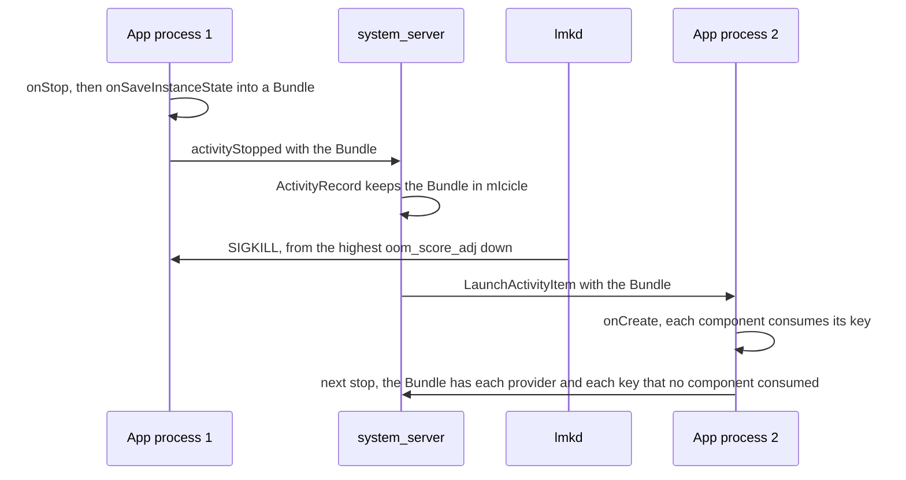

import Snippet from '../../../components/Snippet.astro';
import GoDeeper from '../../../components/GoDeeper.astro';

## The problem

An app does not control the lifetime of its process. The system decides it from the components that run in the process, from their importance to the user and from the free memory. The system puts each process in an importance hierarchy: foreground, visible, service and cached. A cached process is not necessary now, so the system can kill it when it needs memory[^process-lifecycle]. A stopped activity is in a background process, and the chance that the system kills that process is higher than for a visible activity[^activity-lifecycle-state].

A cached process often holds activities whose `onStop` returned. If these activities save their state, the system can kill the process, and the user sees no effect. When the user goes back to an activity, the activity restores its saved state in a new process. When the system kills the process, it does not guarantee a call to `onDestroy`[^process-lifecycle].

A user expects the same screen after a switch to a different app and back. But the system can kill the process while the user is away. Then the screen comes back in a clean state[^saving-states-system]. A `ViewModel` does not survive when the system kills the process. Saved state survives it[^saving-states-options]. Android keeps a serialized copy of the saved state outside the app process. The saved state APIs save only when the activity stops[^saving-states-saved].

In AndroidX, components connect to saved state through a `SavedStateRegistry`. Each component registers a `SavedStateProvider` under a key. At the save, the registry calls `saveState()` of each provider. Later, the component gets its old state back from `consumeRestoredStateForKey` with its key[^saving-states-registry].

This chapter builds such a registry, a fake `system_server` and an app process that a test can kill. A breaking test shows that the registry loses state after two process deaths. Then the chapter follows the real save path: from `onStop` in the app, to the record of the activity in `system_server`, and back into a new process.

## Build it naive

The rebuild is in the module `samples/process-death`. It has no `android.*` classes, no threads and no clock. A `Map` stands for a `Bundle`, and a `fun interface` stands for `SavedStateProvider`:

<Snippet file="process-death/src/main/kotlin/NaiveSavedStateRegistry.kt" region="state" />

On Android, the `SavedState` type of AndroidX is `android.os.Bundle`[^savedstate-android-26].

`NaiveSavedStateRegistry` keeps one provider for each key. It rejects a second provider for the same key, as the real registry does[^savedstateregistryimpl-66]. `performRestore` keeps the state of the last save. `consumeRestoredStateForKey` returns the state of a key and removes the key, so a component gets its state only one time. The real registry also removes the key[^savedstateregistryimpl-48]. `performSave` calls each provider and returns the results by key:

<Snippet file="process-death/src/main/kotlin/NaiveSavedStateRegistry.kt" region="registry" />

`Counter` is a component with one number. It consumes the restored state of its key and takes its count from that state. Then it registers a provider that saves the count:

<Snippet file="process-death/src/main/kotlin/NaiveSavedStateRegistry.kt" region="counter" />

The first test registers two counters and saves the registry. The result has the state of each counter under its key:

<Snippet file="process-death/src/test/kotlin/NaiveSavedStateRegistryTest.kt" region="save" />

`FakeSystemServer` stands for `system_server`. It keeps one saved map for each activity record, outside the app process. Each stop replaces the map of the record. The real `ActivityRecord.activityStopped` also replaces the saved state of the record with the new `Bundle`[^activityrecord-6513][^activityrecord-1347]:

<Snippet file="process-death/src/main/kotlin/FakeProcess.kt" region="server" />

`FakeProcess` stands for an app process with one activity. Its constructor makes a registry and restores it from the server. `stopActivity` saves the registry into the server. `kill` drops the registry and calls nothing in the app. Thus the app must save its state when the activity stops, not when the process dies:

<Snippet file="process-death/src/main/kotlin/FakeProcess.kt" region="process" />

A test gives two counters the counts 1 and 2. It stops the activity and kills the process. Then a new process creates the two counters again:

<Snippet file="process-death/src/test/kotlin/ProcessDeathTest.kt" region="restore" />

The test passes. After one process death, each counter gets its count back. This test is not a breaking test.

## Where it breaks

An app does not always create each component again after a process death. For example, an app can create a screen or a `ViewModel` only when the user opens it. Such a component does not consume its restored state. The breaking test has three processes:

<Snippet file="process-death/src/test/kotlin/ProcessDeathTest.kt" region="breaking" />

1. Process 1 creates the counters A and B with the counts 1 and 2. The activity stops, so the server gets the state of A and B. Then the test kills the process.
2. Process 2 restores the registry and creates only A. The restored state of B stays in the registry, because no component consumes it. The activity stops again. `performSave` writes only the providers that the registry holds, so the server gets only the state of A. Then the test kills the process again.
3. Process 3 creates B. The registry has no state for B, so `restored` is null.

The test passes, so the flaw occurs. B lost its count after the second process death, but process 2 did not change B. The tests use no threads and no clock, so they give the same result on each run.

## The real thing

### The app saves at the stop

When an activity stops, `ActivityThread.callActivityOnStop` calls `onStop`, and then `onSaveInstanceState`[^activitythread-6366]. If the app targets a release below Android 9 (API level 28), `onSaveInstanceState` comes before `onStop`[^activitythread-851]. `onSaveInstanceState` writes into a new `Bundle`[^activitythread-6982]. `callActivityOnStop` does not save the state of an activity that finishes[^activitythread-6366]. The doc of `onSaveInstanceState` gives an example. If the user goes back from activity B to activity A, B gets `onPause` and `onStop`, but not `onSaveInstanceState`, because the system does not restore that instance of B[^activity-2580].

The default `Activity.onSaveInstanceState` saves the state of each view in the hierarchy that has an id. It also saves the state of the fragments and the autofill state[^activity-2592][^activity-2613].

`handleStopActivity` puts the `Bundle` into a `StopInfo`[^activitythread-6416]. `reportStop` posts the `StopInfo` to the main thread[^activitythread-6451]. When the `StopInfo` runs, it sends the `Bundle` to `system_server` with the Binder call `activityStopped`[^pendingtransactionactions-136]. Thus the saved state leaves the app process at each stop. If the process dies later, `system_server` already has the state.

### system_server keeps the Bundle

In `system_server`, `ActivityClientController.activityStopped` finds the `ActivityRecord` of the activity and calls its `activityStopped`[^activityclientcontroller-255]. If the `Bundle` is not null, `ActivityRecord.activityStopped` calls `setSavedState`[^activityrecord-6513]. The field `mIcicle` holds the "last saved activity state". `setSavedState` puts the `Bundle` into `mIcicle`, and sets `mHaveState` to true if the `Bundle` is not null[^activityrecord-496][^activityrecord-1347]. Each stop replaces the `Bundle`, as in `FakeSystemServer`.

The saved state goes to `system_server` in a Binder call, so its size has a limit. If the call fails, and the cause is a `TransactionTooLargeException`, `StopInfo` adds statistics about the `Bundle` to the message. If the app targets Android 7.0 (API level 24) or higher, `StopInfo` throws a `RuntimeException`. Otherwise, it only logs that the system ignored the state[^pendingtransactionactions-147]. The system process keeps the saved state while the user can go back to the activity, also after the system kills the process of the activity. Keep the saved state below 50 KB[^parcelables-sdbp].

<GoDeeper title="the Binder buffer of the receiver">

Each process maps one buffer to receive Binder transactions. Its size is `BINDER_VM_SIZE`, 1 MB minus two pages[^processstate-48][^processstate-624]. The receiver of a call holds the data of the call in its buffer. At the save, the receiver is `system_server`. At the relaunch, the receiver is the new app process. Before the relaunch, `tryRealStartActivityInner` logs "Transaction too large" if the extras of the intent and the saved state together are more than 200,000 bytes[^activitytasksupervisor-1033][^activitytasksupervisor-1156].

</GoDeeper>

### system_server ranks each process

Each app process has an oom adj value. A low value means that the process is important. `Constants.java` defines these values:

- 0: the foreground app[^constants-160].
- 100: a process with activities that the user can see. If two flags are on, the range is 100 to 199[^constants-141].
- 500: a process with an app service[^constants-114].
- 700: the previous app, the app that the user was in before the current app. If a flag is on, the range is 700 to 799[^constants-92].
- 900 to 999: a cached process. It holds only activities that the user cannot see, so the system can kill it "without any disruption"[^constants-74].

`OomAdjuster` computes the process state and the oom adj of each process[^oomadjuster-187]. A process stays at the previous-app value for a maximum time. Then it moves to the cached range[^oomadjuster-661]. If the oom adj of a process changes, and `OomAdjuster` does not batch the change, it gives the new value to `ProcessList.setOomAdj`[^oomadjuster-2316][^oomadjuster-595]. `setOomAdj` sends the PID, the UID and the oom adj to `lmkd` in the command `LMK_PROCPRIO`[^processlist-1519].

`dumpsys activity lru` prints one line for each process. The line has a label for the oom adj[^processlist-4559]. Some labels are `fg` from 0, `vis` from 100, `svc` from 500, `prev` from 700 and `cch` from 900[^processlist-1143]. If the oom adj is above the start of its range, the label also shows the difference[^processlist-1120]. Prompt 2 of "Try it" reads these labels.

Since Android 14, shortly after an app process goes into the cached state, the system does not allow background work in the process, until a component of the process becomes active again[^android-14-cached].

### lmkd kills from the top

For `LMK_PROCPRIO`, `lmkd` writes the oom adj to `/proc/<pid>/oom_score_adj`[^lmkd-1558][^lmkd-1298][^lmkd-1276]. Under memory pressure, `lmkd` looks for a process to kill from the highest `oom_score_adj` down[^lmkd-2598]. Thus cached processes die first, and the foreground app dies last.

<GoDeeper title="how lmkd kills a process">

`lmkd` first tries a cgroup kill: it writes `1` to the kill file of the cgroup of the process. On 5.10 kernels, it reads the PIDs of the cgroup and sends `SIGKILL` to each PID. If the process has no cgroup file, or if the cgroup kill fails, `lmkd` sends `SIGKILL` to the process with `pidfd_send_signal`[^reaper-115].

</GoDeeper>

`OomAdjuster` can also kill processes when memory is not low. If the number of cached processes is more than a limit, it kills a cached process with the reason "too many cached"[^oomadjuster-1430]. If the number of empty processes is more than a limit, it kills an empty process with the reason "too many empty". If the number of empty processes is more than a trim limit, it kills an empty process whose last activity is older than a time limit, with the reason "empty for too long". For each of these kills, `ApplicationExitInfo` gives the reason `REASON_OTHER`[^oomadjuster-1440].

Since Android 17, the system sets memory limits for apps from the total RAM of the device. If a limit affects an app process, the process exits. `ApplicationExitInfo` gives the reason `REASON_OTHER`, and its description contains `MemoryLimiter:AnonSwap`[^android-17-memory]. Thus a process has one more cause of death.

`adb shell am kill <package>` calls `killBackgroundProcesses`. Its help text says that it kills all background processes of the app[^activitymanagershellcommand-2186][^activitymanagershellcommand-5187]. `killBackgroundProcesses` asks `ProcessList` to kill the processes of the package whose oom adj is `SERVICE_ADJ` (500) or higher[^activitymanagerservice-4346]. `ProcessList` skips each process with a lower oom adj[^processlist-3220]. Thus `am kill` does not kill a foreground app. If the caller does not hold `KILL_ALL_BACKGROUND_PROCESSES`, it can kill only the processes of its own app[^activitymanagerservice-4322]. The shell holds this permission[^shell-manifest-176]. Prompt 2 of "Try it" uses `am kill` to kill the launch app in the background.

Since Android 14, `killBackgroundProcesses()` can kill only the background processes of the app that calls it[^android-14-kill]. The shell holds `KILL_ALL_BACKGROUND_PROCESSES`, so `am kill` can still kill the process of a different app.

### The record outlives the process

When the app process dies, `system_server` calls `ActivityRecord.handleAppDied` for each activity of the process[^windowprocesscontroller-1743]. It removes the record if the activity finishes, or if the record has no saved state. Apart from some special cases, it keeps each other record: "The process may be gone, but the activity lives on!"[^activityrecord-4350]. The record keeps its `Bundle` in `mIcicle`. `dumpsys activity activities` prints `mHaveState` and `mIcicle` for each record[^activityrecord-1094]. Prompt 3 of "Try it" reads them while no process of the app exists.

When the user goes back to the activity, `startSpecificActivity` looks for the process of the activity. If the process runs, it starts the activity in that process. If not, it asks for a new process[^activitytasksupervisor-1171]. `realStartActivityLocked` calls `tryRealStartActivityInner`[^activitytasksupervisor-927], which puts the saved `Bundle` of the record into the `LaunchActivityItem`[^activitytasksupervisor-1050]. The [components chapter](/launch-path/components-lifecycle/) shows how the app runs this item. `performLaunchActivity` gives the `Bundle` to `onCreate`[^activitythread-4556]. If the `Bundle` is not null, `handleStartActivity` also gives it to `onRestoreInstanceState`, after `onStart`[^activitythread-4609].

When the activity resumes, the app calls `activityResumed` on `system_server`, which calls `activityResumedLocked`[^activityclientcontroller-211]. `activityResumedLocked` drops the saved state of the record with `setSavedState(null)`[^activityrecord-6260]. The next stop sends a new `Bundle`.

### Each record keeps its own state

The platform keeps the state of each activity until that activity resumes. This is the platform version of the fix for the flaw of the rebuild. A task can hold more than one activity. Each activity has its own `ActivityRecord` with its own `mIcicle`. A stop replaces it[^activityrecord-6513], and a resume drops it[^activityrecord-6260]. For example, the user opens B on top of A and then leaves the app. The process dies. The user comes back, and only B starts in the new process. The record of A keeps its `Bundle`, because A did not resume. If the process dies again, `handleAppDied` keeps the record of A, because it has saved state[^activityrecord-4350]. The naive registry has no such rule: each save replaces the state of each key, also the state of a component that did not run.

<GoDeeper title="one activity dies, and its process lives">

After each garbage collection, `ActivityThread` checks the Java heap. If some activities changed since the last check, and the heap uses more than 3/4 of its maximum, the app calls `releaseSomeActivities` on `system_server`[^activitythread-9292]. `WindowProcessController.releaseSomeActivities` destroys each activity of the process that is stopped, is not visible and has saved state[^windowprocesscontroller-1157]. The activity does not finish, so `destroyImmediately` keeps its record in the task, with the saved state[^activityrecord-4031]. The process does not die, so static fields keep their values. `ComponentActivity` clears its `ViewModelStore` on each destroy that is not a configuration change[^componentactivity-281]. Thus the `ViewModel`s of that activity are gone too. When the user goes back, the system creates a new instance of the activity from its instance state, a set of key-value pairs[^activity-lifecycle-instance].

</GoDeeper>

### What clears the saved state

Some user actions clear the saved state: a swipe from Recents, a force stop, a reboot or a call to `finish()`[^saving-states-user]. The saved state stays only as long as its task stack[^viewmodel-savedstate]. In `system_server`, `removeTask` removes each activity of the task[^activitytasksupervisor-1895]. The saved state goes with each record.

By default, Back on the root activity of a task moves the task to the background only if the home process started that activity with a main intent. Otherwise, the activity finishes[^activityclientcontroller-1960][^activityclientcontroller-2021]. The [components chapter](/launch-path/components-lifecycle/) gives the details. An activity that finishes saves no state[^activitythread-6366], and `handleAppDied` removes its record[^activityrecord-4350].

Since Android 12, Back on a root launcher activity moves the task to the background and does not finish the activity[^android-12-back]. Thus the activity keeps its saved state, as after Home, and gets it back after a later process death.

### Jetpack puts many keys into one Bundle

`androidx.activity.ComponentActivity` connects the platform `Bundle` to the `SavedStateRegistry`. Its constructor attaches the registry and turns on the `SavedStateHandle` support[^componentactivity-301]. `onCreate` restores the registry from `savedInstanceState`[^componentactivity-338]. `onSaveInstanceState` makes the registry save into `outState`[^componentactivity-353]. The `SavedState` type of AndroidX is `android.os.Bundle`[^savedstate-android-26]. Thus the registry writes into the same `Bundle` that the platform sends to `system_server`.

`SavedStateRegistryImpl` keeps a map of keys to providers. `registerSavedStateProvider` rejects a second provider for a key[^savedstateregistryimpl-66]. `performRestore` reads the state of all components from one key of the `Bundle`[^savedstateregistryimpl-106]. `consumeRestoredStateForKey` returns the state of a key and removes the key[^savedstateregistryimpl-48].

`performSave` has the fix for the flaw of the rebuild. Its KDoc says that it calls all registered providers "and merge with unconsumed state". First, it puts the restored state that no component consumed into the output. Then it puts the state of each provider, which replaces the old state of the same key[^savedstateregistryimpl-124]. With this rule, process 2 of the breaking test saves the state of A and B, and B gets its count back in process 3.

`SavedStateHandle` has the same fix, one layer up. All `SavedStateHandle`s of one owner save through one provider[^savedstatehandlesupport-58]. A new `ViewModel` gets its handle from the restored state of its key[^savedstatehandlesupport-67]. The `saveState` of the provider first puts the restored state. Thus the state of a `ViewModel` that the app did not create again after a process death stays. Then it puts the state of each handle[^savedstatehandlesupport-151]. The values of a `SavedStateHandle` persist after the system kills the process[^viewmodel-savedstate].

<GoDeeper title="rememberSaveable and the registry">

`rememberSaveable` values go into the same `SavedStateRegistry`. Each `ComposeView` registers one provider under the key `SaveableStateRegistry:<id>`. The id is the view id of the `ComposeView`, unless an internal tag gives a different id[^disposablesaveablestateregistry-43][^disposablesaveablestateregistry-69]. The registry checks each value with `canBeSavedToBundle`. Only a value that a `Bundle` can hold passes the check[^disposablesaveablestateregistry-115]. If two `ComposeView`s have the same id, they have the same key. Then only the first one restores its state[^disposablesaveablestateregistry-43].

</GoDeeper>

## Mental model

An app does not decide when its process dies. `system_server` gives each process an oom adj, and `lmkd` kills from the highest oom adj down. The system does not guarantee a call to `onDestroy` before the kill. Thus the app saves when the activity stops: `onSaveInstanceState` writes a `Bundle`, and a Binder call sends it to `system_server`. The `ActivityRecord` keeps the `Bundle` in `mIcicle` after the process dies, until the activity resumes. When the user goes back, `system_server` starts a new process and sends the `Bundle` in the `LaunchActivityItem`. `onCreate` gets the `Bundle`, and the `SavedStateRegistry` gives each component its state by key, one time. A component that the app does not create again does not consume its key. The next save must keep that key. The naive registry drops it, so a second process death loses the state. `SavedStateRegistryImpl` and `SavedStateHandlesProvider` merge the keys that no component consumed into each save.



## Try it

### 1. Keep the state that no component consumed

Change `performSave` in `NaiveSavedStateRegistry`. Start from the restored state that no component consumed, and then add the state of each provider. The state of a provider replaces the old state of its key, as in `SavedStateRegistryImpl.performSave`[^savedstateregistryimpl-124]. From the repo root, run the tests of the rebuild:

```sh
samples/gradlew -p samples :process-death:test
```

The breaking test fails, because B now gets its count back in process 3. The other tests pass. The Gradle output includes these lines:

```
ProcessDeathTest > naiveRegistry_losesUnconsumedState_afterSecondProcessDeath() FAILED
    org.opentest4j.AssertionFailedError at ProcessDeathTest.kt:41

9 tests completed, 1 failed
```

### 2. Kill the launch app in the background

Start an emulator with the system image of the checked stamp. From the repo root, install the release build of the `processDeath` flavor of the launch app:

```sh
samples/gradlew -p samples :launch-app:installProcessDeathRelease
```

The flavor has the app name "Process death" and one activity, `ProcessDeathActivity`. The activity writes each step to the log with the tag `ProcessDeath`. `onSaveInstanceState` puts the PID of the process into the `Bundle` and into a static field. `onCreate` logs three values: the PID of the process, the PID in `savedInstanceState` and the PID in the static field.

Stop the app, clear the log and start the activity with its launcher intent:

```sh
adb shell am force-stop io.github.imgurpreetsk.afp.launchapp.processDeath
adb logcat -c
adb shell am start -W -a android.intent.action.MAIN -c android.intent.category.LAUNCHER -n io.github.imgurpreetsk.afp.launchapp.processDeath/io.github.imgurpreetsk.afp.launchapp.ProcessDeathActivity
```

Print the LRU line of the process:

```sh
adb shell dumpsys activity -p io.github.imgurpreetsk.afp.launchapp.processDeath lru
```

{/* Edit step: capture this output on the emulator of the checked stamp. */}

```
ACTIVITY MANAGER LRU PROCESSES (dumpsys activity lru)
  Activities:
  #…: fg       … … …:io.github.imgurpreetsk.afp.launchapp.processDeath/… act:…
```

The option `-p` limits the list to the processes of the package[^activitymanagerservice-11430][^processlist-4608]. The label `fg` shows the oom adj 0 of the foreground app[^processlist-1143][^constants-160]. After the label come the process state, a summary of the capabilities and the process[^processlist-4559].

Try to kill the process while the app is in the foreground:

```sh
adb shell am kill io.github.imgurpreetsk.afp.launchapp.processDeath
adb shell pidof io.github.imgurpreetsk.afp.launchapp.processDeath
```

{/* Edit step: capture this output on the emulator of the checked stamp. */}

```
…
```

`pidof` prints the PID of the process, so the process is alive. `am kill` skips each process with an oom adj below 500[^activitymanagerservice-4346][^processlist-3220]. Write down the PID.

Press Home. Print the LRU line again, kill the process, and read the log of the activity:

```sh
adb shell input keyevent KEYCODE_HOME
adb shell dumpsys activity -p io.github.imgurpreetsk.afp.launchapp.processDeath lru
adb shell am kill io.github.imgurpreetsk.afp.launchapp.processDeath
adb shell pidof io.github.imgurpreetsk.afp.launchapp.processDeath
adb logcat -d -s ProcessDeath
```

{/* Edit step: capture this output on the emulator of the checked stamp. */}

```
ACTIVITY MANAGER LRU PROCESSES (dumpsys activity lru)
  Activities:
  #…: prev     … … …:io.github.imgurpreetsk.afp.launchapp.processDeath/… act:…
… I ProcessDeath: onCreate pid=… savedPid=none staticPid=0
… I ProcessDeath: onStop
… I ProcessDeath: onSaveInstanceState pid=…
```

Each log line starts with the date, the time, the PID and the thread ID. The block shows them as `…`.

- After Home, the label is `prev`. The app is the previous app, with the oom adj 700[^constants-92]. If the oom adj is above 700, the label also shows the difference[^processlist-1120]. After a maximum time, the process moves to the cached range, and the label is `cch`[^oomadjuster-661][^processlist-1143].
- `pidof` prints nothing, so `am kill` killed the process. Its oom adj was 500 or higher[^activitymanagerservice-4346].
- The log has `onStop` and then `onSaveInstanceState`, because the app targets API level 37[^activitythread-6366][^activitythread-851]. The save came at the Home press, before the kill. The log has no `onDestroy` line.

### 3. Find the Bundle in system_server

Do this prompt after prompt 2, while no process of the app exists. Print the saved state of the record of the activity:

```sh
adb shell "dumpsys activity -p io.github.imgurpreetsk.afp.launchapp.processDeath activities | grep mHaveState"
```

{/* Edit step: capture this output on the emulator of the checked stamp. */}

```
mHaveState=true mIcicle=Bundle[…]
```

`ActivityRecord` prints `mHaveState` and `mIcicle`, and the dump skips the records of other packages[^activityrecord-1094][^activityrecord-1217]. No process of the app exists, but `system_server` keeps the record and its `Bundle`, because the record has saved state[^activityrecord-4350].

Start the activity again, read the log, and print the saved state of the record again:

```sh
adb logcat -c
adb shell am start -W -a android.intent.action.MAIN -c android.intent.category.LAUNCHER -n io.github.imgurpreetsk.afp.launchapp.processDeath/io.github.imgurpreetsk.afp.launchapp.ProcessDeathActivity
adb shell "logcat -d -s ActivityManager:I ProcessDeath:I | grep -i processdeath"
adb shell "dumpsys activity -p io.github.imgurpreetsk.afp.launchapp.processDeath activities | grep mHaveState"
```

{/* Edit step: capture this output on the emulator of the checked stamp. */}

```
… I ActivityManager: Start proc …:io.github.imgurpreetsk.afp.launchapp.processDeath/… for …
… I ProcessDeath: onCreate pid=… savedPid=… staticPid=0
mHaveState=false mIcicle=null
```

- `Start proc` shows that `system_server` started a new process. The line has the PID and the name of the new process[^processlist-2994]. No process of the activity existed, so `startSpecificActivity` asked for one[^activitytasksupervisor-1171].
- `savedPid` is the PID that `pidof` printed in prompt 2. The `Bundle` came from the old process, through `system_server`, in the `LaunchActivityItem`[^activitytasksupervisor-1050][^activitythread-4556]. `pid` is the PID of the new process.
- `staticPid` is 0. The old process set the static field, but the new process starts with the default value. The `Bundle` survived the process death, and the memory of the old process did not.
- After the resume, the record has no saved state, because `activityResumedLocked` dropped it[^activityrecord-6260].

Then do prompt 2 and this prompt again, with Back in place of Home. By default, Back moves the task to the background only if the home process started the activity[^activityclientcontroller-2021]. Thus start the activity from its icon:

1. Run `adb shell am force-stop io.github.imgurpreetsk.afp.launchapp.processDeath` and `adb logcat -c`.
2. In the emulator, tap the icon "Process death" on the home screen.
3. Run `adb shell input keyevent KEYCODE_BACK`.
4. Run the `am kill`, `pidof` and `logcat` commands of prompt 2. Then run the first command of this prompt.

The result is the same as with Home. The log has `onStop` and `onSaveInstanceState`, and the record has `mHaveState=true`. Back moved the root launcher activity and its task to the background[^android-12-back].

Do the four steps again, but in step 2, run the `am start` command of prompt 2. The shell started the activity, not the home screen, so Back finishes the activity[^activityclientcontroller-1960]. The log has these lines:

{/* Edit step: capture this output on the emulator of the checked stamp. */}

```
… I ProcessDeath: onCreate pid=… savedPid=none staticPid=0
… I ProcessDeath: onStop
… I ProcessDeath: onDestroy
```

The log has no `onSaveInstanceState` line, because an activity that finishes saves no state[^activitythread-6366]. The `grep mHaveState` command prints nothing, because the record is gone.

[^process-lifecycle]: Processes and app lifecycle: [https://developer.android.com/guide/components/activities/process-lifecycle](https://developer.android.com/guide/components/activities/process-lifecycle)
[^activity-lifecycle-state]: The activity lifecycle, "Activity state and ejection from memory": [https://developer.android.com/guide/components/activities/activity-lifecycle#activity-state](https://developer.android.com/guide/components/activities/activity-lifecycle#activity-state)
[^saving-states-system]: Save UI states, "System-initiated UI state dismissal": [https://developer.android.com/topic/libraries/architecture/saving-states#ui-dismissal-system](https://developer.android.com/topic/libraries/architecture/saving-states#ui-dismissal-system)
[^saving-states-options]: Save UI states, "Options for preserving UI state": [https://developer.android.com/topic/libraries/architecture/saving-states#options](https://developer.android.com/topic/libraries/architecture/saving-states#options)
[^saving-states-saved]: Save UI states, "Use saved state as backup to handle system-initiated process death": [https://developer.android.com/topic/libraries/architecture/saving-states#onsaveinstancestate](https://developer.android.com/topic/libraries/architecture/saving-states#onsaveinstancestate)
[^saving-states-registry]: Save UI states, "Hook into saved state using SavedStateRegistry": [https://developer.android.com/topic/libraries/architecture/saving-states#savedstateregistry](https://developer.android.com/topic/libraries/architecture/saving-states#savedstateregistry)
[^savedstate-android-26]: SavedState.android.kt, line 26: [https://android.googlesource.com/platform/frameworks/support/+/696d8ec0adf47d3d677cb0f42a5974f1f97fb411/savedstate/savedstate/src/androidMain/kotlin/androidx/savedstate/SavedState.android.kt#26](https://android.googlesource.com/platform/frameworks/support/+/696d8ec0adf47d3d677cb0f42a5974f1f97fb411/savedstate/savedstate/src/androidMain/kotlin/androidx/savedstate/SavedState.android.kt#26)
[^savedstateregistryimpl-66]: SavedStateRegistryImpl.kt, lines 66–73: [https://android.googlesource.com/platform/frameworks/support/+/696d8ec0adf47d3d677cb0f42a5974f1f97fb411/savedstate/savedstate/src/commonMain/kotlin/androidx/savedstate/internal/SavedStateRegistryImpl.kt#66](https://android.googlesource.com/platform/frameworks/support/+/696d8ec0adf47d3d677cb0f42a5974f1f97fb411/savedstate/savedstate/src/commonMain/kotlin/androidx/savedstate/internal/SavedStateRegistryImpl.kt#66)
[^savedstateregistryimpl-48]: SavedStateRegistryImpl.kt, lines 48–63: [https://android.googlesource.com/platform/frameworks/support/+/696d8ec0adf47d3d677cb0f42a5974f1f97fb411/savedstate/savedstate/src/commonMain/kotlin/androidx/savedstate/internal/SavedStateRegistryImpl.kt#48](https://android.googlesource.com/platform/frameworks/support/+/696d8ec0adf47d3d677cb0f42a5974f1f97fb411/savedstate/savedstate/src/commonMain/kotlin/androidx/savedstate/internal/SavedStateRegistryImpl.kt#48)
[^activityrecord-6513]: ActivityRecord.java, lines 6513–6519: [https://android.googlesource.com/platform/frameworks/base/+/refs/tags/android-17.0.0_r1/services/core/java/com/android/server/wm/ActivityRecord.java#6513](https://android.googlesource.com/platform/frameworks/base/+/refs/tags/android-17.0.0_r1/services/core/java/com/android/server/wm/ActivityRecord.java#6513)
[^activityrecord-1347]: ActivityRecord.java, lines 1347–1350: [https://android.googlesource.com/platform/frameworks/base/+/refs/tags/android-17.0.0_r1/services/core/java/com/android/server/wm/ActivityRecord.java#1347](https://android.googlesource.com/platform/frameworks/base/+/refs/tags/android-17.0.0_r1/services/core/java/com/android/server/wm/ActivityRecord.java#1347)
[^activitythread-6366]: ActivityThread.java, lines 6366–6392: [https://android.googlesource.com/platform/frameworks/base/+/refs/tags/android-17.0.0_r1/core/java/android/app/ActivityThread.java#6366](https://android.googlesource.com/platform/frameworks/base/+/refs/tags/android-17.0.0_r1/core/java/android/app/ActivityThread.java#6366)
[^activitythread-851]: ActivityThread.java, lines 851–854: [https://android.googlesource.com/platform/frameworks/base/+/refs/tags/android-17.0.0_r1/core/java/android/app/ActivityThread.java#851](https://android.googlesource.com/platform/frameworks/base/+/refs/tags/android-17.0.0_r1/core/java/android/app/ActivityThread.java#851)
[^activitythread-6982]: ActivityThread.java, lines 6982–6998: [https://android.googlesource.com/platform/frameworks/base/+/refs/tags/android-17.0.0_r1/core/java/android/app/ActivityThread.java#6982](https://android.googlesource.com/platform/frameworks/base/+/refs/tags/android-17.0.0_r1/core/java/android/app/ActivityThread.java#6982)
[^activity-2580]: Activity.java, lines 2580–2590: [https://android.googlesource.com/platform/frameworks/base/+/refs/tags/android-17.0.0_r1/core/java/android/app/Activity.java#2580](https://android.googlesource.com/platform/frameworks/base/+/refs/tags/android-17.0.0_r1/core/java/android/app/Activity.java#2580)
[^activity-2592]: Activity.java, lines 2592–2596: [https://android.googlesource.com/platform/frameworks/base/+/refs/tags/android-17.0.0_r1/core/java/android/app/Activity.java#2592](https://android.googlesource.com/platform/frameworks/base/+/refs/tags/android-17.0.0_r1/core/java/android/app/Activity.java#2592)
[^activity-2613]: Activity.java, lines 2613–2622: [https://android.googlesource.com/platform/frameworks/base/+/refs/tags/android-17.0.0_r1/core/java/android/app/Activity.java#2613](https://android.googlesource.com/platform/frameworks/base/+/refs/tags/android-17.0.0_r1/core/java/android/app/Activity.java#2613)
[^activitythread-6416]: ActivityThread.java, lines 6416–6442: [https://android.googlesource.com/platform/frameworks/base/+/refs/tags/android-17.0.0_r1/core/java/android/app/ActivityThread.java#6416](https://android.googlesource.com/platform/frameworks/base/+/refs/tags/android-17.0.0_r1/core/java/android/app/ActivityThread.java#6416)
[^activitythread-6451]: ActivityThread.java, lines 6451–6453: [https://android.googlesource.com/platform/frameworks/base/+/refs/tags/android-17.0.0_r1/core/java/android/app/ActivityThread.java#6451](https://android.googlesource.com/platform/frameworks/base/+/refs/tags/android-17.0.0_r1/core/java/android/app/ActivityThread.java#6451)
[^pendingtransactionactions-136]: PendingTransactionActions.java, lines 136–146: [https://android.googlesource.com/platform/frameworks/base/+/refs/tags/android-17.0.0_r1/core/java/android/app/servertransaction/PendingTransactionActions.java#136](https://android.googlesource.com/platform/frameworks/base/+/refs/tags/android-17.0.0_r1/core/java/android/app/servertransaction/PendingTransactionActions.java#136)
[^activityclientcontroller-255]: ActivityClientController.java, lines 255–289: [https://android.googlesource.com/platform/frameworks/base/+/refs/tags/android-17.0.0_r1/services/core/java/com/android/server/wm/ActivityClientController.java#255](https://android.googlesource.com/platform/frameworks/base/+/refs/tags/android-17.0.0_r1/services/core/java/com/android/server/wm/ActivityClientController.java#255)
[^activityrecord-496]: ActivityRecord.java, line 496: [https://android.googlesource.com/platform/frameworks/base/+/refs/tags/android-17.0.0_r1/services/core/java/com/android/server/wm/ActivityRecord.java#496](https://android.googlesource.com/platform/frameworks/base/+/refs/tags/android-17.0.0_r1/services/core/java/com/android/server/wm/ActivityRecord.java#496)
[^pendingtransactionactions-147]: PendingTransactionActions.java, lines 147–166: [https://android.googlesource.com/platform/frameworks/base/+/refs/tags/android-17.0.0_r1/core/java/android/app/servertransaction/PendingTransactionActions.java#147](https://android.googlesource.com/platform/frameworks/base/+/refs/tags/android-17.0.0_r1/core/java/android/app/servertransaction/PendingTransactionActions.java#147)
[^parcelables-sdbp]: Parcelables and bundles, "Sending data between processes": [https://developer.android.com/guide/components/activities/parcelables-and-bundles#sdbp](https://developer.android.com/guide/components/activities/parcelables-and-bundles#sdbp)
[^processstate-48]: ProcessState.cpp, line 48: [https://android.googlesource.com/platform/frameworks/native/+/refs/tags/android-17.0.0_r1/libs/binder/ProcessState.cpp#48](https://android.googlesource.com/platform/frameworks/native/+/refs/tags/android-17.0.0_r1/libs/binder/ProcessState.cpp#48)
[^processstate-624]: ProcessState.cpp, lines 624–626: [https://android.googlesource.com/platform/frameworks/native/+/refs/tags/android-17.0.0_r1/libs/binder/ProcessState.cpp#624](https://android.googlesource.com/platform/frameworks/native/+/refs/tags/android-17.0.0_r1/libs/binder/ProcessState.cpp#624)
[^activitytasksupervisor-1033]: ActivityTaskSupervisor.java, line 1033: [https://android.googlesource.com/platform/frameworks/base/+/refs/tags/android-17.0.0_r1/services/core/java/com/android/server/wm/ActivityTaskSupervisor.java#1033](https://android.googlesource.com/platform/frameworks/base/+/refs/tags/android-17.0.0_r1/services/core/java/com/android/server/wm/ActivityTaskSupervisor.java#1033)
[^activitytasksupervisor-1156]: ActivityTaskSupervisor.java, lines 1156–1169: [https://android.googlesource.com/platform/frameworks/base/+/refs/tags/android-17.0.0_r1/services/core/java/com/android/server/wm/ActivityTaskSupervisor.java#1156](https://android.googlesource.com/platform/frameworks/base/+/refs/tags/android-17.0.0_r1/services/core/java/com/android/server/wm/ActivityTaskSupervisor.java#1156)
[^constants-160]: Constants.java, lines 160–162: [https://android.googlesource.com/platform/frameworks/base/+/refs/tags/android-17.0.0_r1/services/core/java/com/android/server/am/psc/Constants.java#160](https://android.googlesource.com/platform/frameworks/base/+/refs/tags/android-17.0.0_r1/services/core/java/com/android/server/am/psc/Constants.java#160)
[^constants-141]: Constants.java, lines 141–151: [https://android.googlesource.com/platform/frameworks/base/+/refs/tags/android-17.0.0_r1/services/core/java/com/android/server/am/psc/Constants.java#141](https://android.googlesource.com/platform/frameworks/base/+/refs/tags/android-17.0.0_r1/services/core/java/com/android/server/am/psc/Constants.java#141)
[^constants-114]: Constants.java, lines 114–116: [https://android.googlesource.com/platform/frameworks/base/+/refs/tags/android-17.0.0_r1/services/core/java/com/android/server/am/psc/Constants.java#114](https://android.googlesource.com/platform/frameworks/base/+/refs/tags/android-17.0.0_r1/services/core/java/com/android/server/am/psc/Constants.java#114)
[^constants-92]: Constants.java, lines 92–107: [https://android.googlesource.com/platform/frameworks/base/+/refs/tags/android-17.0.0_r1/services/core/java/com/android/server/am/psc/Constants.java#92](https://android.googlesource.com/platform/frameworks/base/+/refs/tags/android-17.0.0_r1/services/core/java/com/android/server/am/psc/Constants.java#92)
[^constants-74]: Constants.java, lines 74–77: [https://android.googlesource.com/platform/frameworks/base/+/refs/tags/android-17.0.0_r1/services/core/java/com/android/server/am/psc/Constants.java#74](https://android.googlesource.com/platform/frameworks/base/+/refs/tags/android-17.0.0_r1/services/core/java/com/android/server/am/psc/Constants.java#74)
[^oomadjuster-187]: OomAdjuster.java, line 187: [https://android.googlesource.com/platform/frameworks/base/+/refs/tags/android-17.0.0_r1/services/core/java/com/android/server/am/psc/OomAdjuster.java#187](https://android.googlesource.com/platform/frameworks/base/+/refs/tags/android-17.0.0_r1/services/core/java/com/android/server/am/psc/OomAdjuster.java#187)
[^oomadjuster-661]: OomAdjuster.java, lines 661–665: [https://android.googlesource.com/platform/frameworks/base/+/refs/tags/android-17.0.0_r1/services/core/java/com/android/server/am/psc/OomAdjuster.java#661](https://android.googlesource.com/platform/frameworks/base/+/refs/tags/android-17.0.0_r1/services/core/java/com/android/server/am/psc/OomAdjuster.java#661)
[^oomadjuster-2316]: OomAdjuster.java, lines 2316–2326: [https://android.googlesource.com/platform/frameworks/base/+/refs/tags/android-17.0.0_r1/services/core/java/com/android/server/am/psc/OomAdjuster.java#2316](https://android.googlesource.com/platform/frameworks/base/+/refs/tags/android-17.0.0_r1/services/core/java/com/android/server/am/psc/OomAdjuster.java#2316)
[^oomadjuster-595]: OomAdjuster.java, lines 595–596: [https://android.googlesource.com/platform/frameworks/base/+/refs/tags/android-17.0.0_r1/services/core/java/com/android/server/am/psc/OomAdjuster.java#595](https://android.googlesource.com/platform/frameworks/base/+/refs/tags/android-17.0.0_r1/services/core/java/com/android/server/am/psc/OomAdjuster.java#595)
[^processlist-1519]: ProcessList.java, lines 1519–1535: [https://android.googlesource.com/platform/frameworks/base/+/refs/tags/android-17.0.0_r1/services/core/java/com/android/server/am/ProcessList.java#1519](https://android.googlesource.com/platform/frameworks/base/+/refs/tags/android-17.0.0_r1/services/core/java/com/android/server/am/ProcessList.java#1519)
[^processlist-4559]: ProcessList.java, lines 4559–4605: [https://android.googlesource.com/platform/frameworks/base/+/refs/tags/android-17.0.0_r1/services/core/java/com/android/server/am/ProcessList.java#4559](https://android.googlesource.com/platform/frameworks/base/+/refs/tags/android-17.0.0_r1/services/core/java/com/android/server/am/ProcessList.java#4559)
[^processlist-1143]: ProcessList.java, lines 1143–1167: [https://android.googlesource.com/platform/frameworks/base/+/refs/tags/android-17.0.0_r1/services/core/java/com/android/server/am/ProcessList.java#1143](https://android.googlesource.com/platform/frameworks/base/+/refs/tags/android-17.0.0_r1/services/core/java/com/android/server/am/ProcessList.java#1143)
[^processlist-1120]: ProcessList.java, lines 1120–1141: [https://android.googlesource.com/platform/frameworks/base/+/refs/tags/android-17.0.0_r1/services/core/java/com/android/server/am/ProcessList.java#1120](https://android.googlesource.com/platform/frameworks/base/+/refs/tags/android-17.0.0_r1/services/core/java/com/android/server/am/ProcessList.java#1120)
[^android-14-cached]: Android 14 behavior changes, "System enforces cached-app resource usage": [https://developer.android.com/about/versions/14/behavior-changes-all#cached-apps](https://developer.android.com/about/versions/14/behavior-changes-all#cached-apps)
[^lmkd-1558]: lmkd.cpp, lines 1558–1563: [https://android.googlesource.com/platform/system/memory/lmkd/+/refs/tags/android-17.0.0_r1/lmkd.cpp#1558](https://android.googlesource.com/platform/system/memory/lmkd/+/refs/tags/android-17.0.0_r1/lmkd.cpp#1558)
[^lmkd-1298]: lmkd.cpp, lines 1298–1303: [https://android.googlesource.com/platform/system/memory/lmkd/+/refs/tags/android-17.0.0_r1/lmkd.cpp#1298](https://android.googlesource.com/platform/system/memory/lmkd/+/refs/tags/android-17.0.0_r1/lmkd.cpp#1298)
[^lmkd-1276]: lmkd.cpp, lines 1276–1287: [https://android.googlesource.com/platform/system/memory/lmkd/+/refs/tags/android-17.0.0_r1/lmkd.cpp#1276](https://android.googlesource.com/platform/system/memory/lmkd/+/refs/tags/android-17.0.0_r1/lmkd.cpp#1276)
[^lmkd-2598]: lmkd.cpp, lines 2598–2635: [https://android.googlesource.com/platform/system/memory/lmkd/+/refs/tags/android-17.0.0_r1/lmkd.cpp#2598](https://android.googlesource.com/platform/system/memory/lmkd/+/refs/tags/android-17.0.0_r1/lmkd.cpp#2598)
[^reaper-115]: reaper.cpp, lines 115–158: [https://android.googlesource.com/platform/system/memory/lmkd/+/refs/tags/android-17.0.0_r1/reaper.cpp#115](https://android.googlesource.com/platform/system/memory/lmkd/+/refs/tags/android-17.0.0_r1/reaper.cpp#115)
[^oomadjuster-1430]: OomAdjuster.java, lines 1430–1435: [https://android.googlesource.com/platform/frameworks/base/+/refs/tags/android-17.0.0_r1/services/core/java/com/android/server/am/psc/OomAdjuster.java#1430](https://android.googlesource.com/platform/frameworks/base/+/refs/tags/android-17.0.0_r1/services/core/java/com/android/server/am/psc/OomAdjuster.java#1430)
[^oomadjuster-1440]: OomAdjuster.java, lines 1440–1456: [https://android.googlesource.com/platform/frameworks/base/+/refs/tags/android-17.0.0_r1/services/core/java/com/android/server/am/psc/OomAdjuster.java#1440](https://android.googlesource.com/platform/frameworks/base/+/refs/tags/android-17.0.0_r1/services/core/java/com/android/server/am/psc/OomAdjuster.java#1440)
[^android-17-memory]: Android 17 behavior changes, "App memory limits": [https://developer.android.com/about/versions/17/behavior-changes-all#app-memory-limits](https://developer.android.com/about/versions/17/behavior-changes-all#app-memory-limits)
[^activitymanagershellcommand-2186]: ActivityManagerShellCommand.java, lines 2186–2200: [https://android.googlesource.com/platform/frameworks/base/+/refs/tags/android-17.0.0_r1/services/core/java/com/android/server/am/ActivityManagerShellCommand.java#2186](https://android.googlesource.com/platform/frameworks/base/+/refs/tags/android-17.0.0_r1/services/core/java/com/android/server/am/ActivityManagerShellCommand.java#2186)
[^activitymanagershellcommand-5187]: ActivityManagerShellCommand.java, lines 5187–5188: [https://android.googlesource.com/platform/frameworks/base/+/refs/tags/android-17.0.0_r1/services/core/java/com/android/server/am/ActivityManagerShellCommand.java#5187](https://android.googlesource.com/platform/frameworks/base/+/refs/tags/android-17.0.0_r1/services/core/java/com/android/server/am/ActivityManagerShellCommand.java#5187)
[^activitymanagerservice-4346]: ActivityManagerService.java, lines 4346–4352: [https://android.googlesource.com/platform/frameworks/base/+/refs/tags/android-17.0.0_r1/services/core/java/com/android/server/am/ActivityManagerService.java#4346](https://android.googlesource.com/platform/frameworks/base/+/refs/tags/android-17.0.0_r1/services/core/java/com/android/server/am/ActivityManagerService.java#4346)
[^processlist-3220]: ProcessList.java, lines 3220–3228: [https://android.googlesource.com/platform/frameworks/base/+/refs/tags/android-17.0.0_r1/services/core/java/com/android/server/am/ProcessList.java#3220](https://android.googlesource.com/platform/frameworks/base/+/refs/tags/android-17.0.0_r1/services/core/java/com/android/server/am/ProcessList.java#3220)
[^activitymanagerservice-4322]: ActivityManagerService.java, lines 4322–4345: [https://android.googlesource.com/platform/frameworks/base/+/refs/tags/android-17.0.0_r1/services/core/java/com/android/server/am/ActivityManagerService.java#4322](https://android.googlesource.com/platform/frameworks/base/+/refs/tags/android-17.0.0_r1/services/core/java/com/android/server/am/ActivityManagerService.java#4322)
[^shell-manifest-176]: Shell/AndroidManifest.xml, line 176: [https://android.googlesource.com/platform/frameworks/base/+/refs/tags/android-17.0.0_r1/packages/Shell/AndroidManifest.xml#176](https://android.googlesource.com/platform/frameworks/base/+/refs/tags/android-17.0.0_r1/packages/Shell/AndroidManifest.xml#176)
[^android-14-kill]: Android 14 behavior changes, "Apps can kill only their own background processes": [https://developer.android.com/about/versions/14/behavior-changes-all#kill-own-background-processes](https://developer.android.com/about/versions/14/behavior-changes-all#kill-own-background-processes)
[^windowprocesscontroller-1743]: WindowProcessController.java, lines 1743–1760: [https://android.googlesource.com/platform/frameworks/base/+/refs/tags/android-17.0.0_r1/services/core/java/com/android/server/wm/WindowProcessController.java#1743](https://android.googlesource.com/platform/frameworks/base/+/refs/tags/android-17.0.0_r1/services/core/java/com/android/server/wm/WindowProcessController.java#1743)
[^activityrecord-4350]: ActivityRecord.java, lines 4350–4362: [https://android.googlesource.com/platform/frameworks/base/+/refs/tags/android-17.0.0_r1/services/core/java/com/android/server/wm/ActivityRecord.java#4350](https://android.googlesource.com/platform/frameworks/base/+/refs/tags/android-17.0.0_r1/services/core/java/com/android/server/wm/ActivityRecord.java#4350)
[^activityrecord-1094]: ActivityRecord.java, lines 1094–1095: [https://android.googlesource.com/platform/frameworks/base/+/refs/tags/android-17.0.0_r1/services/core/java/com/android/server/wm/ActivityRecord.java#1094](https://android.googlesource.com/platform/frameworks/base/+/refs/tags/android-17.0.0_r1/services/core/java/com/android/server/wm/ActivityRecord.java#1094)
[^activitytasksupervisor-1171]: ActivityTaskSupervisor.java, lines 1171–1207: [https://android.googlesource.com/platform/frameworks/base/+/refs/tags/android-17.0.0_r1/services/core/java/com/android/server/wm/ActivityTaskSupervisor.java#1171](https://android.googlesource.com/platform/frameworks/base/+/refs/tags/android-17.0.0_r1/services/core/java/com/android/server/wm/ActivityTaskSupervisor.java#1171)
[^activitytasksupervisor-927]: ActivityTaskSupervisor.java, lines 927–928: [https://android.googlesource.com/platform/frameworks/base/+/refs/tags/android-17.0.0_r1/services/core/java/com/android/server/wm/ActivityTaskSupervisor.java#927](https://android.googlesource.com/platform/frameworks/base/+/refs/tags/android-17.0.0_r1/services/core/java/com/android/server/wm/ActivityTaskSupervisor.java#927)
[^activitytasksupervisor-1050]: ActivityTaskSupervisor.java, lines 1050–1058: [https://android.googlesource.com/platform/frameworks/base/+/refs/tags/android-17.0.0_r1/services/core/java/com/android/server/wm/ActivityTaskSupervisor.java#1050](https://android.googlesource.com/platform/frameworks/base/+/refs/tags/android-17.0.0_r1/services/core/java/com/android/server/wm/ActivityTaskSupervisor.java#1050)
[^activitythread-4556]: ActivityThread.java, lines 4556–4560: [https://android.googlesource.com/platform/frameworks/base/+/refs/tags/android-17.0.0_r1/core/java/android/app/ActivityThread.java#4556](https://android.googlesource.com/platform/frameworks/base/+/refs/tags/android-17.0.0_r1/core/java/android/app/ActivityThread.java#4556)
[^activitythread-4609]: ActivityThread.java, lines 4609–4619: [https://android.googlesource.com/platform/frameworks/base/+/refs/tags/android-17.0.0_r1/core/java/android/app/ActivityThread.java#4609](https://android.googlesource.com/platform/frameworks/base/+/refs/tags/android-17.0.0_r1/core/java/android/app/ActivityThread.java#4609)
[^activityclientcontroller-211]: ActivityClientController.java, lines 211–217: [https://android.googlesource.com/platform/frameworks/base/+/refs/tags/android-17.0.0_r1/services/core/java/com/android/server/wm/ActivityClientController.java#211](https://android.googlesource.com/platform/frameworks/base/+/refs/tags/android-17.0.0_r1/services/core/java/com/android/server/wm/ActivityClientController.java#211)
[^activityrecord-6260]: ActivityRecord.java, lines 6260–6269: [https://android.googlesource.com/platform/frameworks/base/+/refs/tags/android-17.0.0_r1/services/core/java/com/android/server/wm/ActivityRecord.java#6260](https://android.googlesource.com/platform/frameworks/base/+/refs/tags/android-17.0.0_r1/services/core/java/com/android/server/wm/ActivityRecord.java#6260)
[^activitythread-9292]: ActivityThread.java, lines 9292–9311: [https://android.googlesource.com/platform/frameworks/base/+/refs/tags/android-17.0.0_r1/core/java/android/app/ActivityThread.java#9292](https://android.googlesource.com/platform/frameworks/base/+/refs/tags/android-17.0.0_r1/core/java/android/app/ActivityThread.java#9292)
[^windowprocesscontroller-1157]: WindowProcessController.java, lines 1157–1200: [https://android.googlesource.com/platform/frameworks/base/+/refs/tags/android-17.0.0_r1/services/core/java/com/android/server/wm/WindowProcessController.java#1157](https://android.googlesource.com/platform/frameworks/base/+/refs/tags/android-17.0.0_r1/services/core/java/com/android/server/wm/WindowProcessController.java#1157)
[^activityrecord-4031]: ActivityRecord.java, lines 4031–4043: [https://android.googlesource.com/platform/frameworks/base/+/refs/tags/android-17.0.0_r1/services/core/java/com/android/server/wm/ActivityRecord.java#4031](https://android.googlesource.com/platform/frameworks/base/+/refs/tags/android-17.0.0_r1/services/core/java/com/android/server/wm/ActivityRecord.java#4031)
[^componentactivity-281]: ComponentActivity.kt, lines 281–287: [https://android.googlesource.com/platform/frameworks/support/+/475afe04599ffc0893939effda40187916c4ceb0/activity/activity/src/main/java/androidx/activity/ComponentActivity.kt#281](https://android.googlesource.com/platform/frameworks/support/+/475afe04599ffc0893939effda40187916c4ceb0/activity/activity/src/main/java/androidx/activity/ComponentActivity.kt#281)
[^activity-lifecycle-instance]: The activity lifecycle, "Instance state": [https://developer.android.com/guide/components/activities/activity-lifecycle#instance-state](https://developer.android.com/guide/components/activities/activity-lifecycle#instance-state)
[^saving-states-user]: Save UI states, "User-initiated UI state dismissal": [https://developer.android.com/topic/libraries/architecture/saving-states#ui-dismissal-user](https://developer.android.com/topic/libraries/architecture/saving-states#ui-dismissal-user)
[^viewmodel-savedstate]: Saved State module for ViewModel: [https://developer.android.com/topic/libraries/architecture/viewmodel/viewmodel-savedstate](https://developer.android.com/topic/libraries/architecture/viewmodel/viewmodel-savedstate)
[^activitytasksupervisor-1895]: ActivityTaskSupervisor.java, lines 1895–1898: [https://android.googlesource.com/platform/frameworks/base/+/refs/tags/android-17.0.0_r1/services/core/java/com/android/server/wm/ActivityTaskSupervisor.java#1895](https://android.googlesource.com/platform/frameworks/base/+/refs/tags/android-17.0.0_r1/services/core/java/com/android/server/wm/ActivityTaskSupervisor.java#1895)
[^activityclientcontroller-1960]: ActivityClientController.java, lines 1960–1989: [https://android.googlesource.com/platform/frameworks/base/+/refs/tags/android-17.0.0_r1/services/core/java/com/android/server/wm/ActivityClientController.java#1960](https://android.googlesource.com/platform/frameworks/base/+/refs/tags/android-17.0.0_r1/services/core/java/com/android/server/wm/ActivityClientController.java#1960)
[^activityclientcontroller-2021]: ActivityClientController.java, lines 2021–2031: [https://android.googlesource.com/platform/frameworks/base/+/refs/tags/android-17.0.0_r1/services/core/java/com/android/server/wm/ActivityClientController.java#2021](https://android.googlesource.com/platform/frameworks/base/+/refs/tags/android-17.0.0_r1/services/core/java/com/android/server/wm/ActivityClientController.java#2021)
[^android-12-back]: Android 12 behavior changes, "Root launcher activities are no longer finished on Back press": [https://developer.android.com/about/versions/12/behavior-changes-all#back-press](https://developer.android.com/about/versions/12/behavior-changes-all#back-press)
[^componentactivity-301]: ComponentActivity.kt, lines 301–302: [https://android.googlesource.com/platform/frameworks/support/+/475afe04599ffc0893939effda40187916c4ceb0/activity/activity/src/main/java/androidx/activity/ComponentActivity.kt#301](https://android.googlesource.com/platform/frameworks/support/+/475afe04599ffc0893939effda40187916c4ceb0/activity/activity/src/main/java/androidx/activity/ComponentActivity.kt#301)
[^componentactivity-338]: ComponentActivity.kt, lines 338–343: [https://android.googlesource.com/platform/frameworks/support/+/475afe04599ffc0893939effda40187916c4ceb0/activity/activity/src/main/java/androidx/activity/ComponentActivity.kt#338](https://android.googlesource.com/platform/frameworks/support/+/475afe04599ffc0893939effda40187916c4ceb0/activity/activity/src/main/java/androidx/activity/ComponentActivity.kt#338)
[^componentactivity-353]: ComponentActivity.kt, lines 353–359: [https://android.googlesource.com/platform/frameworks/support/+/475afe04599ffc0893939effda40187916c4ceb0/activity/activity/src/main/java/androidx/activity/ComponentActivity.kt#353](https://android.googlesource.com/platform/frameworks/support/+/475afe04599ffc0893939effda40187916c4ceb0/activity/activity/src/main/java/androidx/activity/ComponentActivity.kt#353)
[^savedstateregistryimpl-106]: SavedStateRegistryImpl.kt, lines 106–122: [https://android.googlesource.com/platform/frameworks/support/+/696d8ec0adf47d3d677cb0f42a5974f1f97fb411/savedstate/savedstate/src/commonMain/kotlin/androidx/savedstate/internal/SavedStateRegistryImpl.kt#106](https://android.googlesource.com/platform/frameworks/support/+/696d8ec0adf47d3d677cb0f42a5974f1f97fb411/savedstate/savedstate/src/commonMain/kotlin/androidx/savedstate/internal/SavedStateRegistryImpl.kt#106)
[^savedstateregistryimpl-124]: SavedStateRegistryImpl.kt, lines 124–142: [https://android.googlesource.com/platform/frameworks/support/+/696d8ec0adf47d3d677cb0f42a5974f1f97fb411/savedstate/savedstate/src/commonMain/kotlin/androidx/savedstate/internal/SavedStateRegistryImpl.kt#124](https://android.googlesource.com/platform/frameworks/support/+/696d8ec0adf47d3d677cb0f42a5974f1f97fb411/savedstate/savedstate/src/commonMain/kotlin/androidx/savedstate/internal/SavedStateRegistryImpl.kt#124)
[^savedstatehandlesupport-58]: SavedStateHandleSupport.kt, lines 58–64: [https://android.googlesource.com/platform/frameworks/support/+/a01f1a6c29523dd9b046b7f2a383d7d24559e316/lifecycle/lifecycle-viewmodel-savedstate/src/commonMain/kotlin/androidx/lifecycle/SavedStateHandleSupport.kt#58](https://android.googlesource.com/platform/frameworks/support/+/a01f1a6c29523dd9b046b7f2a383d7d24559e316/lifecycle/lifecycle-viewmodel-savedstate/src/commonMain/kotlin/androidx/lifecycle/SavedStateHandleSupport.kt#58)
[^savedstatehandlesupport-67]: SavedStateHandleSupport.kt, lines 67–81: [https://android.googlesource.com/platform/frameworks/support/+/a01f1a6c29523dd9b046b7f2a383d7d24559e316/lifecycle/lifecycle-viewmodel-savedstate/src/commonMain/kotlin/androidx/lifecycle/SavedStateHandleSupport.kt#67](https://android.googlesource.com/platform/frameworks/support/+/a01f1a6c29523dd9b046b7f2a383d7d24559e316/lifecycle/lifecycle-viewmodel-savedstate/src/commonMain/kotlin/androidx/lifecycle/SavedStateHandleSupport.kt#67)
[^savedstatehandlesupport-151]: SavedStateHandleSupport.kt, lines 151–182: [https://android.googlesource.com/platform/frameworks/support/+/a01f1a6c29523dd9b046b7f2a383d7d24559e316/lifecycle/lifecycle-viewmodel-savedstate/src/commonMain/kotlin/androidx/lifecycle/SavedStateHandleSupport.kt#151](https://android.googlesource.com/platform/frameworks/support/+/a01f1a6c29523dd9b046b7f2a383d7d24559e316/lifecycle/lifecycle-viewmodel-savedstate/src/commonMain/kotlin/androidx/lifecycle/SavedStateHandleSupport.kt#151)
[^disposablesaveablestateregistry-43]: DisposableSaveableStateRegistry.android.kt, lines 43–52: [https://android.googlesource.com/platform/frameworks/support/+/5e0747401bf56b243e3b5141ae080dc9bc61d29c/compose/ui/ui/src/androidMain/kotlin/androidx/compose/ui/platform/DisposableSaveableStateRegistry.android.kt#43](https://android.googlesource.com/platform/frameworks/support/+/5e0747401bf56b243e3b5141ae080dc9bc61d29c/compose/ui/ui/src/androidMain/kotlin/androidx/compose/ui/platform/DisposableSaveableStateRegistry.android.kt#43)
[^disposablesaveablestateregistry-69]: DisposableSaveableStateRegistry.android.kt, lines 69–96: [https://android.googlesource.com/platform/frameworks/support/+/5e0747401bf56b243e3b5141ae080dc9bc61d29c/compose/ui/ui/src/androidMain/kotlin/androidx/compose/ui/platform/DisposableSaveableStateRegistry.android.kt#69](https://android.googlesource.com/platform/frameworks/support/+/5e0747401bf56b243e3b5141ae080dc9bc61d29c/compose/ui/ui/src/androidMain/kotlin/androidx/compose/ui/platform/DisposableSaveableStateRegistry.android.kt#69)
[^disposablesaveablestateregistry-115]: DisposableSaveableStateRegistry.android.kt, lines 115–142: [https://android.googlesource.com/platform/frameworks/support/+/5e0747401bf56b243e3b5141ae080dc9bc61d29c/compose/ui/ui/src/androidMain/kotlin/androidx/compose/ui/platform/DisposableSaveableStateRegistry.android.kt#115](https://android.googlesource.com/platform/frameworks/support/+/5e0747401bf56b243e3b5141ae080dc9bc61d29c/compose/ui/ui/src/androidMain/kotlin/androidx/compose/ui/platform/DisposableSaveableStateRegistry.android.kt#115)
[^activitymanagerservice-11430]: ActivityManagerService.java, lines 11430–11438: [https://android.googlesource.com/platform/frameworks/base/+/refs/tags/android-17.0.0_r1/services/core/java/com/android/server/am/ActivityManagerService.java#11430](https://android.googlesource.com/platform/frameworks/base/+/refs/tags/android-17.0.0_r1/services/core/java/com/android/server/am/ActivityManagerService.java#11430)
[^processlist-4608]: ProcessList.java, lines 4608–4644: [https://android.googlesource.com/platform/frameworks/base/+/refs/tags/android-17.0.0_r1/services/core/java/com/android/server/am/ProcessList.java#4608](https://android.googlesource.com/platform/frameworks/base/+/refs/tags/android-17.0.0_r1/services/core/java/com/android/server/am/ProcessList.java#4608)
[^activityrecord-1217]: ActivityRecord.java, lines 1217–1219: [https://android.googlesource.com/platform/frameworks/base/+/refs/tags/android-17.0.0_r1/services/core/java/com/android/server/wm/ActivityRecord.java#1217](https://android.googlesource.com/platform/frameworks/base/+/refs/tags/android-17.0.0_r1/services/core/java/com/android/server/wm/ActivityRecord.java#1217)
[^processlist-2994]: ProcessList.java, lines 2994–3013: [https://android.googlesource.com/platform/frameworks/base/+/refs/tags/android-17.0.0_r1/services/core/java/com/android/server/am/ProcessList.java#2994](https://android.googlesource.com/platform/frameworks/base/+/refs/tags/android-17.0.0_r1/services/core/java/com/android/server/am/ProcessList.java#2994)
