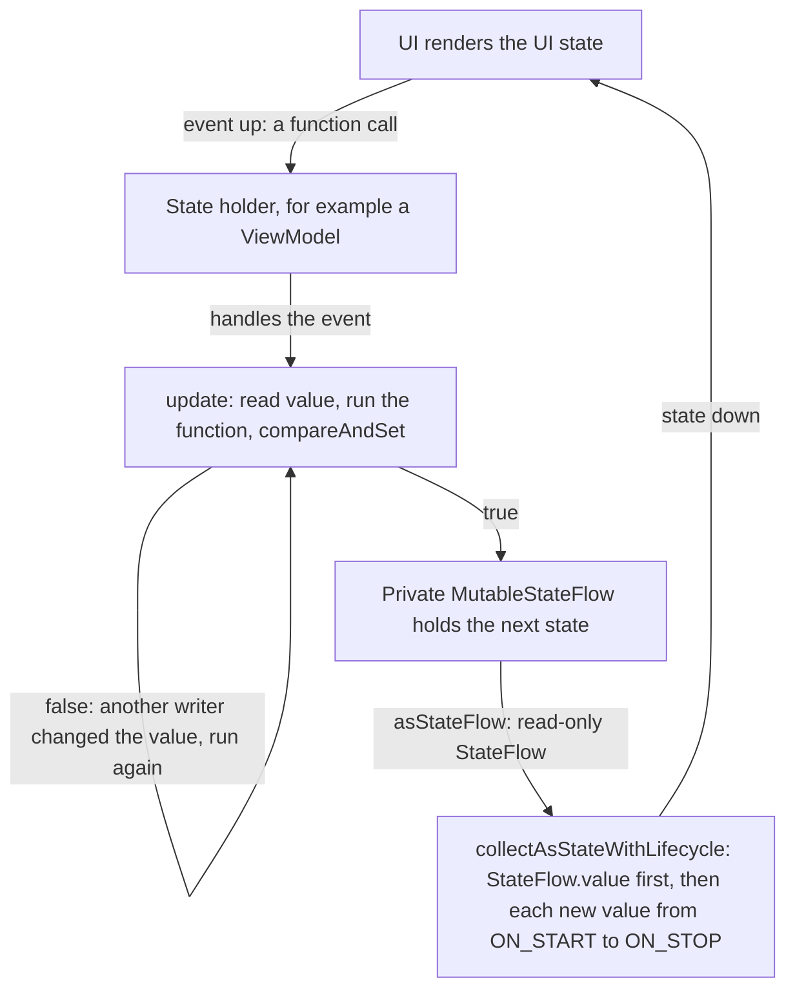

import Snippet from '../../../components/Snippet.astro';
import GoDeeper from '../../../components/GoDeeper.astro';

## The problem

The [config changes chapter](/state-survival/config-changes/) showed how a `ViewModel` keeps its state across a configuration change. This chapter asks a different question: which code can change that state?

If two parts of an app can each change the same data, the app has two sources of truth for that data. The architecture guide gives each type of data a single source of truth (SSOT). Only the SSOT changes the data. The SSOT exposes the data as an immutable type. To change the data, other code calls the functions of the SSOT, or sends events to it[^architecture-ssot].

Unidirectional data flow (UDF) adds a direction to this rule. State flows in one direction. The events that change the state flow in the other direction, up to the SSOT[^architecture-udf]. On a screen, the state holder is usually a `ViewModel`:

1. The `ViewModel` holds the UI state and exposes it to the UI.
2. The UI tells the `ViewModel` about each user event.
3. The `ViewModel` handles the event and updates the state.
4. The new state goes back to the UI, and the UI renders it[^ui-layer-state-holders].

State always exists. Events occur, and each event changes the state[^state-production].

The UI must not change the UI state directly, unless the UI is the only source of that data. Otherwise, the app gets more than one source of truth for the same data, and the data becomes inconsistent. An immutable UI state object prevents this error, because the UI cannot change the object that it gets[^ui-layer-immutability].

The Compose guide also says that immutable values prevent concurrency problems, because no other thread can change the state that a composable gets[^compose-events]. But the state holder still writes its own state. If two writers update the state at the same time, the write itself can lose an update. Immutable values do not prevent this loss.

This chapter builds a small state holder with UDF. The state holder keeps its state in a store. The chapter shows how the write of the store loses an update. Then it shows how `MutableStateFlow.update` of kotlinx.coroutines prevents the loss.

## Build it naive

The rebuild is in the module `samples/unidirectional-data-flow`, in plain Kotlin. It has no Android types and no kotlinx.coroutines.

`NaiveStore` is the store of the state. It keeps the state in the private property `current`. Other code reads the state through the read-only property `state`. Only `update` writes the state. `update` gives the current state to a transform function, and writes the result. Then it gives the new state to each observer. `observe` adds an observer and gives it the current state at once, because the state always exists:

<Snippet file="unidirectional-data-flow/src/main/kotlin/NaiveStore.kt" region="store" />

`CounterHolder` acts as a `ViewModel`. Its UI state is one immutable object, `CounterUiState`. Its store is private, so the UI cannot write the state. The UI calls `onIncrement`. This call is the event that goes up. The holder gives each new state to the render function of the UI. This is the state that comes down:

<Snippet file="unidirectional-data-flow/src/main/kotlin/NaiveStore.kt" region="holder" />

A test acts as the UI. Its render function adds one line of text for each state. The test sends two increment events. The screen shows `Count: 0`, then `Count: 1`, then `Count: 2`:

<Snippet file="unidirectional-data-flow/src/test/kotlin/NaiveStoreTest.kt" region="events" />

The rebuild has the parts of UDF. One object owns the state, and other code gets a read-only view of it. Events go up as function calls. State comes down to each observer. Two more tests check that a new observer gets the current state, and that `update` gives each new state to each observer.

## Where it breaks

`update` reads the state and writes the next state in two separate steps. If another writer changes the state between the two steps, `update` writes over that change. The value that `update` writes comes from the old state.

The breaking test has two writers. Two latches (`CountDownLatch`) set the order of their steps, so each run gives the same result:

<Snippet file="unidirectional-data-flow/src/test/kotlin/NaiveStoreTest.kt" region="lost-update" />

1. Writer B runs on a second thread. Its transform gets the state 0. The transform opens the latch `bHasRead`, and then waits at the latch `aHasWritten`.
2. The main thread is writer A. It waits at `bHasRead` until B has the state. Then it writes 0 + 1, so the state is 1. Then it opens `aHasWritten`, and waits until B ends.
3. The transform of B continues and returns 0 + 1. B writes 1 over the 1 of writer A.

The store got two increment events, but the state is 1. The test passes, so the store lost one update.

The private state and the read-only property did not prevent the loss. They control which code can write the state. They do not make the write atomic.

## The real thing

### The same flaw in `MutableStateFlow.value`

A `ViewModel` can keep its UI state in a `MutableStateFlow` of kotlinx.coroutines 1.11.0. The setter of `value` gives no expected value to the write, so the write does not check if the state changed after the read[^stateflow-319][^stateflow-326]. Thus `_uiState.value = _uiState.value.copy(...)` has the flaw of the rebuild. The getter reads the state. The setter writes the next state later, also if another writer changed the state between the two calls.

A `ViewModel` can write its UI state from a background thread. The state production guide says that `MutableStateFlow` has methods for safe atomic updates[^state-production-one-shot]. If you update the UI state in a background context with `MutableStateFlow`, use the `update` method[^state-production-background].

### `update` runs the function again after a conflict

`MutableStateFlow.update` reads `value`, runs the function on it, and calls `compareAndSet(prevValue, nextValue)`. If `compareAndSet` returns true, `update` returns. If not, `update` starts again: it reads the new value and runs the function again[^stateflow-229].

`compareAndSet` compares the current value with the expected value, with `equals`. If the two values are equal, it writes the new value and returns true. Otherwise, it returns false. It does the comparison and the write atomically[^stateflow-169].

In the order of the breaking test, writer B calls `compareAndSet(0, 1)`. The value is 1, so the call returns false. B runs its function again on 1 and writes 2. No update is lost.

Thus `update` can run the function more than one time. The KDoc says that the function "may be evaluated multiple times" if another writer updates `value` at the same time[^stateflow-227]. Keep the function free of side effects. For example, do not send a request or count a call in it. Prompt 2 of "Try it" shows the second run.

<GoDeeper title="inside compareAndSet">

`compareAndSet` gives the expected value and the new value to `updateState`[^stateflow-323]. `updateState` reads the current value, compares it with the expected value, and writes the new value. These three steps run inside `synchronized(this)`, so no other writer can change the value between the comparison and the write[^stateflow-326].

The setter of `value` calls the same `updateState` with `null` as the expected value[^stateflow-319]. If the expected value is `null`, `updateState` does not compare the current value with an expected value[^stateflow-326]. Thus, in `_uiState.value = _uiState.value.copy(...)`, the setter writes under the lock, but the getter reads the value before the setter takes the lock.

</GoDeeper>

### `asStateFlow` keeps the write private

The KDoc of `StateFlow` has the pattern of the rebuild. `CounterModel` keeps a private `MutableStateFlow`, exposes it with `asStateFlow()`, and changes it with `update`. A comment calls the `update` call atomic and safe for concurrent use[^stateflow-29]. The state production guide uses the same pattern in a `ViewModel`[^state-production-stateflow].

`asStateFlow()` wraps the `MutableStateFlow` in a `ReadonlyStateFlow`[^share-392]. `ReadonlyStateFlow` is a private class. It implements `StateFlow` and sends each call to the wrapped flow, but it does not implement `MutableStateFlow`[^share-410]. Thus the UI cannot cast the exposed flow back to `MutableStateFlow` and write the state. Only the state holder writes the state. In the rebuild, the private property `current` and the read-only property `state` do the same job.

### Events go up as function calls

Usually, the `ViewModel` handles a user event with a function that the UI can call[^events]. If the event needs business logic, the `ViewModel` should handle it[^events-user]. In Compose, a composable takes state and exposes events. For example, `TextField` takes a `value`, and calls `onValueChange` to ask for a new value[^compose-udf-compose]. The update loop has three steps: an event, an update of the state, and the display of the state[^compose-udf]. The UI should never change state outside of an event handler[^compose-events].

Keep related state in one UI state object. If two related values are in two streams, one stream can update while the other stream does not[^ui-layer-additional]. In the rebuild, `CounterUiState` is this object.

### Events from the ViewModel become state

Some events start in the `ViewModel`, for example a message for the user. The events guide says that each `ViewModel` event should always become an update of the UI state. Then the event stays in the state across a configuration change, and the UI does not lose it[^events-viewmodel]. When the UI showed the message, the UI tells the `ViewModel`. Then the `ViewModel` clears the message from the state[^events-consumed].

Some apps send these events through a Kotlin `Channel` or another stream. If the `ViewModel` lives longer than the UI, these streams do not guarantee that the UI gets and handles each event[^events-other].

<GoDeeper title="how a Channel loses an event">

`repeatOnLifecycle(STARTED)` cancels its block at `ON_STOP`[^repeatonlifecycle-40]. Each suspending function of a channel has a prompt cancellation guarantee. If `repeatOnLifecycle` cancels the block while a channel function in it is suspended, the function throws `CancellationException`. This occurs also if the function already changed the state of the channel[^channel-1208]. Thus `receive` can take an element from the channel and still throw `CancellationException`. If the channel has an `onUndeliveredElement` callback, the channel gives the element to the callback[^channel-434]. Otherwise, the element is lost[^channel-1220].

Thus, if the UI receives events from a `Channel` inside `repeatOnLifecycle`, the UI can lose an event at `ON_STOP`.

</GoDeeper>

### State comes down while the UI is on the screen

Do not make the UI observe the UI state while the UI is not on the screen. With flows, collect the state with `collectAsStateWithLifecycle`[^ui-layer-consume]. A state production pipeline must be lifecycle aware. If the UI is not visible or not active, the pipeline must not use resources, unless the app explicitly needs them[^state-production-pipeline].

`collectAsStateWithLifecycle` on a `StateFlow` uses `StateFlow.value` as its initial value. Its default `minActiveState` is `STARTED`[^flowext-58]. It collects the flow each time the lifecycle gets to `minActiveState`, and stops the collection when the lifecycle falls below it[^flowext-35]. For `STARTED`, the collection stops at `ON_STOP` and starts again at the next `ON_START`[^repeatonlifecycle-40]. The UI shows the current state at once, because the initial value is `StateFlow.value`. In the rebuild, `observe` also gives the current state to a new observer at once. The [components and lifecycle chapter](/launch-path/components-lifecycle/) explains the Lifecycle states and events.

<GoDeeper title="how repeatOnLifecycle starts and stops the collection">

`collectAsStateWithLifecycle` calls `produceState` with the initial value. In `produceState`, it calls `lifecycle.repeatOnLifecycle(minActiveState)`. In that block, it collects the flow and writes each value into the `State`[^flowext-170].

`repeatOnLifecycle` adds a `LifecycleEventObserver`. The start event is `Lifecycle.Event.upTo(state)`. On the start event, the observer launches the block in a new coroutine. The cancel event is `Lifecycle.Event.downFrom(state)`. On the cancel event, the observer cancels that coroutine[^repeatonlifecycle-100]. Thus each start event starts a new collection, and each cancel event stops it.

</GoDeeper>

## Mental model

One state holder owns the UI state. The state holder keeps a private `MutableStateFlow` and exposes it as a read-only `StateFlow`, so the UI cannot write the state. The UI sends each event up as a function call. The state holder handles the event and writes the next state with `update`. `update` runs the function on the current value and writes the result with `compareAndSet`. If another writer changed the value first, `update` runs the function again on the new value. Thus no update is lost. The UI collects the state with `collectAsStateWithLifecycle`. The UI gets the current value first, and then each new value between `ON_START` and `ON_STOP`. An event that starts in the state holder also becomes state, so a configuration change does not lose it.



## Try it

### 1. Make the write atomic

Replace the plain write in `NaiveStore` with a compare-and-set loop, as `MutableStateFlow.update` does[^stateflow-229]:

1. Change `current` to a `java.util.concurrent.atomic.AtomicReference`, with `initial` as its first value.
2. In `update`, read the current value with `get`, run the transform on it, and call `compareAndSet(prev, next)`. If `compareAndSet` returns false, do these steps again.
3. In `state`, `update` and `observe`, read the value with `get`.

From the repo root, run the tests of the rebuild:

```sh
samples/gradlew -p samples :unidirectional-data-flow:test
```

The breaking test fails, because the store does not lose the update now. The other three tests pass. The Gradle output includes these lines:

```
NaiveStoreTest > naiveStore_losesUpdate_whenTwoWritersInterleave() FAILED
    org.opentest4j.AssertionFailedError at NaiveStoreTest.kt:59

4 tests completed, 1 failed
```

The `compareAndSet` of writer B returns false, because writer A changed the value to 1. Then B runs its transform again on 1. The next prompt shows the second run.

### 2. Count the runs of the transform

Keep the change of prompt 1. In the breaking test, make these changes:

1. Before `thread`, add `var runsOfB = 0`.
2. In the transform of writer B, add `runsOfB++` as the first line.
3. Replace `assertEquals(1, store.state)` with `assertEquals(2, store.state)` and `assertEquals(2, runsOfB)`.

Run the tests of the rebuild again. All four tests pass. The Gradle output includes this line:

```
BUILD SUCCESSFUL in …
```

The store kept both updates. The transform of writer B ran two times: one time on 0, and one time on 1. `MutableStateFlow.update` also runs its function again after `compareAndSet` returns false[^stateflow-229]. Thus a counter or another side effect in the function of `update` can run more than one time[^stateflow-227].

[^architecture-ssot]: Guide to app architecture, "Single source of truth": [https://developer.android.com/topic/architecture#single-source-of-truth](https://developer.android.com/topic/architecture#single-source-of-truth)
[^architecture-udf]: Guide to app architecture, "Unidirectional data flow": [https://developer.android.com/topic/architecture#unidirectional-data-flow](https://developer.android.com/topic/architecture#unidirectional-data-flow)
[^ui-layer-state-holders]: UI layer, "State holders": [https://developer.android.com/topic/architecture/ui-layer#state-holders](https://developer.android.com/topic/architecture/ui-layer#state-holders)
[^state-production]: UI State production: [https://developer.android.com/topic/architecture/ui-layer/state-production](https://developer.android.com/topic/architecture/ui-layer/state-production)
[^ui-layer-immutability]: UI layer, "Immutability": [https://developer.android.com/topic/architecture/ui-layer#state-immutability](https://developer.android.com/topic/architecture/ui-layer#state-immutability)
[^compose-events]: Compose UI Architecture, "Events in Compose": [https://developer.android.com/develop/ui/compose/architecture#architecture-events](https://developer.android.com/develop/ui/compose/architecture#architecture-events)
[^stateflow-319]: StateFlow.kt, lines 319–321: [https://github.com/Kotlin/kotlinx.coroutines/blob/1.11.0/kotlinx-coroutines-core/common/src/flow/StateFlow.kt#L319-L321](https://github.com/Kotlin/kotlinx.coroutines/blob/1.11.0/kotlinx-coroutines-core/common/src/flow/StateFlow.kt#L319-L321)
[^stateflow-326]: StateFlow.kt, lines 326–333: [https://github.com/Kotlin/kotlinx.coroutines/blob/1.11.0/kotlinx-coroutines-core/common/src/flow/StateFlow.kt#L326-L333](https://github.com/Kotlin/kotlinx.coroutines/blob/1.11.0/kotlinx-coroutines-core/common/src/flow/StateFlow.kt#L326-L333)
[^state-production-one-shot]: UI State production, "One-shot APIs as sources of state change": [https://developer.android.com/topic/architecture/ui-layer/state-production#one-shot-apis](https://developer.android.com/topic/architecture/ui-layer/state-production#one-shot-apis)
[^state-production-background]: UI State production, "Mutating the UI state from background threads": [https://developer.android.com/topic/architecture/ui-layer/state-production#mutating_the_ui_state_from_background_threads](https://developer.android.com/topic/architecture/ui-layer/state-production#mutating_the_ui_state_from_background_threads)
[^stateflow-229]: StateFlow.kt, lines 229–237: [https://github.com/Kotlin/kotlinx.coroutines/blob/1.11.0/kotlinx-coroutines-core/common/src/flow/StateFlow.kt#L229-L237](https://github.com/Kotlin/kotlinx.coroutines/blob/1.11.0/kotlinx-coroutines-core/common/src/flow/StateFlow.kt#L229-L237)
[^stateflow-169]: StateFlow.kt, lines 169–180: [https://github.com/Kotlin/kotlinx.coroutines/blob/1.11.0/kotlinx-coroutines-core/common/src/flow/StateFlow.kt#L169-L180](https://github.com/Kotlin/kotlinx.coroutines/blob/1.11.0/kotlinx-coroutines-core/common/src/flow/StateFlow.kt#L169-L180)
[^stateflow-227]: StateFlow.kt, line 227: [https://github.com/Kotlin/kotlinx.coroutines/blob/1.11.0/kotlinx-coroutines-core/common/src/flow/StateFlow.kt#L227](https://github.com/Kotlin/kotlinx.coroutines/blob/1.11.0/kotlinx-coroutines-core/common/src/flow/StateFlow.kt#L227)
[^stateflow-323]: StateFlow.kt, lines 323–324: [https://github.com/Kotlin/kotlinx.coroutines/blob/1.11.0/kotlinx-coroutines-core/common/src/flow/StateFlow.kt#L323-L324](https://github.com/Kotlin/kotlinx.coroutines/blob/1.11.0/kotlinx-coroutines-core/common/src/flow/StateFlow.kt#L323-L324)
[^stateflow-29]: StateFlow.kt, lines 29–38: [https://github.com/Kotlin/kotlinx.coroutines/blob/1.11.0/kotlinx-coroutines-core/common/src/flow/StateFlow.kt#L29-L38](https://github.com/Kotlin/kotlinx.coroutines/blob/1.11.0/kotlinx-coroutines-core/common/src/flow/StateFlow.kt#L29-L38)
[^state-production-stateflow]: UI State production, "StateFlow": [https://developer.android.com/topic/architecture/ui-layer/state-production#stateflow](https://developer.android.com/topic/architecture/ui-layer/state-production#stateflow)
[^share-392]: Share.kt, lines 392–396: [https://github.com/Kotlin/kotlinx.coroutines/blob/1.11.0/kotlinx-coroutines-core/common/src/flow/operators/Share.kt#L392-L396](https://github.com/Kotlin/kotlinx.coroutines/blob/1.11.0/kotlinx-coroutines-core/common/src/flow/operators/Share.kt#L392-L396)
[^share-410]: Share.kt, lines 410–418: [https://github.com/Kotlin/kotlinx.coroutines/blob/1.11.0/kotlinx-coroutines-core/common/src/flow/operators/Share.kt#L410-L418](https://github.com/Kotlin/kotlinx.coroutines/blob/1.11.0/kotlinx-coroutines-core/common/src/flow/operators/Share.kt#L410-L418)
[^events]: UI events: [https://developer.android.com/topic/architecture/ui-layer/events](https://developer.android.com/topic/architecture/ui-layer/events)
[^events-user]: UI events, "Handle user events": [https://developer.android.com/topic/architecture/ui-layer/events#handle-user-events](https://developer.android.com/topic/architecture/ui-layer/events#handle-user-events)
[^compose-udf-compose]: Compose UI Architecture, "Unidirectional data flow in Jetpack Compose": [https://developer.android.com/develop/ui/compose/architecture#udf-compose](https://developer.android.com/develop/ui/compose/architecture#udf-compose)
[^compose-udf]: Compose UI Architecture, "Unidirectional data flow": [https://developer.android.com/develop/ui/compose/architecture#udf](https://developer.android.com/develop/ui/compose/architecture#udf)
[^ui-layer-additional]: UI layer, "Additional considerations": [https://developer.android.com/topic/architecture/ui-layer#additional-considerations](https://developer.android.com/topic/architecture/ui-layer#additional-considerations)
[^events-viewmodel]: UI events, "Handle ViewModel events": [https://developer.android.com/topic/architecture/ui-layer/events#handle-viewmodel-events](https://developer.android.com/topic/architecture/ui-layer/events#handle-viewmodel-events)
[^events-consumed]: UI events, "Consuming events can trigger state updates": [https://developer.android.com/topic/architecture/ui-layer/events#consuming-trigger-updates](https://developer.android.com/topic/architecture/ui-layer/events#consuming-trigger-updates)
[^events-other]: UI events, "Other use cases": [https://developer.android.com/topic/architecture/ui-layer/events#other-use-cases](https://developer.android.com/topic/architecture/ui-layer/events#other-use-cases)
[^repeatonlifecycle-40]: RepeatOnLifecycle.kt, lines 40–42: [https://android.googlesource.com/platform/frameworks/support/+/a01f1a6c29523dd9b046b7f2a383d7d24559e316/lifecycle/lifecycle-runtime/src/commonMain/kotlin/androidx/lifecycle/RepeatOnLifecycle.kt#40](https://android.googlesource.com/platform/frameworks/support/+/a01f1a6c29523dd9b046b7f2a383d7d24559e316/lifecycle/lifecycle-runtime/src/commonMain/kotlin/androidx/lifecycle/RepeatOnLifecycle.kt#40)
[^channel-1208]: Channel.kt, lines 1208–1212: [https://github.com/Kotlin/kotlinx.coroutines/blob/1.11.0/kotlinx-coroutines-core/common/src/channels/Channel.kt#L1208-L1212](https://github.com/Kotlin/kotlinx.coroutines/blob/1.11.0/kotlinx-coroutines-core/common/src/channels/Channel.kt#L1208-L1212)
[^channel-434]: Channel.kt, lines 434–438: [https://github.com/Kotlin/kotlinx.coroutines/blob/1.11.0/kotlinx-coroutines-core/common/src/channels/Channel.kt#L434-L438](https://github.com/Kotlin/kotlinx.coroutines/blob/1.11.0/kotlinx-coroutines-core/common/src/channels/Channel.kt#L434-L438)
[^channel-1220]: Channel.kt, lines 1220–1225: [https://github.com/Kotlin/kotlinx.coroutines/blob/1.11.0/kotlinx-coroutines-core/common/src/channels/Channel.kt#L1220-L1225](https://github.com/Kotlin/kotlinx.coroutines/blob/1.11.0/kotlinx-coroutines-core/common/src/channels/Channel.kt#L1220-L1225)
[^ui-layer-consume]: UI layer, "Consume UI state": [https://developer.android.com/topic/architecture/ui-layer#consume-ui-state](https://developer.android.com/topic/architecture/ui-layer#consume-ui-state)
[^state-production-pipeline]: UI State production, "State production pipeline assembly": [https://developer.android.com/topic/architecture/ui-layer/state-production#state-production-pipeline](https://developer.android.com/topic/architecture/ui-layer/state-production#state-production-pipeline)
[^flowext-58]: FlowExt.kt, lines 58–68: [https://android.googlesource.com/platform/frameworks/support/+/a01f1a6c29523dd9b046b7f2a383d7d24559e316/lifecycle/lifecycle-runtime-compose/src/commonMain/kotlin/androidx/lifecycle/compose/FlowExt.kt#58](https://android.googlesource.com/platform/frameworks/support/+/a01f1a6c29523dd9b046b7f2a383d7d24559e316/lifecycle/lifecycle-runtime-compose/src/commonMain/kotlin/androidx/lifecycle/compose/FlowExt.kt#58)
[^flowext-35]: FlowExt.kt, lines 35–41: [https://android.googlesource.com/platform/frameworks/support/+/a01f1a6c29523dd9b046b7f2a383d7d24559e316/lifecycle/lifecycle-runtime-compose/src/commonMain/kotlin/androidx/lifecycle/compose/FlowExt.kt#35](https://android.googlesource.com/platform/frameworks/support/+/a01f1a6c29523dd9b046b7f2a383d7d24559e316/lifecycle/lifecycle-runtime-compose/src/commonMain/kotlin/androidx/lifecycle/compose/FlowExt.kt#35)
[^flowext-170]: FlowExt.kt, lines 170–186: [https://android.googlesource.com/platform/frameworks/support/+/a01f1a6c29523dd9b046b7f2a383d7d24559e316/lifecycle/lifecycle-runtime-compose/src/commonMain/kotlin/androidx/lifecycle/compose/FlowExt.kt#170](https://android.googlesource.com/platform/frameworks/support/+/a01f1a6c29523dd9b046b7f2a383d7d24559e316/lifecycle/lifecycle-runtime-compose/src/commonMain/kotlin/androidx/lifecycle/compose/FlowExt.kt#170)
[^repeatonlifecycle-100]: RepeatOnLifecycle.kt, lines 100–122: [https://android.googlesource.com/platform/frameworks/support/+/a01f1a6c29523dd9b046b7f2a383d7d24559e316/lifecycle/lifecycle-runtime/src/commonMain/kotlin/androidx/lifecycle/RepeatOnLifecycle.kt#100](https://android.googlesource.com/platform/frameworks/support/+/a01f1a6c29523dd9b046b7f2a383d7d24559e316/lifecycle/lifecycle-runtime/src/commonMain/kotlin/androidx/lifecycle/RepeatOnLifecycle.kt#100)
